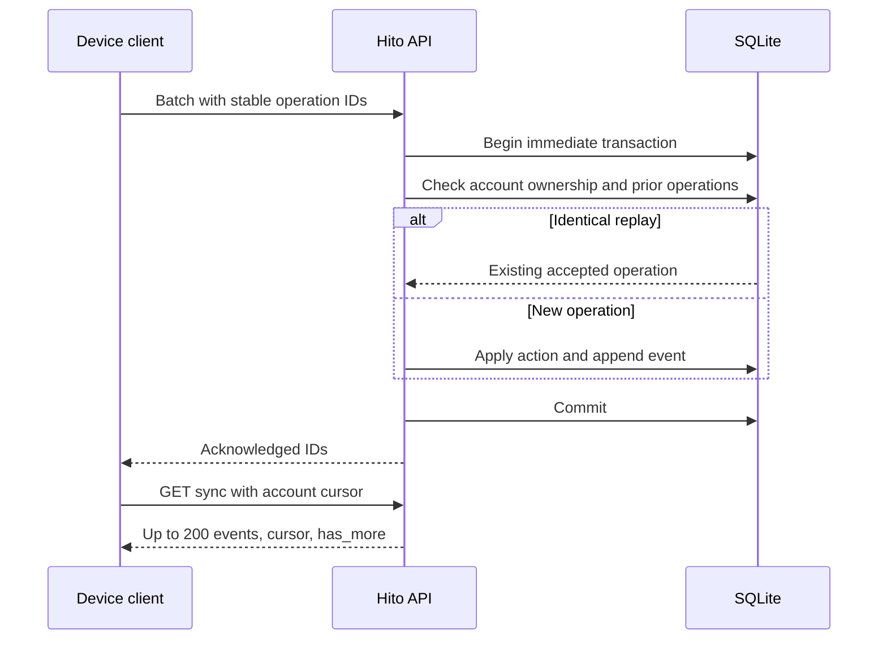
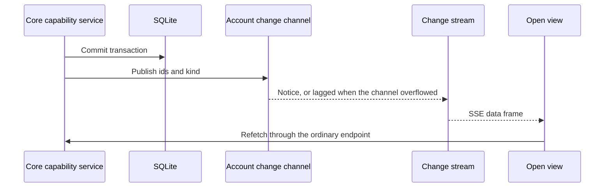

# JSON API

The implemented API uses `/api/v1`. The [OpenAPI document](../openapi.json) is generated from actual route registrations and Rust wire types. The server publishes it at `/api/v1/openapi.json`. Account responses never include password hashes or local filesystem paths. [Development instructions](development.md) cover regeneration and drift checks.

Sign in with `POST /api/v1/login`. Browser clients use an HttpOnly cookie; non-browser clients can use the returned token as `Authorization: Bearer <token>`. Send `X-Hito-Request: 1` with browser mutations. Browser origins must match the configured public origin. A client that keeps account-specific work should send `X-Hito-Account` with the expected user ID so account switching cannot apply it to a different account.

Responses include a generated `X-Request-Id` for correlation. Errors use an `error` string. Malformed JSON and query fields receive static error messages so submitted private values cannot enter extractor rejection logs, including at trace level.

| Operation | Endpoint |
| --- | --- |
| First-run status / create administrator | `GET` / `POST /setup` |
| Sessions | `POST /login`, `POST /logout`, `GET /me` |
| Screen lock and optional PIN ([details](../guide/account.md)) | `GET` / `POST /account/lock`, `POST /account/unlock`, `PUT /account/pin`, `POST /account/pin/remove` |
| Change password, list and revoke the account's own sessions ([details](../guide/account.md)) | `POST /account/password`, `GET` / `DELETE /account/sessions`, `DELETE /account/sessions/{id}` |
| Set or clear the account's own display name ([details](../guide/account.md)) | `PUT /account/display-name` |
| Upload, replace or remove the account's own avatar photo; read it (own account and administrators) ([details](../guide/account.md)) | `PUT` / `DELETE /account/avatar`, `GET /accounts/{id}/avatar` |
| Administrator account management | `GET` / `POST /users`, `DELETE /users/{id}` with `{"username"}` ([account deletion](architecture.md#account-deletion)) |
| Accessible libraries | `GET /libraries` |
| Grant / revoke library membership | `PUT` / `DELETE /libraries/{id}/members/{user}` |
| Schedule scan / inspect progress | `POST /libraries/{id}/scan`, `GET /jobs/{id}` |
| Paginated full-text search | `GET /recordings?q=&offset=&limit=&liked=true` |
| Resolve verified sources | `GET /recordings/{id}/sources` |
| Read the copies of a song, split one off | `GET /recordings/{id}/copies`, `POST /recordings/{id}/copies/split` |
| Authorized embedded or folder artwork | `GET /recordings/{id}/artwork` |
| Original audio with byte ranges | `GET /sources/{id}/audio` |
| Personal playlists | `GET /playlists`, `GET /playlists/{id}` |
| Private recent listening history | `GET /activity` |
| Pause or resume recording history, delete history | `GET`/`PUT /history/preferences`, `DELETE /history` ([listening history](../guide/account.md)) |
| Apply operations / pull accepted events | `POST /sync`, `GET /sync?cursor=0` |
| Private change notices for open views ([details](#change-notices)) | `GET /changes/events` |

Artwork returns PNG, JPEG, GIF, or WebP bytes with `Cache-Control: private, no-store`. Access follows the recording's library permissions. Missing images and inaccessible recordings return 404. Embedded front covers take priority, followed by other embedded pictures and neighboring `cover`, `folder`, or `front` JPEG/PNG files. The reader accepts regular files only, limits image bodies to 8 MiB and cumulative metadata reads to 16 MiB, and shares four blocking-reader permits across catalog clones. A canceled HTTP request retains its permit until the blocking read finishes. Compressed ID3 parsing is disabled because decompression bypasses the physical-read budget; artwork falls back to neighboring cover files when those tags cannot be read.

## Synchronization

A batch contains a device ID and at most 100 operations. Each operation has a UUID and a typed action. The server applies the entire batch in one transaction. Replaying the same operation acknowledges it without reapplying. Reusing its ID with different contents or a different device returns 409. Operation IDs are scoped to the authenticated account.

```json
{
  "device_id": "desktop-a",
  "operations": [{
    "id": "8c9dfc30-dd85-4bea-aafb-041988a1c909",
    "action": {
      "kind": "playlist_create",
      "playlist_id": "31a45c44-f0d7-48a7-af4a-cbc9697de033",
      "name": "Late evenings"
    }
  }]
}
```

Actions currently include `playlist_create`, `playlist_rename`, `playlist_delete`, `entry_insert`, `entry_move`, `entry_remove`, `like_set`, and `progress_set`. Entry inserts contain stable `entry_id`, `recording_id`, and integer `position`. Equal positions sort by entry ID. Deletes leave tombstones. Later edits to deleted playlists or entries cannot restore them. Conflicting live fields follow server acceptance order.



This is the server synchronization contract. A desktop cache and durable offline outbox are not implemented yet. The browser currently requires its server connection for edits and playback.

## Change notices

`GET /changes/events` is a server-sent event stream that tells open views of one account what to refetch. Each `data` frame is a `ChangeNotice` with a `kind` and only identifiers: never titles, names, paths or source details. The stream does not replace reads; clients refetch through the ordinary endpoints.

| Kind | Fields | Meaning |
| --- | --- | --- |
| `resync` | `reason`: `connected` or `lagged` | Refetch everything that is open. `connected` is always the first frame, so a reconnect covers notices missed while disconnected. `lagged` means this stream fell behind and notices were dropped. |
| `sources` | `recording_id` | The recording's sources, choice, resolution or preparation state changed. |
| `recording` | `recording_id` | A recording edit or like changed. |
| `recordings` | none | A release-level edit can change many recordings. |
| `playlist` | `playlist_id` | The playlist or its entries changed. |
| `playlists` | none | The playlist list changed. |
| `artwork` | `entity` (`recording`, `release`, `playlist`), `id` | Provider artwork arrived. |

Core capability services publish a notice only after their transaction commits. Private changes, such as likes, metadata overrides, source choices, playlists and an account's own resolution or preparation status, go only to the account that made them. Changes to shared source data, such as a new provider binding, refreshed sources or a prepared source becoming ready, go to every account that is a member of the recording's library when the transaction commits; a member removed before then is not notified. A rolled-back batch or rejected command publishes nothing. Each account keeps one bounded in-memory channel of 32 notices; a stream that falls behind receives `resync` with reason `lagged` instead of buffering. An account can hold 8 open streams; more return 429. Notices are not stored, so a restart or reconnect relies on the `connected` resync.

The stream authenticates through the shared session extractor and returns `Cache-Control: private, no-store`. It ends when its session signs out, is revoked, is locked, expires or is deleted with its account. After the initial `connected` resync, which carries no identifiers and directly follows the connection's own session check, a stream re-checks its own session against the database, with a one-second bound, before it delivers each notice. An expired, revoked, deleted or locked session, including one that has idled past its lock period, ends the stream instead of receiving the notice. The check only reads: it never counts as activity and never defers the idle lock. Sign-out, revocation, password change, locking and account deletion also signal open streams, so idle streams end promptly. Expiry and idle locks without a signal end an idle stream within 30 seconds, and always before its next notice. A new stream registers for notices before its first session check, so a sign-out that races the connection is still seen. The registration is owned from the moment it is made, so a connection cancelled or rejected during that check releases its slot.



| Producer | Notices | Recipients |
| --- | --- | --- |
| Synchronization batches | `recording`, `recordings`, `playlist`, `playlists` | acting account |
| Manual source choice and reset | `sources` | acting account |
| Automatic source resolution | `sources` | library members when a source is bound; otherwise the acting account |
| Resolution of a recording whose source is already available | `sources` | acting account |
| Source preparation requests and failed or blocked outcomes | `sources` | requesting account |
| Source preparation becoming ready | `sources` | library members |
| Provider adoption, reviewed attachment and source refresh | `sources` | library members |
| Playlist import, follow and follow refresh that changes entries | `playlist`, `playlists` | owning account |
| Playlist metadata refresh | `playlist`, `playlists`, `recordings` | owning account |
| Provider artwork jobs | `artwork`; playlist artwork also sends `playlist`, `playlists` | owning account |

Provider bindings can only be created in the owner's personal provider library today, so library-member delivery currently reaches only that owner. Lyrics, plugin health, artist identity, Cover Art Archive artwork, audiobook and progress changes do not publish notices yet.

## Plugin contract

`hito-plugin-sdk` validates protocol version 1 manifests and the declared capability vocabulary. No plugin installation, plugin HTTP client, or provider service is implemented yet. The full language-neutral data specification and reference services remain release work. Unknown capabilities such as arbitrary code execution are rejected by manifest deserialization.
