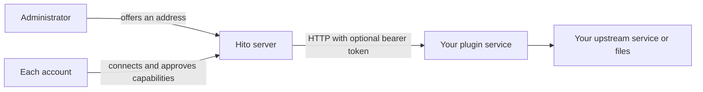

# Write a plugin

A Hito plugin is a separate HTTP service. You can write it in any language. Hito reads its manifest, asks each listener to approve what it declares, and then calls it over HTTP. Hito never downloads or runs plugin code.

The Rust SDK lives in [crates/plugin-sdk](../../crates/plugin-sdk) and is licensed Apache-2.0. For how listeners connect plugins, see the [plugins guide](../guide/plugins.md). For running the official ones, see [self-hosting](../self-hosting/README.md). For where plugins sit in the whole system, see the [architecture](architecture.md).

## How plugins fit



1. You run the plugin somewhere Hito can reach, such as a container on the same Docker network.
2. An administrator offers its base address to the server in Settings, Plugins. Hito fetches the manifest and uses its name. Only administrators choose which addresses Hito contacts.
3. Each account connects the offered service on its own. The listener sees the declared capabilities and approves them. They can enter a bearer token if your service requires one.
4. Hito stores that token encrypted, per account and per connection. It never shows the token again, never logs it and never sends it to the browser.
5. When your manifest later changes its name or capabilities, each listener must review and accept the change before Hito uses anything new.

The base address can use HTTP or HTTPS and can include a path prefix. All plugin paths below are relative to it. Use HTTPS when the plugin and Hito talk across a network you do not trust.

Every request from Hito carries `X-Hito-Plugin-Protocol: 1`. It carries `Authorization: Bearer <token>` only when the listener saved a token. Hito never sends the listener's session cookie or browser headers. Hito does not follow redirects, does not use system proxies and does not retry automatically.

## The manifest

Serve `GET /v1/manifest` with `Content-Type: application/json`. The body must be uncompressed JSON of at most 64 KiB. It declares:

| Field | Rule |
| --- | --- |
| `id` | Your stable plugin ID. 1 to 128 ASCII letters, digits, dots, hyphens or underscores |
| `name` | The name listeners see. 1 to 256 bytes, no control characters |
| `protocol_version` | Always `1` today |
| `capabilities` | At least one known capability |
| `authorization` | Optional. An OAuth 2 PKCE declaration. Hito's support for it is still in development |
| `content_policy` | Optional. `source_persistence` is `explicit_download` or `playback_only` |

A short example:

```json
{
  "id": "org.example.collection",
  "name": "My collection",
  "protocol_version": 1,
  "capabilities": ["search", "sources"],
  "content_policy": { "source_persistence": "playback_only" }
}
```

Known capabilities are `search`, `catalog`, `metadata`, `sources`, `source_links`, `source_preparation`, `playlists`, `artwork`, `dashboard`, `lyrics`, `backing_tracks` and `featured`. Hito rejects unknown capabilities, unknown fields and other protocol versions. `source_links` and `source_preparation` require `sources`. `featured` requires `playlists`. Hito versions that know `source_links` can connect older manifests that omit it; older strict Hito versions reject manifests that advertise a capability they do not know.

`playback_only` tells Hito not to start new offline downloads from your sources. It is a declaration, not proof of a license.

The manifest can be public even when your other routes need a token. Some services also protect the manifest. In that case the administrator gives the offer a custom label.

## Rules for every response

The SDK types in [crates/plugin-sdk/src](../../crates/plugin-sdk/src) define each request and response. Every object rejects unknown fields. Each response type has a `validate` function, and Hito applies the same rules. A response that breaks them fails in Hito, not in the browser.

- Keep text nonblank, without control characters or invisible direction marks. IDs and revisions fit in 256 bytes. Titles and names fit in 2,048 bytes.
- IDs are opaque strings that belong to your plugin. Keep them stable. Do not reuse an ID for a different recording.
- Respect the item and byte limits of each type. They are published as `MAX_*` constants in the SDK.
- Answer quickly. Hito gives each control request ten seconds in total, with a two-second connect deadline. It sends at most one request per account and four in total at a time.
- Never return stream URLs, HTML, scripts or custom UI. Hito renders everything itself.

Hito turns your error status into a plain message and never shows your response body or address:

| Status | What the listener sees |
| --- | --- |
| 401, 403 | The plugin refused the request. Check the connection in Settings |
| 422 | Your own text from a JSON body like `{"error": "..."}`, up to 240 characters. Text that contains a URL is replaced |
| 429 | The music service is busy. Try again in a moment |
| 502, 503, 504, or no answer in time | The music service is not responding right now |
| Other errors | The plugin service rejected the request |

When your upstream service rate-limits you, handle it inside the plugin. Space out upstream calls, honor its `Retry-After`, and answer Hito with 429 or 503 while you wait. The LRCLIB plugin is an example of this. Hito does not read `Retry-After` from plugin responses.

## Capabilities

Each capability maps to a few routes. Requests use `POST` with a JSON body unless noted. Some capabilities also have a version descriptor that Hito reads first. A missing descriptor means "not supported" and does not disable your other capabilities.

| Capability | Routes |
| --- | --- |
| `search` | `/v1/search`, `/v1/recordings/detail` |
| `sources` | `/v1/sources`, `GET` and `HEAD /v1/audio` |
| `source_links` | `/v1/recordings/lookup` |
| `source_preparation` | `/v1/sources/prepare`, `/v1/sources/preparation/status` |
| `metadata` | `/v1/recordings/metadata` |
| `artwork` | `/v1/artwork` |
| `playlists` | `/v1/playlists/detail`, `/v1/playlists/items` |
| `featured` | `/v1/featured` |
| `catalog` | `/v1/catalog/...` with separate descriptors per feature |
| `lyrics` | `/v2/lyrics/capabilities`, `/v2/lyrics`, or the version 1 pair |
| `backing_tracks` | `/v1/backing-tracks/capabilities`, `/v1/backing-tracks` |

### Search and track details

Hito sends a `query`, an optional `cursor` and a `limit` from 1 to 50. You answer with `items` and an optional `next_cursor`. Each item is a recording with `id`, `title`, `artist` and optional duration, release, disc and track numbers and revision. You can also add an ISRC, a list of credited artists and credits with a backlink.

Search results are temporary. When a listener adds or plays a result, Hito asks `/v1/recordings/detail` with the `recording_id` and saves what you return. The detail must describe the same ID.

### Sources and audio relay

`/v1/sources` takes a `recording_id` and returns the complete list of up to 16 sources. Each source has an `id`, a `label` and a `ready` flag. A successful answer replaces the previous list, so omitting a source withdraws it.

Hito then streams audio from `GET /v1/audio?source_id=<id>` and relays it to the browser. The browser never sees your address or token. Your audio response must:

- use a supported audio content type with no compression;
- support single byte ranges, and answer `HEAD` with the same headers;
- not redirect. Hito drops cookies, filenames and custom headers.

Hito waits two seconds to connect, ten seconds for headers and fifteen seconds for each read. A stream that averages less than 4 KiB/s over 30 seconds of waiting is cut off. A healthy stream has no total time limit.

### Source links

`source_links` lets a listener look up a recording from a link owned by your plugin. Hito sends `POST /v1/recordings/lookup` with a bounded opaque `reference`. Return the ordinary recording metadata and source IDs, or answer not found when the link does not identify a recording. References belong to your plugin; Hito does not attach the result automatically, fetch audio or download a file. The listener reviews any candidate before attaching it.

`source_preparation` is for services that must fetch a file before it can play, like the debrid plugins. Hito submits a preparation with an `operation_id` and then polls its status. Your answers include `poll_after_seconds`, or `retry_after_seconds` when you cannot accept the work yet.

### Metadata

`/v1/recordings/metadata` takes a `recording_id`. It returns the recording plus an optional `musical_title`, `album_title` and `source_ids`. Use it when your detail titles are noisy, such as video titles. The response is at most 32 KiB. Hito's use of this capability is still in development.

### Artwork

`/v1/artwork` takes an `entity` of `recording`, `release`, `playlist`, `artist` or `featured`, and your `provider_id`. Answer with the PNG or JPEG bytes and the matching content type. Keep images within 2 MiB and 1,024 pixels on a side. Answer 400 or 422 for a kind you do not support. Hito treats that as "no image" and asks again later.

### Playlists

`/v1/playlists/detail` takes either `{"kind": "reference", "reference": "..."}`, usually a link the listener pasted, or `{"kind": "canonical", "playlist_id": "..."}`. It returns the playlist `id`, `name`, a `snapshot`, `total_count` and an attribution label. Hito then pages `/v1/playlists/items` with the same snapshot, up to 100 entries per page and 10,000 in total. An entry is a recording, an unavailable track, or unknown. Hito imports a copy. Followed playlists ask again on a schedule.

### Featured shelf

`/v1/featured` takes a `limit` from 1 to 24. You return up to that many playlists, albums or new releases for the "From your services" shelf on Discover. Each item has a `reference` that your `/v1/playlists/detail` accepts, and an optional `artwork_id` you serve through `/v1/artwork`. Hito asks for 12 items, waits three seconds and caches the answer for ten minutes.

### Catalog and similar artists

The `catalog` capability covers artist search, artist profiles, paged discographies, release editions and similar artists. Each feature has its own descriptor, such as `GET /v1/catalog/capabilities` for profiles and discographies. Paged reads use opaque cursors and an optional snapshot that must stay the same across pages.

Similar artists use `GET /v1/catalog/similarity/capabilities` and `POST /v1/catalog/similarity/artists`. Hito sends a MusicBrainz artist ID and a limit up to 25. You return scored artists, never the requested artist itself.

#### Look up one release group

Implement this optional lookup to supply canonical release-group metadata without crawling an artist's discography. It uses the account's existing connection with approved `catalog` capability and its saved bearer token, if any. No new manifest capability is needed.

Serve `GET /v1/catalog/release-groups/capabilities` with:

```json
{ "release_group_version": 1, "operations": ["release_group"] }
```

Accept `POST /v1/catalog/release-groups/detail` with:

```json
{ "release_group_id": "group:example:album" }
```

Return a bare `CatalogReleaseGroup`, with the exact requested group ID:

```json
{
  "id": "group:example:album",
  "title": "Example album",
  "artist_credit": [{
    "artist": { "id": "artist:example:performer", "name": "Example performer" },
    "credited_name": "Example performer",
    "join_phrase": ""
  }],
  "kind": "album",
  "secondary_types": [],
  "first_release_date": "2001-05-21",
  "revision": null
}
```

Keep the descriptor response within 4,096 bytes and the detail response within 32,768 bytes, as uncompressed JSON. Return metadata only, without audio, URLs or HTML. A 404 or 501 on the descriptor means this lookup is unsupported; other catalog features remain usable.

For selected editions, keep returning the existing `CatalogEditionTrackList` metadata. Hito's Core derives the audio occurrence count and total duration, so plugins do not add header aggregates to either response. Group titles and dates describe the release group; edition titles and dates describe the selected edition.

### Lyrics

Version 2 is the current contract. Serve `GET /v2/lyrics/capabilities` with `{"lyrics_version": 2}` and `POST /v2/lyrics`. The request names your own recording ID and revision, and your answer must echo it exactly. Return `lyrics: null` when you have none. A document holds either `plain` lines or `anchored` lines with a `start_ms` each, from 1 to 2,000 lines and at most 256 KiB in total.

Version 1 uses timed lines with a start and an end. Anchors belong to your rendition of the song. Hito shows lyrics as static text today. Synchronized highlighting needs alignment with Hito's audio and is unfinished.

### Not finished yet

`backing_tracks` has SDK types but no playback in Hito. `dashboard` is a reserved name with no contract yet.

## Health and credentials

A plugin can serve `GET /v1/health`. It is optional and needs no declaration. Answer from memory, without calling your upstream, in at most 1 KiB:

```json
{ "state": "degraded", "reason": "network", "since": 1700000000 }
```

`state` is `ok` or `degraded`. A degraded report names a `reason`: `network` when you cannot reach your upstream, `refused` when it refuses you. `since` is when the failures began, in Unix seconds. An `ok` report sets both to `null`. Settings then shows a warning on the plugin card. The SDK's `FailureTracker` turns a run of recent failures into this report.

Answer 401 when the token is missing or wrong. A clearer "credentials required" message for that case is in development. Keep any upstream secrets your plugin needs, such as an API key, in your own service. Read them from a private file, and never put them in the manifest or in responses.

## Using the Rust SDK

Add `hito-plugin-sdk` with the `server` feature. It gives you:

- the wire types, their `validate` functions and the path constants;
- `with_manifest`, which adds `/v1/manifest` and a request body limit to an axum router;
- `ServiceAuth`, which checks the bearer token in constant time and requires the protocol header;
- `observe_requests` and `RequestPolicy`, a request layer with size limits, 16 concurrent requests, a deadline and structured logs;
- `FailureTracker` and `HealthReport` for `/v1/health`;
- `init_logging` for JSON logs.

In another language, implement the same HTTP contract. Read the field names and limits from the SDK source; they are the specification. Test your responses against the SDK's `validate` rules before you connect Hito.

The reference plugins under [plugins/](../../plugins) show working services. Start with [listenbrainz](../../plugins/listenbrainz). It is the smallest one: one capability, one descriptor, one POST route and a service token. For search and audio, read [folder](../../plugins/folder), which serves local files and needs no token. [lrclib](../../plugins/lrclib) shows lyrics and upstream rate limiting. [jamendo](../../plugins/jamendo) shows featured items and playlists. [spotify](../../plugins/spotify) shows artwork and playlist import.

## Test a plugin locally

1. Run your plugin where the Hito server can reach it. A container on the Hito Compose network works best. A Hito container cannot reach `127.0.0.1` on your host.
2. Check `GET /v1/manifest` from your machine.
3. Sign in to Hito as an administrator. Open Settings, Plugins, Services for this server. Enter your base address and choose Offer service.
4. Connect the service for your account, enter the token if you use one, and approve the capabilities.
5. Use the feature in Hito. Change the manifest, choose Check connection and accept the review to test upgrades.

Operators can also pre-offer addresses with `HITO_PLUGIN_SERVICES=label=address,...`. That offers the service but connects no account.

Each official plugin has a Compose overlay in [deploy/compose](../../deploy/compose). The overlays share hardened settings from `plugin-base.yaml` and build from one plugin Dockerfile with the crate name and port as arguments. Copy one for your plugin. Use a throwaway Hito instance or the isolated end-to-end server for testing, not a server that holds real listener data. See [development](development.md) for the build commands and [self-hosting](../self-hosting/README.md) for running plugins next to a real server.

## Curated catalogs

The debrid plugins serve a list of recordings that the operator supplies. They check that list at startup with the SDK's `admit_curated_catalog`. It accepts 1 to 128 entries, rejects duplicate recording and source IDs, and limits each recording to 32 KiB and all of them to 48 KiB. Use it if your plugin also serves a fixed list. Errors never include the catalog contents.
