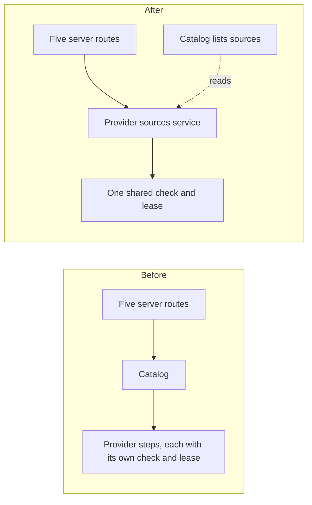

# RFC 0001: One owner for provider sources

Status: Proposed

## The problem

When a recording has no audio, Hito looks for some through plugins. That is one story: find candidates, pick one, prepare it if a debrid service needs time, attach it to the recording, and let the listener choose between sources. In the code, that story is spread over about 45 files in the core and seven in the server.

Each step repeats the same safety work on its own. Before saving a result, every step has to check that the account can still reach the library and that the plugin connection hasn't changed since the work started. Resolving and preparing each have their own version of that check, their own lease for long-running work, and their own receipt type. The test suite mirrors this: the same rule is proven once per step.

The cost is understanding. To answer "what happens if someone disconnects a plugin halfway through finding a source?", you have to read five places and compare them.

## What must stay true

- Before a result is saved, Hito checks again that the account still has access and the plugin connection is unchanged.
- Repeating a request returns the first attempt instead of starting a second search.
- Leases expire. A debrid request whose outcome is unknown survives a restart and is never submitted twice.
- Weak provider evidence never merges two recordings.
- Logs carry safe outcomes and correlation IDs only, never titles, search terms, paths, links or credentials.
- The HTTP API and generated types keep their current shape.
- The server keeps deciding what happens when a browser disconnects. That is transport policy.

## Options

**A. A new provider sources service.** One service in the core owns the whole lifecycle, from discovery to choice. It keeps one shared "pinned connection" check and one lease mechanism, and every step uses them. Each server route makes one call. Reading the list of sources stays with the catalog, because that is browsing, not a workflow.
This is the biggest move. In return, the question "what protects a saved result?" has one answer in one place.

**B. One job queue for everything.** Resolving, preparing and refreshing become kinds of one background job that callers submit and poll.
This hides the most, but resolving is fast and synchronous while preparing is slow and polled. Merging them means migrating live data and changing the API, only to remove duplication that option A also removes.

**C. Share the repeated parts only.** Leave every step where it is and extract the common check and lease into one place.
This is cheap and safe, but the 45-file spread stays. It works well as the first step of A.

## Recommendation

Option A, reached through C. Start by extracting the shared check and proving it holds for every step. Then move the steps into the new service one at a time. Reject B: it costs a data migration and an API change for no extra benefit.

## Plan

1. Extract the shared connection check, with a test that disconnects access between starting and saving. Use it for resolving first.
2. Use the same check for preparing, refreshing and attaching, one step per commit.
3. Use one lease mechanism for resolving and preparing. Their tables stay as they are.
4. Create the provider sources service and move discovery, adoption and attachment into it.
5. Move resolving, then preparing with its background worker, then choosing.
6. Update the architecture and source docs.

No stored data changes at any step. Existing tests keep their assertions and only change which service they call.

## Open questions

- Does choosing between sources belong here or with playback preferences? It works on the same data, so this RFC includes it.
- Should discovery and choice stay out to keep the new service smaller?
- The move conflicts with any open work in the same area, so it should wait until that work lands.
- Changing leases risks submitting twice to a debrid provider. The existing recovery tests must stay green and unchanged.

## Ownership before and after

