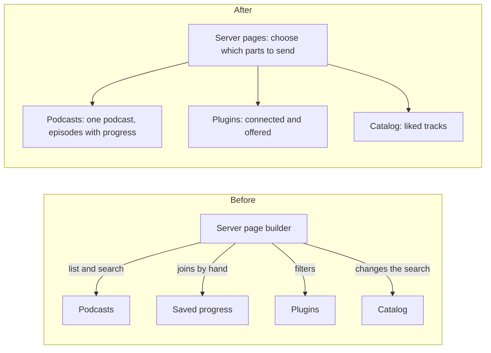

# RFC 0003: Move page data decisions into the core

Status: Implemented

## The problem

When the browser opens a page, the server builds that page's data in one large file. Along the way, that file made decisions that belong to the library, not to the web layer:

- To show one podcast, it loaded every subscription and searched through the list.
- To show episode progress, it combined data from two services by hand. That only worked because both happened to cap pages at 200 items.
- Two pages filtered plugin connections in opposite ways: one showed only connected plugins, the other showed all offered ones. Nothing named or explained the difference.
- The Likes page worked by quietly changing the search the visitor sent.

Because these rules lived in the web layer, the only way to test them was to start a full server.

## What must stay true

- The web layer still decides which parts of a page to send when the browser asks for only some of them. That's transport, not library logic.
- The core owns all database reads, joins and transactions.
- Another account's podcast reads as "not found", never "forbidden".
- The API and generated types keep their shape.

## Options

**A. Named reads in the core.** Add small, specific reads where the data lives: one podcast, a page of episodes with their progress, the account's plugin connections, and the liked list. The web layer calls one of them per page section.

**B. One "page" service in the core.** The core builds whole pages. That removes the most code from the server, but the core would then need to know the browser's partial-reload protocol, and it would grow a second copy of the API model.

**C. Split the big file, change nothing else.** Smaller files, but the rules stay in the web layer and stay hard to test.

## Decision

Option A, then C for whatever was left. A puts each rule where it can be tested without HTTP, and after A every page section is one call, which makes C trivial. We rejected B because the core must not know about the web protocol.

## What we did

1. **One podcast.** A direct lookup replaced the list-and-search. Unknown, malformed and other accounts' podcasts all read as not found. As a side effect, an account with more than 100 subscriptions can now open all of them.
2. **Episodes with progress.** One read returns a page of episodes and the saved progress for exactly those episodes. If the browser asks only for the episode list, the progress read is skipped.
3. **Plugin connections.** One read returns connections, named "connected" and "offered", so each page's choice is visible. We kept the two pages' different behavior and recorded the question below.
4. **Liked tracks.** A dedicated read replaced the trick of changing the visitor's search.
5. **Smaller files.** The page builder is now one file per area: catalog, playlists, audiobooks, podcasts and discover.

The API and generated types did not change.

## Open questions

- Should the playlists page and Discover really show different sets of plugins? We kept the difference because the right answer isn't clear.
- The Likes list may need its own paging rules, separate from search.
- If the desktop app ever needs the same page building, the partial-reload logic may need a new home.

## Ownership before and after

