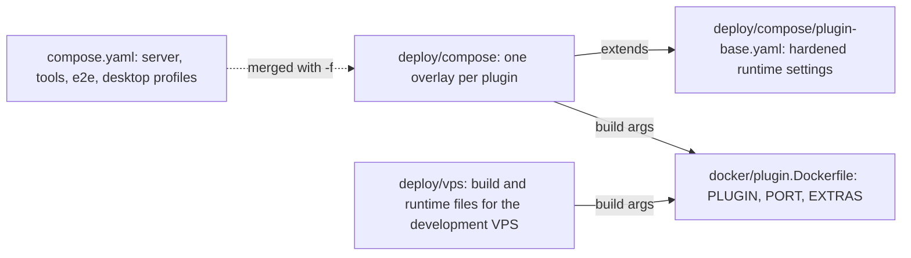

# Development

Build and test Hito in Docker. The repository pins Rust 1.99.0 in `rust-toolchain.toml` and uses the same release in the Docker tools image. Rebuild the tools image after changing that pin:

```sh
docker compose --profile tools build rust
./scripts/verify.sh
```

## Makefile targets

The root `Makefile` is the single task entry. Each target wraps a documented Docker Compose command. `make help` prints the list. The `check-<area>` targets run only the tests of one area through the `tools` profile, so a change in one crate does not need the full `make test-rust`. `make verify` still runs the full suites.

| Target | Runs |
| --- | --- |
| `make up` / `make down` | Build and start, or stop, the normal `server` service. Always act on the running `hito` project |
| `make build-tools` | Build the Rust tools image |
| `make fmt` | `cargo fmt --all`, which rewrites files |
| `make fmt-check` | `cargo fmt --all --check` |
| `make test-rust` | `cargo test --workspace --locked`, then the ignored `storage_walk_stalls` test in `hito-core` |
| `make check-core` | Tests for `hito-core`, `hito-audio`, `hito-testkit`, `hito-metadata-musicbrainz` and `hito-remote-audio`, then the ignored `storage_walk_stalls` test |
| `make check-server` | Tests for `hito-server` |
| `make check-community` | Tests for `hito-community` |
| `make check-playback` | Tests for `hito-playback` without the `device` feature. Device audio checks stay in `scripts/check-playback.sh` |
| `make check-plugins` | Tests for `hito-plugin-sdk`, all nine plugin crates and the four debrid client crates |
| `make check-web` | `make test-web` and `make web-lint` |
| `make lint` | `cargo clippy --workspace --all-targets` with warnings denied |
| `make web-lint` | `npm run lint` in `apps/web`: `prettier --check`, `tsc --noEmit` for the app and e2e projects, and ESLint with the React hooks rules. `rules-of-hooks` violations fail the check. `exhaustive-deps` findings are warnings with a ceiling set in `apps/web/package.json`, so new ones fail but the existing identity-keyed owner hooks do not |
| `make test-web` | `npm test` (vitest) in `apps/web` |
| `make web-install` | `npm ci` from `apps/web`, which installs the root npm workspace into `apps/web/node_modules` |
| `make web-audit` | `npm audit --audit-level=high` |
| `make web-build` | `npm run build` |
| `make contracts` | `scripts/check-contracts.sh` |
| `make setup-check` | `scripts/check-setup.sh` |
| `make e2e` | Generate the e2e audio fixtures, recreate the isolated `e2e-server`, run the Playwright `browser` service, stop the server. `E2E_SCRIPT=<npm script>` picks another Playwright run, for example `make e2e E2E_SCRIPT=e2e:lyric-provider-choice` |
| `make desktop` | `scripts/check-desktop.sh` |
| `make verify` | `scripts/verify.sh`, the full check. The script only calls the targets above |

## npm workspace

The repository root has a `package.json` that declares `apps/web` as its only workspace, one `package-lock.json`, and a `.npmrc` with `install-strategy=nested`. Dependencies still install into `apps/web/node_modules`, so the compose volumes and the scripts that import `apps/web/node_modules/@playwright/test` keep working. Run npm from `/workspace/apps/web` as before. The container also writes a small `node_modules` at the repository root (a workspace link, npm's hidden lockfile and the vitest cache). It holds no dependencies, and git ignores it. To change a dependency, run `npm install -w apps/web <package>` in the `node` service from `/workspace` and review the lockfile diff, because the nested strategy can reshape it.

## Docker only

Run application builds and tests through Docker Compose. Host tools may edit and inspect files. The `tools` profile provides the Rust and Node services. The `e2e` profile provides the isolated browser server. Never point first-run browser tests at the normal persistent server volume.

Dockerfiles live in `docker/`. The root `compose.yaml` is the only Compose entry point at the repository root. It defines the normal `server` service (project `hito`, volume `hito-data`) and the `tools`, `e2e` and `desktop` profiles. Plugin overlays live in `deploy/compose/`. All of them keep the repository root as the build context.



Run an overlay beside the root file, or alone from the repository root:

```sh
docker compose -p hito-spotify-dev -f compose.yaml -f deploy/compose/spotify.yaml --profile plugins build plugin-spotify
docker compose --project-directory . -p hito-jamendo-dev -f deploy/compose/jamendo.yaml --profile plugins build plugin-jamendo
```

`--project-directory .` keeps the build context and the `extends` path relative to the repository root when an overlay is used alone. Each overlay keeps its own `${VAR:?}` checks for credential volumes and frozen source identities, so the overlays are separate files: Compose evaluates those checks even for services in a disabled profile, and one combined file would demand every plugin's settings. Test overlays pinned to recorded evidence, such as `crates/debrid/*/tests/compose.tools.yaml` and the `scripts/*/compose.*.yaml` files, stay beside the scripts and tests that use them.

### Plugin images

Every plugin image is built from `docker/plugin.Dockerfile`. The recipe compiles one plugin in a release build with two Rust jobs and no debug information, then copies the binary into a Debian slim image that runs as UID/GID 10001 with a read-only root filesystem. The image adds no shell tools beyond `curl`, which the health check uses against `/v1/manifest`.

| Build argument | Meaning |
| --- | --- |
| `PLUGIN` (required) | Cargo package and binary name, for example `hito-plugin-spotify` |
| `PORT` (required) | Port the plugin listens on. It sets `EXPOSE` and the health check. The container command must pass the same `--listen 0.0.0.0:<PORT>` |
| `EXTRAS` | `none` (default), `folder` (generated demo audio in `/demo`) or `youtube` (pinned yt-dlp and Deno) |
| `STATE_DIR` | Private writable directory created in the image, default `/state` |
| `SOURCE_ID`, `INPUT_SHA256` | Optional frozen source and input identities. When set they must be 40 and 64 lowercase hex characters, and they become image labels |
| `HITO_PLUGIN_CACHE_ID` | Cargo target cache name. The build appends the target architecture. Give each source snapshot its own value |

```sh
docker build -f docker/plugin.Dockerfile --build-arg PLUGIN=hito-plugin-premiumize --build-arg PORT=8099 \
  --build-arg HITO_PLUGIN_CACHE_ID=hito-plugin-mycheckout -t hito-plugin-premiumize:dev .
```

The image has no default command, so run it with the plugin's own arguments. The overlays in `deploy/compose/` carry the build arguments, ports, commands and credential volumes for `folder`, `spotify`, `youtube`, `jamendo`, `listenbrainz`, `real-debrid`, `all-debrid`, `torbox` and `premiumize`.

## Worktrees and isolated projects

Give each source snapshot and worktree its own Compose project and its own Cargo target. Two source trees mounted at `/workspace` over one shared target can reuse stale artifacts, because cargo compares file timestamps.

```sh
make COMPOSE_PROJECT=hito-arch test-rust
make COMPOSE_PROJECT=hito-arch COMPOSE_EXTRA='path/override.yaml:path/more.yaml' lint
```

`COMPOSE_PROJECT` sets `COMPOSE_PROJECT_NAME`. Compose prefixes named volumes with the project name, so `rust-target`, `cargo-registry` and `node-modules` become separate per project. `COMPOSE_EXTRA` is a colon-separated list of Compose files. The Makefile appends it to `compose.yaml` and exports the result as `COMPOSE_FILE`, so it applies to every target. `COMPOSE_PROJECT` applies to every target except `make up` and `make down`, which always act on the running `hito` project.

## Disk and CPU budget

The tools services set `CARGO_PROFILE_DEV_DEBUG=0`, `CARGO_PROFILE_TEST_DEBUG=0`, `CARGO_INCREMENTAL=0` and `CARGO_BUILD_JOBS=2`. Do not turn debug information or incremental compilation back on.

- Run compiler-heavy checks one at a time.
- Keep at least 40 GiB free on the host.
- Keep all Hito Cargo targets together within 10 GiB.
- Check both before and during large builds. At either limit, stop starting builds and remove only inactive, regenerable Hito output.
- Never run a global Docker prune. Never remove another project's artifacts or application data.

## Catalog storage qualification

`scripts/qualify-replica-catalog-storage.sh` runs formatting, strict Core test-target Clippy, the 100,000-fact catalog install/restart cases and an explicitly enabled real-ENOSPC case through Docker Compose. It uses source-specific targets, a shared Cargo lock, read-only sources and a dedicated ephemeral 64 MiB tmpfs. It never mounts normal server data. Exact counts and phase results are written beneath ignored `test-results/replica-catalog-storage/`.

The default command builds tools and fetches locked dependencies before offline checks. Use `--offline` with a populated cache, and `--help` for an existing tools image or dedicated volume options. The independent acceptance run used the prebuilt/offline path. Read [the measurements and remaining limits](catalog-replication.md#client-storage-qualification) before treating this as release-scale or platform evidence.

## Test layout

[Testing](testing.md) explains the strategy. In short:

- `crates/testkit` (`hito-testkit`) holds helpers shared across crates: log capture, owned TLS, a plugin HTTP server and WAV helpers.
- `hito-core`, `hito-audio`, the debrid crates and the TorBox and Premiumize plugins have a `test-support` feature, which each crate turns on for its own tests. It exposes a `test_support` module that integration tests import. No crate's tests read another crate's directory.
- Each crate keeps its integration tests in its own `tests/` directory. They are grouped into a few binaries per area, not one binary per file. See [Test binaries](testing.md#test-binaries).
- Web tests live next to the feature they cover, in `apps/web/src/features/<domain>/tests`, with fixtures in `fixtures`. Shared helpers and the vitest setup are in `apps/web/src/test`. Browser workflows are in `apps/web/e2e`; the shared-session rules are in [Browser e2e sessions](testing.md#browser-e2e-sessions).

## Running one crate or one test

Use the same Compose services. Debrid and plugin crates enable their own `test-support` feature for their tests through a dev-dependency on themselves, so no `--features` list is needed.

```sh
docker compose --profile tools run --rm rust cargo test --locked -p hito-plugin-sdk
docker compose --profile tools run --rm rust cargo test --locked -p hito-core --test <area_or_standalone_binary>
docker compose --profile tools run --rm rust cargo test --locked -p hito-core --test catalog <test_name_filter>
docker compose --profile tools run --rm rust cargo test --locked -p hito-debrid-torbox <test_name>
docker compose --profile tools run --rm node npx vitest run src/features/catalog/tests/browsing.test.ts
```

Load-sensitive groups (deadline and indexing tests) need fewer test threads. Pass `-e RUST_TEST_THREADS=4` to `docker compose run`. See [load-sensitive tests](testing.md#load-sensitive-tests), which also names the known flaky `indexing_snapshot` test.

## Docker Desktop quirks

Two `hito-core` tests, `metadata_artist_tags_exit` and `metadata_artist_tags_diagnostics`, need a 64 KiB stdout pipe. Docker Desktop's VM caps root pipes at 8 KiB once the per-user pipe quota is used, so the `rust` tools service sets `cap_add: [SYS_RESOURCE]`. Do not drop it, and do not weaken the tests.

Docker Desktop's VM clock can run ahead of the host. After you edit a file on the host, Cargo may then treat the old artifact as fresh. If a rebuild seems skipped, run `touch <edited files>` inside the container, or `cargo clean -p <crate>`.

## Full verification and desktop checks

The verification script checks formatting, Rust tests, Clippy, generated API contracts, browser unit tests, the production web build, dependency audit, and the isolated browser workflow. Its browser server uses temporary storage, separate from the normal server volume.

Browser fixtures live in a generated `fixtures/e2e-generated` directory, distinct from development music in `fixtures/generated`. Neither is tracked. The verification script generates them with `audio-fixtures.mjs --e2e`. Do not mount personal music into the browser test server. Rust indexing tests use owned temporary WAV fixtures and protocol-boundary media-tool scripts, with FFmpeg supplied by the tools image.

The standalone Tauri development host has a separate `desktop` Compose profile and Cargo target. Run `./scripts/check-desktop.sh` for GUI-feature checks and an isolated Linux WebView workflow. See [desktop ownership and remaining work](desktop.md).

The desktop check also runs `scripts/check-audio.sh` and `scripts/check-playback.sh`. They decode deterministic codec fixtures and measure CPAL output through a private clocked PulseAudio monitor. Playback checks use core grants and real local/provider inputs to exercise revocation, controls, canceled observers, and log privacy. Run either script separately after building the Rust and desktop tools images. Both use `scripts/run-audio-test.sh` and its private sink lifecycle. The desktop application uses native Rust playback through the shared React contract; the actual Tauri workflow checks output, reload, controls, progress, and joined shutdown without a browser audio element. See [native playback ownership](native-playback.md) and [engine limits](native-audio.md).

## Rust editor support

Local editors need the pinned toolchain to load build scripts and procedural macros. Rustup selects it automatically inside this repository. Install it without changing your global default:

```sh
rustup toolchain install 1.99.0 --profile minimal --component rustfmt,clippy,rust-src,rust-analyzer
rustup show active-toolchain
```

The active toolchain should be `1.99.0`, overridden by this repository's `rust-toolchain.toml`. Restart the Rust language server after installing or changing the toolchain. Existing processes keep using their old macro helper until they restart.

Zed and VS Code project settings enable build scripts and procedural macros, run Clippy, and isolate rust-analyzer's build artifacts. Do not disable macro expansion to hide diagnostics. An error such as `proc-macro map is missing` can result from an incompatible compiler or macro helper. Inspect the language server log and compare its toolchain with the repository pin.

For an editor running entirely in Docker, open the provided `.devcontainer/devcontainer.json`. It uses the Compose Rust tools service and the same source tree, Cargo caches, and compiler as verification.

## Generated contracts

Rust handler registrations and wire types generate OpenAPI. The web application derives its TypeScript contracts from that schema:

```sh
docker compose --profile tools run --rm rust cargo run --quiet -p hito-server --example export_contract > docs/openapi.json
docker compose --profile tools run --rm node npm run generate:api
./scripts/check-contracts.sh
```

Commit both generated files with changes to the HTTP contract. Do not edit generated models by hand.
