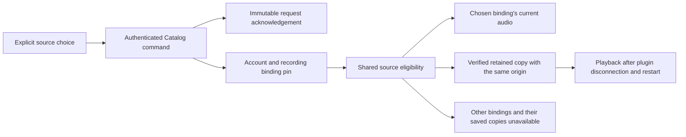

# Manual audio sources

Manual source choice is in development on the automatic-resolution branch. Its first HTTP workflow passes against a real temporary Hito server, SQLite and two owned protocol providers. The normal server has not been upgraded, and browser controls are not implemented yet.

## Choice and ownership

Adding an alternate source and choosing a source are separate commands. Attachment keeps ordinary source eligibility. An explicit choice pins one provider binding to the existing account-owned recording. The pin survives changes to that provider's audio representation.

`POST /api/v1/recordings/{id}/source-choice` accepts strict JSON containing nonempty `request_id` and `source_id` UUIDs. The source identity is an existing Hito provider-source UUID. Core checks current ownership, session, provider representation and approved audio capability without contacting the provider. An unavailable current representation can still be selected deliberately.

The response contains exactly `request_id`, `recording_id`, `source_id` and a positive `revision`. Replaying the same account-owned request returns its stored acknowledgement. Reusing it for another recording or source conflicts. The acknowledgement records the input source; it does not claim that representation remains current forever.

The same policy controls available-source reads, direct audio admission and authorization checks, native candidate enumeration, download origin capture and active download publication. Existing native grants recheck the underlying authority. Physical native output and concurrent revocation still require their own verification.

## Downloads

A saved copy proves its provider origin through the file's retained intent references and their immutable origin fields. A completed download job's lease token is not its origin. Conflicting references cannot establish eligibility for a chosen binding.

Choosing B makes live A and saved A unavailable. It does not relabel A's bytes as B or initiate a persistent download. A new explicit Download must use an eligible source of B. Failed admission must preserve the earlier retention. Successful replacement uses the existing retention and cleanup rules.

Verified saved B does not need a live plugin connection for playback. Current library access and retention checks still apply.

## Verification and remaining work

The first public test compiled and reached an actual missing-route failure after adopting A, downloading and reading A, preserving private collection state and attaching B. After implementation, that same test passes source choice and immutable replay, request conflict, rejection of known A audio URLs, B representation rotation, unavailable B without A fallback, distinct B download bytes, plugin disconnection and a joined server restart. Both providers' total request counters remain unchanged during saved playback and restart replay. Primary metadata, personal edits, duplicate playlist entries, likes and progress remain unchanged.

The first independent review round passed security and found one cleanup issue in both correctness and performance review. A new physical-file check reproduced an orphaned A file after the explicit B download had completed. The fix gives that superseded, unreferenced file to the existing cleanup worker. The same case now verifies that a rejected B request preserves A's filename and bytes, while an accepted replacement eventually leaves only B's exact bytes. Shared-retention, unprojected-playlist removal, original-file preservation and late-writer regressions pass alongside strict workspace all-target Clippy. The second review round is still reserved.

Rust-generated OpenAPI includes the strict command and four-field acknowledgement. Regenerating TypeScript produces identical bytes, and both TypeScript checks pass. The generator's existing formatting is retained.

The populated 0037-to-0038 fixture preserves original typed table columns, rowids, all prior migration receipts/checksums, legacy and enriched automatic decisions, private state and authority rows. Existing choices receive null binding pins and the new receipt table stays empty. Exact schema comparison permits only the declared download-authority replacement and nullable pin column. Ownership, immutable-history and foreign-key guards pass within a rollback; a fresh reopen preserves the same data and integrity. The existing 0035-to-latest and fixed 0036-to-0037 cases also pass. Fixed opaque fixture digests are preserved rather than recomputed, and this is not a production-volume rehearsal or migration performance benchmark.

At `7131a46`, workspace formatting and the complete core/server all-target suite pass in Docker. The filesystem fault-injection case remains explicitly ignored. Strict workspace all-target Clippy passes separately on the same source. These results include the canonical `Live` fix, physical replacement cleanup and populated migration cases.

The listening evidence is one HTTP and audio-body workflow. It does not establish browser decoding, native output, complete authority/race coverage, production-volume upgrade or final-image acceptance. Current-choice reads, return to Automatic, correction controls, download-status presentation, Follow and concurrent-operation tests remain unfinished. The full automatic-source item in [TODO.md](../TODO.md) stays open.
