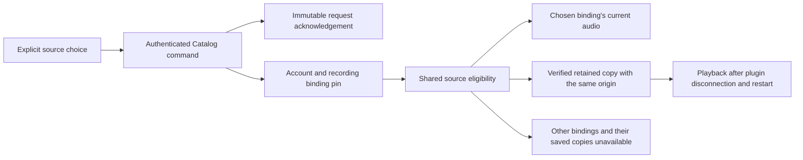

# Manual audio sources

Manual source choice is in development on the automatic-resolution branch. HTTP workflows pass against real temporary Hito servers, SQLite and owned protocol providers. Functional web controls pass React tests through the HTTP boundary. The normal server has not been upgraded, and final browser acceptance remains unfinished.

## Choice and ownership

Adding an alternate source and choosing a source are separate commands. Attachment keeps ordinary source eligibility. An explicit choice pins one provider binding to the existing account-owned recording. The pin survives changes to that provider's audio representation.

`POST /api/v1/recordings/{id}/source-choice` accepts strict JSON containing nonempty `request_id` and `source_id` UUIDs. The source identity is an existing Hito provider-source UUID. Core checks current ownership, session, provider representation and approved audio capability without contacting the provider. An unavailable current representation can still be selected deliberately.

The response contains exactly `request_id`, `recording_id`, `source_id` and a positive `revision`. Replaying the same account-owned request returns its stored acknowledgement. Reusing it for another recording or source conflicts. The acknowledgement records the input source; it does not claim that representation remains current forever.

The same policy controls available-source reads, direct audio admission and authorization checks, native candidate enumeration, download origin capture and active download publication. Existing native grants recheck the underlying authority. Physical native output and concurrent revocation still require their own verification.

## Current choice and Automatic

`GET /api/v1/recordings/{id}/source-choice` returns the current revision, mode and structured sources. Each source reports whether it belongs to the explicit selection and whether it can be chosen. Readiness is independent of selection, so an unavailable current provider representation remains selectable. The read uses one SQLite snapshot, then rechecks current account and recording access. It does not contact providers.

The modes are:

- `manual`: an explicit provider binding is pinned, even if no current representation is available.
- `reviewed`: historical confirmed evidence remains protected, without an explicit pin or reset.
- `automatic`: no protected choice exists, or the user explicitly returned to Automatic.

`POST /api/v1/recordings/{id}/source-choice/reset` accepts strict JSON containing a nonempty `request_id` UUID and a nonnegative `expected_revision`. A new accepted reset clears the pin and increments the revision atomically. A stale revision conflicts. Its acknowledgement contains exactly `request_id`, `recording_id` and `revision`.

Both commands require current ownership and account access. Reusing a request identity with another recording, body or command kind conflicts. Replaying an old accepted command returns its original acknowledgement without applying it again. Read the current choice after an acknowledgement; its recorded revision can be older than the current state.

Returning to Automatic permits a fresh resolution while retaining the confirmed binding and its complete metadata observation history. It does not download or play audio.

## Web controls

Track details expose Playback source controls separately from source preparation. Choosing an option stages it; Use source submits the durable choice. Return to automatic uses the revision from the latest choice read. An unavailable current source can still be chosen.

If Hito cannot confirm a write, Retry source choice repeats its frozen request with a fresh request signal. A confirmed acknowledgement triggers a current-state read before enabling another command. The tested historical acknowledgement at revision 1 therefore leads to a reset using the actual current revision 3. Unsaved metadata edits remain intact, and the controls do not start playback, downloads or a page reload. Confirmed changes refresh the separate download read.

A changed choice revision also invalidates an existing availability snapshot or pending check. Hito reads its current sources without requesting another provider refresh. Until verification succeeds, old readiness cannot enable Play or a new preparation. The separate preparation owner retains its selected source and uncertain request, so its exact retry survives cancellation of an old availability read.

A failed explicit availability check still counts as requested. Later source changes recheck it, including after another read failure. Changing a source before ever checking availability makes no availability request.

## Downloads

A saved copy proves its provider origin through the file's retained intent references and their immutable origin fields. A completed download job's lease token is not its origin. Conflicting references cannot establish eligibility for a chosen binding.

Choosing B makes live A and saved A unavailable. It does not relabel A's bytes as B or initiate a persistent download. A new explicit Download must use an eligible source of B. Failed admission must preserve the earlier retention. Successful replacement uses the existing retention and cleanup rules.

Verified saved B does not need a live plugin connection for playback. Current library access and retention checks still apply.

Download status includes `choice_revision` and `matches_source_choice` from the same read transaction. A retained A remains physically `ready` after choosing B, but reports a mismatch. Reading status does not remove A or start a replacement. A ready B copy must prove its owned immutable file origin before it can match the pin, including after plugin disconnection and restart.

The web page checks the saved copy again after a confirmed source change. While checking or unable to verify status, it does not claim the copy matches or admit a new download/removal. A retained copy from a previous source offers both Download selected source and Remove download. A rejected replacement preserves that copy; a new explicit attempt uses a new request identity. Uncertain requests retain their exact retry even when a source change has deferred the status read.

## Verification and remaining work

The first public test compiled and reached an actual missing-route failure after adopting A, downloading and reading A, preserving private collection state and attaching B. After implementation, that same test passes source choice and immutable replay, request conflict, rejection of known A audio URLs, B representation rotation, unavailable B without A fallback, distinct B download bytes, plugin disconnection and a joined server restart. Both providers' total request counters remain unchanged during saved playback and restart replay. Primary metadata, personal edits, duplicate playlist entries, likes and progress remain unchanged.

The first independent review round passed security and found one cleanup issue in both correctness and performance review. A new physical-file check reproduced an orphaned A file after the explicit B download had completed. The fix gives that superseded, unreferenced file to the existing cleanup worker. The same case now verifies that a rejected B request preserves A's filename and bytes, while an accepted replacement eventually leaves only B's exact bytes. Shared-retention, unprojected-playlist removal, original-file preservation and late-writer regressions pass alongside strict workspace all-target Clippy.

The second and final independent round reviewed `6390c54`. Performance review found no actionable defect. Security and correctness returned three findings: an already-open saved-file body lacks later pin checks, dependent UI actions remain enabled while a source write or its reconciliation is unresolved, and conflict reconciliation can expose a newer choice without refreshing download eligibility. Their public-boundary reproductions and fixes remain pending. Source review does not establish a runtime reproduction or release acceptance.

Rust-generated OpenAPI includes the strict command and four-field acknowledgement. Regenerating TypeScript produces identical bytes, and both TypeScript checks pass. The generator's existing formatting is retained.

The populated 0037-to-0038 fixture preserves original typed table columns, rowids, all prior migration receipts/checksums, legacy and enriched automatic decisions, private state and authority rows. Existing choices receive null binding pins and the new receipt table stays empty. Exact schema comparison permits only the declared download-authority replacement and nullable pin column. Ownership, immutable-history and foreign-key guards pass within a rollback; a fresh reopen preserves the same data and integrity. The existing 0035-to-latest and fixed 0036-to-0037 cases also pass. Fixed opaque fixture digests are preserved rather than recomputed, and this is not a production-volume rehearsal or migration performance benchmark.

At application source `ff773ca`, a fresh Docker run passes workspace formatting, the complete core/server all-target suite and strict workspace all-target Clippy. This includes current-choice reads and resets, account/session isolation, saved-copy eligibility, the canonical `Live` fix, physical replacement cleanup and populated migrations through 0039. The filesystem fault-injection case remains explicitly ignored and requires its separate libc configuration.

The current-choice and reset tracer first reached a real missing-GET failure. It now verifies reviewed protection, unavailable selection, stale reset rejection, old acknowledgement replay across newer choices, cross-command conflicts and a fresh automatic discovery after reset. The final explicit audio request reads C's exact owned PCM bytes. B's complete reviewed observation history, original source identity, primary metadata and private collection state remain unchanged. Reads, selections, resets and replay make no provider requests.

The populated 0038-to-0039 case preserves all prior typed values, rowids, 38 migration receipts/checksums, exact schema definitions and five authority or lineage view projections. An existing pin and choose receipt survive close, migration and reopen. No reset is invented; immutable receipt, revision, ownership and foreign-key guards pass. The fixed earlier migration cases remain unchanged. Selected resolution, preparation, manual-choice and migration regressions pass with strict workspace all-target Clippy.

The download-status tracer first failed on its missing current revision. It now checks six observations across retained A, a B pin, failed B admission, explicit B replacement, plugin disconnection and restart. Each observation preserves the exact ready transfer facts and makes no provider request. Download HTTP isolation, shared retention, original preservation, missing/corrupt files and late-writer regressions pass with strict workspace all-target Clippy on `dfdbb40`.

A further HTTP case verifies two accounts using the same offered service with independent recordings, sources and request receipts. Foreign reads, changes and replay are unavailable. Logout revokes control reads and both receipt replays; a fresh session retrieves the old acknowledgements without replacing a newer pin. Complete metadata snapshots remain unchanged, provider counters do not advance, and no audio or download begins. This characterization and its strict target Clippy pass on `a8e932f`.

The first web tracer reached the missing Playback source region, then passed exact-request recovery, current-state reconciliation, reset, draft preservation, safe error/log output and unmount cancellation. The full frontend at `731048e` passes 221 cases across 62 files, both TypeScript checks and the production build. Existing workflow fixtures now model the new initial choice GET explicitly while retaining their original request, privacy and cancellation assertions.

The saved-copy web tracer first reproduced an incorrect saved claim while a source-change status read was pending. It now verifies previous-source presentation, one explicit replacement despite repeated clicks, preservation after a definitive rejection, a fresh request identity for another attempt, and a matching saved copy after acceptance. Private drafts survive, private response details stay out of UI/logs, and unmount cancels the final read without playback or unrelated writes. At `ff773ca`, the full frontend passes 222 cases across 63 files, both TypeScript checks and its production build.

A separate React characterization at `9f18ae5` verifies an already retained B download whose response is lost across a reset and a newer A choice. The pending write stays live, the same request recovers its original acknowledgement, and a fresh status read identifies B as a previous-source copy. The case and three related recovery/control cases pass with both TypeScript checks. This is receipt and UI evidence, not a physical transfer or new late publication under A.

The availability tracer first reproduced the missing source read after a confirmed choice. It now verifies cancellation and rejection of an older ready snapshot, unavailable current audio, preservation of the same preparation retry and metadata input, exact-request recovery and read cancellation on unmount. At `c38be6e`, formatting of the three changed frontend files, all 224 frontend cases across 65 files, both TypeScript checks and the production build pass. The first full attempt passed the cases but caught an unsupported log field during TypeScript checking; the final run uses the existing permitted revision field and passes the complete pipeline.

The recovery tracer separately reproduced a missing recheck after the first explicit availability request failed. It now distinguishes untouched availability across two choice changes from a failed requested check, preserves safe unavailable state after another failed read, and recovers ready audio after a later reset without autoplay or another provider refresh. At `cf6fbd1`, all 225 frontend cases across 66 files, both TypeScript checks and the production build pass.

This evidence covers HTTP workflows, exact audio bodies and React rendering. It does not establish browser decoding, native output, complete authority/race coverage, production-volume upgrade or final-image acceptance. Broader UI ownership and invalidation cases, Follow and concurrent-operation tests remain unfinished. The full automatic-source item in [TODO.md](../TODO.md) stays open.
