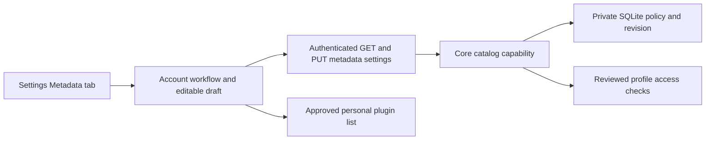

# Account metadata preferences

The verified source exposes account-owned metadata preferences through Settings and the versioned API. New accounts use the built-in MusicBrainz provider by default. A listener can disable provider use, select approved personal catalog connections, remove providers and change their order. Changes require an explicit Save. This source is not yet deployed on the normal development server.

These preferences control the reviewed-profile host. Automatic enrichment, artist search, preview and confirmation pages, discography traversal and album-edition track lists remain unfinished. Opening Settings does not request catalog descriptors or profiles and does not import or download media. File tags and personal metadata edits remain separate.

## Ownership and updates

`GET /api/v1/metadata/settings` returns `revision`, `enabled` and the ordered `providers`. `PUT` accepts those same fields, with the revision last read by the caller. An accepted update advances the revision. A stale revision returns a conflict and preserves the accepted policy. The interface retains the unsaved draft after a failed save; Reload explicitly reads the current policy before another attempt.

Providers are the built-in `builtin_musicbrainz` or `http_plugin` with an opaque personal `installation_id`. An enabled policy requires one to eight distinct providers. Approved catalog capability and current account authority are checked in core. Offered services alone do not authorize personal use. Two connections with the same display name retain distinct identities.

A removed connection may remain referenced by a saved policy. The interface labels it unavailable. Disabling provider use preserves those references and succeeds without contacting the removed service. Re-enabling an unauthorized reference fails without replacing the accepted disabled policy. Removing a provider from the policy does not disconnect its plugin.

## Request lifetime and privacy

The workflow loads the policy and personal plugin list together. Account changes and unmount cancel owned requests and prevent late results from publishing into another account. Save is single flight. A canceled observer cannot silently retry a mutation with newer data. The server authenticates the shared account extractor and applies the normal browser origin and request-header checks.

Structured workflow events include a generated request ID, action, outcome and elapsed time. They exclude account and installation identifiers, service addresses, credentials, titles and search terms. Generated OpenAPI and TypeScript use the registered Rust handlers and core wire types.

## Verification and remaining work

Four owned HTTP cases pass with real temporary SQLite and a local catalog fixture. They cover the built-in default, exact saved personal provider, account isolation, stale revisions, disconnected references, anonymous and mismatched-account denial, browser origin checks and zero catalog-data requests. Both accounts retain their private edits, duplicate playlist entries, likes and progress. The scoped core TRACE case verifies conflict correlation and redaction.

All 298 frontend cases pass, including nine new preference cases. They cover explicit saving, provider identity and ordering, the eight-provider limit, missing references, StrictMode, canceled reads, account changes, concurrent saves and explicit conflict reload. The real Settings component supports the Metadata deep link and existing keyboard tab navigation. Both TypeScript checks and the production frontend build pass.

The combined server run passes 148 distinct cases. After correcting test fixture registration, the four new cases and strict workspace Clippy pass again. Formatting and contract reproduction pass. Independent production security, correctness and performance reviews pass, and the browser gate passes its privacy review.

The complete settings workflow passes in Chromium and WebKit against both the development binary and one immutable release image, with fresh temporary data for each run. It saves four exact revisions, preserves ordered provider identities and complete private music snapshots, separates accounts and retains a removed reference when disabled. Only four manifest requests occur; catalog, audio, download and source mutations remain at zero. Bounded workflow-log checks and the zero-browser-error gate pass. The isolated server stops cleanly.

Normal deployment remains pending. These checks do not establish live metadata availability, physical-device compatibility or public-release performance.

## Automatic lookups

Three per-account choices live beside the provider policy in `account_metadata_automation` (migration 0066) and are returned by `GET /api/v1/metadata/settings` as `automatic_artist_lookup`, `automatic_artwork` and `automatic_service_search`. All default to on for an account that never saved them.

- **Look up artists on MusicBrainz automatically** starts the [background matching job](artist-matching.md#automatic-matching-and-consent). It also requires enrichment to be enabled with the built-in provider selected.
- **Fetch album artwork automatically** allows [Cover Art Archive requests](plugin-artwork.md#cover-art-archive). It is separate from the artist choice because it contacts a different third party (the Internet Archive), and it sends only a MusicBrainz identifier.
- **Search connected services automatically** is stored for the web app, which decides when to search the account's connected services for playable sources. The server only stores it.

`PUT /api/v1/metadata/automation` accepts any of the three booleans; an omitted one keeps its value and unknown fields are rejected. It does not change the provider revision, so saving providers and saving these choices never conflict. A choice takes effect on the next job step or lookup; pending work for a choice that is now off is dropped without a request.
