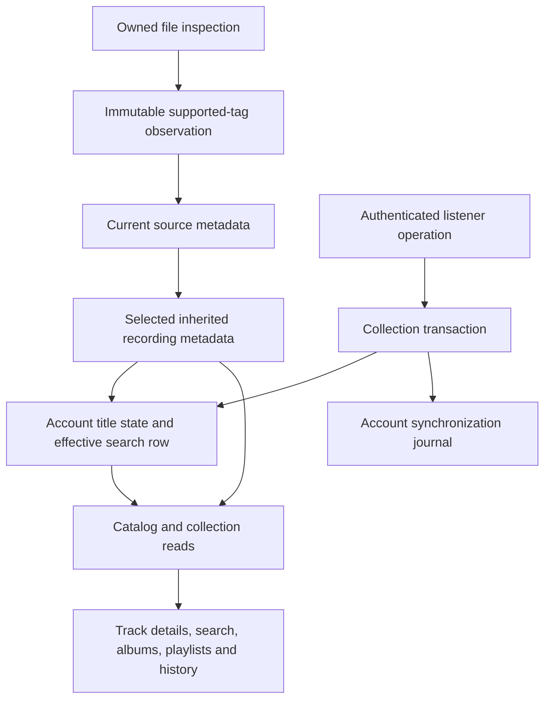

# Recording titles and source observations

Listeners can open track details from a recording's information link. They can save a personal title or choose **Use source title** to follow inherited metadata again. This first implementation edits recording titles. Artist/release corrections, provider enrichment, unlinking, split/undo operations, and administrator promotion remain release work.

## Personal titles

A title belongs to the authenticated account and the recording UUID. It applies to library search, likes, playlists, listening history, and every album appearance of that performance. It changes neither the audio file nor recording/source/release identities. Other accounts retain their own titles and inherited metadata.

Saving a title pins it even when it equals today's inherited title. Retagging or a change of metadata source does not replace the pin. Choosing **Use source title** accepts a new synchronization operation and removes the pin. Library rows then use the latest selected source title; album rows return to each appearance's observed title.

The browser updates titles already in its queue without restarting audio. Each queued occurrence carries its inherited title so reset can restore different release labels. The queue remains a device-local snapshot; refreshing inherited queue labels after a separate source change or an edit from another client still needs the synchronization client.

`recording_title_set` and `recording_title_inherit` use the existing versioned synchronization API. Each accepted operation has a UUID. Identical delivery only acknowledges the original operation; it cannot reapply an older title over a newer reset. Reusing an operation UUID with different contents fails. All operations in a batch commit together or roll back together, including title state, search indexes, and the synchronization journal. Conflicting title operations follow committed server acceptance order.

Required titles contain 1 to 2048 UTF-8 bytes and no control characters. Blank titles are rejected. Library membership is required for new title operations and provenance reads. Removing membership hides existing personal state without deleting it; a later grant reveals that account's state again.

## What provenance records

`GET /api/v1/recordings/{id}/metadata` returns the effective, inherited, and personal title, the account's latest title operation ID, the selected source observation, and a bounded observation page. It exposes no filesystem paths or file checksums. Other accounts' corrections and operation IDs are excluded.

Each successful inspection records a normalized snapshot and the six supported chosen tags: title, artist, album, album artist, disc, and track. Tag values retain whether FFprobe found them in file tags or an audio stream. Missing tags remain absent in this structured evidence. The normalized values still apply Hito's filename and unknown-value fallbacks. This distinguishes a title tag from a filename fallback without retaining arbitrary probe output.

Observations identify the source, recording, release, provider, inspection version, and observation time. A distinct source/checksum/inspection revision gets one immutable snapshot. A cached scan reuses it. Returning to a previously observed revision can select its earlier snapshot; this history is revision evidence, not a log of every scan. Personal title operations never rewrite snapshots.

Migration 0014 records the normalized metadata available at upgrade as `legacy_normalized`. Its original tags and observation time are unknown and stay null. Inspection version 2 captures supported tag evidence on the next successful scan. Until then, the details page explains the missing evidence. Migration cannot reconstruct the selected origin if an older version had already discarded that pointer.

The current source metadata row points to its observation. The recording keeps a separate selected-observation pointer. If every source becomes unavailable, Hito retains the last inherited metadata and its observation while clearing the playable source owner. Provenance therefore remains useful when the original drive is absent.

Observation pages are newest first, default to 20 entries, and return at most 100. `before` is an exclusive sequence cursor constrained to the authorized recording. The selected observation is returned separately, including when it falls outside the current history page. The browser replaces one history page at a time and cancels stale requests when its account or recording changes.

## Ownership and indexes

Library storage owns inspection, observations, source selection, leases, and indexing transactions. Collection owns personal operation acceptance. The private metadata module owns title validation, title joins, and provenance reads. HTTP authenticates and maps typed results. React uses those generated contracts; it does not resolve metadata precedence.

Personal title state is sparse. Only recordings that an account has edited or reset need a replacement row. That row retains the accepted operation ID and indexes the effective title plus inherited artist credit. Shared recording changes refresh its inherited values transactionally. Search excludes those recording IDs from the account's shared branch and merges their indexed replacement branch. This makes multiword title/artist search, counts, order, and pagination agree with displayed metadata.

Personal artist credits must not enter the shared artist registry. They need account-specific effective grouping before artist editing can ship. Release membership and disc/track corrections also need explicit appearance identities; editable names must not silently regroup recordings.

## Evidence and limits

Public Docker tests cover title propagation, account isolation, revocation/regrant, invalid-batch rollback, replay after reset, retagging, different release appearances, source-owner changes, retained provenance, revision paging, cache reuse, and truthful legacy upgrades. HTTP tests cover authenticated metadata and Inertia reads. Browser tests exercise editing and resetting during playback, details inspection, and phone layout.

Independent SQL diagnostics used the project's bundled SQLite 3.46.0 with 100,000 tracks, ten accounts, and 50,000 personal title rows. Median count-plus-page times after `ANALYZE` were about 75 ms for ordinary browsing, 442 ms for a common-term search, 0.16 ms for a selective search, and 287 ms at offset 90,000. A 100,000-row observation migration took about 1.76 seconds. These sequential synthetic diagnostics do not establish HTTP p95, concurrent-listener performance, playback targets, or platform release gates.

Provider-backed provenance, configurable enrichment, shared correction layers, negative matching decisions, stable corrected appearance identities, undo, and promotion remain unimplemented. Raw retagging can still change an inferred release UUID because its current key includes album tags and directory identity. Hito must resolve that behavior explicitly before claiming preservation of future release overrides.
