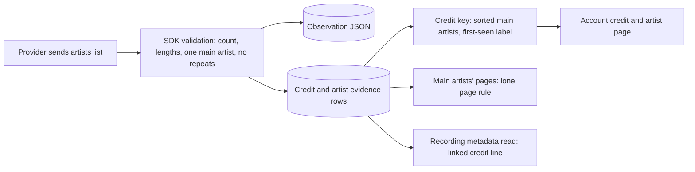
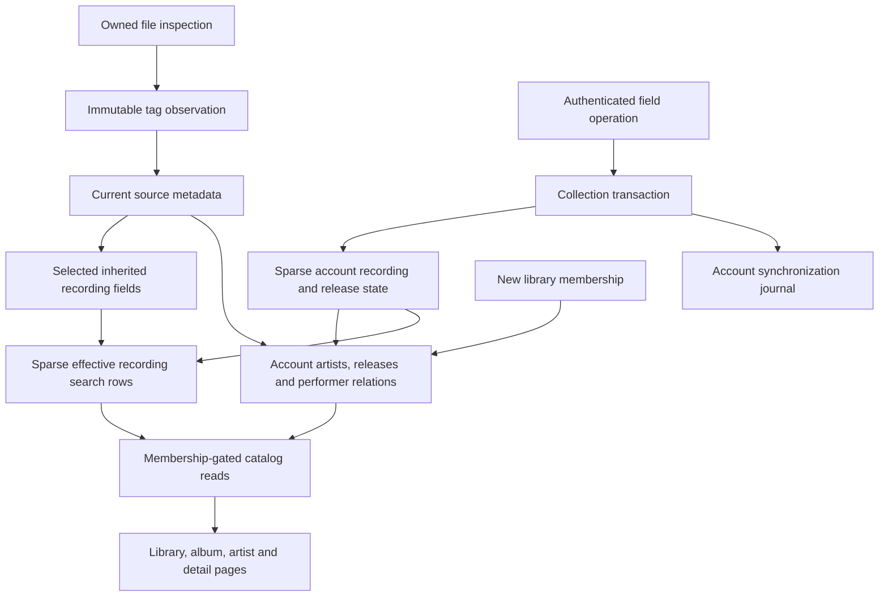

# Personal metadata and source observations

Track details let listeners edit a recording's title and artist. Album pages link to a separate editor for that album's title and album artist. Each field has its own **Use source** action. Edits belong to the signed-in account and do not change audio files or source observations.

## Fields and identity

Recording edits follow the recording UUID across library search, likes, playlists, listening history, and every album appearance. Album edits follow the release UUID. Changing an album artist leaves its track artists alone. Giving two albums the same title and artist does not merge them.

Saving a value pins it, even when it equals today's inherited value. Retagging or selecting another source does not replace the pin. Reset accepts a new synchronization operation and follows inherited metadata again. Library rows use the selected source; album track rows use each appearance's observed title and artist.

The browser updates current and queued recording fields without reopening audio or changing position or speed. Each queued occurrence carries its inherited title and artist, so reset can restore different appearance credits. Queues remain device-local snapshots. Updating them after an external source change or an edit from another client still needs the synchronization client.

Artist pages group exact credit text within an account and library. These are credit labels, not canonical people. A personal artist never enters the shared observed-artist registry. Its account-owned ID stays stable if a later file inspection observes the same name. Empty historical credits are retained internally but hidden from browsing.

Raw retagging can still change an inferred release UUID because its key includes album tags and directory identity. Personal edits do not run that identity constructor. Moving corrections to a different release after raw retagging needs explicit reconciliation and remains unfinished.

## Acceptance and access

The versioned synchronization API accepts these field operations:

| Object | Set | Follow source |
| --- | --- | --- |
| Recording title | `recording_title_set` | `recording_title_inherit` |
| Recording artist | `recording_artist_set` | `recording_artist_inherit` |
| Album title | `release_title_set` | `release_title_inherit` |
| Album artist | `release_artist_set` | `release_artist_inherit` |

Each field retains its own accepted operation UUID. Identical delivery acknowledges the original operation without reapplying it over a newer reset. Reusing a UUID with different contents fails. Batch acceptance, personal state, search indexes, artist relations, and the account journal commit or roll back together. Conflicting field operations follow committed server acceptance order.

Values require 1 to 2048 UTF-8 bytes, nonblank text, and no control characters. Live library membership gates new writes and metadata reads. Revocation hides retained personal state and artist relations immediately. Regrant restores the account's state and refreshes its catalog transactionally. Other accounts receive their own effective values and operation IDs.

## Provenance

`GET /api/v1/recordings/{id}/metadata` returns effective, inherited, and personal values for both fields, their operation IDs, the selected source observation, and a bounded observation page. `GET /api/v1/releases/{id}/metadata` returns the album fields and observations associated with that release. An album does not claim one selected track observation for its entire group. Neither response exposes filesystem paths or file checksums.

Each successful inspection records a normalized snapshot and six supported chosen tags: title, artist, album, album artist, disc, and track. Tag values retain whether FFprobe found them in file tags or an audio stream. Missing tags remain absent. Normalized values still apply Hito's filename and unknown-value fallbacks.

A distinct source/checksum/inspection revision gets one immutable snapshot. Cached scans reuse it. Returning to a previously observed revision can select its earlier snapshot; this is revision evidence, not a log of every scan. Personal edits never rewrite these snapshots.

Migration 0014 records available upgrade metadata as `legacy_normalized`. Original tags and observation times remain null. Inspection version 2 captures supported tag evidence on the next successful scan. Migration cannot reconstruct a previously discarded source pointer.

Current source metadata points to its observation. Recordings keep separate selected-observation pointers. If every source becomes unavailable, Hito retains the last inherited metadata and observation while clearing the playable source owner.

History pages are newest first, default to 20 entries, and return at most 100. The exclusive `before` cursor is constrained to the authorized object. A recording's selected observation is returned separately, even outside that page. The browser replaces one page at a time and cancels stale requests across account, object kind, and object ID changes.

## MusicBrainz artist tag evidence in verified source

Inspection version 3 retains emitted `MusicBrainz Artist Id`, `MUSICBRAINZ_ARTISTID`, `MusicBrainz Album Artist Id` and `MUSICBRAINZ_ALBUMARTISTID` tags. `InspectedTags.musicbrainz_artist_tags` contains their exact key, raw value, performer or album-artist role, and format/audio-stream location. Values remain source assertions. [Artist matching](artist-matching.md) uses a single, valid performer value as verified evidence; provider enrichment remains separate work.

A null array means evidence was unavailable, including old observations and rejected optional evidence. An empty array means inspection found no recognized artist tag. Values are retained without UUID parsing or delimiter splitting. The collector permits at most 16 assertions, 64 bytes per key, 2,048 bytes per value and 32 KiB for the encoded array. Exceeding a bound makes the optional evidence unavailable.

Expanded FFprobe output remains limited to 65,536 bytes. A clean output-limit failure permits one ordinary-tag probe under the same original deadline, including admission and cleanup. Diagnostics, an observed unsuccessful exit, cancellation, timeout or malformed JSON do not trigger another attempt. Captured processes and private inputs stay owned until retirement. Logs contain controlled reasons, counts and timings rather than values or paths.

On the next scan, unchanged version-2 files refresh metadata while retaining completed decoded-audio evidence, including known unsupported profiles. Current version-3 inspections are reused. Original media, old observations, recording/source IDs and private collection state remain intact.

This slice was not yet on the local server when it was tested; the local development server now runs through migration 0069. Public fixtures verify raw assertions, tag-only changes, a truthful version-2 upgrade without redecoding, 70 KiB and 1 MiB optional values, shared deadlines, diagnostics combined with overflow, a proven natural failed exit, cancellation and private log values. The frozen full core run passes 316 distinct cases with one usual filesystem-fault case ignored; the later 1 MiB case passes separately. The server passes 144 distinct cases. Strict workspace Clippy, formatting, generated contracts and frontend checks pass. These Linux fixtures do not establish every container/tag format or other platform's process behavior.

## ISRC tags in verified source

Inspection version 4 also retains the first `isrc` (ID3 `TSRC`) tag as `InspectedTags.isrc`, a raw source assertion like the ordinary tags (null when absent or not yet inspected). Its value is normalized only when Hito uses it as [provider evidence](artist-matching.md#matching-from-provider-evidence); a malformed value is ignored there. Unchanged version-3 files refresh their tags on the next scan without decoding audio again, exactly as version 2 did. FLAC, Ogg Vorbis, MP3, M4A and WAV (ID3 chunk) fixtures verify the tag; other containers are unverified.

## Release and recording MusicBrainz identifiers in verified source

Inspection version 5 also retains four more tags as raw source assertions on `InspectedTags` (each null when absent or not yet inspected): `musicbrainz_album_id` (`MusicBrainz Album Id`, `MUSICBRAINZ_ALBUMID`, the release), `musicbrainz_release_group_id`, `musicbrainz_recording_id` (`MusicBrainz Track Id`, `MUSICBRAINZ_TRACKID`, the recording, following MusicBrainz Picard) and `musicbrainz_release_track_id` (`MusicBrainz Release Track Id`, `MUSICBRAINZ_RELEASETRACKID`). Unchanged version-4 files refresh their tags on the next scan without decoding audio again.

Each well-formed value (a hyphenated UUID; stored in lower case; the nil UUID is rejected) is also kept as an immutable row in `recording_musicbrainz_observations` (migration 0064), beside the observation that stated it, with the recording and the release the observation belongs to. A malformed value stays a raw assertion only. Rows are never updated or deleted, so a retag adds a new observation instead of changing an old answer.

This is evidence, not a merge. Two local releases that carry the same release identifier stay two releases, a recording is never matched to another by an identifier, and nothing here edits a title, artist, album or any other personal field. The album and track details pages link the release, release group and recording identifiers when Hito holds them ([details](catalog-browsing.md#musicbrainz-identifiers-on-details-pages)), and the release identifier chooses the exact album edition ([details](catalog-browsing.md#edition-named-by-the-file-tags)). The release and release group rows drive cover art and genres, and the recording row is evidence for the credited artist in the background provider pass (migration 0076, see [artist matching](artist-matching.md#release-and-recording-identifiers-from-tags)); reading the tags never contacts MusicBrainz.

FLAC, Ogg Vorbis, M4A (freeform atoms), MP3 and WAV (ID3 chunk) fixtures verify the tags. A `TXXX` frame named `MusicBrainz Track Id` is ambiguous (some taggers put the release track identifier there), so on files with ID3 tags (MP3, WAV, AIFF, ADTS) that value is deliberately not read as the recording identifier. Vorbis and MP4 `MUSICBRAINZ_TRACKID` / `MusicBrainz Track Id` are read as the recording identifier. Files with ID3 tags state the recording in the `UFID` frame; see inspection version 7.

Inspection version 6 also retains the first `genre` tag as `InspectedTags.genre`, a raw source assertion (null when absent or not yet inspected), and derives the browsable genre list from it (see [catalog browsing](catalog-browsing.md#genres-and-artist-radio)). Unchanged version-5 files refresh their tags on the next scan without decoding audio again, so the first scan after the 5 to 6 upgrade re-probes every file once. Recordings without a file genre can also take MusicBrainz genres (see [artist matching](artist-matching.md#musicbrainz-genres)); these are separate observations with provenance `musicbrainz` and never replace the tag or a personal edit. FLAC, Ogg Vorbis, MP3, M4A and WAV (ID3 chunk) fixtures verify the tag; the browser fixtures verify the WAV INFO `IGNR` form.

Inspection version 7 reads the ID3 `UFID` frame owned by `http://musicbrainz.org`, where MusicBrainz Picard stores the recording identifier in MP3 and WAV (ID3 chunk) files, as `musicbrainz_recording_id`. FFprobe does not expose that frame, so Hito reads it itself from the private media copy while it already prepares the ID3 tags for FFmpeg. The reader is bounded: the tag span is checked against the file and the existing 16 MiB tag limit, the first MusicBrainz-owned frame decides (when its identifier is unusable there is no recording identifier, and later frames or stacked tags are not consulted, as Picard and mutagen do), the owner must match exactly, the identifier must be 1 to 64 printable ASCII bytes, and a frame that is compressed, encrypted, grouped, individually unsynchronised or prefixed with a data length is skipped (compressed text frames remain supported; a compressed `UFID` is not). Whole-tag unsynchronisation, extended headers and footers are handled, and malformed headers leave the value empty without failing the scan. The value is a raw source assertion like the others; only a well-formed UUID becomes evidence. No network request is made. Unchanged version-6 files are refreshed on the next scan without decoding audio again, but every file is still copied to the private media area, hashed and probed once, so the first scan after the upgrade reads the whole library from disk. Existing MP3 and WAV libraries gain the identifier and the background artist matching and proven-duplicate grouping see it without a migration. Fail-closed limits, each leaving the recording identifier empty: ID3v2.2 tags (three-letter frame ids), tags appended at the end of a file, tags with more than 8,192 frames, tags larger than 16 MiB, identifiers padded with NUL bytes (the identifier must be printable ASCII), and formats that do not carry ID3 (FLAC, Ogg, M4A keep their own tags). AIFF and ADTS files with ID3 tags use the same reader but have no fixture. Tests cover both tag versions, RIFF chunks, stacked tags, unsynchronisation, tables of rejected frames, first-frame cases, extended headers, footers, RIFF chunk edge cases, and truncated and corrupted headers with pinned outcomes (unit), scans of MP3 and WAV through the public capability, and the upgrade from version 6 through to an artist match.

One-time cost of the version 4 to 5 change. Version 5 is a new inspection version, so the first scan after an upgrade re-probes every file with FFprobe once. Audio is not decoded again. Each file gains one observation row and at most four evidence rows. A large library therefore takes noticeably longer on that first scan; later scans reuse the version 5 result for unchanged files.

## Compressed ID3 tags and tag compatibility

FFprobe reads tags from a private copy of each file. Before it runs, Hito looks at ID3v2.3 and v2.4 tags at the start of the file and in RIFF (WAV) and AIFF ID3 chunks. Only tags that contain at least one compressed frame are rewritten, in place and at the same length. Other files are untouched.

Behavior before this change, measured with FFmpeg 5.1 in the Docker image:

| Case | Result |
| --- | --- |
| v2.4 compressed text frame | Read correctly |
| v2.3 compressed text frame | Flag not recognized. The field fell back to the filename or showed garbage |
| Corrupt zlib stream, or a stream larger than FFprobe's 16 MiB allocation limit, in v2.4 | FFprobe printed an error and the whole file was not indexed, although the scan finished |
| v2.3 tag with whole-tag unsynchronisation and a compressed frame | Other frames in the tag were lost as well |

Current policy:

- Only compressed `T***` text frames are inflated in the private copy. Other compressed frames, including pictures, are dropped from it (artwork has its own reader, see below). Frames that also carry grouping or encryption flags are dropped.
- A frame is dropped, never fatal, when its declared size is zero or above 1 MiB, when the file's declared total passes 4 MiB (charged before inflating, across stacked tags and chunks), when a frame above 4 KiB expands more than 100 times, when the stream is invalid or its length differs from the declared size, or when the plain result does not fit in the original tag. v2.4 tag-level unsynchronisation applies to every frame and footers are skipped. A failed write to the private copy is counted and the copy is used unmodified. Reading stops at 16 MiB of tag, the snapshot deadline applies, and decompression never allocates beyond the declared and capped size.
- Dropped frames leave the field to the filename or unknown-value fallback, so observation provenance still shows the field as not found in tags. Personal edits and pins are unchanged.
- Per file, one debug event `id3_compressed_frames` records counts of inflated and dropped frames by reason. It contains no values or paths.
- In WAV files that hold both a `LIST`/`INFO` chunk and an ID3 chunk, FFmpeg ignores the ID3 tag. Hito renames the INFO list in the private copy so the ID3 tag wins. Its fields are fuller (album artist, disc). Fields missing from the ID3 tag are not filled from INFO.

### Appended ID3v2 tags

ID3v2.4 allows a tag at the end of a file, marked by a footer (`3DI`) that sits before an optional ID3v1 tag or at the end of the file. FFmpeg ignores such a tag, and the stray bytes make audio decoding fail, so these files used to be skipped.

In the private copy, Hito now finds the footer and checks that a tag header (`ID3`, version 4, same flags and size) sits exactly where the footer says. A tag that passes is moved to just after any leading ID3 tags, and the audio is shifted over, so the copy has the same length and an ID3v1 tail stays last. The moved tag then goes through the same reader as a leading tag, with the same limits: 16 MiB of tag, 8,192 frames, the compressed-frame rules above, and bad frames dropped one by one.

- **Merging.** FFmpeg reads stacked tags in order and the first tag that has a field wins. The appended tag is placed last, so leading tags win and the appended tag only fills fields the leading tags lack. This applies to a file that only has an encoder-only leading tag, which FFmpeg writes. The first MusicBrainz `UFID` frame still decides the recording identifier, in file order.
- **Dropped, not read.** An appended tag is cut out of the copy and ignored when it is over 16 MiB, or when four leading tags already exist. The file stays in the library with its other fields.
- **Only MPEG audio.** Appended tags are moved only in files that start with an ID3 header or with an MPEG audio sync. WAV, AIFF, MP4, FLAC and Ogg copies are never changed, so no container header is shifted. A leading tag over 16 MiB is not counted as a leading tag, matching what the reader processes. An ID3v1 marker that happens to sit 128 bytes before the end does not hide a footer at the very end; both positions are tried.
- **Not found.** A footer whose size does not lead to a matching tag header is left alone. The copy keeps the unknown bytes and decoding fails as it does for any trailing junk, so the file is skipped. ID3v2.3 tags have no footer and cannot be found at the end of a file.
- A debug event `id3_compressed_frames` also counts `appended_moved` and `appended_dropped`.

### Compressed pictures

Embedded artwork is read on request from the original file, not from the private copy, and is not part of the inspection record. The reader first uses Lofty. Lofty is built without ID3 decompression, so it skips or fails on a compressed `APIC` frame. When Lofty finds no usable picture, Hito reads the leading ID3v2.3 and v2.4 tags (up to four stacked tags) itself and looks at every `APIC` frame, compressed or not.

- A compressed picture is inflated only if its declared size is at most 8 MiB plus 64 KiB for the type and description, its compressed bytes fit the same cap, the total declared size of all pictures in the file is within the 16 MiB metadata budget, and the stream is valid and exactly the declared length. A stream that is larger or smaller than declared, a corrupt stream, a v2.4 frame without a data length, an encrypted frame, and a bad type, encoding or description are dropped. Inflation never allocates beyond the declared size, so a zip bomb costs at most the cap.
- The result goes through the same check as any embedded picture: it must be PNG, JPEG, GIF or WebP by its first bytes and at most 8 MiB. A front cover is preferred over other types. If nothing valid remains, the folder cover images are tried as before.
- A bad picture never hides the rest of the tag. Title, artist and album come from the inspection reader, which does not look at pictures.
- Retained provider artwork still goes through the stricter 1,024-pixel decode in the catalog. Embedded pictures keep the existing, looser rule, which is unchanged.
- The second read is skipped unless a quick walk over the frame headers of the leading tags finds a compressed `APIC` frame (or a layout it cannot walk, such as whole-tag unsynchronisation), so ordinary files are not read twice.
- Artwork reads run under the same per-drive blocking wrapper as local audio opens: at most two reads per drive, a five-second bound, and the global artwork slot is released when the bound is reached. A source on a stalled drive is skipped, other drives keep serving artwork, and artwork returns once the drive responds. A Docker test with the read-fault shim covers a stalled drive, a healthy neighbour and recovery.
- Only leading tags are searched for pictures. A picture inside an appended tag is not read.
- This does not change stored inspection data, so the inspection version is unchanged.

Tests scan MP3 files with compressed `APIC` frames in v2.3 and v2.4: a PNG, a JPEG with a front cover preferred over another type, a picture over the cap, pictures whose declared sizes together pass the 16 MiB budget (in one tag and in stacked tags), a picture in a fifth stacked tag, v2.3 and v2.4 bombs with a small and a near-cap declared size, a 600 MiB stream (a zip bomb) with a true and a false declared size, an impossible declared size, corrupt zlib data and compressed bytes that are not an image. Each dropped case also checks that the tag title is still read.

Unchanged files keep their earlier observation until they change or the inspection version rises. A version bump re-inspects every unchanged file once on the next scan: the file is hashed and probed again, the audio proof is reused so audio is not decoded again, a new observation is kept beside the old one, and a later scan does nothing more. The appended-tag and compressed-picture reading above needed no bump: a file with an appended tag was never indexed before, and pictures are read on request. The appended-tag and picture changes left the inspection version alone; it is now 9 for the file facts below. A test moves an indexed MP3 back to version 7 and checks one probe, no decode and no repeat on later scans.

Tests for appended tags use an FFmpeg-made MP3 with the tag appended by the test, with and without the encoder-only leading tag: an appended-only file, leading plus appended, a bad compressed frame in an appended tag, a footer that points nowhere, a tag over 16 MiB, and an ID3v1 tag after the footer, plus byte-level unit tests of the move and the cut. Tests build tags byte by byte and scan them through the public capability. They cover compressed title, artist and album in v2.3 and v2.4, on MP3 and WAV, per-frame and whole-tag unsynchronisation, corrupt streams, oversize and highly expanding frames, false declared sizes, non-text compressed frames, privacy of logs and personal edits. A compatibility test writes the title, artist, album, album artist, disc and track with Lofty, FFmpeg or hand-built bytes and reads them back for these dialects: ID3v1, ID3v2.3, ID3v2.4, AAC with ID3, FLAC, Ogg Vorbis and Opus comments, M4A/MP4 atoms, WAV `LIST`/`INFO` and ID3 chunks, AIFF ID3 and WMA. ID3v1 and INFO carry no album artist or disc. FFmpeg ignores an ID3v1 tag when any ID3v2 tag exists, even an encoder-only one. A tag appended at the end of a file is read when it ends in an ID3v2.4 footer (see below). These are Linux Docker results with FFmpeg 5.1 and do not cover other FFmpeg versions.

## File facts on the track page (inspection version 9)

Current behavior in source, not deployed. Inspection version 9 keeps four more facts from the probe that already runs on each local file: the container and codec (shown as FLAC, MP3, WAV, AIFF, WMA, AAC, ALAC, Ogg Vorbis or Opus), the bit depth (lossless formats only), the sample rate, and the `date`, `label` (or `publisher`, `organization`) and `tracktotal` (or `totaltracks`) tags. They sit inside the observation's tag record with the other raw source assertions. Nothing is decoded again; the version bump re-inspects each unchanged file once on the next scan, as described above.

`GET /api/v1/recordings/{id}/metadata` and the recording page now also return:

- `audio_format`: the format, bit depth and sample rate of the latest inspected local file of the recording, plus the file size Hito already stores. Any part that is not known is null, and the whole value is null when the recording has no local file.
- `release_facts`: release year (the first four digits of the date tag), track total (from `3/11` style track tags, otherwise the total tag) and label. Unknown values are null.
- `last_played`: the signed-in account's resume position and the time it was last saved (`listening_progress`). It is null when the account never played the recording, and another account's progress is never read.
- `appears_in`: up to 50 of the signed-in account's own playlists that currently contain the recording, by name. Playlists of other accounts and removed entries are not listed.

All four are read in the same transaction as the rest of the details, with one bounded query each. A file that has not been re-inspected yet shows its size but no format, year, label or total. Provider-only recordings have none of the file facts. Release year, label and track total come only from file tags; Hito does not copy them from MusicBrainz or a provider.

## Credited artists from providers

A provider that knows who is credited sends them as a list beside the display text (`ProviderRecording.artists`, see the [plugin contract](plugin-catalog.md#recording-evidence)). Core keeps that list as evidence of the observation that stated it: `recording_credit_observations` holds one row per observation with the credit label, and `recording_credited_artist_observations` one row per artist (position, name, role, join text, provider identifier and artist page). The two observation tables are written once beside the observation and never change (migration 0078), and rows of observations from files or from plugins that send no list do not exist. Nothing is rewritten for existing recordings, and the display `artist` text, recording identifiers and personal edits never change.

Current behavior, tested with real temporary SQLite and an owned provider:

- **Credit identity.** For a recording whose current observation has a list, the account's credit (the artist row that groups its recordings) is found by a key, the main artists' names in sorted, case-folded order (`account_credit_keys`, one row per account, library and key). "Ada & Bo", "Bo, Ada" and "bo & ADA" therefore land in one credit. The key is each main artist's name trimmed (Unicode white space, including the no-break space) and lower-cased with Unicode rules, sorted and joined; internal spacing and accents still count, so "Émile" and "émile" are one artist while "Emile" and "Émile" are two. The credit keeps the label of the first observation recorded with that key (the main artists in the provider's order joined with ` & `, so "Simon & Garfunkel" is never shown as "Garfunkel & Simon"), and the recording rows keep showing the provider's own wording. When a key has no artist yet and the provider's own display text for the observation is exactly the name of a text-only artist of the library that no key holds, the key takes that artist and its label, so refreshing "Ada, Bo" with a list keeps it on its existing artist and its not-yet-refreshed siblings. A credit with a featured artist never adopts, because it names fewer artists than the text. Creating a new artist asks for a matching walk. A literal artist name equal to a collaboration's label shares its credit. A list too long for the stored bounds (key over 8,192 bytes) is not retained and the credit stays text. Featured artists are not part of the label, so "Bo feat. Ada" with Ada featured is credited to Bo. A personal artist edit still wins over the label. A credit written only as text keeps its text and is never split or merged by guessing.
- **Matching evidence.** The lone-artist-page rule of [provider evidence](artist-matching.md#matching-from-provider-evidence) looks at the main artists only: the observation's pages are the pages of its main artists, and only when every main artist has one. A featured artist's page never identifies the credit, and a collaboration of several main artists stays uncertain. A recording without a list keeps the pages the provider listed.
- **Local files (inspection version 8, source only).** Files tagged by MusicBrainz Picard and similar taggers state each artist on its own, and inspection turns that into the same credit evidence. Inspection reads the repeated tags itself from the private media copy (the lofty tag reader, no network), because FFprobe cannot supply them:

| Container | Artist list | MusicBrainz artist ids | What FFprobe returns |
| --- | --- | --- | --- |
| FLAC, Ogg Vorbis, Opus | repeated `ARTISTS` comments | repeated `MUSICBRAINZ_ARTISTID` | Values joined with `;` (`A;B`) |
| MP3 with ID3v2.4 (WAV and AIFF ID3 chunks go through the same reader but have no fixture) | `TXXX:ARTISTS`, else a `TPE1` with NUL-separated values | `TXXX:MusicBrainz Artist Id` with NUL-separated values | One `ARTISTS` value only; `TPE1` cut to its first value |
| M4A | `----:com.apple.iTunes:ARTISTS` | `----:com.apple.iTunes:MusicBrainz Artist Id` | Only the last value |

  The list becomes a credit only when it has two to 16 distinct names of at most 256 bytes without control characters; a single `ARTISTS` value, a duplicate name or a longer list leaves the file text-only, exactly as before. Position follows the tag order, and each name is main unless the display `ARTIST` text names it after a `feat.`, `ft.` or `featuring` marker (bare or bracketed; the exact-name rule is shared with the Spotify plugin through `hito_plugin_sdk::credit_feature_names`), and never when that would leave no main artist. The display text, titles and personal edits do not change, and a personal artist edit still hides the list. The tagged identifiers are kept as each artist's `provider_artist_id` only when every name has exactly one well-formed identifier, otherwise none are kept. The same retention bounds as provider lists apply, scanning makes no network call, and logs carry counts only.
- **Upgrade.** Inspection version 8 re-inspects every file once on the next scan without decoding audio again; the new observation carries the list and the scan queues the account's matching walk, as for version 7. Older observations are untouched. Album artists still follow the display text, so an album of such tracks stays credited to that text until album artists get a structure of their own.
- **Reading.** `GET /api/v1/recordings/{id}/metadata` returns `credited_artists` for the current observation (name, role, join text and the account's artist page for exactly that name, if it has one). It is empty after a personal artist edit and for text-only credits.
- **Page.** The recording page shows the credit line with each artist that has a page linked separately, using the provider's join text.
- **Removal.** The two observation tables leave with the recording, when missing recordings are purged and when an account's library is erased. A key stays with its artist after its recordings go and leaves only with the account.

Planned, not built: one credit row per artist (so each member of a collaboration has its own artist page listing the collaboration), crediting featured artists on their own pages, `join` text in lists and search results, structured credits for local files, and splitting existing text-only credits. Until then a collaboration's members are linked on the recording page only where the account already has an artist of exactly that name.

## Ownership and data flow

Library storage owns inspection, observations, source selection, and indexing transactions. Identity provisions account relations when granting a library. Collection owns personal operation acceptance. The private metadata module owns validation, effective field expressions, catalog projection updates, and bounded provenance reads. HTTP authenticates and maps typed results. React uses generated contracts.

Recording search state stays sparse. Only edited or reset recordings need replacement rows. The effective title and artist are indexed together; inherited updates refresh them in the same transaction. Search merges those rows with the remaining shared branch. Album and artist graphs are materialized per account, with account-scoped FTS and indexed performer relations. Every read still checks current library membership. Unchanged indexing skips projection and FTS rewrites.

Migration 0015 preserves prior title pins, resets, and operation IDs while adding an independent recording artist field. Migration 0016 backfills the account catalog. Migration 0017 adds independent release fields and indexed release history.

## Evidence and limits

Public Docker tests cover field propagation, private search and grouping, equal-name album separation, grant/revoke/regrant, rollback, replay, retags, appearance fallbacks, source changes, retained provenance, paging, cache reuse, and truthful upgrades. A schema-14 upgrade test preserves saved pins and reset operation IDs through the public capability. HTTP tests cover authentication, authorization, rollback, private values, and Inertia props. Log capture rejects private titles, credits, invalid route identifiers, and credentials.

The Chromium workflow saves and resets all four fields while audio continues, verifies the unchanged album URL and track performers, and follows the personal album artist. It delays a real refresh response to verify disabled controls and preservation of an unsaved artist draft. Desktop and phone captures were inspected; a phone viewport assertion keeps the album reset control above the player dock. These checks do not establish native or cross-browser acceptance.

Independent diagnostics used bundled SQLite 3.46.0 with 100,000 recordings, ten accounts, 50,000 recording correction states, 10,000 release correction states, and one million account source credits. After `ANALYZE`, median count/page timings were about 29/0.25 ms for recording browse, 41/77 ms for broad recording search, 21/9 ms for artist browse, and 4/0.62 ms for release browse. A new membership across 100,000 sources took 861 ms. Unchanged source refresh across ten or eleven memberships took 0.067–0.094 ms and wrote no rows. Indexed history returned 101 rows in 0.13–0.22 ms. Migration 0016 took about six seconds. These sequential synthetic measurements exclude HTTP, concurrent listeners, decoding, and playback latency.

Provider enrichment, shared correction layers, negative matches, split, general undo, disc/track corrections, stable corrected appearance identities, administrator promotion, and release identity reconciliation remain unimplemented. Personal unlinking and latest-change undo exist only for reviewed artist-catalog associations; see [Reviewed artist profiles](artist-catalog-host.md#unlinking-and-undo).
