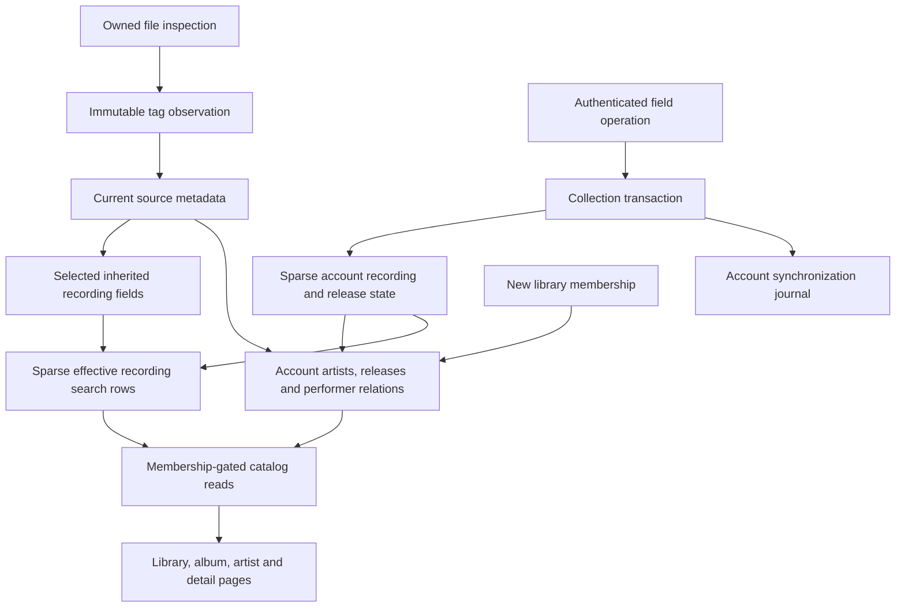

# Personal metadata and source observations

Track details let listeners edit a recording's title and artist. Album pages link to a separate editor for that album's title and album artist. Each field has its own **Use source** action. Edits belong to the signed-in account and do not change audio files or source observations.

## Fields and identity

Recording edits follow the recording UUID across library search, likes, playlists, listening history, and every album appearance. Album edits follow the release UUID. Changing an album artist leaves its track artists alone. Giving two albums the same title and artist does not merge them.

Saving a value pins it, even when it equals today's inherited value. Retagging or selecting another source does not replace the pin. Reset accepts a new synchronization operation and follows inherited metadata again. Library rows use the selected source; album track rows use each appearance's observed title and artist.

The browser updates current and queued recording fields without reopening audio or changing position or speed. Each queued occurrence carries its inherited title and artist, so reset can restore different appearance credits. Queues remain device-local snapshots. Updating them after an external source change or an edit from another client still needs the synchronization client.

Artist pages group exact credit text within an account and library. These are credit labels, not canonical people. A personal artist never enters the shared observed-artist registry. Its account-owned ID stays stable if a later file inspection observes the same name. Empty historical credits are retained internally but hidden from browsing.

Raw retagging can still change an inferred release UUID because its key includes album tags and directory identity. Personal edits do not run that identity constructor. Moving corrections to a different release after raw retagging needs explicit reconciliation and remains unfinished.

## Acceptance and access

The versioned synchronization API accepts these field operations:

| Object | Set | Follow source |
| --- | --- | --- |
| Recording title | `recording_title_set` | `recording_title_inherit` |
| Recording artist | `recording_artist_set` | `recording_artist_inherit` |
| Album title | `release_title_set` | `release_title_inherit` |
| Album artist | `release_artist_set` | `release_artist_inherit` |

Each field retains its own accepted operation UUID. Identical delivery acknowledges the original operation without reapplying it over a newer reset. Reusing a UUID with different contents fails. Batch acceptance, personal state, search indexes, artist relations, and the account journal commit or roll back together. Conflicting field operations follow committed server acceptance order.

Values require 1 to 2048 UTF-8 bytes, nonblank text, and no control characters. Live library membership gates new writes and metadata reads. Revocation hides retained personal state and artist relations immediately. Regrant restores the account's state and refreshes its catalog transactionally. Other accounts receive their own effective values and operation IDs.

## Provenance

`GET /api/v1/recordings/{id}/metadata` returns effective, inherited, and personal values for both fields, their operation IDs, the selected source observation, and a bounded observation page. `GET /api/v1/releases/{id}/metadata` returns the album fields and observations associated with that release. An album does not claim one selected track observation for its entire group. Neither response exposes filesystem paths or file checksums.

Each successful inspection records a normalized snapshot and six supported chosen tags: title, artist, album, album artist, disc, and track. Tag values retain whether FFprobe found them in file tags or an audio stream. Missing tags remain absent. Normalized values still apply Hito's filename and unknown-value fallbacks.

A distinct source/checksum/inspection revision gets one immutable snapshot. Cached scans reuse it. Returning to a previously observed revision can select its earlier snapshot; this is revision evidence, not a log of every scan. Personal edits never rewrite these snapshots.

Migration 0014 records available upgrade metadata as `legacy_normalized`. Original tags and observation times remain null. Inspection version 2 captures supported tag evidence on the next successful scan. Migration cannot reconstruct a previously discarded source pointer.

Current source metadata points to its observation. Recordings keep separate selected-observation pointers. If every source becomes unavailable, Hito retains the last inherited metadata and observation while clearing the playable source owner.

History pages are newest first, default to 20 entries, and return at most 100. The exclusive `before` cursor is constrained to the authorized object. A recording's selected observation is returned separately, even outside that page. The browser replaces one page at a time and cancels stale requests across account, object kind, and object ID changes.

## Ownership and data flow

Library storage owns inspection, observations, source selection, and indexing transactions. Identity provisions account relations when granting a library. Collection owns personal operation acceptance. The private metadata module owns validation, effective field expressions, catalog projection updates, and bounded provenance reads. HTTP authenticates and maps typed results. React uses generated contracts.

Recording search state stays sparse. Only edited or reset recordings need replacement rows. The effective title and artist are indexed together; inherited updates refresh them in the same transaction. Search merges those rows with the remaining shared branch. Album and artist graphs are materialized per account, with account-scoped FTS and indexed performer relations. Every read still checks current library membership. Unchanged indexing skips projection and FTS rewrites.

Migration 0015 preserves prior title pins, resets, and operation IDs while adding an independent recording artist field. Migration 0016 backfills the account catalog. Migration 0017 adds independent release fields and indexed release history.

## Evidence and limits

Public Docker tests cover field propagation, private search and grouping, equal-name album separation, grant/revoke/regrant, rollback, replay, retags, appearance fallbacks, source changes, retained provenance, paging, cache reuse, and truthful upgrades. A schema-14 upgrade test preserves saved pins and reset operation IDs through the public capability. HTTP tests cover authentication, authorization, rollback, private values, and Inertia props. Log capture rejects private titles, credits, invalid route identifiers, and credentials.

The Chromium workflow saves and resets all four fields while audio continues, verifies the unchanged album URL and track performers, and follows the personal album artist. It delays a real refresh response to verify disabled controls and preservation of an unsaved artist draft. Desktop and phone captures were inspected; a phone viewport assertion keeps the album reset control above the player dock. These checks do not establish native or cross-browser acceptance.

Independent diagnostics used bundled SQLite 3.46.0 with 100,000 recordings, ten accounts, 50,000 recording correction states, 10,000 release correction states, and one million account source credits. After `ANALYZE`, median count/page timings were about 29/0.25 ms for recording browse, 41/77 ms for broad recording search, 21/9 ms for artist browse, and 4/0.62 ms for release browse. A new membership across 100,000 sources took 861 ms. Unchanged source refresh across ten or eleven memberships took 0.067–0.094 ms and wrote no rows. Indexed history returned 101 rows in 0.13–0.22 ms. Migration 0016 took about six seconds. These sequential synthetic measurements exclude HTTP, concurrent listeners, decoding, and playback latency.

Provider enrichment, shared correction layers, negative matches, unlink/split, undo, disc/track corrections, stable corrected appearance identities, administrator promotion, and release identity reconciliation remain unimplemented.
