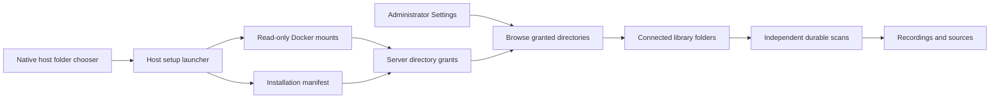
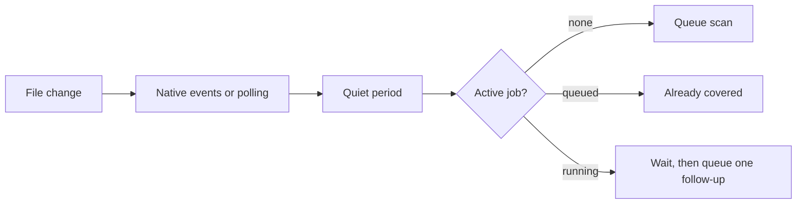

# Music folders

Administrators manage folders in **Settings → Library**. Adding a folder queues its first scan. Each folder has status, rescan, and removal controls. Choose a library first when an account has several. Ordinary listeners do not request folder administration data.

## Choose folders through the file explorer

Run **Hito Setup.command** on macOS, **Hito Setup.ps1** on Windows, or `./hito-setup` on Linux. Docker must be running. Linux needs Zenity or KDialog. Windows rejects directory links and asks for the original folder.

Select locations to share. macOS supports multiple selections, Windows offers another selection after each folder, and Linux can add another location by running setup again. Existing locations remain shared. Setup builds the server in Docker, generates read-only mounts, retains recognized existing data, and archives the stopped data volume before restarting.

In Hito, select **Settings → Library → Add music folder**, browse a shared location, and choose **Use this folder**. Repeat for other locations. No environment-variable editing is required.

The browser can select only locations already shared with the server. It cannot open the server computer's native dialog or grant Docker access to another drive. Run setup on the server computer to share another location. The application has no Docker socket or Docker-control API.

Setup files live in `~/Library/Application Support/Hito` on macOS, `%LOCALAPPDATA%\Hito` on Windows, and `$XDG_CONFIG_HOME/hito` or `~/.config/hito` on Linux. The private installation record contains host paths and stable grant IDs. The server manifest contains container paths. Administrator API responses expose labels and relative selections, without host paths. The host configuration directory is private; its manifest is readable by the container user.

Setup discovers server containers using their repository label, or uses its saved project. More than one candidate stops setup before configuration changes. Unsupported network settings or mounts also stop adoption. Moving repositories/configuration and native platform recovery remain installation acceptance work.

## Removal and recovery

Removing a folder withdraws its sources and cancels its scans. Originals stay on disk. Recordings, playlists, likes, progress, and identity evidence remain. Another source can keep a recording playable. Reconnecting the same selection verifies files and restores the same source IDs when identity matches. Already-open streams retain their file descriptors; new requests recheck access.

Overlapping selections within a shared location are rejected. Setup rejects overlapping normalized host locations. Identical pathnames on different hosts have independent ownership. A device-local file stays unavailable on another host unless that host has another playable source.

Each scan attempt has its own token and the folder's current generation. Publication and reconciliation require both to remain valid. A recovered job cannot reuse an earlier attempt's observations. Incomplete enumeration preserves previously verified files. A failed root open withdraws only that folder's sources. Physically disconnected drives show unavailable folder status; their sources withdraw on a failed scan or revoked grant.

Opening and browsing have deadlines. Per-grant limits isolate stalled locations. Walking has a five-second inactivity deadline that observes unsupported entries, rather than a deadline for the entire scan. Abandoned calls retain their permit until they finish, with one operation thread and one walk thread per grant. Detached threads do not hold the async runtime open during shutdown. Operating-system calls cannot be forcibly cancelled in process.

Pending legacy witnesses are checked before ordinary matching. Incomplete legacy discovery fails conservatively rather than guessing identity. Metadata follows a surviving verified source when its previous owner becomes unavailable.

## Automatic rescans

The server watches every connected, bound server folder and queues a scan when its supported audio files are added, removed, renamed or changed. It uses the same scan job, lease, generation and attempt-token checks as a manual rescan. There is no second scanner.

- A burst of changes collapses into one scan. The quiet period restarts on each change and is capped at ten times its length.
- A change during a running scan waits for that scan, then queues exactly one follow-up. A change while a scan is only queued adds nothing, because that scan has not started reading yet.
- Native operating-system events are the default. Hito uses polling instead when the operator asks for it, when the folder sits on a network, virtual or removable volume (detected on Linux), or when the system refuses another watch (for example at the inotify limit). Polling compares file names, sizes and modification times at the poll interval. Each folder logs its choice once, with a reason code and no path.
- Watching never follows symbolic links out of the folder. Events only trigger a scan; the scan itself still reads through the granted directory handle.
- Disconnecting or removing a folder stops its watcher. Reconnecting starts a new watcher for the new generation. Shutdown stops and joins every watcher before the server exits. Files that changed while the server was stopped are not seen until the next manual or reconnect scan.
- Operators set the behaviour with `HITO_FOLDER_WATCH` (`auto`, `poll` or `off`) and `HITO_FOLDER_WATCH_POLL_SECONDS`. See [operations](operations.md#music-scanning).

Automated tests cover a new file, a removed file, a burst, a change during a running scan, disconnect and reconnect, the polling fallback, links leaving the folder, a disabled setting and shutdown. They ran on Linux inside Docker with temporary directories. Windows and macOS native watching, network volumes and removable drives are not yet tested. Native desktop folders (automatic discovery and native selection) are separate unfinished work.

## Evidence and limits

`./scripts/verify.sh` covers core/HTTP tests, generated contracts, browser tests, setup generation, Compose interpolation, formatting, Clippy, web build, and dependency audit. The browser flow adds two folders and checks desktop/mobile layout, status, Escape, focus restoration, playback, and account isolation.

Root-open fault injection uses the normal Linux backend. Enumeration injection explicitly builds rustix's libc backend so a libc shim can delay directory reads. It verifies source preservation, subsequent healthy-folder progress, shutdown, and successful traversal taking more than five seconds while unsupported entries continue. This does not prove production Linux raw-syscall outage handling or release latency targets.

Live native dialogs, permissions, drive reconnects, ambiguous-project recovery, rollback, signing, and packaging still need macOS, Windows, and Linux acceptance. PowerShell syntax was checked in Docker, which does not verify its Windows GUI. Automatic desktop Music-folder discovery and filesystem watching remain unfinished.
