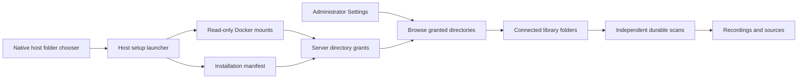
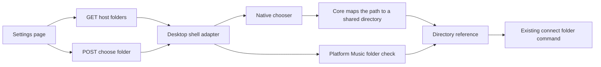
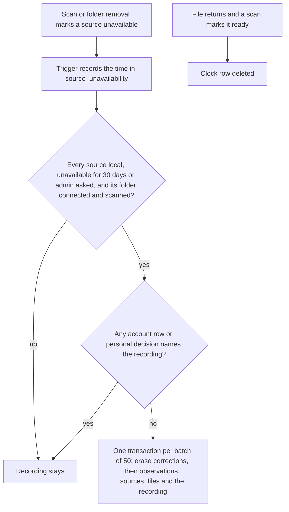
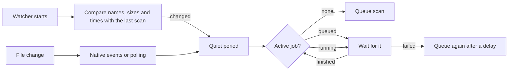

# Music folders

Administrators manage folders in **Settings → Library**. Adding a folder queues its first scan. Each folder has status, rescan, and removal controls. Choose a library first when an account has several. Ordinary listeners do not request folder administration data.

## Choose folders through the file explorer

Run **Hito Setup.command** on macOS, **Hito Setup.ps1** on Windows, or `./hito-setup` on Linux. Docker must be running. Linux needs Zenity or KDialog. Windows rejects directory links and asks for the original folder.

Select locations to share. macOS supports multiple selections, Windows offers another selection after each folder, and Linux can add another location by running setup again. Existing locations remain shared. Setup builds the server in Docker, generates read-only mounts, retains recognized existing data, and archives the stopped data volume before restarting.

In Hito, select **Settings → Library → Add music folder**, browse a shared location, and choose **Use this folder**. Repeat for other locations. No environment-variable editing is required.

The browser can select only locations already shared with the server. It cannot open the server computer's native dialog or grant Docker access to another drive. Run setup on the server computer to share another location. The application has no Docker socket or Docker-control API.

Setup files live in `~/Library/Application Support/Hito` on macOS, `%LOCALAPPDATA%\Hito` on Windows, and `$XDG_CONFIG_HOME/hito` or `~/.config/hito` on Linux. The private installation record contains host paths and stable grant IDs. The server manifest contains container paths. Administrator API responses expose labels and relative selections, without host paths. The host configuration directory is private; its manifest is readable by the container user.

Setup discovers server containers using their repository label, or uses its saved project. More than one candidate stops setup before configuration changes. Unsupported network settings or mounts also stop adoption. Moving repositories/configuration and native platform recovery remain installation acceptance work.

## Desktop Music folder and native chooser

The standalone desktop app runs the same Settings screen against its bundled local backend. It adds two helpers for administrators. Browsers and the Docker server show neither.

- **Proposal.** In **Settings → Library**, Hito offers "Add your Music folder?" when the computer has a readable Music folder that is not already connected. Nothing is added until you choose **Use Music folder**. **Not now** hides the offer until the page is opened again. New installations reach this screen from the empty library's **Add music folder** button.
- **Choose folder…** opens the operating system's folder chooser. A cancelled chooser changes nothing. A chosen folder is connected through the same add-folder command as the in-app browser, so scans, overlap checks, removal and recovery are unchanged.

The Music folder is the standard one for the platform: the Windows Music known folder, `~/Music` on macOS, and the XDG user-directory setting on Linux. An absolute `XDG_MUSIC_DIR` environment value that names an existing directory takes priority, and `~/Music` is the last fallback. A missing, non-directory or unreadable folder is not proposed.

The desktop shell only supplies a folder path from inside the application process. The web page never sends or receives a path; it receives a shared-directory reference like the browser flow. Core checks that the signed-in account is an administrator and that the folder exists and can be read. If an existing grant contains the folder, it reuses that grant. Otherwise it adds a grant whose label is the folder's name and whose ID is derived from the path. Paths that are not valid text are refused. Logs record only whether a folder was chosen or cancelled, never the path.

Core refuses, with a conflict message, a new grant for the filesystem root, the user's home folder itself, and any folder that equals or contains the Hito data directory (database and credentials). It also refuses a folder that contains a connected folder, or sits inside a connected folder of another grant, because the same files would be indexed twice. Choosing the same folder again is allowed. A second chooser request while one dialog is open is answered with a conflict ("A folder chooser is already open"). A cancelled chooser is not an error.

At the next start, core restores a host grant only for folders that are still connected. It re-resolves the stored path, requires the identifier to match that path, and applies the same refusals. Removing a folder therefore stops its grant from coming back after a restart; until then the grant stays listed in memory. If more grants exist than the 64-grant limit, extra host grants are skipped with a counted warning and startup continues. Grants that fail these checks are skipped the same way.

The private database can authorise host folders on the desktop: anyone who can edit it can add a connected-folder row that restores a grant for any readable folder that passes the checks above. The desktop database is private to the user's account, so this does not widen their own access. Do not share it.

Limits: the 5-second lookup for a slow or stalled path abandons the wait, but the operating system call keeps running on a background thread until it returns. Only one native chooser is open at a time, and closing the window while it is open leaves it to the operating system.

Linux Docker tests cover the Music-folder lookup (override, fallback, missing, file and unreadable cases), the core grant mapping, refusals, overlap and restart, the HTTP routes (including a busy chooser and the cross-site request guard) and the desktop host with a fake chooser, and the web flow with the chooser stubbed. The real chooser on macOS, Windows and Linux (including GTK, window parenting and sandboxed paths) is device verification work and is not tested here.

## Removal and recovery

Removing a folder withdraws its sources and cancels its scans. Originals stay on disk. Recordings, playlists, likes, progress, and identity evidence remain; [missing tracks](#missing-tracks) that no account uses are removed after 30 days. Another source can keep a recording playable. Reconnecting the same selection verifies files and restores the same source IDs when identity matches. Already-open streams retain their file descriptors; new requests recheck access.

Overlapping selections within a shared location are rejected. Setup rejects overlapping normalized host locations. Identical pathnames on different hosts have independent ownership. A device-local file stays unavailable on another host unless that host has another playable source.

Each scan attempt has its own token and the folder's current generation. Publication and reconciliation require both to remain valid. A recovered job cannot reuse an earlier attempt's observations. Incomplete enumeration preserves previously verified files. A failed root open withdraws only that folder's sources. Physically disconnected drives show unavailable folder status; their sources withdraw on a failed scan or revoked grant.

Opening and browsing have deadlines. Per-grant limits isolate stalled locations. Walking has a five-second inactivity deadline that observes unsupported entries, rather than a deadline for the entire scan. Abandoned calls retain their permit until they finish, with one operation thread and one walk thread per grant. File verification during a scan has one read thread per grant, so a drive whose reads stall can hold only one of the two shared verification slots. Detached threads do not hold the async runtime open during shutdown. Operating-system calls cannot be forcibly cancelled in process.

Pending legacy witnesses are checked before ordinary matching. Incomplete legacy discovery fails conservatively rather than guessing identity. Metadata follows a surviving verified source when its previous owner becomes unavailable.

## Missing tracks

Removing a folder or losing a file only makes the track unavailable. Hito then decides when the library record itself goes, so a drive that was unplugged for a weekend costs nothing and a library that lost files years ago does not keep ghosts forever.

**The rule.** A recording is removed when all of these hold. Each is part of the SQL that selects it, so a recording that stops meeting one is skipped.

- It belongs to a shared library (not a personal provider library) and has at least one source.
- Every source is a local file source (`provider = 'local'`) that is unavailable (`ready = 0`) and has been for longer than the retention window, 30 days (`RETENTION_SECONDS` in core). The clock starts when a source changes from available to unavailable, whichever path did it: a scan that no longer finds the file, a folder removal, a failed folder open or a replaced file. Migration 0070 records the time with triggers on `sources`, so every present and future path is covered. A returning file clears the row. Sources that were already unavailable when 0070 ran start their clock at the upgrade.
- Its folders vouch for the absence. Each file's folder must be connected, bound to this host and have a completed latest scan job that finished after the file went missing. A drive that is unplugged, a folder that was removed or is reconnecting, a scan that failed, is queued or is running, all keep the recording, however long they last: the clock only counts time that a successful scan has confirmed. After the folder is back, a completed scan decides, using the original date.
- No account row references it. Any row in `likes` (including an unlike), `listening_progress`, `playlist_entries` (including a removed entry), downloads and their retentions and receipts, audiobook bookmarks and continuations, podcast episodes, provider bindings, remembered source choices, resolutions and preparations, artwork requests or community reports keeps the recording. So do the account's own decisions about it: personal title or artist edits, manually confirmed artist associations, artist identity choices, remembered album editions, and unlink, undo and split history. Only automatic matches, match checks and stored identifier observations are erased with the recording. The list is `REFERENCING_TABLES` in core, and a test fails when a table, or a column named `recording_id`, `source_id` or `public_recording_id` even without a foreign key, is in neither that list nor the list of tables removed with it.
- Provider and podcast recordings are never removed by this path: a recording with any non-local source, provider binding or podcast episode is kept.

**Who removes them.** The server runs a bounded maintenance pass two minutes after start and then every six hours (`purge_expired_missing_recordings`). One pass removes at most 500 recordings, in batches of 50, and runs again after five seconds while more are due. Administrators can also choose **Settings → Library → Music folders → Remove missing tracks now**. After a confirmation it removes every eligible recording of that library immediately, ignoring the 30 days but not the other conditions, up to 2,000 per request. It is refused with a conflict message while any connected folder of the library is unavailable, unbound, scanning, queued or failed, so the administrator never removes records because a drive is away; the result says how many were removed, how many stay because an account uses them, and whether to run it again. A file that is still on disk and readable is never touched because its source is available.

**What a purge removes.** For each recording, in one transaction per batch of 50: the artist-correction rows that name it (automatic matches and identifier observations, through `erase_recording_corrections` inside its own scope row, see [deletion and retention](artist-catalog-host.md#deletion-and-retention)), then account credits, source credits, tag metadata, observations, content evidence, file records, genres, the unavailability clock, the sources and the recording with its search entry. It never touches another recording, an original file or an account's data. If a batch fails, it is rolled back whole and each of its recordings is tried alone, with the full eligibility check run again inside that transaction (a source that came back in between keeps its recording), so one stuck recording does not block the rest; the pass then reports an error and the stuck recording is retried on the next pass. The erasure scope table is empty when the transaction ends, and opening the database clears any leftover scope. An interrupted pass loses nothing, since each batch is atomic and the next pass selects what is left.

**Limits.** Albums and artist names that no longer have any track are left as they were. The 30-day window is a constant, not a setting. Recordings of a folder that was removed stay until the folder is connected and scanned again; there is no way to purge them while it is disconnected. One backend host per database is assumed: availability is read from `sources.ready`, which hosts do not keep separately. Logs record the trigger, counts and timings, never titles, paths or identifiers.

## Automatic rescans

The server watches every connected, bound server folder and queues a scan when its supported audio files are added, removed, renamed or changed. It uses the same scan job, lease, generation and attempt-token checks as a manual rescan. There is no second scanner.

- Only audio and directory changes count. Native events for cover art, partial downloads (`.part`), hidden files such as `.DS_Store` and other non-audio files are ignored. A removed or renamed path counts unless its name is clearly noise (images, text and playlist files, `.part`, `.tmp`, `.DS_Store` and similar), because it may have been a directory such as `Dr.Dre` holding music. Renaming `track.part` to `track.mp3` counts. Polling compares only supported audio files, so it follows the same rule.
- A burst of changes collapses into one scan. The quiet period restarts on each change and is capped at ten times its length.
- A change during a running scan waits for that scan, then queues exactly one follow-up. A change while a scan is only queued adds nothing, because that scan has not started reading yet. Waiting uses plain reads with a short back-off, not write transactions.
- If a watched scan fails, Hito queues it again after one second, doubling the delay up to five attempts. Failed requests, such as a library with no administrator, back off from one to 30 seconds and log once.
- When a watcher starts (server start, reconnect), it compares file names, sizes and modification times with what the last scan indexed. It queues one scan only when a file was added, removed, resized or modified since that scan. It never reads file contents. A file copied in with an old modification time while the server was stopped is not found this way; run a manual rescan.
- Native operating-system events are the default. Hito polls instead when the operator asks for it, when the folder sits on a network, virtual or removable volume (detected on Linux), or when the system refuses another watch (for example at the inotify limit). Polling compares file names, sizes and modification times. Its walk never uses the scanner's walk slot, so a poll cannot make a scan fail. The wait grows to ten times the last walk when walks are slow. Polling and the start-up comparison read at most 500,000 audio files per folder and log when they stop at that cap.
- Each folder logs its backend choice once, with a reason code and no path.
- Watching never follows symbolic links out of the folder. Events outside the granted root are discarded. Events only trigger a scan; the scan itself still reads through the granted directory handle.
- Disconnecting or removing a folder stops its watcher. Reconnecting starts a new watcher for the new generation. A watcher that ends or fails while its folder is still connected is started again after a delay of one second, doubling up to a minute. Shutdown stops and joins every Hito watcher task before the server exits. The `notify` library's own event thread is only signalled to end when its watcher is dropped, and is not joined.
- Operators set the behaviour with `HITO_FOLDER_WATCH` (`auto`, `poll` or `off`) and `HITO_FOLDER_WATCH_POLL_SECONDS`. See [operations](operations.md#music-scanning).

Automated tests cover a new file, a removed file, a burst, a change during a running scan, a failed scan, ignored non-audio changes, a rename into audio, disconnect and reconnect, start-up comparison (changed, removed and unchanged), request back-off, the polling fallback, links leaving the folder, a disabled setting and shutdown. A unit test shows that a poll walk leaves the scanner's walk slot free. They ran on Linux inside Docker with temporary directories. Windows and macOS native watching, network volumes and removable drives are not yet tested.

## Evidence and limits

`./scripts/verify.sh` covers core/HTTP tests, generated contracts, browser tests, setup generation, Compose interpolation, formatting, Clippy, web build, and dependency audit. The browser flow adds two folders and checks desktop/mobile layout, status, Escape, focus restoration, playback, and account isolation.

### Local audio on stalled or disconnected drives

Three test binaries cover playback, scanning and the HTTP stream with a preloaded libc shim that holds or fails `read` and `realpath` calls on a drive named `hito-faulty-*`. A control file switches each fault on and off, so the tests wait for signals and not for clocks. They run on Linux in Docker: `crates/core/tests/local_audio_faults.rs` and `apps/server/tests/local_audio_http_faults.rs`.

| Situation | Result | Status |
| --- | --- | --- |
| Opening a file on a stalled drive for playback | Gives up after at most five seconds with "not found" (HTTP 404). Concurrent requests for the same drive also end. Another drive plays without delay. The path never appears in logs or the response. | Locked in by a test that passed when written |
| The drive comes back after a stalled open | The same file opens and plays in full, and no admission slot or file handle stays behind. | Locked in |
| A read stalls after playback started | The stream ends with an error after the 15-second chunk limit. Other drives keep playing, and the file plays again once the stall clears. | Locked in |
| A read fails after the response headers were sent | The core stream and the HTTP body both end with an error. No file handle is left open. | Locked in |
| The next request after the drive is unplugged | "Not found" (HTTP 404). When the drive returns and reads work, the same source plays in full. | Locked in |
| Stalled reads while verifying files in a scan | The scan finishes, the unverifiable files are withdrawn until a later scan, and the next scan makes them available again with the same source IDs. | Fixed (see below) |

Fixed defect: file verification used two global slots, and a thread stuck on a stalled read kept its slot. Two stuck reads on one drive made every other drive's files fail verification, which withdrew healthy music from the library. Each drive now allows one verification read at a time, so a stalled drive holds at most one slot and healthy drives continue.

Not covered: a stalled `open` of the file itself (as opposed to the shared folder), because the open uses raw system calls that the shim cannot intercept; a stalled `ffprobe` or `ffmpeg` read of the original file (the tools read a private copy, and their own deadlines are tested in `inspection_command_deadline.rs`); and real network or removable drives on macOS and Windows. A thread blocked in a system call cannot be cancelled, so its slot returns only when the drive answers or fails.

Root-open fault injection uses the normal Linux backend. Enumeration injection explicitly builds rustix's libc backend so a libc shim can delay directory reads. It verifies source preservation, subsequent healthy-folder progress, shutdown, and successful traversal taking more than five seconds while unsupported entries continue. This does not prove production Linux raw-syscall outage handling or release latency targets.

Live native dialogs, permissions, drive reconnects, ambiguous-project recovery, rollback, signing, and packaging still need macOS, Windows, and Linux acceptance. PowerShell syntax was checked in Docker, which does not verify its Windows GUI. Automatic desktop Music-folder discovery and filesystem watching remain unfinished.
