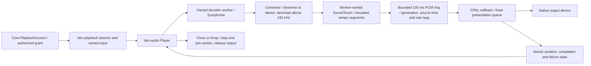
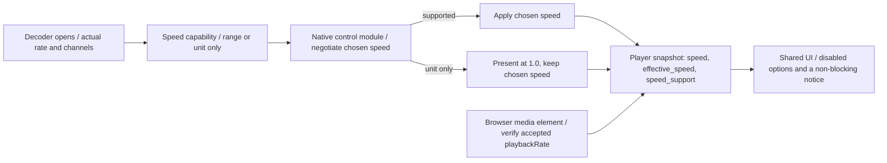
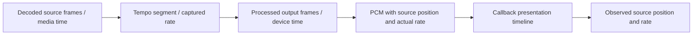
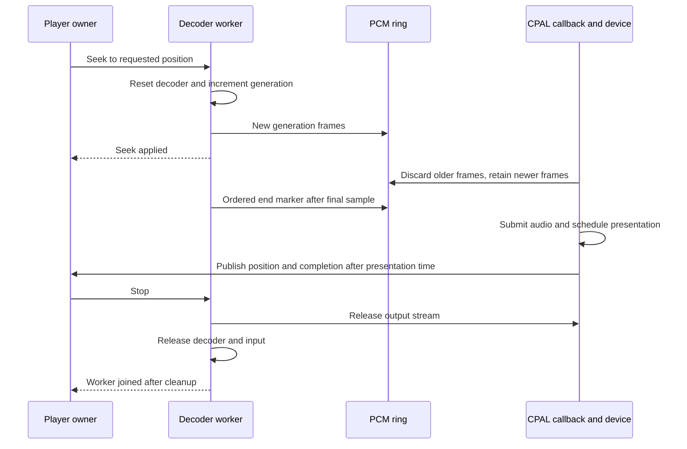

# Native audio engine

`hito-audio` decodes an owned input with Symphonia and, with its `device` feature, sends PCM through CPAL. The [native playback owner](native-playback.md) now supervises authorized local/provider input and session revocation around this engine. The Tauri shared UI uses authenticated native commands and observations. Rust owns queues, source recovery, output, and listening progress; ordinary web sessions retain browser playback.

## Ownership

The engine accepts an owned `Input`, including `std::fs::File`, with read/seek and length capabilities. It accepts no path, URL, account string, or renderer-supplied authority. A trusted input can perform I/O; `hito-playback::Source` obtains it through core's `PlaybackAccess` and retains its [playback access grant](playback-access.md). An opened file alone does not provide revocation.



`Decoder` exposes the actual decoded sample rate and channel count, interleaved float samples, seeking, and interruptible packet scanning. It preserves high-resolution samples. It rejects nonfinite PCM and changes in rate or channel count during a stream. Public errors contain static categories.

`Player` opens one input, starts paused, and owns resume, pause, seek, volume, speed, snapshots, and cleanup. Its worker owns both the decoder and output stream. Construction and control methods block. The native session owner calls them outside Tokio's asynchronous worker threads. Seeking waits for the decoder to apply the target, preserves paused state, and changes the PCM generation. The callback discards older generations and preserves frames newer than its current observation.

The output starts with silence and waits for two callbacks before returning readiness. This primes the device before application audio. Device selection requests a 20 ms period within its advertised bounds; the negotiated callback size may differ. Output requires the converted representation's exact rate and one or two channels, with float32, signed 16-bit, or unsigned 16-bit samples. The [conversion stage](#conversion-and-speed-capability) produces that representation; no other device-rate resampling exists yet.

The PCM ring holds 100 ms of frames. The callback performs no allocation, locking, decoding, filesystem access, networking, or logging. Its fixed presentation queue holds at most 1,024 points. Overflow becomes a typed output failure. Stale-frame work is bounded by ring capacity for each callback.

## Conversion and speed capability

Each decoded source has one capability, derived from its actual decoded sample rate and channel count before the output opens. `AudioFormat::speed_capability` reports either a range (0.5 to 3.0) or unit-only speed, and `Player::speed_capability` exposes it for the opened source. Every representation the decoder accepts has the full range, because the engine converts it first. The accepted representations are 1 to 32 channels at 8 to 192 kHz, or at one of the four standard high rates 352.8, 384, 705.6 and 768 kHz. `capability::supported` holds these bounds and both the decoder and the capability use it, so they cannot disagree. A rate above 192 kHz outside those four (for example 200, 220.5 or 250 kHz) would decimate onto a rate that output devices do not open, so the decoder rejects it with the typed `Unsupported` error instead of failing later at the device, and `AudioFormat::speed_capability` reports unit-only for it. No decoder-accepted source reports unit-only, so the unit-only path is exercised by owner unit tests and the browser path rather than by a native audio fixture.

`Converter` sits between the decoder and the time-stretcher and is the only place sample rate or channel count changes:

- A source at or below 192 kHz with one or two channels is forwarded unchanged: no sample is modified, so 1.0 playback of those sources is bit-exact.
- A source above 192 kHz is decimated by an integer factor (two for 352.8 and 384 kHz, four for 705.6 and 768 kHz, so the results are 176.4 kHz or 192 kHz, always in the 44.1 or 48 kHz family) with a 129-tap linear-phase Kaiser-windowed low-pass filter. Tests measure 1 kHz and 10 kHz tones at 384 kHz, a 3 kHz tone at 705.6 and 768 kHz kept within 2 percent of their amplitude and a 150 kHz tone, which would fold to 42 kHz, rejected below 0.2 percent of full scale (about 54 dB), so out-of-band content cannot fold into the audible band. They do not characterise the full passband ripple or compare against a reference resampler. The filter is centred on each output frame, so media time needs no latency offset, and trailing silence flushes the final frames at the end of the stream. This conversion applies at every speed, including 1.0: a stream cannot change its output rate while playing, and most output devices do not accept rates above 192 kHz, so the converted rate is the one the device opens.
- A source with more than two channels is mixed to stereo using its speaker positions. Front channels keep their side, centre channels feed both sides at -3 dB, surround and rear channels feed their side at -3 dB, and low-frequency channels are dropped. These ITU-R BS.775 style coefficients are not normalised, so a front-only signal keeps its stereo level (a front-only 5.1 tone measures the same as the same tone in stereo). A mix with content in many channels can sum above full scale, so a peak limiter follows the downmix: its gain is exactly 1 until a frame would pass full scale, drops at once to hold that frame at full scale, and returns to 1 over about 150 ms. Output samples of a downmix therefore never exceed full scale, and quiet or front-only material is not altered. The limiter is not applied to sources that are not downmixed. A layout without speaker positions (for example AIFF with more than three channels) uses the default speaker order for its channel count: 3 front left, front right, centre; 4 front pair and rear pair; 5 front pair, centre and rear pair; 6 front pair, centre, low-frequency and rear pair; 7 front pair, centre, low-frequency, rear centre and side pair; 8 front pair, centre, low-frequency, rear pair and side pair. Counts above eight alternate channels between left and right. Surround content therefore plays at every speed instead of failing at the output.

The processing is bounded: the filter keeps only its own history plus one decoded packet, output blocks are one packet, and cancellation reaches the decoder between packets exactly as before. Converted media time follows the decoder's packet times: each segment starts at a packet time, and a packet that does not continue the previous one by more than one converted frame starts a new segment, so a timeline gap is not smeared into drift. Positions never exceed the source duration. Seeking resets the filter and the limiter and restarts media time at the decoder's reported position; the first few output frames after a seek carry a filter transient shorter than a millisecond.



The native control module in `hito-playback` negotiates for each opened session. It applies the chosen speed when the source's capability supports it and otherwise leaves the session at unit speed without failing it. The chosen speed stays in the owner, so a later capable source applies it again. The owner snapshot reports `speed` (the chosen speed), `effective_speed` (derived by the owner from the chosen speed and the source's reported support, so it changes in the same snapshot as a speed command and engine updates cannot revert it) and `speed_support` (the range in thousandths, `1000`-`1000` for unit-only, absent while unknown). The browser player verifies after each source loads that the media element accepted the rate; a refused or throwing rate returns the element and its default rate to 1.0 and reports unit-only for that source, and the next source retries the chosen speed. Both players expose `speedRange` and `effectiveSpeed` through the shared player interface. The speed menu disables choices outside the range, and when the effective speed differs from the chosen one a non-blocking status line says that the source plays at 1× and that the chosen speed returns with a source that supports it.

## Tempo and media time

Native speed accepts finite rates from 0.5 to 3.0. The decoder worker uses bundled SoundTouch 2.3.2 through a private C ABI adapter and the pinned `soundtouch-ffi` library to change tempo while preserving pitch. A 1.0 rate bypasses processing. C++ constructs and deletes each processor; Rust owns its opaque handle through unconditional Drop. The C ABI contains native exceptions. SoundTouch owns its processing buffers on the worker; the callback only reads prepared frames. The dependency and license are recorded in [third-party notices](third-party-notices.md).

Each transition drains the current processor before starting the latest requested rate. The adapter calculates the expected segment output from genuine input frames and tempo, supplies bounded silence using the configured initial latency and input sequence size, verifies that the expected output exists, and trims padding before delivery. Failure to drain is an output error, never a successful empty ending. Padding does not advance media time. Already prepared audio keeps its original rate tag. The worker retains any unread raw samples, including when returning to 1.0 or reversing a pending transition. Changing speed neither seeks the input nor changes play/pause, so forward-only streams remain usable. Processing consumes chunks of at most 10 ms and returns at most 4,096 frames at a time. Input reads and output buffering can delay the rate becoming audible; a successful control reply acknowledges the request, not its presentation.



The bundled processor rejects sample rates above 192 kHz, so the [conversion stage](#conversion-and-speed-capability) hands it at most 192 kHz and at most two channels. A request outside the source's capability is rejected before changing its rate or playback state. Monitor fixtures cover tempo at 8, 16, 44.1, 48, 96, and 192 kHz, and converted 384 kHz, 352.8 kHz and 5.1 sources (705.6 and 768 kHz are covered by conversion tests but not yet by a monitor fixture) at unit speed, 2.0 and 0.5, including mid-playback speed changes, seeking and cleanup.

Positions, seeks, and duration use source media time. At 2.0, four seconds of source audio produce about two seconds of device audio. Each frame carries its source cursor and segment rate. Snapshots publish that rate when the corresponding audio is estimated to have played. A completion marker only advances position/completion and preserves the last presented rate, including a short clip ending within one callback or a seek directly to the end. Before any audio is presented, the observed rate starts at 1.0. Seeking resets the processor and generation while retaining the latest requested rate; output recovery uses the same reset at the last presented cursor.

## Position and completion

Decoder read-ahead does not advance playback position. The callback schedules source positions and the ordered end marker against CPAL's playback timestamps. Consecutive buffers cannot overlap, including the initial silent buffers. Later callbacks publish points after their estimated presentation time. One callback-owned atomic sequence publishes position, rate, and completion together. Worker seeks/recovery use a separate sequence for the base cursor and generation. Snapshot readers retry if either publication is incomplete or changed; the callback takes no lock. Completion therefore follows the final marker rather than an empty producer observation.

This is an estimate from the selected backend's clock, not proof of physical speaker timing. The Linux monitor test verifies the emitted signal. Other drivers and platforms need their own acceptance checks.

The Loom model uses the actual `State::present`, `reset`, and single observation-read attempt with modeled atomics. It checks presentation, resetting an ended observation, and a retiring callback concurrent with reset. Each writer performs one operation and the reader makes one attempt, with at most two thread preemptions and a [1,000-thread-switch execution limit](https://docs.rs/loom/0.7.2/loom/model/struct.Builder.html#structfield.max_branches). It checks observation consistency rather than progress of the retry loop. [Loom cannot model every relaxed-memory execution](https://docs.rs/loom/0.7.2/loom/#relaxed-memory-ordering), so this is bounded regression evidence, not proof for every platform. Run it separately with `sh scripts/check-audio-model.sh`; it uses `/build/loom-target` and does not compile CPAL, SoundTouch, or Tauri.



An ALSA underrun is recoverable. Its callback records a counter. The worker releases the broken stream, seeks to the last presented position, opens a fresh output stream and PCM ring, and acknowledges recovery. It allows at most three consecutive resets without 200 ms of playback progress. The output suppresses old queued audio until acknowledgment and resets its presentation timeline. Error handling is scoped to each stream so a fatal replacement error cannot disappear during recovery. Other device failures stop output and remain visible in snapshots. Full source failover belongs to the planned coordinator.

`stop_handle()` returns a cloneable terminal stop request independent of the player lock. It silences callbacks even while the worker is blocked, and prevents later resume or seek. Close and Drop request stop and join the worker. It releases the decoder, input, and output stream before the join returns. Packet scanning checks interruption between demuxed packets, including packets for other tracks. A blocked operating-system read, internal container seek, or driver call cannot be forcibly interrupted by this implementation. Real disconnected-drive behavior remains a release gate.

## Verification

After building the Docker tools images, run:

```sh
docker compose --profile tools build rust
docker compose --profile desktop build desktop
sh scripts/check-audio.sh
```

The desktop verification script also runs this check. Ordinary workspace builds keep CPAL disabled and need no ALSA development package.

The hardware-independent tests cover exact WAV samples, backward and zero seeks, nonfinite/truncated input, 24-bit precision, cancellation during a video-only tail, and trace-level log privacy. FFmpeg generates deterministic PCM16/PCM24/float WAV, FLAC, MP3, Vorbis, AAC-LC, ALAC, AIFF, and CAF fixtures. These checks establish decoding for those profiles, not every profile of each codec. Opus explicitly returns unsupported until fallback exists.

The Linux device check uses an unprivileged process, private temporary PulseAudio socket, clocked null sink, and its monitor. It measures real CPAL output for tone identity, pause silence, backward/zero seeking, volume, short-clip completion, restart after end, explicit close/Drop, and underrun recovery at 2.0. Tempo checks measure preserved pitch and output duration (including converted high-rate and surround sources), source-time progression, pause/seek behavior, forward-only input, rapid rate reversal, and final observed rate. It never mounts the normal server volume or personal music. Renderer and end-marker races also have deterministic callback-boundary tests.

Vendor diagnostics are suppressed only around Symphonia calls because malformed media can enter its log messages. Hito retains safe decoder readiness, seek, speed requests, tempo transitions, output, recovery, failure, and cleanup events. Player spans use a process-local audio ID. No media bytes or private paths enter those events.

## Remaining integration

The [application coordinator](native-coordinator.md) supplies authorized recording/source IDs, stable queue entries, bounded source attempts, progress persistence, and account/session command fencing. The desktop retains native cleanup through shutdown. Its HTTP adapter reuses server authentication and local process protection. React sends commands and observes snapshots through the shared player interface; web sessions keep the browser implementation. FFmpeg fallback, resampling to arbitrary device-supported rates, gapless, and platform/hardware acceptance remain unfinished.

FFmpeg fallback, resampling to a rate the output device supports (only decimation above 192 kHz exists), gapless preparation, device selection/media controls, platform verification, and release latency targets remain unfinished. Linux monitor evidence does not establish speed quality across all codecs, physical devices, or platforms. The [release plan](release-plan.md) and [TODO](../TODO.md) retain those requirements.

The pinned [Symphonia documentation](https://docs.rs/symphonia/0.6.1/symphonia/) lists codec and gapless limitations. [CPAL](https://docs.rs/cpal/0.18.2/cpal/) defines callback/device behavior, and [rtrb](https://docs.rs/rtrb/0.4.0/rtrb/) supplies the fixed-capacity SPSC ring.
