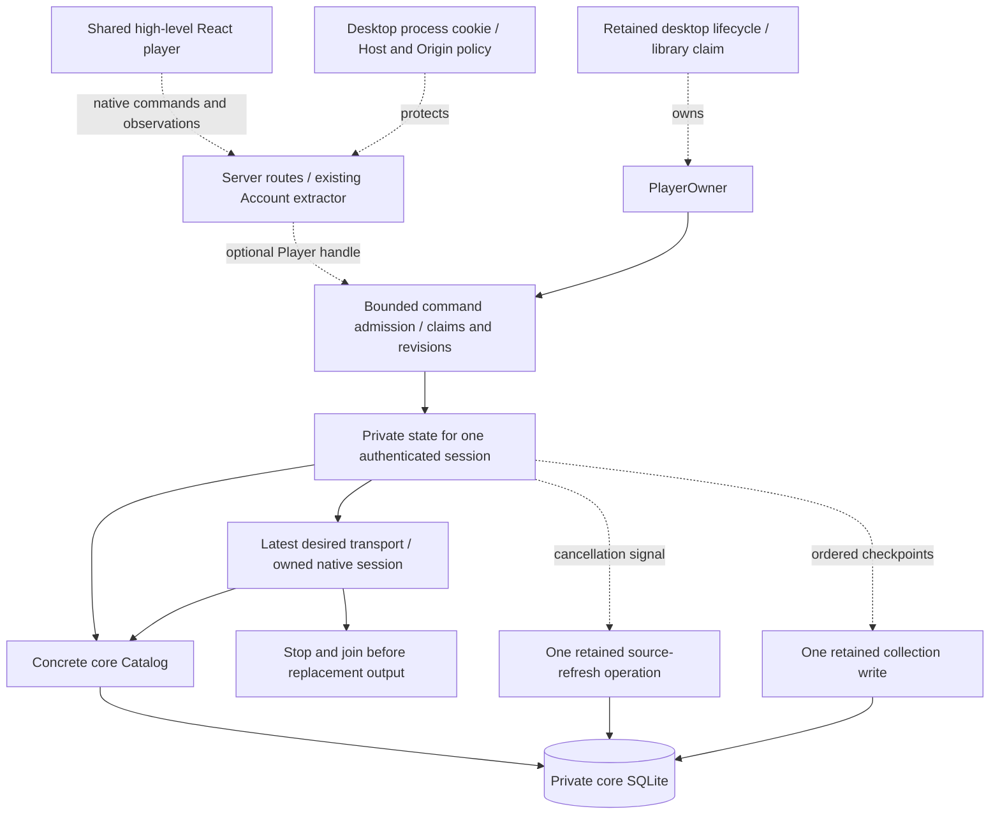

# Native application coordination

`hito-playback::Player` owns authenticated command admission and an in-memory queue. With the `device` feature, `Player::native` drives the existing [native session](native-playback.md) through core-authorized source grants. `Player::start` remains a queue-only owner and reports native output unavailable. Source recovery, progress persistence, HTTP routes, desktop lifecycle wiring, and the React adapter remain planned below. The desktop application still uses browser audio.

## Public boundary

The cloneable `Player` handle accepts authenticated core actors and typed actions. A retained `PlayerOwner` joins admission and native cleanup. Shutdown closes observation channels, cancels read-only preparation, requests terminal native stop, and waits for the session join. No write effects are connected yet. The application will retain this owner through audio cleanup and admitted transactions when host wiring is added. Renderer input will contain recording IDs, stable queue-entry IDs, validated controls, and ordering tokens.

Solid arrows show current command/queue, native ownership, and core reads. Dashed arrows show unfinished application integration and write effects. One retained supervisor owns claims, commands, and concrete core services. Device substitution can be added when a second implementation or deterministic scheduling test requires it. Public command fixtures use actual CPAL output through an isolated clocked monitor.

The current Rust operations are:

- Inspect the device epoch and return private state only for the matching authenticated session. Inspection never claims playback.
- Claim using the observed epoch. Compare it at admission after authentication, rotate the command lease, and return an authoritative attachment. A stale claim fails without a blind retry.
- Submit a typed command with the lease, a client sequence allocated at user intent, and the current revision. Commands never claim implicitly.
- Read or subscribe using the exact actor/session and lease. Structural state and playback position have separate watch channels. Old account subscriptions close before another account's state is published.
- Page queue metadata through a fresh core catalog lookup using the lease and expected revision.
- Close the retained lifecycle owner. Dropping the owner also signals shutdown; the surrounding host must retain its runtime until cleanup finishes.

Same-session attachment preserves the queue and selection while rotating the command lease and closing previous observations. A different login session begins empty, including another login for the same account. Inspection returns no private state for a different session. A separate monitor checks retained session authority every 250 ms through core's one-second deadline. A failed check currently clears ownership and the queue, including a transient authority failure. Protected queue recovery across such failures remains work before release.

Commands support Replace, Append, Select, Next, Move, Remove, Clear, Resume, and Pause. Queue mutations increment the revision. Resume and Pause leave it unchanged unless Resume selects the first entry of a nonempty queue without a current entry. Selection has a separate generation: moving or appending keeps it, selecting or changing the current entry advances it. The last 64 accepted command payloads and receipts are retained per lease. An identical retry returns its original receipt without another mutation or metadata lookup. A conflicting payload with a retained request ID fails; an evicted original retry still fails its stale sequence. This is bounded process-local replay, not a durable journal.

Same-session attachment preserves desired play/pause, selection, observed position, and accepted native work. Changing sessions requests terminal stop on the old engine and retains it until joined. Native updates carry an ownership scope, selection generation, and entry ID; a lease rotation for the same session does not restart output. Device epoch, command lease, queue revision, selection generation, and future source attempts identify different kinds of ordering; one counter cannot replace all of them.

The native React adapter will serialize acceptance receipts for causal queue mutations. Receipts do not wait for decoding or playback. This permits Next to supersede an opening source while preserving Play-then-Next order. Repeated requests need bounded receipt replay so a lost response cannot apply Next twice. Existing discovery selection tickets must still prevent late adoption from replacing a newer intention.

## Queue and effect ownership

Every occurrence receives its own stable entry ID, including duplicate recordings. The queue retains only entry and recording UUIDs. Structural snapshots contain counters and the current reference, without copied metadata or position ticks. Queue pages resolve metadata through `Catalog::recordings_by_ids`, preserving order, duplicates, account-effective fields, and current membership checks. A missing or inaccessible batch is rejected as a whole. Queue mutation admission checks session liveness and rechecks ownership and ordering after preparation.

Replace/Append accept at most 1,000 IDs each. The current queue limit is 100,000 entries; pages contain 1 to 1,000 entries. Admission retains at most 32 queued requests and one in-flight read-only preparation. Session checks have their own lane. Public fixtures exercise 100,000 queue occurrences of one owned recording, separate pages, input/capacity rejection, account transfer, and live metadata withdrawal. The separate core fixture directly seeds 100,000 recording rows in SQLite; it does not scan 100,000 audio files. Neither establishes release throughput or p95 latency.

Move and remove address entry IDs. Moving preserves the current selection; removing it selects its successor or leaves no current entry at the end. Appending does not select or start an item. Natural completion advances to the next entry. Previous, shuffle traversal, repeat, and failure traversal remain unimplemented. They must follow actual played history, keep canonical order separate, apply repeat-one only to natural completion, and visit failed entries finitely.

The supervisor keeps fixed effect lanes selectable beside admission, session monitoring, and shutdown. Refresh and progress lanes remain planned:

| Work | Ownership and bound |
| --- | --- |
| Read-only selection/admission | One replaceable lookup or source-grant operation, with core deadlines |
| Native device | One active/opening session or retiring session; replacement waits for the previous join |
| Native control | One in-flight control and desired play/pause; public seek/volume remain planned |
| Provider refresh, planned | One retained operation, canceled by signal before publication, plus latest pending demand |
| Progress, planned | One retained write plus a bounded checkpoint buffer and reserved terminal capacity |

Supersession drops read-only observation/control futures, requests terminal native stop, and retains cleanup. Replacement output waits for that join while command admission remains responsive. A genuine OS or driver stall can delay replacement output. Adding write effects must retain them through completion rather than dropping their futures.

A native session starts paused. The current coordinator applies desired play/pause after readiness. If Pause supersedes an in-flight Resume, it stops and rebuilds the session paused, restoring observed position before a later resume. Already submitted device audio can drain before the observed position settles. Future seek/volume controls must apply their latest desired values before resuming. Recovery must preserve an explicit backward or zero seek in preference to an older observed position.

Core's `preferred_playback_source` selects one cached ready grant under a one-second deadline. It checks local candidates for the owning host using the existing ready-source index, then the current provider snapshot. It does not materialize unavailable source history. The deadline and one-row result do not establish a constant work bound across arbitrary ready candidates. A failure remains visible on the current entry; Resume can retry. It does not yet try alternatives or refresh providers. The remaining recovery work must try each cached source once, then one refreshed phase. Refreshed sources may reuse an ID with new stream authority. If refresh fails, reread the current cache once for a peer's accepted update. Exhaustion must record a safe failure and advance the finite queue traversal. Session withdrawal ends account ownership; withdrawing one source should recover through another authorized source of the recording.

## Cancellation and progress

`Catalog::refresh_sources_until` observes a supplied cancellation future during read-only preparation/provider work and immediately before publication. It returns `None` when canceled before publication. After publication admission it completes commit or explicit rollback and returns its result. The coordinator must signal cancellation and retain/poll that operation until completion. Dropping or aborting the whole future is outside this contract.

Progress uses observed device position, periodic samples, and terminal checkpoints at pause, seek completion, transition, completion, and shutdown. Preserve zero/backward seeks and prevent a pre-seek sample from overwriting a later target. Retry an immutable operation with its original UUID. A dedicated synchronization client identity remains separate from backend `HostDeviceId`.

Checkpoint memory is bounded. Coalesce periodic samples while retaining ordered terminal checkpoints. Reserve terminal space before starting another entry, and delay ordinary transitions when the writer backlog is full. Clear, logout, and shutdown must still stop output. Persistence errors remain visible. Guaranteed progress retention through disk failure needs core-owned durable storage; memory cannot provide that guarantee.

## Host, HTTP, and UI integration

Native routes belong inside `hito-server` so they reuse its `Account` extractor, browser security, safe input extraction, telemetry, and generated OpenAPI. An optional player handle enables them for the desktop backend. The complete router remains inside desktop process protection. Ordinary server/browser playback continues through its existing implementation.

The retained desktop host task must stop and join playback alongside HTTP/indexing before releasing its library claim. Dropping a shutdown observer must not release that claim. The runtime must remain alive through engine cleanup and admitted transactions.

React will consume a typed high-level player contract with browser and native implementations. Structural queue state and position updates remain separate subscriptions. Pages do not subscribe to position ticks. Native speed must report unsupported until the engine implements it.

Acceptance must cover stale claims and reordered commands, same-account distinct sessions, reload leases, old subscription privacy, duplicate queue entries, natural transitions, finite failures, gated provider supersession, current-position recovery, paused recovery, checkpoint ordering/backpressure, and canceled host shutdown. Use real temporary core databases, owned audio/provider fixtures, and the isolated CPAL monitor. These checks add to the [release gates](release-plan.md); they do not replace platform, hardware, gapless, or latency acceptance.
