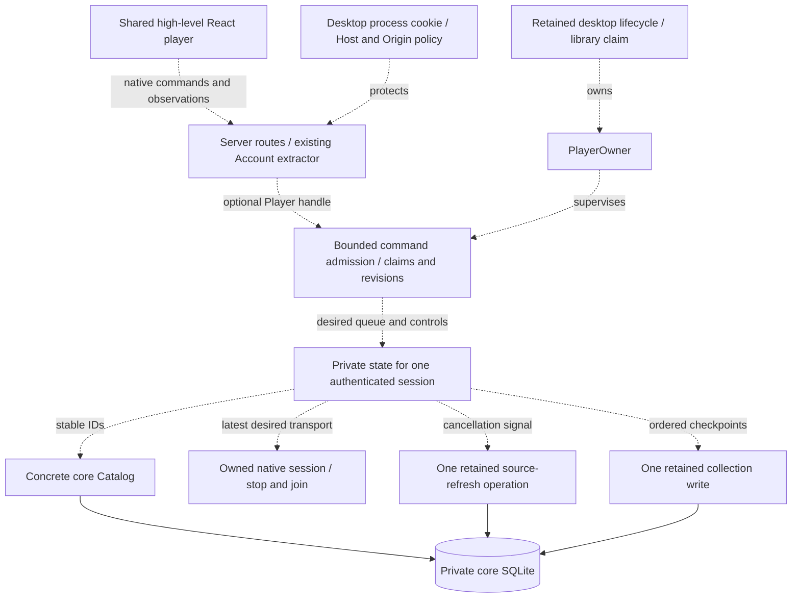

# Native application coordination

This is the selected design for connecting native playback to the desktop application. The coordinator, HTTP routes, and React adapter are not implemented yet. The current [native session](native-playback.md) owns one authorized input and device lifetime. Core now supplies ordered recording lookup, opaque session comparison, live session checks, transactional progress/refresh fencing, and cooperative refresh cancellation.

## Public boundary

The application will own one cloneable `Player` handle and a retained `PlayerOwner`. The handle accepts authenticated actors and high-level queue actions. The owner stops admission, requests silence, and joins native work and started writes. Renderer input consists of recording IDs, stable queue-entry IDs, validated controls, and ordering tokens.

One retained supervisor owns claims, commands, and concrete core services. Device substitution can be added when a second implementation or deterministic scheduling test requires it. Actual CPAL fixtures remain the evidence for silence and native cleanup.

The planned operations are:

- Inspect the device epoch and return private state only for the matching authenticated session. Inspection never claims playback.
- Claim using the observed epoch. Compare it at admission after authentication, rotate the command lease, and return an authoritative attachment. A stale claim fails without a blind retry.
- Submit a typed command with the lease, a client sequence allocated at user intent, and the queue revision for relative edits. Commands never claim implicitly.
- Read or subscribe using the exact actor/session and lease. Old account subscriptions close before another account's state is published.
- Stop and join through the retained lifecycle owner, independently of HTTP response observers.

Same-session attachment preserves the queue, desired controls, and accepted native work while rotating the command lease. A different login session begins empty, including another login for the same account. The old engine stops immediately and remains owned until joined. Device epoch, command lease, queue revision, selection generation, and native attempt identify different kinds of ordering; one counter cannot replace all of them.

The native React adapter will serialize acceptance receipts for causal queue mutations. Receipts do not wait for decoding or playback. This permits Next to supersede an opening source while preserving Play-then-Next order. Repeated requests need bounded receipt replay so a lost response cannot apply Next twice. Existing discovery selection tickets must still prevent late adoption from replacing a newer intention.

## Queue and effect ownership

Every occurrence receives its own stable entry ID, including duplicate recordings. Core resolves IDs with `Catalog::recordings_by_ids`. A lookup accepts at most 1,000 IDs, preserves order and duplicates, checks current session/membership, and returns account-effective metadata. It rejects an entire missing or inaccessible batch. That is a lookup batch limit, not a chosen final queue limit. Larger queues need bounded batching and paged presentation.

Move and remove address entry IDs. Moving the current entry preserves its engine. Removing it selects its successor. Canonical queue order stays separate from shuffle traversal and played history. Previous follows actual history. Repeat-one applies to natural completion; explicit navigation still advances. Automatic failure traversal visits eligible entries finitely, so repeat/shuffle cannot create an endless failure loop.

The supervisor keeps fixed work lanes selectable beside admission, authorization, cancellation, and shutdown:

| Work | Ownership and bound |
| --- | --- |
| Read-only selection/admission | One replaceable lookup or source-grant operation, with core deadlines |
| Native device | One active/opening session or retiring session; replacement waits for the previous join |
| Native control | One in-flight control and the latest desired seek/play/volume values |
| Provider refresh | One retained operation, canceled by signal before publication, plus latest pending demand |
| Progress | One retained write plus a bounded checkpoint buffer and reserved terminal capacity |

Each effect completion carries its owner, selection, entry, and attempt identity. Stale results cannot publish metadata, position, errors, or playback. Supersession drops read-only observation/control futures, requests terminal native stop, and retains cleanup. It never drops a started write future. A genuine OS or driver stall can delay replacement output; admission and state remain responsive through a releasing-device phase.

A native session starts paused. Apply the latest desired seek and volume before resuming. Recovery preserves an explicit backward or zero seek in preference to an older observed position. A blocked seek may require stopping and rebuilding the engine to apply a newer pause or selection safely.

Try cached ready sources in core order, with local audio first. Try each source once, then one refreshed phase. Refreshed sources may reuse an ID with new stream authority. If refresh fails, reread the current cache once for a peer's accepted update. Exhaustion records a safe failure and advances the finite queue traversal. Session withdrawal ends account ownership; withdrawing one source can recover through another authorized source of the recording.

## Cancellation and progress

`Catalog::refresh_sources_until` observes a supplied cancellation future during read-only preparation/provider work and immediately before publication. It returns `None` when canceled before publication. After publication admission it completes commit or explicit rollback and returns its result. The coordinator must signal cancellation and retain/poll that operation until completion. Dropping or aborting the whole future is outside this contract.

Progress uses observed device position, periodic samples, and terminal checkpoints at pause, seek completion, transition, completion, and shutdown. Preserve zero/backward seeks and prevent a pre-seek sample from overwriting a later target. Retry an immutable operation with its original UUID. A dedicated synchronization client identity remains separate from backend `HostDeviceId`.

Checkpoint memory is bounded. Coalesce periodic samples while retaining ordered terminal checkpoints. Reserve terminal space before starting another entry, and delay ordinary transitions when the writer backlog is full. Clear, logout, and shutdown must still stop output. Persistence errors remain visible. Guaranteed progress retention through disk failure needs core-owned durable storage; memory cannot provide that guarantee.

## Host, HTTP, and UI integration

Native routes belong inside `hito-server` so they reuse its `Account` extractor, browser security, safe input extraction, telemetry, and generated OpenAPI. An optional player handle enables them for the desktop backend. The complete router remains inside desktop process protection. Ordinary server/browser playback continues through its existing implementation.

The retained desktop host task must stop and join playback alongside HTTP/indexing before releasing its library claim. Dropping a shutdown observer must not release that claim. The runtime must remain alive through engine cleanup and admitted transactions.

React will consume a typed high-level player contract with browser and native implementations. Structural queue state and position updates remain separate subscriptions. Pages do not subscribe to position ticks. Native speed must report unsupported until the engine implements it.

Acceptance must cover stale claims and reordered commands, same-account distinct sessions, reload leases, old subscription privacy, duplicate queue entries, natural transitions, finite failures, gated provider supersession, current-position recovery, paused recovery, checkpoint ordering/backpressure, and canceled host shutdown. Use real temporary core databases, owned audio/provider fixtures, and the isolated CPAL monitor. These checks add to the [release gates](release-plan.md); they do not replace platform, hardware, gapless, or latency acceptance.
