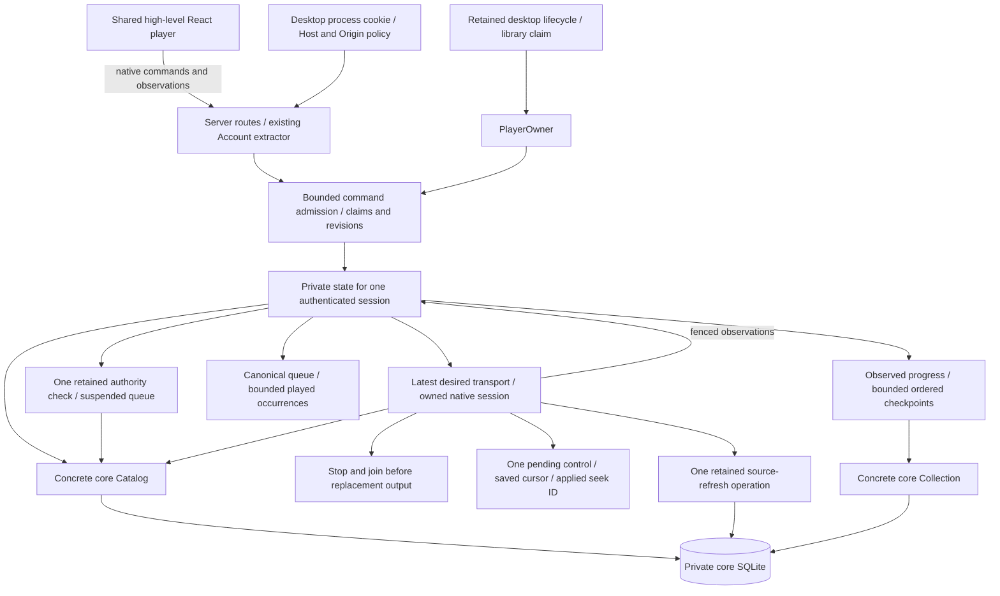
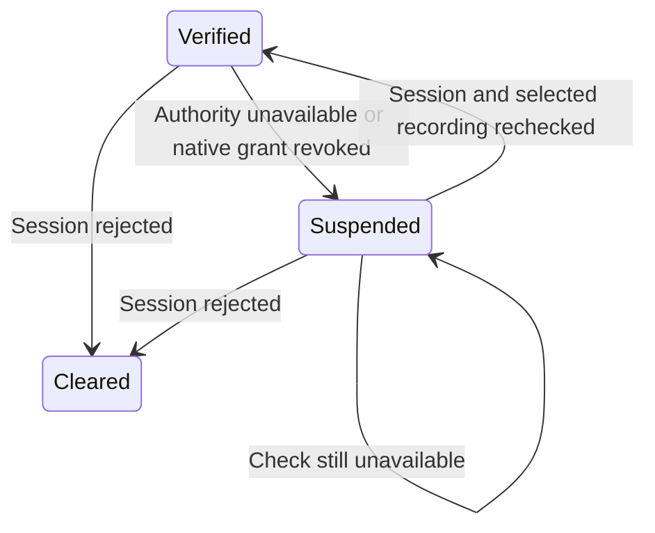
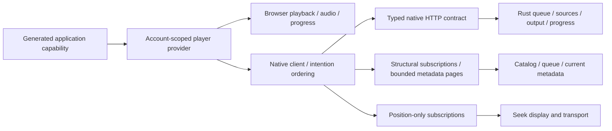

# Native application coordination

`hito-playback::Player` owns authenticated command admission and an in-memory queue. With the `device` feature, `Player::native` drives the existing [native session](native-playback.md) through core-authorized source grants, recovers through alternatives, advances after exhaustion, and persists observed listening progress. The desktop's shared React UI uses that owner through authenticated HTTP. Ordinary web sessions retain browser playback. `Player::start` remains a queue-only owner and reports native output unavailable.

## Public boundary

The cloneable `Player` handle accepts authenticated core actors and typed actions. A retained `PlayerOwner` joins admission, native cleanup, and progress writes. Shutdown closes observation channels, cancels read-only preparation, requests terminal native stop, and waits for the session join and admitted provider/progress publication. The desktop backend retains this owner alongside HTTP/indexing cleanup before releasing its library claim. Renderer input contains recording IDs, stable queue-entry IDs, validated controls, and ordering tokens.

The arrows show current React, HTTP, Rust, and host ownership. One retained supervisor owns claims, commands, and concrete core services. Public command, protected desktop HTTP, and actual Tauri UI fixtures use CPAL output through an isolated clocked monitor.

The current Rust operations are:

- Inspect the device epoch and return private state only for the matching authenticated session. Inspection never claims playback.
- Claim using the observed epoch. Compare it at admission after authentication, rotate the command lease, and return an authoritative attachment. A stale claim fails without a blind retry.
- Submit a typed command with the lease, a client sequence allocated at user intent, and the current revision. Commands never claim implicitly.
- Read or subscribe using the exact actor/session and lease. Structural state and playback position have separate watch channels. Old account subscriptions close before another account's state is published.
- Page queue metadata through a fresh core catalog lookup using the lease and expected revision.
- Close the retained lifecycle owner. Dropping the owner also signals shutdown; the surrounding host must retain its runtime until cleanup finishes.

Same-session attachment preserves the queue and selection while rotating the command lease and closing previous observations. A different login session begins empty, including another login for the same account. Inspection returns no private state for a different session. A separate monitor checks retained session authority every 250 ms through core's one-second query deadline. Definitive session rejection clears ownership and closes its private observations. Temporary authority failures suspend output while preserving the exact queue and attachment.

Commands support Replace, Append, Select, Next, Previous, Move, Remove, Clear, Resume, Pause, Seek, and Volume. Queue mutations increment the revision. Transport controls leave it unchanged unless Resume selects the first entry of a nonempty queue without a current entry. Previous changes revision when it selects a past occurrence; restarting the current one is a seek. Seek uses nonnegative integer milliseconds within JavaScript's exact integer range and requires a selected entry. Volume uses an integer level from 0 to 1,000, where 0 is mute and 1,000 is full volume. Native controls return Unsupported on the queue-only owner. Selection has a separate generation: moving or appending keeps it, selecting or changing the current entry advances it. The last 64 accepted command payloads and receipts are retained per lease. An identical retry returns its original receipt without another mutation or metadata lookup. A conflicting payload with a retained request ID fails; an evicted original retry still fails its stale sequence. This is bounded process-local replay, not a durable journal.

Same-session attachment preserves desired play/pause, selection, observed position, and accepted native work. Changing sessions requests terminal stop on the old engine and retains it until joined. Native updates carry an ownership scope, selection generation, and entry ID; a lease rotation for the same session does not restart output. Device epoch, command lease, queue revision, selection generation, and future source attempts identify different kinds of ordering; one counter cannot replace all of them.

The native React adapter serializes acceptance receipts for causal queue mutations. Receipts do not wait for decoding or playback. This permits Next to supersede an opening source while preserving Play-then-Next order. Exact immutable retries use the retained receipt so a lost response cannot apply Next twice. Discovery selection tickets prevent late adoption from replacing a newer intention.

## Queue and effect ownership

Every occurrence receives its own stable entry ID, including duplicate recordings. The queue retains only entry and recording UUIDs. Structural snapshots contain counters and the current reference, without copied metadata or position ticks. Queue pages resolve metadata through `Catalog::recordings_by_ids`, preserving order, duplicates, account-effective fields, and current membership checks. A missing or inaccessible batch is rejected as a whole. Queue mutation admission checks session liveness and rechecks ownership and ordering after preparation.

Replace/Append accept at most 1,000 IDs each. The current queue limit is 100,000 entries; pages contain 1 to 1,000 entries. Admission retains at most 32 queued requests and one in-flight read-only preparation. Session checks have their own lane. Public fixtures exercise 100,000 queue occurrences of one owned recording, separate pages, input/capacity rejection, account transfer, and live metadata withdrawal. The separate core fixture directly seeds 100,000 recording rows in SQLite; it does not scan 100,000 audio files. Neither establishes release throughput or p95 latency.

Move and remove address entry IDs. Moving preserves the current selection; removing it selects its successor or leaves no current entry at the end. Appending does not select or start an item. Natural completion advances to the next entry. Source exhaustion also advances when playback is desired, stopping at queue end. A paused exhausted entry stays selected and failed. Previous follows observed played occurrences. Shuffle and repeat remain unfinished; they must preserve canonical order, and repeat-one must apply only to natural completion.

The supervisor keeps fixed effect lanes selectable beside admission, session monitoring, and shutdown:

| Work | Ownership and bound |
| --- | --- |
| Read-only selection/admission | One replaceable lookup or source-grant operation, with core deadlines |
| Native device | One active/opening session or retiring session; replacement waits for the previous join |
| Native control | One in-flight control, desired play/pause/volume, and a retained explicit seek target |
| Provider refresh | One retained operation, canceled by signal before publication, plus latest pending demand |
| Progress | One retained write, at most 64 queued/active checkpoints, and one coalesced observed sample |

Supersession drops read-only observation/control futures, requests terminal native stop, and retains cleanup. Replacement output waits for that join while command admission and retained publication remain responsive. Source results may arrive during retirement, but only the guarded session-start path can open their input. A genuine OS or driver stall can delay replacement output. Admitted write effects stay owned through completion.

A native session starts paused. The control module applies volume, the retained seek target, and desired play/pause after readiness. If Pause or a newer seek/volume supersedes an in-flight control, the session retires before replacement. A pending explicit seek, including zero or a backward target, takes precedence over an older observed cursor. Once configuration completes, later recovery uses the actual observed position. Already submitted device audio can drain before pause settles.

Structural snapshots expose desired volume and whether a seek remains pending. Separate position observations carry `seek_id`, the UUID of the last completed seek command. A receipt confirms command acceptance; matching `seek_id` confirms application. During restoration, Opening observations retain the intended cursor without acknowledging it as a completed seek. Known media duration clamps seek position. A seek accepted as a track finishes can still configure that ended session, preventing a stalled Opening state. Same-session reattachment retains controls and completed seek identity. Another login receives fresh defaults, including full volume. Volume persists across selections; seek targets belong to one selection. Speed remains unsupported by the native engine.

Core's opaque `PlaybackCandidates` cursor selects ready local grants for the owning host, then grants from the captured provider generation. It rechecks live session and recording access on each advance. Each source is visited once per phase. Local traversal has an ID ceiling and a finite initial budget; provider snapshots contain at most sixteen sources. Concurrent changes can alter eligibility within those bounds. The cursor retains no source vector, transaction, or audio locator. Construction and each advance have a one-second deadline. The local count/ceiling prepass grows with ready rows; the 100,000-row fixture covers unavailable history, not arbitrary ready-candidate latency.

After cached candidates fail, native recovery attempts one provider refresh and rereads current candidates once, even if refresh fails. A refreshed source may reuse the same Hito source ID with new authority. Recovery stops and joins the previous session, restores its observed position, and applies current play/pause before playback. A paused source withdrawal can recover without producing audio. A source's withdrawal does not end account ownership. Unauthorized results clear ownership. Unavailable candidate authorization or a revoked native grant suspends output and command admission before trying fresh sources.

Structural snapshots expose the current Hito source ID and the latest exhausted-entry failure as typed error and stable entry/recording references. This is one bounded failure record, not durable history. Exhaustion while playing continues to the next occurrence; a queue of failed duplicates finishes finitely. Manual Resume can retry a paused failed entry. Source preferences, manual overrides, debrid preparation, and deferred-track reconsideration remain unfinished.

## Played occurrences and Previous

The queue retains at most 100,000 recent played occurrence UUIDs, separately from canonical queue order. A verified Ready observation records a playing occurrence, or a completed occurrence while playback was desired. Ownership scope, selection, entry, and applied seek identity must match. Paused selection, opening, stale observations, and sources that fail before playback do not add history. Consecutive observations of the same occurrence coalesce. This is observed native traversal state, separate from core's persisted listening activity.

Previous restarts the current occurrence at zero after more than three seconds. Otherwise it returns to the prior played occurrence. With no prior history, a selected occurrence restarts at zero. A pending seek target takes precedence over an older observed position. Restarting uses the existing seek workflow and command UUID, preserving queue revision and selection generation. Returning through history selects a stable occurrence and increments both. Receipt replay cannot apply either action twice. Desired play/pause is preserved.

Moving entries leaves history intact. Removing an occurrence removes its visits from history. Clear and Replace discard the old generation's history. Same-session attachment retains it; a different login begins empty. Previous can return from queue end to the last played occurrence, remaining paused because completion stopped desired playback. The private structural snapshot exposes only `can_previous`, not the history list. The UI can enable Previous without current metadata or a selected entry. A fully cleared queue disables it.

History adds constant work to accepted native observations. Returning through history and editing the queue can scan bounded in-memory IDs; no catalog or metadata query runs per position tick. These bounds do not establish large-queue latency targets. History is process-local and does not survive application restart.

## Temporary authority failure

`Suspended` means access cannot currently be verified. It stops native output, retains and joins cleanup, and cancels read-only source selection. The queue, stable occurrence IDs, revision, lease, desired play/pause, volume, and observed cursor remain in memory. Commands cannot mutate that state while suspended. An exact accepted-command retry may return its original receipt after a fresh session check; it cannot apply a second mutation. Metadata pages still require live core authorization.

The monitor owns one retained check beside admission, cleanup, progress, and provider publication. Recovery validates the captured session and at most one selected recording through core. A successful check started before suspension cannot restore playback. A missing recording permits normal finite source-failure handling after recovery; a rejected session clears private ownership. Persistent unavailability keeps the queue suspended without advancing it. Native grant revocation also suspends before a retiring session has joined, closing the admission window before fresh candidate checks.

Recovery uses fresh grants after the previous native session joins. It restores the same occurrence near its observed position and keeps paused selections silent. The UI explains that playback paused while access is checked. A failed metadata request preserves known track details and that explanation; after recovery, any retained progress-persistence warning remains visible. Safe suspension/restoration events include account correlation without session material or metadata.

Owned temporary SQLite fixtures rename authority tables to cause real query failures. They verify retained duplicate entries and receipts, rejected mutations, source-only failure with a still-valid session, silent output, recovery, and definitive revocation. An event gate holds actual native cleanup open to prove admission is suspended before fresh candidates can mask the failure. This does not prove disconnected-drive behavior, disk exhaustion, crash durability, or queue persistence after process exit.

## Cancellation and progress

`Catalog::refresh_sources_until` observes a supplied cancellation future during read-only preparation/provider work and immediately before publication. It returns `None` when canceled before publication. The native owner uses `refresh_playback_sources_until`, which shares the same publication behavior and returns completion without materializing retained source history. After publication admission, both operations complete commit or explicit rollback. The coordinator signals cancellation and retains/polls the operation until completion, including after a canceled close observer. Dropping or aborting the whole future is outside this contract.

Progress accepts only Ready observations for the current ownership scope, selection, entry, and applied seek identity. Opening cursors and superseded seek frames cannot become saved progress. Merely selecting a paused recording creates no history. The first playing observation creates a checkpoint; a first observation that already reports completion does too. Subsequent position ticks coalesce into one sample. A five-second timer enqueues that sample when the writer has no backlog. Pause, completed seek, selection exit, natural completion, and shutdown checkpoint the latest observed position. Zero and backward seeks remain valid values.

The writer submits immutable `ProgressSet` operations through core `Collection::apply`, which owns the transaction, session check, and recording access check. It retries the same UUID, payload, and synchronization client identity in FIFO order after a 250 ms delay. This `native-<UUID>` client identity belongs to the player owner and is separate from backend `HostDeviceId`. Native speed is currently 1.0. The writer does not load saved positions when starting a new selection.

Memory is bounded to 64 queued/active checkpoints plus one retained sample. Ordinary command admission returns Busy at 60 checkpoints, reserving room for terminal events. Pause, Volume, and Clear remain available. If the buffer fills, the latest dirty sample stays retained and a different selection cannot start until capacity returns. Periodic ticks do not queue behind terminal checkpoints. Persistence failures are visible through `PlayerSnapshot.persistence_error`; a successful write for the same ownership scope clears that status. Old-account results cannot change a new account's status or activity.

Shutdown keeps any started write future polled through commit or rollback, even when its close observer is canceled. It joins native cleanup alongside progress flushing. Lost authority rejects the old checkpoint without retrying it. Other final write failures return `PlayerError::Persistence`; later queued checkpoints can remain unsaved in that case. Checkpoints are process-local until core commits them. Crash recovery, a durable offline outbox, and guaranteed progress retention through disk failure remain unfinished. Shutdown saves the last observed position, without claiming the exact final device frame.

## Host and HTTP integration

Native routes live inside `hito-server` and reuse its `Account` extractor, browser security, safe input extraction, telemetry, and generated OpenAPI. `router_with_player` supplies the desktop's player. The complete router remains inside desktop process protection, including native routes and event streams. An ordinary server reports `native: false`, a null epoch, and no private state; claims are unsupported there. Authentication is required for inspection even when native playback is disabled. Ordinary server/browser playback continues through its existing implementation.

| Method | Path | Result |
| --- | --- | --- |
| GET | `/api/v1/player` | Native availability, observed epoch, and matching-session structural state; never claims |
| POST | `/api/v1/player/claim` | Compare the supplied epoch and return a new lease/attachment |
| POST | `/api/v1/player/commands` | Admit the typed command and return its acceptance receipt |
| POST | `/api/v1/player/queue` | Resolve an authorized metadata page for the supplied lease/revision/offset/limit |
| POST | `/api/v1/player/state/events` | SSE data frames containing `PlayerSnapshot` |
| POST | `/api/v1/player/position/events` | SSE data frames containing `PlayerPosition` |

Request bodies use generated Rust schemas. Commands use the `kind` tag and reject unknown fields, including source locators. Claims, queue pages, and observations carry ordering values in JSON bodies, keeping them out of URLs. Browser calls must carry the normal request marker and expected account header. Mutation origin checks and desktop Host/Origin/process-cookie checks apply before command admission. Busy responses use HTTP 429 and Retry-After; stale ordering uses 409. Typed backend failures become safe HTTP errors.

Streams publish the latest value initially, then coalesce watch updates. They close when their lease/session closes, including logout. They check closure before reading a cached value. At most 32 observation responses may remain open per router, across both stream kinds. Each response owns its permit until completion or cancellation. The payloads contain references and counters rather than queue metadata. Frames use `private, no-store` and keepalive comments. Clients must fence delayed frames by their captured account and attachment, and reconnect with the same lease rather than silently claiming ownership.

The retained desktop backend task stops and joins playback alongside HTTP/indexing before releasing its library claim. Dropping a shutdown observer leaves this task running. The `gui` feature includes `device` and selects `Player::native`; a headless build without `device` supplies the queue-only constructor. Owner failures, including a failed final progress flush, reach `Error::Shutdown` after joined cleanup. Existing Session cleanup join failures still emit a safe warning rather than propagate through PlayerOwner. The runtime must remain alive through engine cleanup and admitted transactions.

The network server and connection tasks retain their tracing subscriber. Observation cleanup retains its request span even after headers have returned. Safe events correlate request, player owner, account, command, and observation IDs without logging leases or private payloads.

## Shared UI integration

The generated `native_playback` Inertia prop selects the implementation of the shared `Player` contract. Browser playback retains its audio element, source resolution, queue, and progress workflow. Native mode instantiates none of those browser effects: Rust owns queue/source decisions, output, recovery, and progress. Disposing the native client cancels its observations and metadata reads; it does not clear or stop the Rust queue. Reloading the same authenticated session can reattach without restarting output. Logout or host shutdown stops output through Rust authority and lifecycle ownership.

`NativeSession` owns the attachment, stream lifetimes, command lane, and exact retries. `NativeCommands` translates shared user actions and fences asynchronous discovery adoption. `NativePlayback` projects snapshots into shared structural and position stores and resolves current metadata through fresh authorized queue reads. Leases remain in private request bodies and memory; they are not persisted or logged. Account replacement aborts the old client and clears private views. Ownership rejection closes the client and drops queued intentions. Automatic observation reconnection reuses the same lease; an explicit reconnect performs a new inspect/claim.

At most 32 intention jobs retain 100,000 recording IDs in total. A large play selection reserves its command tickets at user intent, pauses, replaces/appends batches of at most 1,000 IDs, selects the requested stable entry, applies any requested seek, and resumes. Later intentions wait for this acceptance chain, never for decoding. A failed chain invalidates later intentions already queued behind it. Metadata requests retain one current-entry read and bounded visible queue pages: 50 full rows or four preview rows. Position frames cannot invalidate those pages or render the catalog. A failed visible page offers an independent retry.

Both observation streams must be healthy before transport controls are enabled. Either stream can reconnect without a structural change or a new claim. Native Pause and Next depend on the authoritative selected entry, and Previous uses the authoritative availability flag, so delayed metadata cannot disable them. Preparing audio can be paused using desired play state. Unsupported native shuffle, repeat, and speed are disabled with explanations; the browser keeps those features. Queue movement has a Rust command but no shared drag/reorder interaction yet. Native Next and Previous preserve current desired play/pause.

The actual Linux Tauri fixture verifies no browser audio element, audible native output, advancing UI position, navigation and reload without source/entry replacement, silent pause, audible resume, Rust-owned history, persisted account/library/history after restart, and silence after joined window shutdown. This is a container audio monitor, not physical-device or cross-platform acceptance.

Acceptance must cover stale claims and reordered commands, same-account distinct sessions, reload leases, old subscription privacy, duplicate queue entries, natural transitions, finite failures, gated provider supersession, current-position recovery, paused recovery, checkpoint ordering/backpressure, and canceled host shutdown. Use real temporary core databases, owned audio/provider fixtures, and the isolated CPAL monitor. These checks add to the [release gates](release-plan.md); they do not replace platform, hardware, gapless, or latency acceptance.
