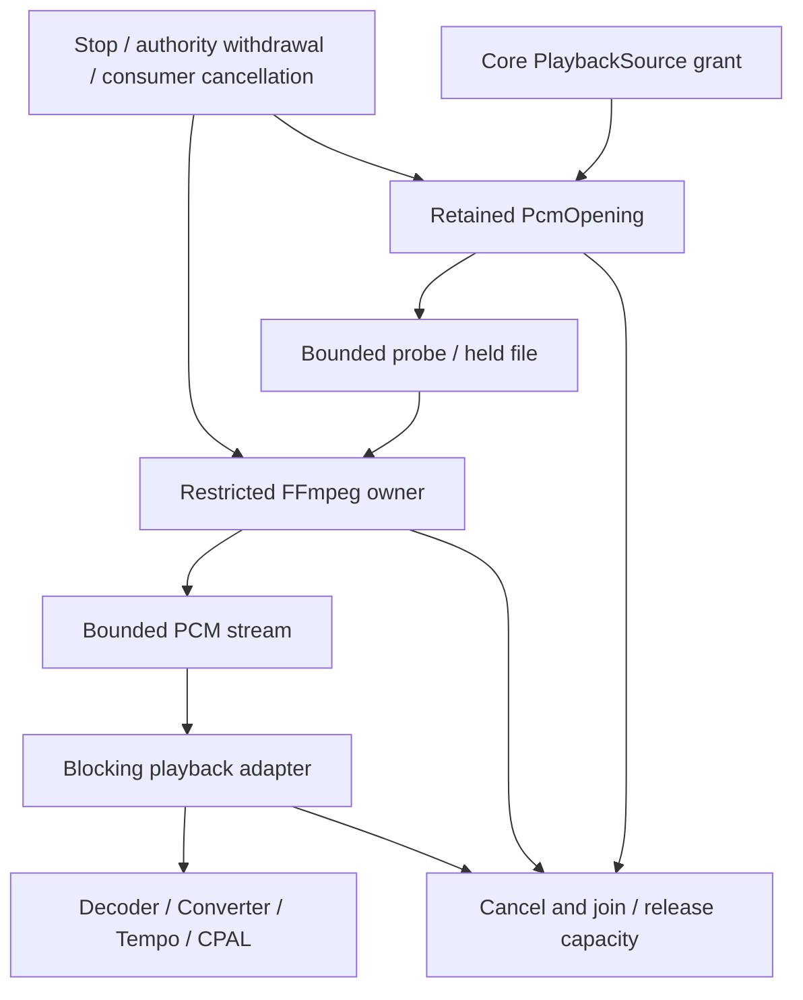

# Native decoding fallback

Development source can play authorized local and server-managed Opus through FFmpeg when Symphonia reports `Unsupported`. This work has not been deployed or included in a new desktop package. The [release plan](release-plan.md) remains open.

## Current policy and ownership

Symphonia runs first. Only `Unsupported` triggers fallback, not corrupt-input, device or cancellation errors. Fallback accepts probed Opus with one or two channels at 8 to 192 kHz. Fixtures exercise 48 kHz Opus. Provider streams stay unchanged; other fallback codecs and layouts remain unsupported.

Core owns files, probing, admission and FFmpeg. Playback supplies PCM through `Decoder::from_pcm` to the existing converter, tempo processor and CPAL. The engine receives no paths or credentials.

`PlaybackSource::begin_pcm(start)` returns a retained `PcmOpening`. Cancelling its `ready()` wait preserves the opening; successful readiness transfers ownership to `PcmStream`. Both owners expose `close()` to cancel and join. Drop signals cancellation without waiting.

Dropping the convenience `open_pcm(start)` future during startup requests cleanup without confirming a join. Native playback retains the opening and explicitly joins cancelled startup, seeks, prepared-input removal and shutdown.

The probe receives a cloned file descriptor. Core then rewinds the same held file for FFmpeg, avoiding a pathname reopen. Commands restrict formats, file/pipe protocols, probing and individual allocations; provider URLs never enter FFmpeg. Input currently uses inherited stdin through `/dev/stdin`; Windows portability is unfinished.

Probing allows 16 KiB and ten seconds; initial PCM waits ten seconds, later process reads fifteen seconds, and successful EOF requires child exit within two seconds. Two queued blocks hold at most 32 KiB each, plus retained first/current data. Admission shares the AAC budget: two host slots by default, one to eight configurable, at most three per account subject to that limit. Slots remain held through termination. See [conversion admission](audio-conversion.md#process-ownership).

Authority checks cover every delivery, including prefetched PCM. Owners watch revocation and consumer closure while paused or backpressured. Missing tools and decoding failures have safe typed core outcomes. Downloads, library records and originals remain untouched.

## Time and preparation

PCM retains source positions and the full optional duration. Seeking joins the previous generation, rounds to a source frame, seeks up to one second early, then decodes and trims that fixed preroll. Starts are limited to seven days. A nonzero start at or beyond a known end returns EOF without a decoder.

One preparation worker keeps current controls responsive. A bounded, attempt-tagged mailbox wakes the session when decoding finishes; completion no longer waits for the 25 ms state-publishing tick. A full mailbox still prompts completion inspection, and stale notices cannot adopt a replacement attempt. Its child token cancels a successor independently; session shutdown still propagates after adoption. Engine acceptance records the successor grant before state publication and the receipt, so losing an observer cannot leave the old grant attached. Pending and ready cancellation join their resources.

The adapter pins one `next_block` future across 15 ms control checks; ticks never restart authority queries. Core retains received blocks across cancelled waits until the final authority check. Spans and subscribers cross Tokio tasks and native threads. Logs retain safe account, grant and session correlation, outcomes and timings, excluding titles, paths, credentials, signed URLs, audio and tool stderr.

## Qualification and remaining work

Docker checks on 10 November 2026 used temporary SQLite, owned fixtures and controlled tool faults. Actual CPAL output ran through an unprivileged private PulseAudio null-sink monitor, not physical speakers.

| Boundary             | Qualified evidence                                                                                                                                                                                                                                                                                                                                                                              |
| -------------------- | ----------------------------------------------------------------------------------------------------------------------------------------------------------------------------------------------------------------------------------------------------------------------------------------------------------------------------------------------------------------------------------------------- |
| Audio engine         | 76 hardware-independent cases, including nine PCM cases for format, samples, positions, interruption, seeking, EOF and ownership. Standalone Symphonia still rejects Opus.                                                                                                                                                                                                                      |
| Core                 | 19 new PCM cases and 51 existing playback regressions cover decoding, bounded seeking, retained-file safety, admission, failed tools, cancellation, revocation, saved copies and private logs.                                                                                                                                                                                                  |
| Native integration   | [`native_pcm_fallback`](../crates/playback/tests/native_pcm_fallback/main.rs) has 15 cases for real tone output, saved Opus with its provider offline, controls, prepared inputs, dropped observers, joined cancellation and scoped logs. Eleven existing [`native_session`](../crates/playback/tests/native_session/main.rs) cases also pass, including the existing gapless counter fixtures. |
| Wait and regressions | Two owned-future cases check completion across several control ticks and cancellation. The default playback suite passes 71 cases. Scoped strict Clippy, formatting, fresh source reviews and independent core/audio/native repeats pass.                                                                                                                                                       |

The component counts come from explicit runs. The readiness change reproduced a 2× successor gap of 2,400 frames: a ready decoder waited another 16.5 ms before the engine rejected its late handoff. Event-driven delivery reduced that gap to one frame in three focused runs. A held-probe replacement case also verifies stale completion fencing and joined retirement. [`scripts/check-playback.sh`](../scripts/check-playback.sh) now invokes the monitor target and the two device-library wait cases.

Counts overlap earlier qualification and must not be added into a release total. Twenty alternating WAV/Opus opens form one diagnostic case. Opus gapless and release p95 were not measured.

### Open transport regression gate

The broader transport run after the readiness change passed 67 of 70 cases. Deferred failure, ready-before-boundary and removal cases failed exact counter or silence assertions. Earlier Never-ready, recovery and 2× failures passed in that run; those passes do not explain all earlier failures. That run stopped before progress, saved-position and audiobook checks. A later startup-buffer correction passes all 70 transport cases with unchanged assertions; a subsequent run also passes eight progress, fourteen saved-position, seven audiobook and one native logging case.

An isolated pre-engine `e80faf8d` baseline, with identical diagnostic-only test changes, passed five of six focused cases. Its removal case failed with 128 silent frames although all 576,000 source frames remained in order. The matched current run passed four of six. Its deferred-failure capture included a logged backend xrun and replayed audio; its removal capture lost 189 source frames without a logged recovery. These are different observations. The baseline failure establishes an older continuity qualification problem, not the cause of every current failure.

A later two-case counter run passed both current cases but failed baseline removal with one backend xrun, one producer underrun and replayed frames. That proves the older engine also exhibits recovery-associated replay; it does not explain the current missing-frame case.

The earlier failures remain part of qualification history. The later 70-case pass does not explain the separate missing-frame observation or establish recovery behavior on physical output. Ideal gapless output and recovery near the observed position during a real underrun are separate requirements. Assertions and fixtures remain unchanged. Post-join diagnostics now expose existing underrun, xrun, output-failure and callback counters; no logging runs in the audio callback.

An opt-in callback witness now compares owned fixture output before the backend write with the actual Pulse monitor. It preallocates bounded sample/header storage, performs no allocation, locking or logging in the callback, and exports only after joined teardown. Five deterministic ownership/bounds cases and a real counter calibration pass, including an independent repeat. This exists only in device test support. Deferred fixtures require both `HITO_OUTPUT_WITNESS=1` and an owned `HITO_CAPTURE_DUMP` directory; normal application builds do not collect audio.

One paired run localized a current failure: callback and monitor both contained exactly 128 silent frames after 1,152 source frames. All 576,000 source samples remained ordered. The joined counters reported one producer underrun and no backend xrun. The paired baseline passed. This identifies producer starvation in that run; it does not classify the separate 189-frame loss or close the broader gate. A controlled public PCM fixture then reproduced 2,688 silent callback frames, five producer underruns and no xruns when only the second read paused for 80 ms. All 48,000 source frames remained present. The correction now passes that same fixture with no internal silence, no producer underrun, no xrun and all 48,000 frames ordered.

### Initial output buffering

Output now waits for the existing 100 ms ring to fill, or for the source end marker when it is shorter. This does not enlarge the ring or add a timer. Readiness belongs to the current output epoch, so seek and output recovery must prepare their own buffer. The callback retires stale frames while gated; otherwise an old full ring could prevent the replacement from becoming ready. Pause and Stop remain responsive, and a gapless successor in the same epoch keeps its existing output stream.

Four public PCM cases cover the delayed second block, joined cancellation while paused, seeking during buffering and short or empty sources. The four pass alongside five selected device cases, five tempo cases, seven gapless cases and 45 audio unit cases. The native integration repeat passes 15 PCM, 11 session and all 70 transport cases. Eight progress, fourteen saved-position, seven audiobook and one native logging case also pass. Strict audio and playback Clippy pass. These are Linux Docker monitor results, not physical-platform or p95 evidence.

### Controlled output recovery and fixture ownership

Development diagnostics now include a safe numeric player identity, recovery target, attempt and previous callback count on the recovery event. The identity remains visible with normal INFO/WARN filtering. Diagnostics execute outside the output callback.

A controlled public Player fixture pauses only its verified private Pulse backend. At 48 kHz, callback and monitor both capture 193,920 frames from a 192,000-frame source. The additional 1,920 frames are 40 ms of already-heard audio. Recovery starts at 506,666,667 ns, exactly the last observed presentation position. This explains that run through the existing recovery policy. The separate historical 189-frame loss remains unclassified.

The Linux fixture launcher now owns process groups, adopts and reaps orphaned descendants, signals verified pidfds and bounds termination. Thirteen repository controls cover default invocation, startup and cleanup cancellation, TERM/INT, stopped wrappers/backend, nested and escaped descendants, child failure, escalation and descriptor retirement. Review found and corrected delayed default cancellation, orphaned grandchildren, missing normal-level player correlation and interruption status lost during cleanup.

An independent final-source Docker repeat passes all thirteen launcher controls, 45 audio unit cases, nine PCM cases, one privacy case and both public recovery cases. Strict device all-target Clippy, workspace formatting and syntax checks also pass. The separate hardware witness calibration remains explicitly ignored.

A later official-runner qualification timed out in the concurrent-player correlation case. An unchanged end-only diagnostic reproduced that failure with both players finished normally, zero xruns and no errors: the 200 ms backend pause had not induced the intended recovery. The concurrent fixture now suspends only its verified client while Pulse continues consuming. A separate pidfd watchdog resumes that client and its wrapper if the controller dies; both child processes are ready before the fault and joined on completion. Embedded controls cover cancellation before the fault and deliberate controller death after the client stops. The first backend-target test and the five-second recovery, progress, error and INFO-identity assertions remain unchanged.

Fresh independent review passes. An independent final-source Docker repeat passes both recovery cases in 11.69 seconds, the default counter/monitor witness in 2.90 seconds and all thirteen launcher controls, with audio device all-target Clippy, workspace formatting and shell syntax checks. The official playback check now includes these cases. To run only recovery qualification, use `sh scripts/run-audio-test.sh hito-audio output_recovery --backend-fault-control --nocapture`; the explicit flag exposes only the launcher's owned private backend, and default invocation keeps fault control disabled.

This qualifies the Linux fixture and runner. Physical output, the unexplained missing frames, startup failure, other codecs/platforms and reference-hardware p95 remain open. No installed desktop or VPS changed.

### Accepted writes and monitored audio

A separate diagnostic checkout adds bounded observations around the pinned CPAL 0.18.2 ALSA writes and captures the owned Pulse client alongside the existing sink monitor. The original removal-case assertions remain unchanged. The second attempt fails those assertions with complete joined witnesses; this is diagnostic evidence, not an accepted playback correction.

| Observation | Ordered nonzero source frames | Internal zero samples |
| --- | ---: | ---: |
| Rendered callback data | 576,000 | 0 |
| Successful ALSA writes | 576,000 | 0 |
| Owned Pulse client monitor | 575,462 | 639 |
| Pulse sink monitor | 575,462 | 639 |

The rendered and reconstructed accepted buffers are byte-identical. All 914 writes accept their full 640 frames without errors or short writes. The two monitor recordings have identical active bytes. Their prefix matches the accepted source through offset 231,040; the remaining heard sequence matches a single 538-frame omission followed by the exact suffix. Independent reconstruction confirms those comparisons. The first observed divergence in this run is therefore between ALSA acceptance and the client monitor.

At that boundary, CPAL callback timestamps are 39.869708 ms apart instead of the nominal 13.333333 ms period, and reported delay falls from 26.041667 ms to zero. The corresponding ledger invocation interval is a separate observation clock. Neither measurement distinguishes scheduling, polling, status work or Pulse lock waits, and reported delay is not independent proof of fresh server buffer state. Producer underruns, reported xruns, recovery events and boundary waits remain zero.

The capture lifecycle is checked separately: four zero-only controls distinguish normal stream teardown from premature removal, including the same exit code and stderr reason. Samples and accounting now export after joins before validation, with an initial unvalidated marker. A complete boundary marker still requires the original source assertions to pass.

Successful ALSA writes do not establish physical presentation: the pinned [ALSA Pulse writer](https://github.com/alsa-project/alsa-plugins/blob/v1.2.7.1/pulse/pcm_pulse.c#L407-L460) returns accepted frames after submitting data to Pulse. The pinned [`parec` record callback](https://github.com/pulseaudio/pulseaudio/blob/v16.1/src/utils/pacat.c#L212-L245) converts record holes to zero samples. Both monitors share Pulse's observation path, so this comparison cannot distinguish playback loss from a shared capture effect. This 538-frame observation does not locate the historical 189-frame loss or justify a playback-policy change. The diagnostic dependency copy and capture changes are unmerged; installed applications and the VPS are unchanged.

### Controlled late-write experiment

A separate standalone ALSA/Pulse writer reproduces a qualified late-write failure without another Hito playback attempt. It uses the pinned container libraries, the same requested hardware/software parameters and a deterministic 576,000-frame stereo counter. Two owned monitors are ready before the counter starts. One write at source offset 231,040 completes 40.280362 ms after the previous successful completion while the ALSA Pulse mainloop lock is held. This is an induced mechanism, not a measurement of why the earlier Hito callback arrived late.

The negotiated ALSA buffer is 1,920 frames, the period 640 and the start threshold 1,280. Pulse reports a 15,360-byte target length, 10,240-byte prebuffer and 5,120-byte minimum request. The writer accepts the entire counter and closes without an ALSA error. Both captured channels are identical. The client and sink have identical active bytes, with 575,588 source frames, one exact 412-frame omission at the induced boundary and 639 internal zero samples.

The record observations contain no holes in either stream. Successful drop bytes exactly match exported capture bytes, with no unexported tail. Owned process identity, joined EOF, bounded stderr, committed observer records and write accounting all pass. Independent reconstruction from the binary ledgers and sample files confirms the counter, omission, channel equality and record accounting. The strict fidelity assertion fails and the standalone command returns nonzero.

The Pulse underflow callback is delivered to the original ALSA callback with an underflow index of 1,914,880 bytes after cumulative accepted writes reach 1,920,000 bytes. The pinned [ALSA underrun condition](https://github.com/alsa-project/alsa-plugins/blob/v1.2.7.1/pulse/pcm_pulse.c#L570-L593) therefore evaluates false in this run. This supports a specific late-write and delayed-notification mechanism, and excludes `parec` hole substitution for this observation. It still does not establish physical-output loss or explain the historical 189-frame case.

Pre-execution review also corrected two diagnostic false-success paths. A clean counter cannot override a transport fault, failed close or missing completion, and both stereo channels must match before collapsing the capture for counter analysis. Fourteen independent Docker controls pass against the frozen controller without running audio. No playback buffer, recovery policy or dependency is changed by this experiment. A proposed correction must preserve startup, seek and recovery behavior and pass the original native continuity assertions.

### Paired buffer diagnostic

A new predeclared pair uses the same frozen executable and counter with only a closed 20 or 30 ms request argument. Both conditions move the induced write to the common source offset 230,400 and check divisibility by the measured period before starting the counter. Each condition runs once. The earlier 231,040-offset experiment stays immutable.

| Request | Actual buffer / period / start threshold, frames | Completion gap | Source frames in each monitor | Internal zeros | Underflow callbacks |
| --- | --- | ---: | ---: | ---: | ---: |
| 20 ms baseline | 1,920 / 640 / 1,280 | 42.101070 ms | 575,560 | 639 | 1 |
| 30 ms candidate | 2,880 / 960 / 1,920 | 42.607693 ms | 576,000 | 0 | 0 |

Both writes accept the entire 576,000-frame counter. The baseline's exact 440-frame omission starts at the induced boundary; its strict fidelity check returns nonzero. The candidate's accepted, client and sink traces contain the complete exact counter despite the slightly larger measured delay. Stereo equality, zero record holes, complete successful-drop/output byte accounting and joined process cleanup pass for both conditions. Independent raw reconstruction, artifact hashes and fresh source review confirm this limited result.

This supports the scheduling cushion only in the pinned Linux ALSA/Pulse null-sink experiment. The negotiated 40 and 60 ms buffer durations describe geometry, not measured startup, seek, recovery or p95 latency. The subsequent Rust policy candidate has public-audio evidence, described below, but its complete continuity gate fails. The 100 ms producer ring and epoch readiness are separate and remain unchanged. Unfiltered underflow detection, other ALSA backends, macOS, Windows and physical-output acceptance remain open. The pair changes no production code, dependency or deployed application.

### Development output policy candidate

An isolated Rust candidate requests 30 ms on Linux ALSA and retains 20 ms on other hosts. Device limits still clamp fixed requests; unknown or invalid ranges keep the backend default. The 100 ms producer ring, epoch readiness and recovery policy remain unchanged. Safe numeric output/player correlation and configured geometry are logged outside the callback. CPAL's reported buffer size is an estimate, not a presentation or queue bound.

A controlled public Rust Player fixture first fails with the 20 ms request. One aligned write completes 40.756914 ms after its predecessor; accepted and rendered data contain all 576,000 frames, while both stereo monitors omit 462 source frames and contain 639 internal zeros. With the candidate request, the induced gap is 40.918705 ms and accepted, rendered, client and sink data contain the exact full counter. Independent raw reconstruction confirms zero recorder holes, matching channels and complete exported bytes in both runs. The original baseline executable was not preserved separately before its rebuild, so its binary provenance is weaker than the pinned candidate's. These single observations establish neither p95 nor physical output.

Two independent review rounds found diagnostic false-success paths. Recorder holes in surrounding silence could disappear from the decision after trimming. Exported PCM could also be shorter than its drop/process accounting while retaining the full active counter. The analyzer now rejects every recorder hole and requires supplied PCM bytes, process bytes and successful-drop bytes to agree before trimming. An independent Docker repeat runs ten methods with no skips: four client/sink hole subcases, eight missing/extra silent-frame subcases and both retained-output classifications. Each defect first reproduces against the preceding analyzer. Original raw evidence remains unchanged; this correction runs no new audio.

The first independent standard native transport gate fails: 68 cases pass and two fail in 322.01 seconds. The 2× gapless transition records 2,400 silent frames, or 50 ms, against the unchanged maximum of two frames. A separate authority-history case fails before its behavioral assertions because its temporary recordings-table rename conflicts with the source-artist trigger's forced SQLite autoindex.

A follow-up diagnoses the transition's late preparation of the next track. Its isolated correction exposes the existing epoch-fenced buffer readiness to playback orchestration and permits next-track preparation at zero position only when playback is requested, controls are idle and that buffer is ready. The existing positive-position path remains. An initial correction without the readiness guard failed the unheard-track repeat case and was rejected. No buffer threshold, output callback or audibility/history rule changes. An independent bounded Loom repeat passes all four reset/presentation/readiness cases with its existing model bounds.

The outage fixture now reversibly renames one recording column instead of its table, preserving primary indexes and trigger bindings. Exact restoration checks include generated columns, implicit row IDs and embedded-NUL text. Two review rounds found no production defect; their fixture-check gaps were corrected with failing-then-passing controls.

The independent follow-up standard run passes 69 of 70 cases in 319.42 seconds. Both original failures pass, but the expired-link seek-recovery case fails its final 440 Hz amplitude assertion. The requested position and Ready state alone do not establish presented audio.

A separately pinned single attempt reproduces that amplitude failure. The original window ends at 809,951 microseconds while public position remains at the requested 6,000 ms; amplitude is 0.159398 against the unchanged minimum of 0.2. The first matching post-seek progress reaches 6,020 ms at 824,151 microseconds. A later window within the original eight-second deadline measures 0.396708. All ten artifact hashes match, and independent reconstruction of both 2,400-frame windows confirms those amplitudes. Audio owners, observers, capture and output writers are joined. This supports a premature test window in this reproduction; it does not establish the cause of every historical failure or physical presentation.

The corrected test requires matching seek identity and progress beyond the requested base before capture. It preserves the original deadline, amplitude and provider-request bounds. A new held-recovery control first fails against the old predicate, then rejects base-only progress for the full eight-second deadline. Both exact cases, formatting and scoped strict checks pass. The subsequent independent standard run executes all 71 cases against the pinned executable and unchanged 2,519 Rust, SQL and Cargo inputs: 70 pass and one fails in 327.18 seconds. The seek cases and original gapless/history cases pass. Withdrawing a playing copy now fails its final captured-tone assertion. That separate failure remains unclassified; the suite is not accepted and the candidate is not integrated. No retry was used to replace the failing result.

The candidate remains unintegrated. Strict broader acceptance, recovery replay bounds, startup/seek latency, reference-hardware p95, other backends and physical platforms remain open. The application image, VPS and desktop packages are unchanged.

### Unresolved output startup failure

An earlier thirteen-case native run failed once with `Native(Output)` during `Session::open`, before Resume. Subsequent twenty-open diagnostics, later fourteen- and fifteen-case runs and eleven existing native cases passed, including independent repeats. Those passes do not identify or fix the failure. It has not been classified as pre-existing. A diagnostic now reports static output failure categories and callback/xrun counts after worker join, outside the audio callback. No automatic retry was added.

Broader codec and timing profiles, missing-tool installation behavior, additional rates/layouts, portable process input, macOS/Windows builds and physical output remain open. Opus gapless measurements, reference-hardware performance and packaged application acceptance are also required. Track these and the startup failure in [Playback and desktop](../TODO.md#playback-and-desktop).
