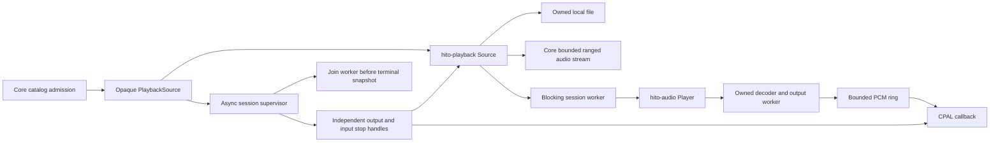
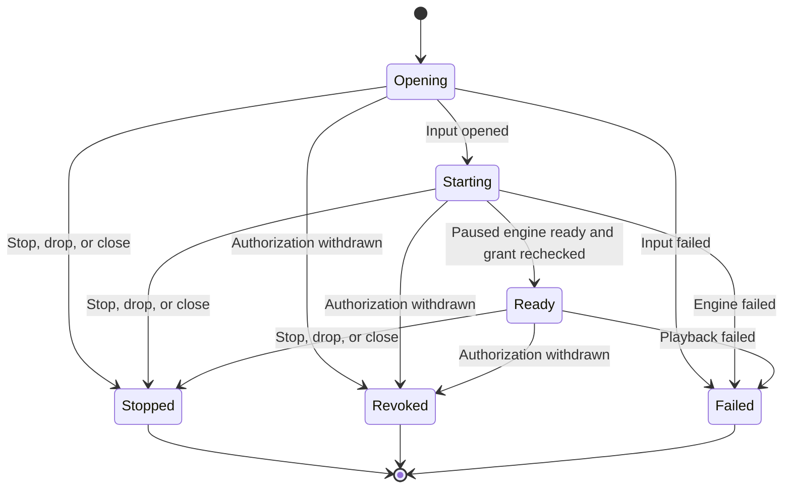
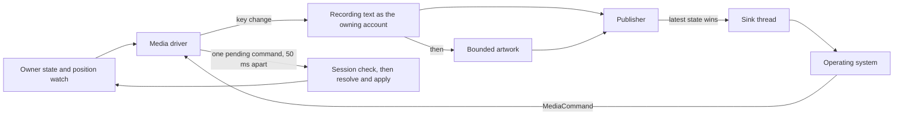

# Native playback owner

`hito-playback` connects a core `PlaybackSource` grant to owned decoding and CPAL output. It supervises authorization during opening, playback, pause, and buffered output. This is a trusted Rust component used by the desktop's authenticated queue owner. The shared React native player sends high-level commands and observes that owner; ordinary web sessions retain browser audio.

## Input and authority

`Source::open(grant)` accepts an opaque core grant. It accepts no path, URL, account string, or renderer metadata. Core keeps ownership of SQL, filesystem containment, provider credentials, HTTP protocol checks, and admission limits.



Local input uses an owned `std::fs::File` on the blocking decoder worker. Reads and seeks check the grant before returning data. A blocked operating-system read stays within that worker's lifetime; it does not become a detached Tokio filesystem read.

Remote input bridges core's asynchronous body into the blocking decoder. It retains one bounded chunk, checks authority around reads, and cancels pending reads when stopped or revoked. Range seeks drop the old body before opening another through the same grant. Returned ranges must start at the requested byte and preserve a known total length. Valid short ranges continue at the next byte. Failed reads or range replacements remain failures instead of becoming clean end-of-file. Cancellation uses `ConnectionAborted`, because standard `read_exact` retries `Interrupted`.

`Source` implements `hito_audio::Input`. Its synchronous read/seek methods require a blocking thread and a live Tokio runtime. It performs no persistent download or temporary-file caching. Equal representation lengths alone do not prove equal audio; stronger HTTP representation validation remains separate work.

## Session lifetime

With the `device` feature, `Session::start(grant)` creates the retained supervisor before asynchronous opening begins. `ready()` observes startup, `command()` sends bounded controls, `snapshot()` and `subscribe()` expose state, and `close()` waits for joined cleanup. `Session::open(grant).await` combines start and readiness. `stop()` requests terminal cancellation immediately, including during input opening or decoder startup, without consuming the session or requiring a close observer. After stop, readiness cannot report success from an older ready snapshot. `close()` still joins the retained owner.



Ready includes paused, playing, and ended states, recorded as separate snapshot flags. Startup constructs the engine paused. The supervisor rechecks the grant before activating its worker and publishing readiness. Resume after completion seeks to zero. Controls include pause, resume, seek, volume, and speed. Speed changes preserve paused state and snapshots carry the rate of presented audio separately from accepted owner preferences. An eight-request mailbox bounds queued commands; starting or full controls return a typed busy result. Dropped queued replies are skipped.

The supervisor keeps polling `revoked()` independently of controls and decoder reads. On withdrawal it first requests callback silence through `hito_audio::Stop`, then cancels input. The output stop handle does not acquire the player or wait for a seek. The supervisor joins its blocking worker before publishing a terminal state. The worker owns and joins the engine's decoder/output worker.

Dropping the session or canceling a caller waiting for startup or close requests cancellation. It does not abandon worker ownership. The retained supervisor continues cleanup. The desktop host retains its library claim and live runtime until this cleanup finishes.

Revocation uses the [core grant's polling and query deadlines](playback-access.md), not an instantaneous cutoff. Already submitted device audio can still drain. An operating-system read, container seek, or driver call cannot be forcibly interrupted in process, so joined cleanup may wait for it to return.

## System media sink

The playback owner can publish to the operating system's Now Playing surface through `MediaSink`, a small trait in `hito-playback`. The owner passes it structural facts only. The React UI is not involved, so native mode needs no audio element and no Media Session code.



The publisher keeps one current track keyed by account, queue entry and recording. A key change clears the sink at once and starts a metadata load. Title, artist, album and duration are published as soon as the recording loads. Artwork loads afterwards and adds one more update. A failed load is retried for the same track after 0.5, 1, 2, 4 and 8 seconds, except when the recording is gone or the session is rejected. A result for an earlier track is ignored.

Artwork comes from the release image, then the recording image, through the owner's account session. An image counts only if it is a PNG or JPEG of at most 2 MiB and 1024 by 1024 pixels, judged from the file header and not from the declared type. A slow image is dropped after three seconds.

Playback state is republished on pause, resume, seek, speed change and track change. Position ticks never reach the sink, so the operating system extrapolates between updates. The duration is the decoded one unless it is more than 10 percent and 5 seconds longer than the recording's known duration, in which case the known one wins. This is the rule the browser player uses. If the decoded duration changes by a second or more after the first publish, the track is published again with it, reusing the same artwork.

The sink runs on its own thread. Calls from the owner only update a small pending slot, so a stalled D-Bus or system call cannot hold up client commands. While the sink is busy, the newest track and state replace older ones, and a clear discards undelivered updates. When the owner closes, the thread gets a final clear and is not joined, so process exit can cut it short.

The sink is cleared when the queue empties, the session is withdrawn (logout or a failed session check), another session claims the player, a system Stop arrives, and when the owner closes.

System commands are Play, Pause, Toggle, Next, Previous, Stop, absolute Seek and relative seek. The driver keeps only the newest waiting command and releases one every 50 milliseconds. It sends a command into the request queue only while at least 16 slots are free, so a burst of key events cannot make client commands busy. When the owner admits a command it checks the session first. Then, in one synchronous step, it turns the command into a player action using the state at that moment, gives it the next sequence number and the current revision, applies it, and puts the sequence counter back. A media key therefore never makes a client's next command a conflict, and a track that ended just before cannot make the command stale. Stop maps to Clear, as in the browser. Seeks are clamped to the reconciled duration and ignored when none is known.

Current limits. The state shows paused for a moment while a track loads. If output underruns and then recovers while the state stays playing, the operating system's position is not re-anchored until the next state change. The playback rate is passed to the sink, but the chosen OS crate has no rate field, so a sped-up track drifts on the operating system's clock until then. No physical operating-system panel has been checked. See [the desktop host](desktop.md#system-media-controls).

## Verification and limits

After building the Docker Rust and desktop images, run:

```sh
sh scripts/check-playback.sh
```

The desktop check includes this script. Default tests cover local decode/seeking, approved provider decode, pending-read cancellation, valid short-range continuation, and failed-range persistence. Actual CPAL monitor tests cover local logout without another command, cancellation of a close observer during blocked startup, terminal stop during opening, readiness after stop, paused provider withdrawal, transport controls, and safe logging across async, blocking, and native threads. They use temporary SQLite and owned synthetic audio through a private clocked PulseAudio sink.

The public `Session` API is backend-only. It does not authenticate a new caller for each command. The [command/queue owner](native-coordinator.md) supplies exact session/lease checks, ordering fences, stable queue entries, and live catalog pages. Its optional native constructor drives `Session`, including play/pause, Previous through observed played history, shuffle/repeat, ordered seek/volume/speed, finite source recovery, provider refresh, position restoration, paused recovery, queue advancement, account switching, ordered progress persistence, and joined replacement/shutdown. Revoked grants suspend admission before fresh source recovery. Temporary authority failures retain the queue while stopping output; definitive session rejection clears it. The desktop host protects the native HTTP routes and retains cleanup with its library claim. The shared UI uses that authenticated boundary. Do not expose trusted `Session::command` directly as an authenticated route.

Core supplies a bounded ordered `recordings_by_ids` lookup and opaque `Actor::same_session` comparison. Equality does not prove a session is live; retained owners use `Identity::check_session`. Collection writes and provider-source publication recheck sessions inside their existing transactions. The [application coordinator](native-coordinator.md) records their queue, HTTP, and host integration.

These fixtures establish ownership and cancellation behavior in Linux Docker. They do not establish sustained throughput, p95 latency, physical audio timing, gapless transitions, FFmpeg fallback, speed quality across all codecs/devices, or macOS/Windows acceptance. See [engine limits](native-audio.md) and the full [release plan](release-plan.md).
