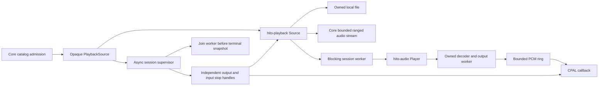
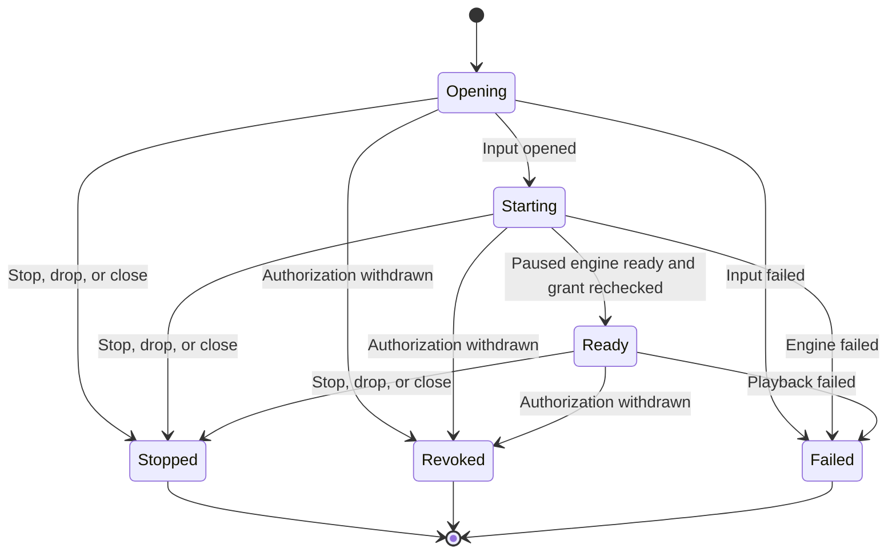

# Native playback owner

`hito-playback` connects a core `PlaybackSource` grant to owned decoding and CPAL output. It supervises authorization during opening, playback, pause, and buffered output. This is a trusted Rust component. The desktop application still uses browser audio; its queue, HTTP adapter, and React controller do not use this component yet.

## Input and authority

`Source::open(grant)` accepts an opaque core grant. It accepts no path, URL, account string, or renderer metadata. Core keeps ownership of SQL, filesystem containment, provider credentials, HTTP protocol checks, and admission limits.



Local input uses an owned `std::fs::File` on the blocking decoder worker. Reads and seeks check the grant before returning data. A blocked operating-system read stays within that worker's lifetime; it does not become a detached Tokio filesystem read.

Remote input bridges core's asynchronous body into the blocking decoder. It retains one bounded chunk, checks authority around reads, and cancels pending reads when stopped or revoked. Range seeks drop the old body before opening another through the same grant. Returned ranges must start at the requested byte and preserve a known total length. Valid short ranges continue at the next byte. Failed reads or range replacements remain failures instead of becoming clean end-of-file. Cancellation uses `ConnectionAborted`, because standard `read_exact` retries `Interrupted`.

`Source` implements `hito_audio::Input`. Its synchronous read/seek methods require a blocking thread and a live Tokio runtime. It performs no persistent download or temporary-file caching. Equal representation lengths alone do not prove equal audio; stronger HTTP representation validation remains separate work.

## Session lifetime

With the `device` feature, `Session::start(grant)` creates the retained supervisor before asynchronous opening begins. `ready()` observes startup, `command()` sends bounded controls, `snapshot()` and `subscribe()` expose state, and `close()` waits for joined cleanup. `Session::open(grant).await` combines start and readiness. `stop()` requests terminal cancellation immediately, including during input opening or decoder startup, without consuming the session or requiring a close observer. After stop, readiness cannot report success from an older ready snapshot. `close()` still joins the retained owner.



Ready includes paused, playing, and ended states, recorded as separate snapshot flags. Startup constructs the engine paused. The supervisor rechecks the grant before activating its worker and publishing readiness. Resume after completion seeks to zero. Controls include pause, resume, seek, and volume. An eight-request mailbox bounds queued commands; starting or full controls return a typed busy result. Dropped queued replies are skipped.

The supervisor keeps polling `revoked()` independently of controls and decoder reads. On withdrawal it first requests callback silence through `hito_audio::Stop`, then cancels input. The output stop handle does not acquire the player or wait for a seek. The supervisor joins its blocking worker before publishing a terminal state. The worker owns and joins the engine's decoder/output worker.

Dropping the session or canceling a caller waiting for startup or close requests cancellation. It does not abandon worker ownership. The retained supervisor continues cleanup. The surrounding host must retain its library claim and live runtime until this cleanup finishes; that application integration remains unfinished.

Revocation uses the [core grant's polling and query deadlines](playback-access.md), not an instantaneous cutoff. Already submitted device audio can still drain. An operating-system read, container seek, or driver call cannot be forcibly interrupted in process, so joined cleanup may wait for it to return.

## Verification and limits

After building the Docker Rust and desktop images, run:

```sh
sh scripts/check-playback.sh
```

The desktop check includes this script. Default tests cover local decode/seeking, approved provider decode, pending-read cancellation, valid short-range continuation, and failed-range persistence. Actual CPAL monitor tests cover local logout without another command, cancellation of a close observer during blocked startup, terminal stop during opening, readiness after stop, paused provider withdrawal, transport controls, and safe logging across async, blocking, and native threads. They use temporary SQLite and owned synthetic audio through a private clocked PulseAudio sink.

The public `Session` API is backend-only. It does not authenticate a new caller for each command. The [command/queue owner](native-coordinator.md) supplies exact session/lease checks, ordering fences, stable queue entries, and live catalog pages. Its optional native constructor drives `Session`, including play/pause, natural queue advancement, account switching, and joined replacement/shutdown. Native source recovery, progress persistence, HTTP/local process protection, host shutdown integration, and the shared UI adapter remain unfinished. Do not expose trusted `Session::command` directly as an authenticated route.

Core now supplies a bounded ordered `recordings_by_ids` lookup and opaque `Actor::same_session` comparison. Equality does not prove a session is live; retained owners use `Identity::check_session`. Collection writes and provider-source publication recheck sessions inside their existing transactions. The [selected application coordinator design](native-coordinator.md) records how these boundaries will connect to queues, HTTP, and the host.

These fixtures establish ownership and cancellation behavior in Linux Docker. They do not establish sustained throughput, p95 latency, physical audio timing, gapless transitions, FFmpeg fallback, playback speed, or macOS/Windows acceptance. See [engine limits](native-audio.md) and the full [release plan](release-plan.md).
