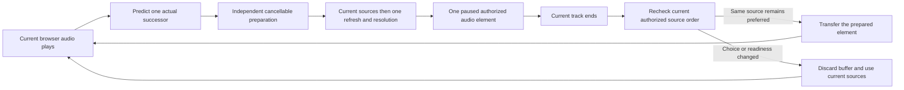

# Preparing the next browser queue entry

The shared browser player prepares one upcoming queue occurrence while the current track plays. This is deployed to the normal local development server. Native preparation, deployment of provider-side preparation and release performance acceptance remain open.

## Ownership and behavior

Preparation uses the same successor calculation as natural advancement, including shuffle, repeat and failed entries. It retains the queue occurrence ID, queue revision and playback generation. Position updates do not copy or scan the queue.

The preparation owns its source attempts, cancellation signal and paused media. It has a fifteen-second background acquisition/buffering deadline. It runs the same ordered stages as ordinary Play: existing sources, one refresh, one automatic resolution. All of that happens while the current track plays, never at the transition. Preparation never issues Download or Keep offline commands.

At handoff, current authorized source order is read again. A historical resolution result does not override a newer manual source choice. An exhausted preparation also checks for a source that became ready while the current track played. This final server read means prebuffering alone does not establish a gapless or zero-wait transition.

Queue replacement, removal, repeat/shuffle changes and account teardown cancel obsolete work. Ownership is limited to current media and one preparation. A repeated recording retains distinct queue entry IDs and can reuse a verified current source without repeating provider matching. Buffer transfer releases the outgoing element. If seeking the adopted element fails, ordinary source recovery retains its attempt identity and requested position.

## Sources that need provider preparation

When those stages leave no ready source but the next entry has one that an approved connection can prepare (`ready` false, `can_prepare` true), lookahead asks the provider to prepare it. This is the same `POST .../sources/{source}/preparation` request the Prepare audio button sends, with one request UUID and no automatic retry. A rejected request (quota, authorization) ends the attempt.

Lookahead then checks the status every five seconds, or later if the server sets `next_check_at`, for up to 90 seconds from the start of preparation. `failed`, `blocked`, `cancelled` and `submission_unknown` end the attempt. Three consecutive failed status reads also end it. On `ready` it re-reads the authorized sources, so a manual choice made meanwhile still decides which source plays, then buffers that source as usual.

At the boundary, any wait for a source (resolution or provider preparation) lasts at most ten seconds in total. After that the entry is skipped as unavailable, which is today's outcome, and the work stops. Buffering an already found source keeps its own fifteen-second limit. If the server's `next_check_at` falls beyond the 90-second bound, lookahead stops instead of polling. Queue edits, skips, repeat/shuffle changes and account teardown abort the polling and any buffered media. The server keeps its own durable preparation. Hito has no cancel endpoint, so an abandoned request still finishes there and the source is ready the next time it is played. Hito never creates a download.

Lookahead remembers, for the one upcoming queue entry, which source it has already submitted. Pausing and resuming restarts lookahead but never sends a second request for that entry. An interrupted preparation resumes polling, and a rejected or finished one is not repeated. The memory resets when the upcoming entry changes. Pause and resume still repeat the cached/refresh/resolve reads.

Only the first preparable source in authorized order is prepared, and only for the one upcoming entry. This does spend provider quota without a click. The play-time path still never prepares a source on its own; only lookahead does.

## Verification

The original normal-policy Chromium test failed against the old player: the first owned WAV was playing, but the next recording had no background search. The final prototype package `sha256:9f8d4083b82033f36006577f1a6f9ef42cef24652668a3d004e1b246e66b2e6f` passes the unchanged workflow. It uses the migration-0045 server image with the prepared-player assets. Chromium has no autoplay-policy override.

The browser plays a twenty-second owned WAV, holds the next recording's provider search while current audio advances, verifies the next buffer before the first ends, then observes natural playback on that prepared element without a second matching operation or persistent download. The run took 21.5 seconds, which includes the fixture's first track and is not a latency benchmark. Console checks pass; 5,059 backend JSON records contain none of the fixed private fixture canaries. The disposable host stops with exit zero, no OOM and no restart.

Public player and provider tests cover changed source authority, newly available audio after exhausted preparation, clear/removal during preparation, failed seek recovery, shuffle, repeat one/all and duplicate occurrences. Provider component tests cover Strict Mode replay, account replacement during acquisition, ignored-abort late acknowledgements, adopted-buffer teardown, stale media events and late progress acknowledgements. They verify at most two owned media elements and no Download requests.

Independent security, correctness and performance reviews pass their second and final round. The first round found stale exhausted-source handoff, failed-seek attempt ownership and Strict Mode media cleanup defects. Each had an actual failing regression before its minimal fix. A test-only TypeScript narrowing error was corrected without changing its assertions. The combined main source at `c3cbc85` passes all 258 frontend tests across 82 files, both TypeScript checks and its production build.

The integrated backend passes 299 distinct core cases with one usual ignored fault case, all 139 distinct server cases, formatting and strict core/server Clippy. A download fixture was corrected to wait for actual idle worker turns after safe tracing reproduced its premature completion; application behavior and the original preservation assertions were unchanged.

The combined release image `sha256:6eacc678c8f0ff5380c8947e670bde52f9fd17009db7b040eb474ee5fc48f366`, built from application source `83ae186`, passes fresh Chromium and WebKit workflows in 22.6 and 24.1 seconds respectively. Both play the first owned WAV while the next search is held, buffer the successor before the first ends and naturally advance without a second resolution or Download. The same package includes the HTTP resolution lifetime changes. The Chromium backend log check examines 3,039 JSON records without finding the fixed private canaries; WebKit acceptance includes browser console checks, not that backend-log count.

WebKit initially failed the final audio audit after successful playback. A lifecycle trace and pinned WebKit source identify two GStreamer delegate notifications before the actual HTTP exchanges. The audit now recognizes only exact expected GET URLs with an unrouted, completed status-zero notification and no headers or failure. Its body must be empty or unavailable with the exact `no_resource_data` error. Each notification must pair with a later, distinct routed 200/206 response containing the complete expected audio bytes. Twenty-three contract cases retain rejection of foreign, unpaired, routed-zero, malformed and actual body-read failures. Fresh independent review passes. This is a test classification change, not an application playback fix or physical Safari evidence.

A stopped whole-volume clone rehearsal and a fresh normal backup precede local publication. The migration-only command remains at 0045 with zero migrations applied. Both stopped audits preserve all 106 prior tables, rows and rowids, sequences, receipts, migration checksums, FTS indices, keys, host identity and non-SQLite files. Separate candidate runtime checkpoints change no database rows or managed descendants. Published health, exact OpenAPI/JS/CSS and anonymous player rejection pass, including host checks through loopback and the LAN address. See [deployment evidence](status.md#running-local-deployment).

The later browser Media Session image `sha256:3c2941e1ea009813503c39cd0fb0ca1bfefea5477189d4202c6ae1be5278221c` retains the same Rust application and is now deployed locally. Fresh next-entry workflows on that exact image pass Chromium in 21.6 seconds and WebKit in 22.6 seconds after integration. These remain workflow timings, not latency benchmarks.

Native playback, unavailable/debrid preparation, physical Safari behavior, broader outages, codec coverage, measured start/recovery targets and deterministic gapless verification remain separate gates. See [the release backlog](../TODO.md).

## Provider preparation evidence

Fourteen provider-boundary cases cover the next entry in this state: request and status checks during current playback with the current element never paused, buffer adoption without a second search or download, the five-second cadence, each stopped phase, a rejected request without retry, a non-preparable source, one preparation however many position ticks arrive, cancellation on skip, queue edit and account change, a manual choice made during preparation, and the ten-second boundary limit in both directions. They failed before the change and the 142 playback cases pass after it.

A default-run Chromium test (`next-entry-deferred-preparation.spec.ts`) uses the shared provider fixture, now with an optional preparation capability. It plays the first of two tracks, sees one prepare request for the second, sees the second track's audio fetched while the first still plays with no pause event, then seeks the first to near its end. The `playing` event for the second track follows the first track's `ended` event by under one second. No Download request is sent. This is one workflow timing, not a latency benchmark. Native playback and gapless output are still open.

## Duration and end of a prepared entry

When prepared media is adopted, the player applies the same duration rule as for a directly opened source. If the browser reports a duration more than 10 percent and 5 seconds above the recording's known duration, the known duration drives the timeline and the entry ends when playback reaches it. See [overlong browser duration estimates](browser-media-session.md#overlong-browser-duration-estimates). A late `ended` event from the retired element is ignored, and the next entry is never skipped.
