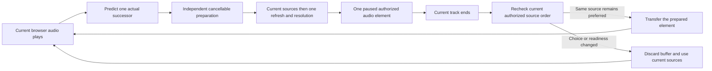

# Preparing the next browser queue entry

The shared browser player prepares one upcoming queue occurrence while the current track plays. The implementation is integrated in the development source. It is not yet deployed to the normal local server. Native preparation, unavailable-source preparation and release performance acceptance remain open.

## Ownership and behavior

Preparation uses the same successor calculation as natural advancement, including shuffle, repeat and failed entries. It retains the queue occurrence ID, queue revision and playback generation. Position updates do not copy or scan the queue.

The preparation owns its source attempts, cancellation signal and paused media. It has a fifteen-second background acquisition/buffering deadline. It can resolve a ready source through approved providers, but does not yet start the separate unavailable-source preparation workflow. Preparation never issues Download or Keep offline commands.

At handoff, current authorized source order is read again. A historical resolution result does not override a newer manual source choice. An exhausted preparation also checks for a source that became ready while the current track played. This final server read means prebuffering alone does not establish a gapless or zero-wait transition.

Queue replacement, removal, repeat/shuffle changes and account teardown cancel obsolete work. Ownership is limited to current media and one preparation. A repeated recording retains distinct queue entry IDs and can reuse a verified current source without repeating provider matching. Buffer transfer releases the outgoing element. If seeking the adopted element fails, ordinary source recovery retains its attempt identity and requested position.

## Verification

The original normal-policy Chromium test failed against the old player: the first owned WAV was playing, but the next recording had no background search. The final prototype package `sha256:9f8d4083b82033f36006577f1a6f9ef42cef24652668a3d004e1b246e66b2e6f` passes the unchanged workflow. It uses the migration-0045 server image with the prepared-player assets. Chromium has no autoplay-policy override.

The browser plays a twenty-second owned WAV, holds the next recording's provider search while current audio advances, verifies the next buffer before the first ends, then observes natural playback on that prepared element without a second matching operation or persistent download. The run took 21.5 seconds, which includes the fixture's first track and is not a latency benchmark. Console checks pass; 5,059 backend JSON records contain none of the fixed private fixture canaries. The disposable host stops with exit zero, no OOM and no restart.

Public player and provider tests cover changed source authority, newly available audio after exhausted preparation, clear/removal during preparation, failed seek recovery, shuffle, repeat one/all and duplicate occurrences. Provider component tests cover Strict Mode replay, account replacement during acquisition, ignored-abort late acknowledgements, adopted-buffer teardown, stale media events and late progress acknowledgements. They verify at most two owned media elements and no Download requests.

Independent security, correctness and performance reviews pass their second and final round. The first round found stale exhausted-source handoff, failed-seek attempt ownership and Strict Mode media cleanup defects. Each had an actual failing regression before its minimal fix. A test-only TypeScript narrowing error was corrected without changing its assertions. The combined main source at `c3cbc85` passes all 258 frontend tests across 82 files, both TypeScript checks and its production build.

The next release image still needs combined-package browser acceptance and normal deployment. Native playback, unavailable/debrid preparation, physical Safari behavior, broader outages, codec coverage, measured start/recovery targets and deterministic gapless verification remain separate gates. See [the release backlog](../TODO.md).
