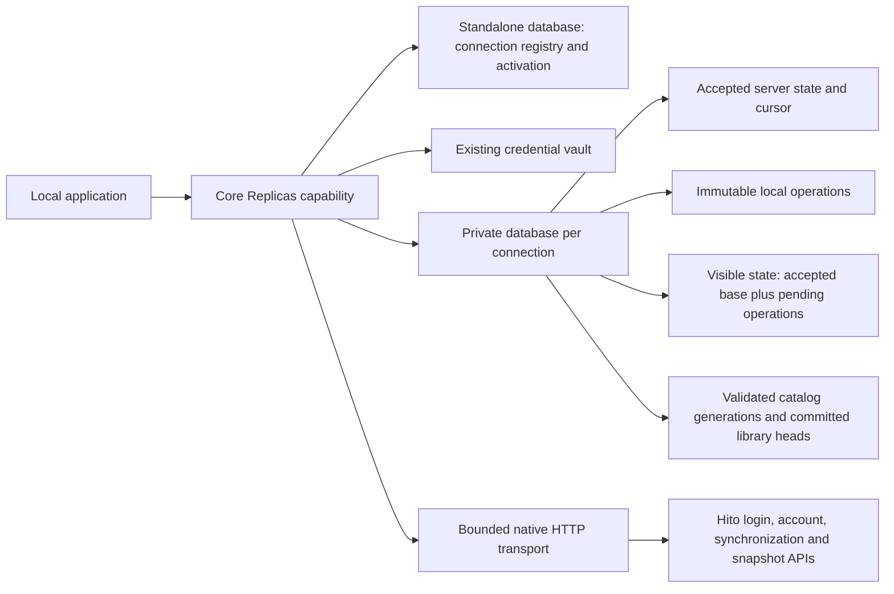
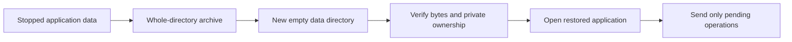

# Offline replicas

This is an unfinished core capability in development source. It is not exposed in desktop settings, packaged or deployed. The collection projection handles empty playlist creation, renaming and deletion. A later extension installs local recording/source snapshots into a separate durable catalog cache. Incremental catalog changes, populated playlist entries, likes, progress and playable files remain unfinished.

## Ownership

`Replicas` owns remote connections, encrypted session credentials, private SQLite profiles, the durable outbox and reconciliation. HTTP transport uses the existing Hito login and synchronization wire types. It never opens a remote webpage or replaces the standalone library.

The local account and its session authorize every operation. A remote connection binds one canonical server origin, verified remote account and stable synchronization client ID. The synchronization client ID is separate from `HostDeviceId`, which determines filesystem ownership and local source availability.

Connection profiles use opaque UUID directories beside the standalone database. Core opens their private stores directly, without starting indexing, provider or managed-file workers. A profile's remote principal supplies database ownership only. It has no usable password, session or administrator authority. SQLite, profile paths and credentials remain private to core.

## Offline changes and reconnects

An enqueue receipt means the local operation was retained, not accepted by the server. The outbox keeps the operation UUID, exact payload and local ordering. Repeating an identical operation is idempotent; reusing its UUID with different contents fails. Disconnecting retains this work, and reconnecting to the same verified account preserves the synchronization client ID.

A synchronization pass pushes a bounded batch, records its exact acknowledgements, then pulls server events. Acknowledged changes remain in the local overlay until their matching events arrive. Reconciliation updates accepted state, received-event history, the visible projection and the cursor in one profile transaction. It does not call the server-side collection acceptance workflow or publish incoming events again.

Server acceptance order resolves competing names. Deletion wins over later edits. Unsupported actions and server publications reject the whole page without advancing the cursor. These are deliberate limits of this first slice, not evidence that a populated server library can already be replicated.

A pass sends at most 100 operations and respects the server's 262,144-byte request limit. The current profile retains at most 10,000 local operations, including echoed operations, and 100,000 received events. Reaching either history limit fails explicitly. History compaction remains unfinished.

Work on a profile transaction happens outside the standalone database's write guard. Immediately before committing, a short control transaction rechecks the local session, connection generation and activation. Retirement during a slow profile write therefore rolls the staged change back, while unrelated accounts can continue writing.

## Lifetime and privacy

Activations have a process-owner identity and cancellation signal. Deactivation, replacement and disconnect retire the affected lease and join its synchronization work. Owner shutdown cancels outgoing calls and joins initialization before closing profile pools. Reopening core does not make leases from an earlier owner valid.

Account erasure removes registry rows, activations and encrypted credentials in the account transaction. It retains only opaque profile IDs for post-commit file removal. Removal requires an owned private directory, lock, marker and known files; it does not sweep arbitrary directories. Core removes and syncs database files before removing ownership evidence. A retry can finish validated lock-only or empty directories, but never adopts markerless data or unknown files. All queued leases retire before file cleanup, and one failed profile does not prevent other accounts' cleanup. Failed IDs remain queued. Other accounts and the standalone library stay separate.

Transport bounds request and response bytes, deadlines and concurrent calls. It does not follow redirects, use ambient proxies, retain cookies or retry requests implicitly. The existing vault binds each encrypted token to its local owner, connection, server and remote account. Missing or mismatched keys preserve encrypted records instead of generating a replacement key.

Workflow logs use correlation IDs, safe outcomes, counts and timings. They exclude credentials, session values, endpoint URLs, private paths, playlist names and response bodies.

## Catalog snapshots

The profile can install and retain validated local recording/source facts through `Replicas.install_catalog`, then read committed metadata and pages offline. Installation stages a new generation and atomically replaces its library head, preserving the old cache on failure before publication. It does not project those facts into ordinary local recordings or make server-relay availability local playback readiness. The collection cursor and immutable outbox remain separate.

Migration 0094 covers the new tables in the strict child-first account erasure plan. A retained installation owner holds admission and authority through SQLite settlement after cancellation or a failed commit, and joins profile retirement. Current local session, PIN and activation checks protect cached reads. Remote refresh failure retains the last known cache; the current protocol cannot guarantee immediate remote-revocation erasure while offline. See [catalog ownership, bounds and evidence](catalog-replication.md#durable-private-catalog-cache).

## Stopped backup and restoration

Back up the complete data directory only after the application has stopped. Preserve the standalone database and its SQLite companion files, `hito.plugin-key` and the complete `hito.replicas` directory together. A database-only copy cannot retain the encrypted connection and private profile as a coherent backup. Restore into a new empty directory with the original private permissions and ownership.

A Linux Docker acceptance uses separate Core processes before and after restoration. The first process creates a standalone playlist, synchronizes one remote playlist operation and retains an offline rename. Both processes exit before the next archive or preservation check. Before reopening the restored copy, every file matches its source bytes, mode, UID and GID. Restored login and synchronization retain the account, encrypted connection, synchronization client, accepted cursor and exact pending operation. The server sees only the pending rename added to its existing history. The stopped source, archive and external original-audio sentinel remain unchanged.

The public case passes with strict test-target Clippy, formatting, independent source review and an independent repeat. This qualifies the stated stopped-data workflow for empty-playlist replicas in Linux Docker. It does not establish online backup, indexed-media restoration, physical power-loss recovery or macOS/Windows package acceptance.

## Qualification and remaining work

Docker qualification on 10 November 2026 passed 19 public core cases, 16 protocol cases, three replica-vault cases and six actual Hito Router cases. An independent run repeated all four groups against unchanged source. Strict scoped core/server Clippy and formatting pass. Existing account-deletion, collection and historical schema-upgrade checks also pass, alongside directed embedded-host, connection-drain, indexing, signal and download-shutdown regressions. These counts overlap earlier runs and do not form a release total.

The core cases use temporary SQLite and owned HTTP fixtures for durable changes, exact retries, lost acknowledgements, event reconciliation, deletion, account isolation, stale leases, retirement, malformed pages and private file handling. Retirement covers eight process-interruption boundaries, markerless-data refusal, and another account's held request while an earlier profile cannot be removed. These tests do not simulate physical power loss.

Actual Router acceptance verifies native access through a different address from the configured browser origin while unlisted browser origins remain forbidden. Two independent replicas retain exact operations across restart and a lost acknowledgement, then converge in server acceptance order without resurrecting deletion. Other cases cover account switching, real remote-session revocation and reauthentication. Shared server/desktop-host shutdown cancels a held outgoing synchronization request while HTTP drains, before returning with the replica owner closed. Independent review identified and resolved origin handling and interrupted-retirement defects.

The schema-driven erasure guard also covers `replica_state` through its principal foreign key. A public two-case regression verifies removal for the erased principal and exact preservation for another principal. Profile-local playlist/outbox/event tables and the opaque retirement ledger are explicitly classified outside the relational account graph; their private data still leaves through owned profile-file retirement after commit. The guard algorithm and exact-set assertions remain intact.

Passing these checks does not qualify desktop remote mode. Private catalog snapshot installation now has separate qualification; incremental catalog events, populated playlists, likes and progress, remote audio availability, standalone import preview, desktop selection and offline playback remain open. History compaction, broader populated-profile and platform backup restoration, Windows filesystem support, physical platform checks and release performance also remain required. Nothing in this slice updates the running server or desktop packages.
