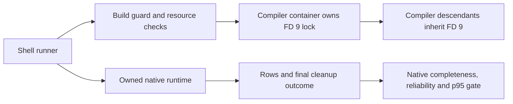
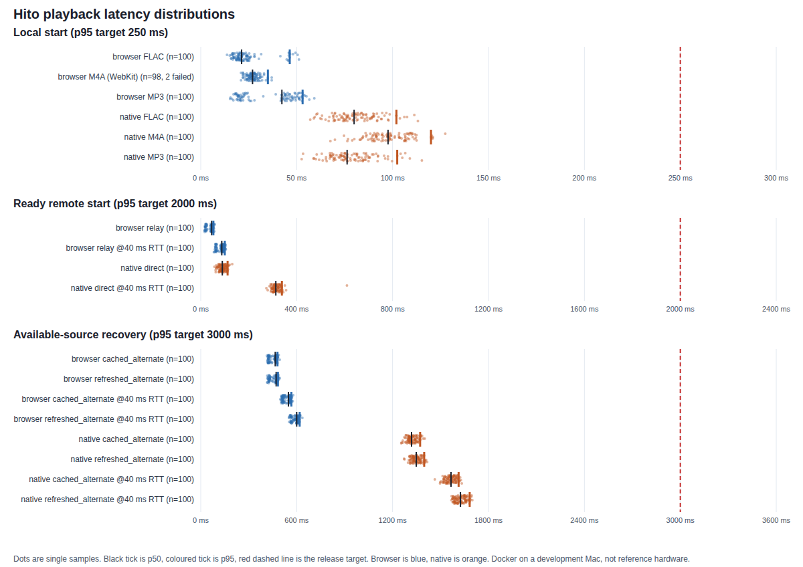

# Playback latency

This page records how Hito measures its three playback latency targets, what the first measurement showed, and what that measurement does not cover. It is a development measurement made with Docker on a development Mac. It is not the fixed reference hardware of the release gate and not a public release result.

## Targets

The release gates below apply to fixed, documented hardware and network:

| Gate                      | Target (p95) | Meaning in this document                                                           |
| ------------------------- | -----------: | ---------------------------------------------------------------------------------- |
| Local start               |    250 ms    | Play request to the first audible frame of a file in the local library             |
| Ready remote start        |     2 s      | Play request to the first audible frame of a provider source already verified ready |
| Available-source recovery |     3 s      | A playing source fails and another verified source exists: failure to audible again |

Debrid preparation (a provider fetching or converting a file before a source is ready) is a separate measurement and is not part of these numbers. It is still open.

## What is measured


Browser start: the clock starts in the page at the capture-phase `click` event of the real Play button. It stops at the first moment a tight in-page loop sees the player's media clock above zero while the element is not paused, after the `playing` event. The `playing` time is recorded too. The loop avoids the 250 ms granularity of `timeupdate`. This is the media clock, not measured sound: headless browsers have no audio device.

Native start: the clock starts before the `Replace` command is submitted to the player owner, which the desktop UI follows with `Resume`. It stops at the local monotonic timestamp taken after a `parec` monitor read containing a sample above an absolute amplitude of `1e-4`. Reads request up to 5 ms of 48 kHz stereo PCM from the PulseAudio null sink fed by CPAL/ALSA. This detects monitor output, with read buffering and scheduling delay; it does not timestamp the first audible frame or physical presentation. The commands are called in process; the desktop's local HTTP or IPC hop is not included.

Recovery: the fake provider cuts the playing stream (it destroys the socket) and answers further requests for that source with 503. Two numbers are kept for each sample.

- Failure to audible: for native playback, from immediately before the socket-cut command is sent until a fresh monitor read after verified replacement. The current example first requires a different source for the same recording and queue entry, Ready/playing state and subsequent independent position progress. The provider's socket-cut timestamp has a separate clock and is not subtracted from the local monotonic clock. The full release runner must compare the resulting distribution with the 3 s target.
- Audible gap: from the moment the failure is seen (the browser raises a media error, or the native output falls silent) to audible output again. This is a monitor-level interruption estimate; physical presentation is not measured.

The browser stops playing when it sees the error. The native player keeps playing audio it already buffered. The fake provider sends 1.5 s of audio at once and then at real-time speed, so about 1.2 s of buffered audio remains at the cut. That buffer inflates the native failure-to-audible number by a fixed amount, which is why both numbers are reported.

Two alternatives are measured. In the cached alternative the recording already has two verified ready sources and the player uses the second. In the refreshed alternative only the failing source is known, so the player asks the provider for its sources again and finds a replacement.

## Method

- Library: 10,000 synthetic tracks (3,334 FLAC, 3,333 MP3, 3,333 M4A with AAC), 20 seconds each, 44.1 kHz stereo, one sine tone per file with a unique frequency, MP3 and AAC at 128 kb/s. They sit under 500 artists and 1,000 albums with tags, 2.9 GB in total. Both surfaces scan the full library through the ordinary scan job before measuring. Generated by `scripts/bench/generate-library.sh`; nothing in it is real music.
- Server: the release `hito-server` image from `docker/server.Dockerfile` (thin LTO), the production web bundle, `RUST_LOG=info`, JSON logs, a memory-backed data directory, one administrator. The native player keeps its database in `/dev/shm`. The container needs no other services.
- Browser: Playwright 1.56.1 with headless Chromium 141 for FLAC, MP3 and provider MP3. Chromium from Playwright does not decode AAC, so M4A is measured with Playwright's WebKit. The same browser session stays open for a series; each sample searches the library box for one title and clicks its Play button, so the app is warm and the track is new.
- Native: the `start_latency` example of `hito-playback`, built in release mode, with its own core instance on the same library. It runs in the desktop tools container under the same null-sink audio harness the native playback tests use.
- Fake provider: `apps/web/e2e/latency/fake-provider.mjs`, a loopback HTTP service that implements the plugin protocol (manifest, search, detail, sources, ranged audio) for 630 recordings. The audio is one 60 second, 128 kb/s MP3. It delays every response by a settable number of milliseconds. 0 ms and 40 ms are used. 40 ms stands for a regional connection and is a stand-in for the round trip time, not a measured network.
- Samples: 100 measured samples per series after 5 warm-up samples excluded from percentiles. Every sample uses a different track or recording, picked by a fixed stride through the library. A failed sample (no audible output within 15 seconds) counts as an infinite latency in the percentiles and is listed.
- Statistics: nearest-rank percentiles (the value at rank ceil(p × n)).

The provider delay applies to the provider only. Start scenarios apply it for the whole sample. Recovery scenarios apply it from the moment of the cut.

## Native repeat qualification

The results below remain the 6 November run. No new 100-sample native run has been made. A native repeat means nine series with 100 measured attempts each, plus five warmups per series, for 900 measured attempts and 45 warmups.

The benchmark prerequisite work on 11 November has 27 focused Rust controls for owned streams, processes and CSV production, plus thirteen report CLI controls. Quiet-output controls require the full continuous interval in newly observed frames and reject acceptance after the original monotonic deadline. These controls also verify fragmented stereo PCM, recorder EOF/read errors/panic, joined cleanup, bounded provider output, request deadlines and late-ack rejection. Warmup outcomes are retained separately from measured samples. The explicit `--strict-native` report mode requires every measured index 0–99 in all nine series, all 45 warmups, finite successful timings and explicit failure counts. Failed warmups or measured attempts mark reliability failure; the nearest-rank percentile formula is unchanged. Strict-native rendering uses only the validated native snapshot. Rejected structure produces static failure output and safe counts; malformed configuration cannot define output identifiers, and unvalidated browser rows are excluded. Structurally valid data with failed attempts still renders its reliability result. File I/O failures emit static operation codes without original paths or stacks. Browser-only reports keep their existing mode.

An independent fresh-source Docker repeat passes all 27 Rust and thirteen CLI controls with exact test-name sets, no failures and no ignored cases. The original 25 Rust and ten CLI names remain. Strict example Clippy and workspace formatting pass, and all 3,934 source and support inputs remain unchanged. The capture and protocol implementations have separate cohesive test modules. Two review rounds found and resolved stale silence, late acceptance and report privacy failures; their original failing observations remain recorded.

These prerequisite controls do not qualify playback latency. At that checkpoint, successful recording start, recovery and focused private-audio verification remained pending. Later evidence appears under [source-verified recovery](#source-verified-recovery-measurements) and [runner gate qualification](#native-runner-gate-qualification). The provider command budget proof applies only to the pinned, owned benchmark protocol: a fresh stdin pipe, one outstanding command of at most 512 bytes including its newline, and a reply emitted after that line is consumed. Any timeout or protocol error retires the owner before another write. Reply payload validation runs inside this retirement boundary, with original-deadline checks after receipt and after validation. The deadline control proves rejection after validation crosses the original budget; it does not reproduce the precise queued-before-receive scheduler window.

At that checkpoint, strict-native mode checked data completeness and reliability; runner integration and p95 enforcement remained open. The [runner gate qualification](#native-runner-gate-qualification) records their later completion. No new audio, release build or 900-attempt measurement was performed for this prerequisite qualification.

### Checked commands and owned resources

The next development slice checks each Player command receipt, including Pause. Start commands and start observation share one original deadline; Pause and its fresh quiet interval also share one deadline. A rejected command, command timeout or late receipt retires the controller before a later command can submit. An observation timeout after accepted command receipts remains a failed measurement and can settle through checked Pause. Failed measurements still prevent a successful run.

The owned resource scope catches work unwind, attempts every cleanup after returned failures and preserves both work and cleanup outcomes. It closes Player before finishing the recorder and sample output, finishes the provider, drops Core callers and waits for SQLite worker-local resources before releasing the temporary directory. An exceeded retirement budget remains a reported failure while storage stays retained through actual drainage. This is not an OS-thread or TLS-destructor join. Partial CSV measurements survive rejected commands, and startup failures still record the run outcome. The run status distinguishes incomplete, failed and complete work; prior result artifacts are refused rather than overwritten.

An independent fresh-source Docker run passes 42 Rust controls in 12.82 seconds and all thirteen CLI controls with exact names, zero failures, zero ignored cases and zero filtered cases. The original 27 Rust names remain. Strict device-example Clippy and workspace formatting pass; all 3,944 source and support inputs remain unchanged, and Cargo reports the Core `test-support` feature used by the resource controls. Fresh security, correctness and performance reviews pass against the same six owned source files. The independent result manifest has SHA-256 `1fc84f559368f824bd931cd401de43e0fab2a3e4734d2ab5056f9a6099c7a6d2`.

These controls use real temporary Core SQLite and public Player commands. The supported Pause control constructs a native-capable player with no current recording and an empty queue; it creates no audio Session, decoder or output. Other controls exercise rejected authorization, expired Clear, startup and claim errors, owned pipe readers, unwind, held SQLite retirement and partial output. No benchmark main invocation, audio fixture generation, successful recording start, recovery, zero-gap observation, release build or 900-attempt measurement is included. Those checks and full-runner threshold enforcement remained open at that checkpoint. Later [recovery](#source-verified-recovery-measurements) and [runner gate](#native-runner-gate-qualification) qualifications record the subsequent work.

### Source-verified recovery measurements

The current example checks that recovery actually changed source for the same recording and queue entry. It then requires Ready/playing state, a later independent position observation and newly read audible PCM within the original deadline. An old-source content gap or buffered tone cannot satisfy replacement by itself. A continuous audible capture can yield a fresh observation without another silence transition; that pipe behavior does not establish physical zero-gap output.

A fresh combined-source Docker repeat passes all 43 ordinary Rust controls, preserving the original 42 names, and all thirteen report CLI controls. Two private native controls are ignored by the ordinary invocation and pass when explicitly run with actual CPAL/ALSA output into an isolated PulseAudio null sink. The two-source positive confirms replacement and subsequent progress; the A-only negative confirms playing progress before withdrawal, then rejects the buffered original. Both finish their process, SQLite and storage retirement checks cleanly. Strict example Clippy and workspace formatting pass; all 4,121 source inputs remain unchanged. Root separately repeats the thirteen CLI controls.

The fixed Debug main is also executed, rather than only linked. Its nine single-attempt series complete in 19.45 seconds, with nine successful rows, no warmups, no failed rows and clean retirement. Local starts are 124.32–139.52 ms; the two direct remote starts are 149.09 and 373.30 ms; four source recoveries are 1,480.38–1,748.06 ms. The owned deterministic fixtures, source identity witnesses and output records are preserved with the qualification evidence. This is a bounded Debug smoke, not percentiles or a release measurement.

The independent result manifest has SHA-256 `78cba195eb9f3e4d67d9cecd555e79eb96a0d2ea41e0c74b1abf13a9d2aa769c`. The example main hashes to `944eb1c1cfc47234fad9e7f9b3b41394e49bbabd64b59e7d6fab24f20e01f821`. The verifier starts from the accepted backend plus the seven frozen measurement files, with a new Cargo target and read-only source. No application deployment, physical presentation timestamp or platform installer is qualified.

At that checkpoint, a current release build, all 900 measured attempts and 45 warmups, full-runner threshold enforcement and physical output remained open. The [runner gate qualification](#native-runner-gate-qualification) below completes enforcement only. The older percentile results do not gain these stronger source-causality checks retroactively.

## Native runner gate qualification

Development source at `87b10d584` adds `--gate-native` to the report CLI and invokes it automatically after native collection, including native-only runs and failed collections with retained evidence. Report-only runs also select it when native artifacts exist. The gate requires all nine native series, exactly 900 measured rows with indices 0–99 per series and 45 warmup rows with indices 0–4 per series. Successful timings must be finite and nonnegative. Every attempt and warmup must succeed, the final run must report complete work, output and SQLite retirement, and failure counts must agree. The runner also requires successful owned-runtime cleanup. A report checks the runtime record when present.

Each native series must meet its inclusive nearest-rank p95 target: 250 ms for local start, 2,000 ms for ready remote start and 3,000 ms for recovery. Browser series stay in the combined visual report but cannot affect native acceptance. The prior default report and explicit `--strict-native` semantics remain unchanged. Partial and failing rows, warmups and final outcomes remain available; existing collection outputs are refused rather than replaced.

Source fingerprints cover tracked and unignored source inputs. A separate hash of the worktree path gives each source/worktree pair its own Cargo target namespace. The actual compiler container takes the shared primary-target `flock` on FD 9 before resource admission and passes that descriptor to compiler descendants. A controller exit therefore cannot release exclusion while a compiler descendant still owns it. The public shell runner forwards cancellation to its build guard and joins it. Build and runtime guards join their detached creation client, then make a final positive check that their owned container has retired, including a container created late during cancellation.



Fresh R2 review passes. An independent sanitized combined-source Docker Compose tools-profile repeat passes all 73 Node controls in 33.805 seconds with exact R2 names and 4,177 unchanged inputs. All 69 earlier cases remain, plus four lifecycle cases with retained failing and passing observations for public-runner cancellation and delayed build/runtime creation. A real private temporary shell/FD 9 `flock` control checks descendant inheritance after controller death. Docker lifecycle checks use an owned protocol fake; they do not launch a Rust compiler or prove Docker runtime performance.

This qualifies gate enforcement and owned lifecycle behavior. No new Rust or image build, actual 900-attempt measurement, physical presentation or reference-hardware result was produced. A separately qualified guarded Release server build and immutable server/tools images remain preparation dependencies. The full current Release repeat, physical output, documented reference hardware/network and release load gates remain open.

## Environment of the recorded run

| Item                  | Value                                                                                         |
| --------------------- | --------------------------------------------------------------------------------------------- |
| Date                  | 6 November 2026, UTC 03:47 to 05:07                                                           |
| Host                  | Mac17,9, Apple M5 Pro, 15 logical CPUs (5 + 10 at two performance levels), 24 GiB, macOS 27.0 |
| Docker                | OrbStack 29.4.0, Linux 7.0.14, the VM sees 15 CPUs and 11.73 GiB                              |
| Containers            | No CPU or memory limits; idle containers of other projects were running                      |
| Network               | Loopback only; server, browser and fake provider share one container network namespace        |
| Chromium / WebKit     | Chromium 141.0.7390.37 headless on Linux arm64; Playwright WebKit build 2215                  |
| Native output         | CPAL, ALSA, PulseAudio null sink at 48 kHz stereo, `parec` monitor with 5 ms chunks           |
| First library scan    | 933 s in the native player (10,000 tracks), 940 s on the server, about 94 ms per file (before the parallel scan, see [Library scan speed](#library-scan-speed)) |
| Code                  | Commit `80d18e80` plus the benchmark files committed afterwards (`a233b901`, `94de8c0d`, `6d421249`) |

## Results

### Local start (play request to first audible frame), p95 target 250 ms

| Surface | Variant | Provider RTT | Samples ok/total | p50 ms | p95 ms | p99 ms | max ms | p95 verdict |
| --- | --- | ---: | ---: | ---: | ---: | ---: | ---: | --- |
| browser | all formats | 0 ms | 298/300 | 26.0 | 51.2 | 56.6 | fail | meets, 2 failed starts |
| browser | FLAC | 0 ms | 100/100 | 21.3 | 46.4 | 50.5 | 51.2 | meets |
| browser | M4A (WebKit) | 0 ms | 98/100 | 27.0 | 35.0 | fail | fail | meets, 2 failed starts |
| browser | MP3 | 0 ms | 100/100 | 42.3 | 53.1 | 56.6 | 59.2 | meets |
| native | all formats | 0 ms | 300/300 | 85.0 | 110.5 | 120.5 | 127.5 | meets |
| native | FLAC | 0 ms | 100/100 | 79.9 | 102.0 | 111.3 | 113.2 | meets |
| native | M4A | 0 ms | 100/100 | 97.6 | 120.0 | 121.0 | 127.5 | meets |
| native | MP3 | 0 ms | 100/100 | 76.3 | 102.4 | 109.0 | 115.3 | meets |

### Ready remote start, p95 target 2000 ms

| Surface | Variant | Provider RTT | Samples ok/total | p50 ms | p95 ms | p99 ms | max ms | p95 verdict |
| --- | --- | ---: | ---: | ---: | ---: | ---: | ---: | --- |
| browser | relay | 0 ms | 100/100 | 45.6 | 52.7 | 57.3 | 58.1 | meets |
| browser | relay | 40 ms | 100/100 | 87.6 | 100.3 | 103.3 | 104.5 | meets |
| native | direct | 0 ms | 100/100 | 89.9 | 112.0 | 120.7 | 131.3 | meets |
| native | direct | 40 ms | 100/100 | 313.1 | 338.4 | 355.9 | 609.7 | meets |

### Available-source recovery, p95 target 3000 ms

| Surface | Variant | Provider RTT | Samples ok/total | p50 ms | p95 ms | p99 ms | max ms | p95 verdict |
| --- | --- | ---: | ---: | ---: | ---: | ---: | ---: | --- |
| browser | cached_alternate | 0 ms | 100/100 | 466.0 | 480.1 | 487.9 | 493.9 | meets |
| browser | refreshed_alternate | 0 ms | 100/100 | 471.8 | 482.8 | 492.1 | 492.9 | meets |
| browser | cached_alternate | 40 ms | 100/100 | 548.6 | 567.0 | 575.3 | 578.2 | meets |
| browser | refreshed_alternate | 40 ms | 100/100 | 600.0 | 618.8 | 622.3 | 635.6 | meets |
| native | cached_alternate | 0 ms | 100/100 | 1318.6 | 1372.4 | 1392.3 | 1401.6 | meets |
| native | refreshed_alternate | 0 ms | 100/100 | 1348.2 | 1397.8 | 1410.0 | 1416.4 | meets |
| native | cached_alternate | 40 ms | 100/100 | 1565.7 | 1613.1 | 1627.2 | 1632.8 | meets |
| native | refreshed_alternate | 40 ms | 100/100 | 1624.6 | 1682.4 | 1694.7 | 1698.8 | meets |

### Recovery detail: failure observed and audible gap

The failure is observed when the browser raises a media error or the native output falls silent. The gap runs from that point to audible output again.

| Surface | Variant | Provider RTT | Drop to failure observed p50 ms | p95 ms | Audible gap p50 ms | p95 ms | max ms |
| --- | --- | ---: | ---: | ---: | ---: | ---: | ---: |
| browser | cached_alternate | 0 ms | 312.1 | 322.8 | 155.5 | 162.8 | 171.8 |
| browser | refreshed_alternate | 0 ms | 311.3 | 320.5 | 161.4 | 168.7 | 175.5 |
| browser | cached_alternate | 40 ms | 354.2 | 366.9 | 196.9 | 207.9 | 211.2 |
| browser | refreshed_alternate | 40 ms | 355.3 | 365.9 | 246.6 | 260.8 | 274.0 |
| native | cached_alternate | 0 ms | 1226.8 | 1275.3 | 89.2 | 118.8 | 134.4 |
| native | refreshed_alternate | 0 ms | 1229.5 | 1281.4 | 108.9 | 130.1 | 138.6 |
| native | cached_alternate | 40 ms | 1226.8 | 1273.5 | 327.7 | 355.0 | 364.3 |
| native | refreshed_alternate | 40 ms | 1242.7 | 1281.5 | 383.8 | 414.3 | 423.9 |

### Start detail: time to the playing signal

Browser: the media element `playing` event. Native: the player state reporting playing. Audible output follows this signal.

| Surface | Scenario | Variant | Provider RTT | playing p50 ms | playing p95 ms |
| --- | --- | --- | ---: | ---: | ---: |
| browser | local_start | all formats | 0 ms | 21.5 | 30.0 |
| browser | local_start | FLAC | 0 ms | 20.5 | 25.6 |
| browser | local_start | M4A (WebKit) | 0 ms | 26.0 | 34.0 |
| browser | local_start | MP3 | 0 ms | 20.3 | 24.8 |
| native | local_start | all formats | 0 ms | 52.4 | 75.3 |
| native | local_start | FLAC | 0 ms | 47.5 | 65.5 |
| native | local_start | M4A | 0 ms | 63.3 | 79.9 |
| native | local_start | MP3 | 0 ms | 44.4 | 62.9 |
| browser | remote_start | relay | 0 ms | 20.5 | 25.7 |
| browser | remote_start | relay | 40 ms | 62.9 | 70.7 |
| native | remote_start | direct | 0 ms | 56.7 | 78.1 |
| native | remote_start | direct | 40 ms | 280.1 | 305.1 |



Every p95 is far below its target on this setup. The worst p95 for each gate was 120 ms for local start (native M4A), 338 ms for ready remote start (native, 40 ms delay) and 1,682 ms for recovery (native, refreshed alternative, 40 ms delay).

## What decides the time

No target was missed, so nothing was profiled for a fix. The data does show where time goes.

- Native local start: about 52 ms until the player reports playing and about 33 ms more until the first frame reaches the monitor. The second part contains the output buffering of the null sink and the monitor's chunking, which real hardware replaces with its own buffer.
- Browser local start: about 21 ms until the `playing` event and a few to 20 ms more until the media clock moves. MP3 is slower than FLAC by about 20 ms at the median. The cause was not investigated.
- Browser ready remote start: one provider audio request per start (counted at the provider). The relay adds about 3 ms at the median over a local MP3 and each 40 ms of provider delay adds 42 ms.
- Native ready remote start: five provider audio requests per start (all but one of the 200 samples). A 40 ms delay adds about 220 ms, which matches the requests running one after another. Extending that line gives 2 s at a provider round trip near 380 ms. That is an estimate, not a measurement, and it ignores TLS handshakes and bandwidth. Fewer or overlapping probes would lower it.
- One native sample at 40 ms took 610 ms and logged ten provider audio requests and one source request. The player probably failed its first attempt, asked the provider for sources again and retried. The cause was not found.
- Browser recovery: about 310 ms from the cut to the media error, with three provider audio requests per sample (the start, probably one retry of the cut stream by the browser, and the new source). The remaining median gap of 155 to 247 ms is the player choosing the next source and starting it. The refreshed alternative adds one source request.
- Native recovery: about 1.23 s of buffered audio keeps playing after the cut. The median audible gap is 89 to 384 ms. A 40 ms provider delay adds about 240 ms to it, which matches the five provider requests that opening a source makes.

## Findings that stay open

- WebKit AAC starts failed 2 times in 100. The media element reported `playing` with `currentTime` stuck at 0 and no error. A diagnostic repeat of 200 starts on a small library reproduced one stall for one of the same tracks. The failed starts follow a `seeking` and `seeked` pair at the start that the successful ones also show. None of the 800 measured Chromium starts and 900 measured native starts stalled. It may belong to Playwright's Linux WebKit build and was not investigated further. The failed starts count as infinite in the table, so the WebKit M4A p99 reads `fail`.
- The first scan of 10,000 tracks took about 15.5 minutes. At that rate 100,000 tracks would take about 2.6 hours. That scan time is not a playback target but matters to the 100,000-track load gate. It was profiled and sped up afterwards, see [Library scan speed](#library-scan-speed).

## Limits

- Not the reference hardware, not fixed: Docker on a development Mac, one run, no CPU pinning, other containers present. Run-to-run variation was not measured.
- The browser measures the media clock in headless browsers. No sound is heard. Chromium here cannot decode AAC.
- The native numbers come from a Linux null sink and a `parec` monitor. They contain that path's buffering and not the buffering of a physical device, CoreAudio, WASAPI or ALSA hardware. Windows, Linux desktops and macOS audio were not measured.
- Native remote start and recovery talk to the provider directly from core. Only the browser goes through the server relay.
- The network is loopback with a fixed delay per response. There is no TLS, bandwidth limit, packet loss or connection setup, and no real provider.
- One account, one listener, 10,000 tracks of 20 seconds. The 100,000-track, ten-account and five-listener gate is separate and still open.
- Debrid preparation is not measured. Neither are slow providers, expired links, failed seeks or a restarting server.
- Files and the database were warm in the operating system cache after the scan. Cold-disk starts were not measured.

## Run it again

`scripts/bench-playback.sh`, also available as `make bench-playback`, runs the opt-in measurement. It never builds or pulls a server or tools image. Use separately qualified prebuilt images, including a server from a guarded Release build. The runner does not establish that preparation or a reference-hardware result. The historical run took about 80 minutes, including about 30 minutes for its two serial first scans. That duration is historical evidence, not an estimate for the current runner.

Freeze the intended source, then inspect its fingerprint and path-specific target namespace on the host:

```sh
node scripts/bench/resource-guard.mjs identity
```

For browser collection, set `BENCH_SERVER_IMAGE` to an immutable local image ID or digest and `BENCH_SERVER_SHA256` to the qualified server binary's SHA-256. The image must carry matching `org.hito.benchmark.source_id` and `org.hito.benchmark.server.sha256` labels. The runner checks the fingerprint, both labels and the actual `/usr/local/bin/hito-server` bytes. Labels alone do not qualify the build. For library generation or native collection, set `BENCH_NATIVE_TOOLS_IMAGE` to the qualified immutable local desktop-tools image ID or digest. Report-only use needs neither server nor tools image.

The default Compose project is unique to the source and run, `hito-bench-<fingerprint>-<runid>`. A `BENCH_PROJECT` override must use the owned `hito-bench-` prefix and be idle, including no stopped containers. The benchmark server uses the e2e profile with synthetic music and `/data` on tmpfs. It never uses the normal persistent server data volume. Keep any library-volume override exclusive to owned synthetic data. Rust/Node work uses the tools profile.

Native compilation uses the existing primary `hito-arch_rust-target` volume at `/build/bench-<source>-<worktree>`, with debug information and incremental compilation disabled. Its guard reserves a 2.4 GiB namespace allowance, accounts for all Hito target volumes, registered and sibling worktree targets and BuildKit Cargo caches within the 10 GiB combined bound, and retains at least 40 GiB of host headroom before and during compilation. Unknown or active BuildKit Cargo caches block admission. The external `hito-arch_cargo-registry`, `hito-arch_cargo-git`, `hito-arch_rust-target` and `hito-arch_node-modules` volumes must already exist. See [the lock and lifecycle qualification](#native-runner-gate-qualification).

The steps are `library`, `browser`, `native` and `report`, selected with `BENCH_STEPS`; all four run by default. Settings include:

| Variable | Default | Purpose |
| --- | --- | --- |
| `BENCH_SAMPLES` | 100 | Measured attempts per series |
| `BENCH_WARMUP` | 5 | Excluded warmup attempts per series |
| `BENCH_RTT_MS` | 40 | Provider delay for delayed scenarios |
| `BENCH_TRACKS` | 10000 | Synthetic library size |
| `BENCH_LIBRARY_VOLUME` | `<project>_library` | Owned synthetic library volume |
| `BENCH_RESULTS` | `test-results/latency` | Collection output directory, ignored by Git |

Use a fresh collection output directory. The runner refuses existing browser/native outputs or a prior `host.txt` before collecting. Native collection compiles the Release example under the guard, retains partial samples and final outcomes on failure, and always runs the native acceptance gate. Reducing sample or warmup counts can help a development smoke, but cannot pass the 900-attempt gate.

Outputs include sample CSVs, separate native warmups, environment records, `host.txt`, `results.md`, `summary.json` and chart data. Native evidence also includes validation, gate, build-resource, build-result, execution, runtime-result and final run records. The runner retires its owned containers and run-labelled network. Reclaim only inactive, regenerable artifacts belonging to the run, such as its synthetic library and its exact target namespace after confirming it is unused. Never delete the whole shared target volume, normal application data or another project's artifacts, and never prune globally.

The measurement code is `apps/web/e2e/latency/` for browser/provider work, `crates/playback/examples/start_latency.rs` for native measurement, and `scripts/bench/` for generation, qualification and reporting. The full measurement is opt-in and does not ship in release binaries.


## Library scan speed

The first scan of the 10,000-track library above took about 15.5 minutes. This section records where that time went, what was changed and the re-measurement. It is a development measurement with the same host as the latency run (Docker on an Apple M5 Pro, 15 CPUs visible), not reference hardware.

### Where the time went

Profile of the serial scan over 1,000 tracks of the same library (92.4 ms per file, release build, in-process, database in memory-backed storage):

| Step per file                                   | Mean ms | Share | What it is                                                                 |
| ----------------------------------------------- | ------: | ----: | -------------------------------------------------------------------------- |
| `ffmpeg` decode and audio hash                  |    59.3 |   64% | One process: starts, decodes 20 s of audio to 64-bit float PCM, hashes it  |
| `ffprobe` tags and stream facts                 |    30.3 |   33% | One process: starts, reads tags, duration and the audio profile            |
| Private copy, checksum and ID3 normalisation    |     0.8 |    1% | Reads the file once into a private copy and hashes it                      |
| Second checksum after inspection                |     0.6 |    1% | Proves the file did not change while it was inspected                      |
| Database write (one transaction)                |     1.0 |    1% | Release, recording, source and observation rows                            |
| Lookup, walking, other                          |    0.4 |    0% | Cached-inspection lookup, directory walk                                   |

Nearly all the time was two child processes per file, run one after another. Starting either tool costs about 28 to 30 ms on this host (`ffprobe -version` takes 28 ms, `ffmpeg -version` 30 ms), so about 58 ms of the 92 ms is process start-up and loading shared libraries, and about 32 ms is real work. The scan loop inspected one file at a time and the media command limit was two, so only one or two of the 15 CPUs were busy. Hashing, copying and SQLite were not a factor.

What was not changed, on purpose:

- The audio digest is the SHA-256 of FFmpeg's decoded 64-bit float PCM. That is the identity of the audio, so it needs the same decoder; Symphonia would give a different digest. It stays.
- `ffprobe` and `ffmpeg` stay two processes. The profile decides whether the decode runs at all, and their outputs cannot be merged without changing what is stored.
- File checksums, the private copy, the second checksum and the one-transaction-per-file write are unchanged. Writes were 1% of the time.

### What changed

The scan now keeps several files in inspection at once, as a short pipeline. The directory walker feeds paths while fewer than `parallelism` files are in flight. Results are indexed strictly in walk order, one transaction each, exactly as before, so duplicate resolution, skipping of bad files, cancellation and lease renewal behave as in the serial loop. Only the child processes overlap.


- `MediaTools.parallelism` bounds both the files in flight and the number of media processes alive at once (it was a fixed 2). The default is the number of CPUs, at least 2 and at most 8. Setting 1 gives the old serial behaviour.
- The per-folder limits still hold: two read threads per folder, one walker, and the stall deadlines and cancellation of each read and command.
- Every file in flight holds one private copy of its media file in the temporary directory until it is inspected. A total byte budget (`MediaTools.temp_budget`, default 2 GiB) bounds the copies together: a file is admitted to inspection only while the sizes of the copies in flight stay within the budget. Admission is first come, first served, so a large file is not starved. A single file bigger than the budget waits for the other copies to finish and is then inspected alone, so it never deadlocks. Small files still run fully parallel. Budget is returned when the copy is removed, including when the scan is stopped, a file fails or the scan is cancelled. The budget is measured in 4 KiB blocks of file size and counts the copy only, not the temporary space `ffmpeg` itself may use.
- If the temporary disk is full anyway (or over quota), the copy fails with the existing `insufficient_storage` error, the scan stops instead of skipping every remaining file, the job reports that there is not enough temporary disk space, and the partial copies are removed.
- Server settings: `HITO_SCAN_PARALLELISM` (1 to 64), `HITO_SCAN_TEMP_BUDGET_MIB` (1 to 1048576, default 2048) and `HITO_SCAN_TEMP_DIR` (an existing writable directory; default the system temporary directory). See [operations](operations.md#music-scanning).
- The scan logs `parallelism`, the files read and skipped, and the elapsed milliseconds of the inspection phase. No path or title is logged.

### Re-measurement

Run with `cargo test --release -p hito-core --test indexing scan_speed_over -- --ignored --nocapture` and `BENCH_LIBRARY` set to the generated library; `BENCH_PARALLELISM` overrides the limit. It opens core with a database in `/dev/shm`, runs the first scan and then a rescan with no changes through the ordinary scan job. The before row is the same code with `parallelism` 1, which is the previous serial loop.

| 10,000 tracks (3.0 GB)       | Parallelism | First scan | Files/s | Speed-up | Rescan, no changes | Files/s |
| ---------------------------- | ----------: | ---------: | ------: | -------: | -----------------: | ------: |
| Before (serial)              |           1 |      948.6 s |   10.5 |     1.0x |             18.9 s |     529 |
| After, default on this host  |           8 |      146.2 s |   68.4 |     6.5x |             11.0 s |     912 |

Scaling on 1,000 tracks (first scan): parallelism 1 took 92.4 s, 4 took 25.5 s (3.6x), 8 took 14.9 s (6.2x) and 15 took 10.3 s (9.0x). The work is processor-bound, so the gain follows the CPUs available to the scan. A host with 2 CPUs gets at most about 2x.

Projection for 100,000 tracks, extending the 10,000-track rates linearly (not measured): the serial scan would take about 2.6 hours; the parallel scan about 24 minutes on this host with 8 slots, and a rescan with no changes about 2 minutes. Larger libraries add database size and directory depth, which were not measured. A cold disk was not measured either; the library was warm in the operating system cache.

The first scan is still processor-bound by the two child processes. Raising the cap above 8 would help this host (9.0x at 15) but takes processor time from playback and requests on a small server, so the default stops at 8.

## Source-artist metadata writes

Development source includes migration 0093, which replaces only the two source-artist triggers. A stale small-catalog estimate previously let SQLite scan recordings for each source-metadata insertion or artist update. The replacement uses existing indexed source and recording identities. Per-library artist assignment, generated identities and conflict behavior remain unchanged.

Pinned SQLx SQLite 3.46.0 tests measure whole-statement VM work, including the triggers:

| Operation, 128 to 512 recordings         |   Previous triggers |   Migration 0093 |
| ---------------------------------------- | ------------------: | ---------------: |
| Metadata insert, stale statistics        | 80,100 to 1,107,000 | 15,200 to 60,900 |
| Metadata artist update, stale statistics | 77,600 to 1,096,700 | 12,700 to 50,700 |

The fixed work grows about four times for four times the input under absent, stale and fresh statistics, on fresh and upgraded databases. Query-plan checks require both indexed lookups. Five focused cases cover work, old/new semantics, current catalog privacy and exact migration preservation. Historical source and playlist upgrade regressions pass. Three independent specialist reviews and an independent test repeat also pass.

The 92-to-93 upgrade preserves prior typed cells, rowids, FTS tables, migration receipts/checksums and planner statistics, while changing exactly the two trigger definitions. This is source-level development qualification, not a deployed upgrade or physical power-loss test. It measures the targeted lookup work at 128 and 512 recordings, not a 100,000-file scan, unique-artist growth, storage I/O, playback p95 or the complete release load.
