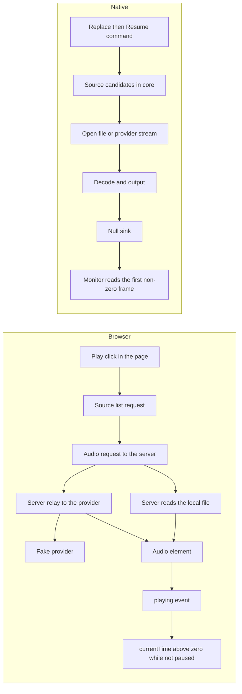

# Playback latency

This page records how Hito measures its three playback latency targets, what the first measurement showed, and what that measurement does not cover. It is a development measurement made with Docker on a development Mac. It is not the fixed reference hardware of the release gate and not a public release result.

## Targets

[The release plan](release-plan.md#release-gates) sets these gates for fixed, documented hardware and network:

| Gate                      | Target (p95) | Meaning in this document                                                           |
| ------------------------- | -----------: | ---------------------------------------------------------------------------------- |
| Local start               |    250 ms    | Play request to the first audible frame of a file in the local library             |
| Ready remote start        |     2 s      | Play request to the first audible frame of a provider source already verified ready |
| Available-source recovery |     3 s      | A playing source fails and another verified source exists: failure to audible again |

Debrid preparation (a provider fetching or converting a file before a source is ready) is a separate measurement and is not part of these numbers. It is still open.

## What is measured

Browser start: the clock starts in the page at the capture-phase `click` event of the real Play button. It stops at the first moment a tight in-page loop sees the player's media clock above zero while the element is not paused, after the `playing` event. The `playing` time is recorded too. The loop avoids the 250 ms granularity of `timeupdate`. This is the media clock, not measured sound: headless browsers have no audio device.

Native start: the clock starts before the `Replace` command is submitted to the player owner, which the desktop UI follows with `Resume`. It stops at the first non-zero frame an independent `parec` process reads from the monitor of a PulseAudio null sink that the player's CPAL/ALSA output feeds. The commands are called in process; the desktop's local HTTP or IPC hop is not included.

Recovery: the fake provider cuts the playing stream (it destroys the socket) and answers further requests for that source with 503. Two numbers are kept for each sample.

- Failure to audible: from the cut to audible output again. This is the number compared with the 3 s target because it is the stricter reading.
- Audible gap: from the moment the failure is seen (the browser raises a media error, or the native output falls silent) to audible output again. This is what a listener hears as an interruption.

The browser stops playing when it sees the error. The native player keeps playing audio it already buffered. The fake provider sends 1.5 s of audio at once and then at real-time speed, so about 1.2 s of buffered audio remains at the cut. That buffer inflates the native failure-to-audible number by a fixed amount, which is why both numbers are reported.

Two alternatives are measured. In the cached alternative the recording already has two verified ready sources and the player uses the second. In the refreshed alternative only the failing source is known, so the player asks the provider for its sources again and finds a replacement.

## Method

- Library: 10,000 synthetic tracks (3,334 FLAC, 3,333 MP3, 3,333 M4A with AAC), 20 seconds each, 44.1 kHz stereo, one sine tone per file with a unique frequency, MP3 and AAC at 128 kb/s. They sit under 500 artists and 1,000 albums with tags, 2.9 GB in total. Both surfaces scan the full library through the ordinary scan job before measuring. Generated by `scripts/bench/generate-library.sh`; nothing in it is real music.
- Server: the release `hito-server` image from `docker/server.Dockerfile` (thin LTO), the production web bundle, `RUST_LOG=info`, JSON logs, a memory-backed data directory, one administrator. The native player keeps its database in `/dev/shm`. The container needs no other services.
- Browser: Playwright 1.56.1 with headless Chromium 141 for FLAC, MP3 and provider MP3. Chromium from Playwright does not decode AAC, so M4A is measured with Playwright's WebKit. The same browser session stays open for a series; each sample searches the library box for one title and clicks its Play button, so the app is warm and the track is new.
- Native: the `start_latency` example of `hito-playback`, built in release mode, with its own core instance on the same library. It runs in the desktop tools container under the same null-sink audio harness the native playback tests use.
- Fake provider: `apps/web/e2e/latency/fake-provider.mjs`, a loopback HTTP service that implements the plugin protocol (manifest, search, detail, sources, ranged audio) for 630 recordings. The audio is one 60 second, 128 kb/s MP3. It delays every response by a settable number of milliseconds. 0 ms and 40 ms are used. 40 ms stands for a regional connection and is a stand-in for the round trip time, not a measured network.
- Samples: 100 measured samples per series after 5 discarded warm-up samples. Every sample uses a different track or recording, picked by a fixed stride through the library. A failed sample (no audible output within 15 seconds) counts as an infinite latency in the percentiles and is listed.
- Statistics: nearest-rank percentiles (the value at rank ceil(p × n)).

The provider delay applies to the provider only. Start scenarios apply it for the whole sample. Recovery scenarios apply it from the moment of the cut.

## Environment of the recorded run

| Item                  | Value                                                                                         |
| --------------------- | --------------------------------------------------------------------------------------------- |
| Date                  | 6 November 2026, UTC 03:47 to 05:07                                                           |
| Host                  | Mac17,9, Apple M5 Pro, 15 logical CPUs (5 + 10 at two performance levels), 24 GiB, macOS 27.0 |
| Docker                | OrbStack 29.4.0, Linux 7.0.14, the VM sees 15 CPUs and 11.73 GiB                              |
| Containers            | No CPU or memory limits; idle containers of other projects were running                      |
| Network               | Loopback only; server, browser and fake provider share one container network namespace        |
| Chromium / WebKit     | Chromium 141.0.7390.37 headless on Linux arm64; Playwright WebKit build 2215                  |
| Native output         | CPAL, ALSA, PulseAudio null sink at 48 kHz stereo, `parec` monitor with 5 ms chunks           |
| First library scan    | 933 s in the native player (10,000 tracks), 940 s on the server, about 94 ms per file         |
| Code                  | Commit `80d18e80` plus the benchmark files committed afterwards (`a233b901`, `94de8c0d`, `6d421249`) |

## Results

### Local start (play request to first audible frame), p95 target 250 ms

| Surface | Variant | Provider RTT | Samples ok/total | p50 ms | p95 ms | p99 ms | max ms | p95 verdict |
| --- | --- | ---: | ---: | ---: | ---: | ---: | ---: | --- |
| browser | all formats | 0 ms | 298/300 | 26.0 | 51.2 | 56.6 | fail | meets, 2 failed starts |
| browser | FLAC | 0 ms | 100/100 | 21.3 | 46.4 | 50.5 | 51.2 | meets |
| browser | M4A (WebKit) | 0 ms | 98/100 | 27.0 | 35.0 | fail | fail | meets, 2 failed starts |
| browser | MP3 | 0 ms | 100/100 | 42.3 | 53.1 | 56.6 | 59.2 | meets |
| native | all formats | 0 ms | 300/300 | 85.0 | 110.5 | 120.5 | 127.5 | meets |
| native | FLAC | 0 ms | 100/100 | 79.9 | 102.0 | 111.3 | 113.2 | meets |
| native | M4A | 0 ms | 100/100 | 97.6 | 120.0 | 121.0 | 127.5 | meets |
| native | MP3 | 0 ms | 100/100 | 76.3 | 102.4 | 109.0 | 115.3 | meets |

### Ready remote start, p95 target 2000 ms

| Surface | Variant | Provider RTT | Samples ok/total | p50 ms | p95 ms | p99 ms | max ms | p95 verdict |
| --- | --- | ---: | ---: | ---: | ---: | ---: | ---: | --- |
| browser | relay | 0 ms | 100/100 | 45.6 | 52.7 | 57.3 | 58.1 | meets |
| browser | relay | 40 ms | 100/100 | 87.6 | 100.3 | 103.3 | 104.5 | meets |
| native | direct | 0 ms | 100/100 | 89.9 | 112.0 | 120.7 | 131.3 | meets |
| native | direct | 40 ms | 100/100 | 313.1 | 338.4 | 355.9 | 609.7 | meets |

### Available-source recovery, p95 target 3000 ms

| Surface | Variant | Provider RTT | Samples ok/total | p50 ms | p95 ms | p99 ms | max ms | p95 verdict |
| --- | --- | ---: | ---: | ---: | ---: | ---: | ---: | --- |
| browser | cached_alternate | 0 ms | 100/100 | 466.0 | 480.1 | 487.9 | 493.9 | meets |
| browser | refreshed_alternate | 0 ms | 100/100 | 471.8 | 482.8 | 492.1 | 492.9 | meets |
| browser | cached_alternate | 40 ms | 100/100 | 548.6 | 567.0 | 575.3 | 578.2 | meets |
| browser | refreshed_alternate | 40 ms | 100/100 | 600.0 | 618.8 | 622.3 | 635.6 | meets |
| native | cached_alternate | 0 ms | 100/100 | 1318.6 | 1372.4 | 1392.3 | 1401.6 | meets |
| native | refreshed_alternate | 0 ms | 100/100 | 1348.2 | 1397.8 | 1410.0 | 1416.4 | meets |
| native | cached_alternate | 40 ms | 100/100 | 1565.7 | 1613.1 | 1627.2 | 1632.8 | meets |
| native | refreshed_alternate | 40 ms | 100/100 | 1624.6 | 1682.4 | 1694.7 | 1698.8 | meets |

### Recovery detail: failure observed and audible gap

The failure is observed when the browser raises a media error or the native output falls silent. The gap runs from that point to audible output again.

| Surface | Variant | Provider RTT | Drop to failure observed p50 ms | p95 ms | Audible gap p50 ms | p95 ms | max ms |
| --- | --- | ---: | ---: | ---: | ---: | ---: | ---: |
| browser | cached_alternate | 0 ms | 312.1 | 322.8 | 155.5 | 162.8 | 171.8 |
| browser | refreshed_alternate | 0 ms | 311.3 | 320.5 | 161.4 | 168.7 | 175.5 |
| browser | cached_alternate | 40 ms | 354.2 | 366.9 | 196.9 | 207.9 | 211.2 |
| browser | refreshed_alternate | 40 ms | 355.3 | 365.9 | 246.6 | 260.8 | 274.0 |
| native | cached_alternate | 0 ms | 1226.8 | 1275.3 | 89.2 | 118.8 | 134.4 |
| native | refreshed_alternate | 0 ms | 1229.5 | 1281.4 | 108.9 | 130.1 | 138.6 |
| native | cached_alternate | 40 ms | 1226.8 | 1273.5 | 327.7 | 355.0 | 364.3 |
| native | refreshed_alternate | 40 ms | 1242.7 | 1281.5 | 383.8 | 414.3 | 423.9 |

### Start detail: time to the playing signal

Browser: the media element `playing` event. Native: the player state reporting playing. Audible output follows this signal.

| Surface | Scenario | Variant | Provider RTT | playing p50 ms | playing p95 ms |
| --- | --- | --- | ---: | ---: | ---: |
| browser | local_start | all formats | 0 ms | 21.5 | 30.0 |
| browser | local_start | FLAC | 0 ms | 20.5 | 25.6 |
| browser | local_start | M4A (WebKit) | 0 ms | 26.0 | 34.0 |
| browser | local_start | MP3 | 0 ms | 20.3 | 24.8 |
| native | local_start | all formats | 0 ms | 52.4 | 75.3 |
| native | local_start | FLAC | 0 ms | 47.5 | 65.5 |
| native | local_start | M4A | 0 ms | 63.3 | 79.9 |
| native | local_start | MP3 | 0 ms | 44.4 | 62.9 |
| browser | remote_start | relay | 0 ms | 20.5 | 25.7 |
| browser | remote_start | relay | 40 ms | 62.9 | 70.7 |
| native | remote_start | direct | 0 ms | 56.7 | 78.1 |
| native | remote_start | direct | 40 ms | 280.1 | 305.1 |

Every p95 is far below its target on this setup. The worst p95 for each gate was 120 ms for local start (native M4A), 338 ms for ready remote start (native, 40 ms delay) and 1,682 ms for recovery (native, refreshed alternative, 40 ms delay).

## What decides the time

No target was missed, so nothing was profiled for a fix. The data does show where time goes.

- Native local start: about 52 ms until the player reports playing and about 33 ms more until the first frame reaches the monitor. The second part contains the output buffering of the null sink and the monitor's chunking, which real hardware replaces with its own buffer.
- Browser local start: about 21 ms until the `playing` event and a few to 20 ms more until the media clock moves. MP3 is slower than FLAC by about 20 ms at the median. The cause was not investigated.
- Browser ready remote start: one provider audio request per start (counted at the provider). The relay adds about 3 ms at the median over a local MP3 and each 40 ms of provider delay adds 42 ms.
- Native ready remote start: five provider audio requests per start (all but one of the 200 samples). A 40 ms delay adds about 220 ms, which matches the requests running one after another. Extending that line gives 2 s at a provider round trip near 380 ms. That is an estimate, not a measurement, and it ignores TLS handshakes and bandwidth. Fewer or overlapping probes would lower it.
- One native sample at 40 ms took 610 ms and logged ten provider audio requests and one source request. The player probably failed its first attempt, asked the provider for sources again and retried. The cause was not found.
- Browser recovery: about 310 ms from the cut to the media error, with three provider audio requests per sample (the start, probably one retry of the cut stream by the browser, and the new source). The remaining median gap of 155 to 247 ms is the player choosing the next source and starting it. The refreshed alternative adds one source request.
- Native recovery: about 1.23 s of buffered audio keeps playing after the cut. The median audible gap is 89 to 384 ms. A 40 ms provider delay adds about 240 ms to it, which matches the five provider requests that opening a source makes.

## Findings that stay open

- WebKit AAC starts failed 2 times in 100. The media element reported `playing` with `currentTime` stuck at 0 and no error. A diagnostic repeat of 200 starts on a small library reproduced one stall for one of the same tracks. The failed starts follow a `seeking` and `seeked` pair at the start that the successful ones also show. None of the 800 measured Chromium starts and 900 measured native starts stalled. It may belong to Playwright's Linux WebKit build and was not investigated further. The failed starts count as infinite in the table, so the WebKit M4A p99 reads `fail`.
- The first scan of 10,000 tracks took about 15.5 minutes. At that rate 100,000 tracks would take about 2.6 hours. That scan time is not a playback target but matters to the 100,000-track load gate.

## Limits

- Not the reference hardware, not fixed: Docker on a development Mac, one run, no CPU pinning, other containers present. Run-to-run variation was not measured.
- The browser measures the media clock in headless browsers. No sound is heard. Chromium here cannot decode AAC.
- The native numbers come from a Linux null sink and a `parec` monitor. They contain that path's buffering and not the buffering of a physical device, CoreAudio, WASAPI or ALSA hardware. Windows, Linux desktops and macOS audio were not measured.
- Native remote start and recovery talk to the provider directly from core. Only the browser goes through the server relay.
- The network is loopback with a fixed delay per response. There is no TLS, bandwidth limit, packet loss or connection setup, and no real provider.
- One account, one listener, 10,000 tracks of 20 seconds. The 100,000-track, ten-account and five-listener gate is separate and still open.
- Debrid preparation is not measured. Neither are slow providers, expired links, failed seeks or a restarting server.
- Files and the database were warm in the operating system cache after the scan. Cold-disk starts were not measured.

## Run it again

`scripts/bench-playback.sh` (or `make bench-playback`) runs the whole measurement. It needs Docker, about 3 GB for the generated library volume and 1.5 GB of Cargo output, a free host with nothing heavy running, and about 80 minutes for 10,000 tracks (about 30 minutes of that are the two first scans). The script refuses to start while another `hito-arch-latency` container exists.

It uses its own Compose project (`hito-arch-latency` by default), separate volumes, and never the normal `hito` project. The steps are `library`, `browser`, `native` and `report`, set with `BENCH_STEPS` (all four by default). Other settings:

| Variable                 | Default                           | Purpose                                              |
| ------------------------ | --------------------------------- | ---------------------------------------------------- |
| `BENCH_SAMPLES`          | 100                               | Measured samples per series                          |
| `BENCH_RTT_MS`           | 40                                | Provider delay for the delayed scenarios             |
| `BENCH_TRACKS`           | 10000                             | Library size (use 300 for a quick development run)   |
| `BENCH_LIBRARY_VOLUME`   | `hito-arch-latency_library`       | Volume that holds the generated library              |
| `BENCH_SERVER_CACHE_ID`  | `hito-arch-latency-release`       | Docker build cache for the release server            |
| `BENCH_RESULTS`          | `test-results/latency`            | Where results are written (ignored by Git)           |

The results directory holds `browser-samples.csv` and `native-samples.csv` (every sample), `results.md` and `summary.json` (the tables), `latency-distribution.png`, `host.txt` and the two environment files. The first run builds a release server image and a release native example, which takes a while.

To remove what a run leaves behind, remove the containers of the project, its images and the volumes `hito-arch-latency_library` and `hito-arch-latency_rust-target` by name. Do not prune globally.

The measurement code is `apps/web/e2e/latency/` (browser and fake provider), `crates/playback/examples/start_latency.rs` (native) and `scripts/bench/` (library, report and chart). None of it runs in the default test suites or ships in release binaries.

