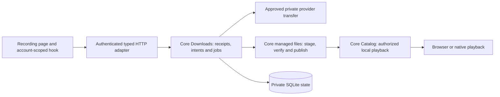

# Persistent downloads

This document describes the provider-track download slice under development. Migration 29 and this implementation are not accepted or deployed. The normal local development deployment remains `main` commit `6dad1dc`, with migration 28 and playlist Follow. Neither deployment is a completed public release. The full scope remains in [the release plan](release-plan.md).

## Ownership and flow

A user selects **Download** for a saved provider recording. Loading its page, adopting it into the library, checking availability, or playing it does not create a persistent download. The authenticated request records durable work; a joined host worker transfers and verifies audio before making a managed source playable.

`Downloads` owns acceptance, transactions, durable authority, leases, progress, removal and recovery. `Plugins` supplies the approved provider transfer without exposing credentials or upstream URLs. Managed storage owns generated filenames, private directory handles, audio inspection and file publication. `Catalog` owns source visibility and playback grants. The host composes these services and joins background work; HTTP and React contain no SQL or filesystem ownership rules.

The durable intent belongs to an account, recording and backend `HostDeviceId`. Its authority captures the library access grant and approved provider binding, installation, service and credential revisions. Transfer authority outlives the initiating browser request; it does not retain that request's session as a background-job credential. Workers recheck the captured authority before publication. A synchronization client's device ID does not grant access to the backend's files.

A completed managed source remains account-private and belongs to its backend host. Playback rechecks current access and the retained file/intent identity. Ready playback uses the managed copy without contacting its original provider. Source selection prefers a suitable user-owned local file, then a managed copy, then provider audio. Successful publication does not replace recording identity, selected source metadata, personal edits, playlists, likes or progress.

## HTTP and UI

Rust routes and wire types generate OpenAPI and TypeScript. The development interface has these routes:

| Request                                                        | Result                                                                                  |
| -------------------------------------------------------------- | --------------------------------------------------------------------------------------- |
| `POST /api/v1/recordings/{id}/download` with `DownloadRequest` | `202` and a `DownloadReceipt`                                                           |
| `GET /api/v1/recordings/{id}/download`                         | `200` and `DownloadStatus` for the visible current intent; `404` when absent or removed |
| `DELETE /api/v1/downloads/{intent_id}`                         | `204` after accepting removal of that owned intent                                      |

`DownloadRequest` contains one request UUID. Its immutable receipt records the account, request identity, recording/backend-host request digest and intent identity. Exact replay returns the retained receipt without creating another transfer, including after removal. Reusing that UUID for another recording or backend conflicts. A receipt is not a promise that its old intent is still ready.

The recording page delegates asynchronous work to an account/recording-scoped hook. It cancels stale reads, polls queued/running/verifying work, and renders **Saved on this server** for web sessions or **Saved on this device** for the local desktop host. Download status does not start playback or replace an unsent metadata draft. An uncertain create retries the same request UUID. Removal captures the intent UUID, so retrying an old removal cannot target a later copy for the same recording. Focus changes and retries must retain this ownership.

Browser downloads live on the Hito server. The browser still requires its server connection. This slice does not provide full browser offline operation.

## Files, removal and explicit repair

Managed storage uses a private directory beside the database, separate from user-selected music folders. On Unix, new directories use mode `0700` and audio files use `0600`. Core opens capability-relative handles, rejects aliases and non-regular inputs, and generates names from file and attempt UUIDs. Public download requests and status expose UUIDs and progress, never filesystem paths or signed stream URLs.

A transfer writes an exclusive staging file. The shared inspector checks the complete input and decoded audio, determines a supported MIME type, and records its checksum and length. On Unix, inspection snapshots also use creation-time directory mode `0700` and file mode `0600`. An unsupported inspection profile is not accepted as verified audio. Publication synchronizes file data, creates the final generated name without overwriting another file, and synchronizes the directory before committing a ready source. The current input bound is 2 GiB; verification also needs temporary snapshot space. That bound is not disk reservation or disk-exhaustion acceptance.

Removal withdraws the specific intent before reclaiming its managed copy. It preserves original music files and library/private state. Known owned staging/final files can require deferred cleanup. Retained receipts do not silently recreate removed content. Attempt reservations exist before a worker publishes its lease, and removal revokes admission before cleanup. Host shutdown waits for actual managed filesystem work, snapshot readers and decoder processes to retire. Retirement renews its lease while retaining the original authority checks; an authorized interrupted intent returns to the queue.

Status checks validate file presence, ownership, type and length. Opening audio also checks its full checksum. When validation identifies a missing or corrupt copy, core fences that exact retained file and reports `file_unavailable`; it does not silently download replacement audio. The UI directs the user to remove the failed download and select **Download** again. Repair uses a fresh request UUID. Replaying the original UUID continues to return its original receipt. Status checks are not a periodic full-disk corruption scan.

Workflow logs use structured account/request/intent/job/file identifiers, static outcomes, progress and timings. Frequent polling belongs at debug/trace. Credentials, sessions, bodies, audio, private paths, titles and upstream URLs must stay out of logs. Final redaction and lifecycle review are part of acceptance.

## Evidence and remaining gates

The current root-run core/server suite passed 317 unique cases, with one usual ignored fault test. Its 321 passing execution records include four child-process repetitions. The workspace check, strict core/server Clippy, formatting and actual Rust OpenAPI export comparison passed. The unchanged frontend passed 168 web cases across 46 files and its production build; both TypeScript checks and formatting for the new workflow and browser fixtures passed again. Focused public capability and HTTP/runtime checks exercised verified WAV publication, provider-outage and restart playback, local audio/range responses, intent-specific removal and receipt replay, while preserving originals and catalog/private state. These are development results, not codec, performance or release certification.

The first independent review exposed two real failing public regressions: a late writer could survive completed removal, and an actual snapshot reader could survive host shutdown. Both reproduced on the previous implementation and passed after reservation and inspection ownership fixes. Eleven unique focused capability and HTTP/runtime cases, strict core/server Clippy and formatting passed. Migration-backed SQLite query plans now use the queued-intent and queued-job indexes instead of recurring historical-intent scans. This checks query shape, not a populated workload or release latency.

The second and final independent review found three more issues: a timed-out removal thread could outlive host shutdown, retirement beyond the 30-second lease could fail an authorized interrupted intent, and command admission was outside the command timeout. Each received an actual failing regression and passed after correction. A separate public held-decoder test exposed permissive temporary snapshot modes, which now pass with private creation permissions and joined process/file cleanup. The command timeout and temporary-mode gaps also existed in the earlier implementation. Five focused cases and the complete suite passed after these fixes. Verification was direct; no third independent review or independently clean final verdict is claimed.

The Chromium recording-download workflow is written but not yet verified. It requires an explicitly opted-in fresh disposable server and owned provider bytes. It covers no implicit download or autoplay, saved-copy persistence across navigation/reload, managed playback with provider audio unavailable, draft preservation, original/private-state retention, and an actual committed removal whose acknowledgement is lost before an old-intent retry. Process restart has a separate HTTP/runtime test. The actual release-image browser run and deployment migration audit remain open.

This is a Unix provider-track slice. Local-original Download behavior, playlist and followed-playlist download references, shared-copy accounting, a separate temporary playback-cache policy, disk reservations and exhaustion, forced crashes, the supported codec/conversion matrix, and load/performance gates remain release work. Windows private ACL support is unfinished; downloads are rejected there before audio is written while the rest of the application can open. macOS and Windows verification, packaging/signing and platform playback acceptance remain open. These tasks remain required by the release plan.
