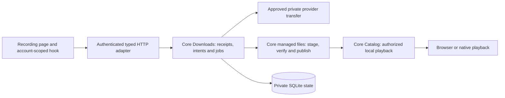

# Persistent downloads

Explicit provider-track downloads are deployed to the local development server on migration 29. Open a saved recording with an available provider audio source and select **Download**. The web UI reports **Saved on this server** after verification. This is a development slice, not a completed public release. The full scope remains in [the release plan](release-plan.md).

## Ownership and flow

A user selects **Download** for a saved provider recording. Loading its page, adopting it into the library, checking availability, or playing it does not create a persistent download. The authenticated request records durable work; a joined host worker transfers and verifies audio before making a managed source playable.

`Downloads` owns acceptance, transactions, durable authority, leases, progress, removal and recovery. `Plugins` supplies the approved provider transfer without exposing credentials or upstream URLs. Managed storage owns generated filenames, private directory handles, audio inspection and file publication. `Catalog` owns source visibility and playback grants. The host composes these services and joins background work; HTTP and React contain no SQL or filesystem ownership rules.

The durable intent belongs to an account, recording and backend `HostDeviceId`. Its authority captures the library access grant and approved provider binding, installation, service and credential revisions. Transfer authority outlives the initiating browser request; it does not retain that request's session as a background-job credential. Workers recheck the captured authority before publication. A synchronization client's device ID does not grant access to the backend's files.

A completed managed source remains account-private and belongs to its backend host. Playback rechecks current access and the retained file/intent identity. Ready playback uses the managed copy without contacting its original provider. Source selection prefers a suitable user-owned local file, then a managed copy, then provider audio. Successful publication does not replace recording identity, selected source metadata, personal edits, playlists, likes or progress.

## HTTP and UI

Rust routes and wire types generate OpenAPI and TypeScript. The development interface has these routes:

| Request                                                        | Result                                                                                  |
| -------------------------------------------------------------- | --------------------------------------------------------------------------------------- |
| `POST /api/v1/recordings/{id}/download` with `DownloadRequest` | `202` and a `DownloadReceipt`                                                           |
| `GET /api/v1/recordings/{id}/download`                         | `200` and `DownloadStatus` for the visible current intent; `404` when absent or removed |
| `DELETE /api/v1/downloads/{intent_id}`                         | `204` after accepting removal of that owned intent                                      |

`DownloadRequest` contains one request UUID. Its immutable receipt records the account, request identity, recording/backend-host request digest and intent identity. Exact replay returns the retained receipt without creating another transfer, including after removal. Reusing that UUID for another recording or backend conflicts. A receipt is not a promise that its old intent is still ready.

The recording page delegates asynchronous work to an account/recording-scoped hook. It cancels stale reads, polls queued/running/verifying work, and renders **Saved on this server** for web sessions or **Saved on this device** for the local desktop host. Download status does not start playback or replace an unsent metadata draft. An uncertain create retries the same request UUID. Removal captures the intent UUID, so retrying an old removal cannot target a later copy for the same recording. Focus changes and retries must retain this ownership.

Browser downloads live on the Hito server. The browser still requires its server connection. This slice does not provide full browser offline operation.

## Files, removal and explicit repair

Managed storage uses a private directory beside the database, separate from user-selected music folders. On Unix, new directories use mode `0700` and audio files use `0600`. Core opens capability-relative handles, rejects aliases and non-regular inputs, and generates names from file and attempt UUIDs. Public download requests and status expose UUIDs and progress, never filesystem paths or signed stream URLs.

A transfer writes an exclusive staging file. The shared inspector checks the complete input and decoded audio, determines a supported MIME type, and records its checksum and length. On Unix, inspection snapshots also use creation-time directory mode `0700` and file mode `0600`. An unsupported inspection profile is not accepted as verified audio. Publication synchronizes file data, creates the final generated name without overwriting another file, and synchronizes the directory before committing a ready source. The current input bound is 2 GiB; verification also needs temporary snapshot space. That bound is not a disk reservation; [disk exhaustion](#full-disk-interrupted-transfers-and-restart) is handled after it happens.

Removal withdraws the specific intent before reclaiming its managed copy. It preserves original music files and library/private state. Known owned staging/final files can require deferred cleanup. Retained receipts do not silently recreate removed content. Attempt reservations exist before a worker publishes its lease, and removal revokes admission before cleanup. Host shutdown waits for actual managed filesystem work, snapshot readers and decoder processes to retire. Retirement renews its lease while retaining the original authority checks; an authorized interrupted intent returns to the queue.

Status checks validate file presence, ownership, type and length. Opening audio also checks its full checksum. When validation identifies a missing or corrupt copy, core fences that exact retained file and reports `file_unavailable`; it does not silently download replacement audio. The UI directs the user to remove the failed download and select **Download** again. Repair uses a fresh request UUID. Replaying the original UUID continues to return its original receipt. Status checks are not a periodic full-disk corruption scan.

Workflow logs use structured account/request/intent/job/file identifiers, static outcomes, progress and timings. Frequent polling belongs at debug/trace. Credentials, sessions, bodies, audio, private paths, titles and upstream URLs must stay out of logs. Final redaction and lifecycle review are part of acceptance.

## Full disk, interrupted transfers and restart

These rules are current behavior in the source tree. They need no migration. They are not deployed to the running development server.

| Situation | What happens |
| --- | --- |
| The disk fills while audio is written, synced or published (`ENOSPC` or `EDQUOT`) | The attempt ends with the typed core error `insufficient_storage`. The intent stays `queued` and `GET /api/v1/recordings/{id}/download` reports `error: "insufficient_storage"`. The recording page says **Not enough disk space on this server. Hito will try again.** It is not shown as a provider failure and does not use up the three provider attempts. |
| The same disk is still full | The job waits 120 seconds before its next attempt, so nothing retries in a loop. Each queued download makes at most one attempt per wait. When the next attempt succeeds, the intent returns to `running` and then `ready` with no manual step. |
| Any failed attempt | The partial staging file is deleted, no source row is published, and the original provider source stays the only source. Cleanup removes files, so it works on a full disk. |
| The provider connection drops mid-body | If the provider advertised `Accept-Ranges: bytes` and a total length, the same attempt asks again for `Range: bytes=N-`, where N is the number of bytes already written to the staging file, and appends the answer to that file. This resume happens at most three times per attempt and does not use up an attempt. It continues only for a `206` whose `Content-Range` starts at N and whose total length equals the first answer, and whose `ETag` and `Last-Modified` equal the first answer's wherever the first answer had them (a weak `ETag` never supports a resume). A plain `200` (the provider ignored the range), a changed validator or total, or a `416` makes the attempt discard the staging bytes and start from byte zero in the same file; a resumed body is never spliced onto different content. A provider that does not advertise ranges, a resume that gets an error status, or a failure after the three resumes fails the attempt as `provider_unavailable`, the staging file is deleted, and the next attempt starts again from byte zero with a new generated file name. The partial file is not kept between attempts. |
| The provider keeps sending, but too slowly | The [audio throughput floor](plugins.md#audio-throughput-floor) ends the attempt with the typed core error `stream_too_slow`. It is not resumed inside the attempt. It counts as a provider failure: the intent returns to `queued` as `provider_unavailable` with the usual 2 and 4 second backoff, and the third failed attempt ends as `transfer_failed`. |
| The provider body ends cleanly but short | The audio inspector rejects the incomplete file. The intent is `failed` with `transfer_failed`, nothing is published, and a fresh Download request after removal succeeds with complete audio. |
| The server starts | Core lists the `<uuid>.<uuid>.part` regular files in the private downloads directory and deletes each one whose attempt id has no running job with an unexpired lease. A file that a live transfer still holds, in this or another process, is kept; a lease is renewed at least every second and lasts 30 seconds. Files that fail the exact lowercase name check (uppercase, extra dots, a `.bak` suffix), directories, symlinks, verified `.media` files, unknown files and music folders are never touched. The database row of an interrupted attempt is recovered by lease expiry as before. A sweep failure is logged and does not stop startup. The sweep logs at info when it removes files and at debug otherwise. |
| A saved download is played while the disk is full | Playback reads the managed copy only. It does not write to the private directory, and it works while the provider is offline. |

The reason is not stored on the intent, because its error check cannot change without rebuilding the table. A queued intent reports `insufficient_storage` when its single queued job has zero attempts and a next attempt exactly 120 seconds after its last update. A storage failure gives the attempt back and sets that wait, and the reason stays on the status until the next attempt claims the job, so it does not flicker back to a plain queued state when the wait ends. A provider retry always keeps at least one attempt, and a new or shutdown-requeued job has no such gap, so neither matches. The wire types are unchanged, so no TypeScript was regenerated. A playlist download entry waiting for space reports `status: "queued"` with the same `error: "insufficient_storage"` code, from the same shared check as the recording status, and the playlist download strip says "entries are waiting for disk space on this server. Hito will try again." instead of counting them as failures. The code carries no paths or sizes. The core error maps to HTTP 507 with the generic body "Hito could not complete this request" (checked by a unit test in `apps/server/src/error.rs`; no current route returns it). When the database shares the full disk, SQLite reports `SQLITE_FULL` (code 13). Core treats that as a storage failure. If the attempt cannot even be settled, the worker remembers the lease in memory, and lease-expiry recovery in the same process gives the attempt back and waits 120 seconds instead of keeping the attempt used. After a process restart that memory is gone, so expiry recovery counts the attempt as before and three such failures end as `failed` with `lease_expired`. Inspection snapshots in the system temporary directory are not covered: a full temporary directory still fails as a transfer failure. The wait is a fixed 120 seconds. It is not exponential and does not adapt to free space, and it does not check free space before it starts a transfer.

Tests: `crates/core/tests/download_disk_full.rs` (three cases) runs the actual worker in a child process with `crates/core/tests/fixtures/write_fault_shim.rs`. That `LD_PRELOAD` shim returns `ENOSPC` from `write`, `writev`, `pwrite`, `pwrite64` and `fsync` for files under the private downloads directory while a flag file exists. It is Linux only, so it runs in Docker. `crates/core/tests/downloads/download_interrupted_transfer.rs` covers the dropped and short bodies. `crates/core/tests/downloads/download_startup_sweep.rs` covers the startup sweep, near-miss names and a live leased transfer that survives a second open. `download_disk_full.rs` also covers a full disk shared with the database (`full-db` flag), a failing directory fsync, the 100 to 120 second wait and the persistent status reason. ENOSPC from creating the staging file and from the hard link is mapped in code but untested: the file operations go through direct system calls that `LD_PRELOAD` cannot intercept. `apps/web/src/features/downloads/tests/recording-download-storage.test.ts` covers the message, and `playlist-download-storage.test.ts` covers the playlist strip; `download_disk_full.rs` also covers the playlist entry reason and its clearing once the copy is saved. These are development results with owned deterministic audio. They are not a measure of real disk behavior, a quota, or a production incident exercise.

## Evidence and remaining gates

The current root-run core/server suite passed 317 unique cases, with one usual ignored fault test. Its 321 passing execution records include four child-process repetitions. The workspace check, strict core/server Clippy, formatting and actual Rust OpenAPI export comparison passed. The unchanged frontend passed 168 web cases across 46 files and its production build; both TypeScript checks and formatting for the new workflow and browser fixtures passed again. Focused public capability and HTTP/runtime checks exercised verified WAV publication, provider-outage and restart playback, local audio/range responses, intent-specific removal and receipt replay, while preserving originals and catalog/private state. These are development results, not codec, performance or release certification.

The first independent review exposed two real failing public regressions: a late writer could survive completed removal, and an actual snapshot reader could survive host shutdown. Both reproduced on the previous implementation and passed after reservation and inspection ownership fixes. Eleven unique focused capability and HTTP/runtime cases, strict core/server Clippy and formatting passed. Migration-backed SQLite query plans now use the queued-intent and queued-job indexes instead of recurring historical-intent scans. This checks query shape, not a populated workload or release latency.

The second and final independent review found three more issues: a timed-out removal thread could outlive host shutdown, retirement beyond the 30-second lease could fail an authorized interrupted intent, and command admission was outside the command timeout. Each received an actual failing regression and passed after correction. A separate public held-decoder test exposed permissive temporary snapshot modes, which now pass with private creation permissions and joined process/file cleanup. The command timeout and temporary-mode gaps also existed in the earlier implementation. Five focused cases and the complete suite passed after these fixes. Verification was direct; no third independent review or independently clean final verdict is claimed.

The actual release-image Chromium workflow passed in 8.5 seconds on application source `893bf23`, image `sha256:dd8d7b1cda1488072b1d02153d018b0bc24ddde84977616e5472f30e2baba992`. Its explicitly opted-in disposable server used private temporary data and owned provider bytes. It verified no implicit download or autoplay, saved-copy persistence across navigation/reload, actual managed audio playback while the provider returned `503`, draft preservation, original/private-state retention, and a committed removal whose acknowledgement was lost before an old-intent retry preserved a newly downloaded copy. Final removal made both status and managed audio unavailable. Process restart has a separate HTTP/runtime test.

A scoped check of 1,903 structured server log records found none of the known fixture credential, provider/personal/draft title or private path markers. This is evidence for that workflow, not a universal logging certification.

The migration-28 whole-volume backup was restored into a fresh owned volume before rehearsing migration 29. A separate fresh backup preceded the normal upgrade. Both actual migrations preserved all columns, rows and hidden rowids in 75 previous application and FTS tables, sequence rows and high-water values, all previous migration records, schema and triggers. All 29 source checksums, database integrity, foreign keys and six FTS integrity checks pass. The only new tables are the four empty download tables; the new authority view matches the actual migration. The private managed directory is empty, mode 0700 and owned by UID/GID 10001. Other volume entries, including credential and host-identity files, retain their bytes and metadata.

The candidate first started without published ports, then stopped for the data audit. The final published server passes health, generated OpenAPI, exact served JS/CSS and rejection of an anonymous player request. Environment, mounts, configured network endpoints, runtime policy and unrelated services were preserved. No listener account was authenticated or changed by the deployment. The private audit helpers used conservative entry, depth and JSON bounds for this specific volume; large-volume and packaged backup acceptance remain open. See [deployment evidence](status.md#running-local-deployment).

This is a Unix provider-track slice. Local-original Download behavior, playlist and followed-playlist download references, shared-copy accounting, a separate temporary playback-cache policy, disk reservations and free-space checks before a transfer, forced process crashes, the supported codec/conversion matrix, and load/performance gates remain release work. Windows private ACL support is unfinished; downloads are rejected there before audio is written while the rest of the application can open. macOS and Windows verification, packaging/signing and platform playback acceptance remain open. These tasks remain required by the release plan.
