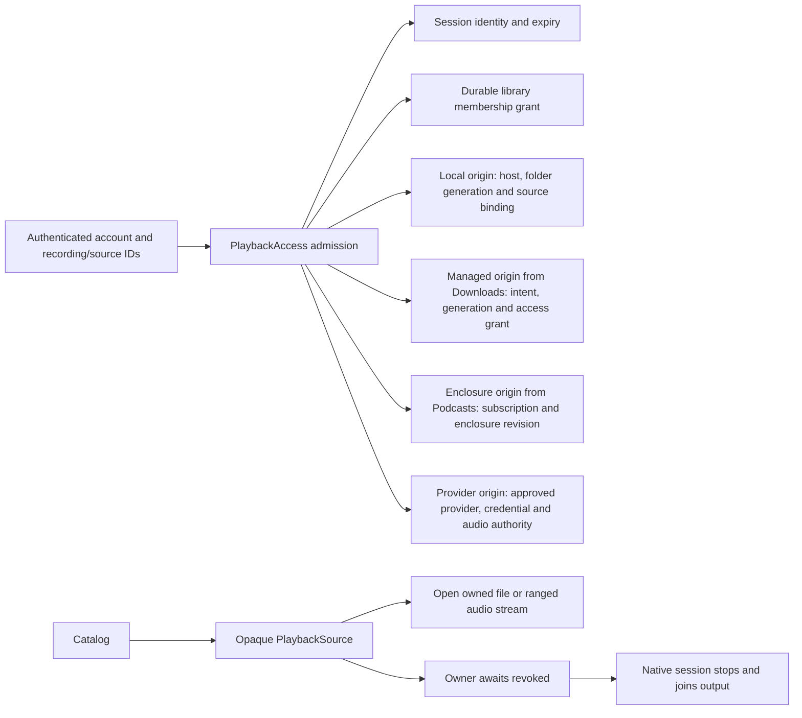

# Playback access

`PlaybackAccess::playback_source(actor, recording, source)` issues an opaque core grant for an exact recording/source pair. The [native playback owner](native-playback.md) now uses it for authorized input and output supervision. The desktop shared UI uses authenticated commands; its Rust queue owner calls this boundary. The renderer never receives the trusted grant or private locator.

An authenticated `Actor` retains a private session fingerprint. It is neither serialized nor included in Debug output. Ordinary application requests still authenticate through the shared HTTP extractor. A long-running playback owner must retain the grant and supervise `revoked()` while starting, playing, paused, or draining buffered audio.

## Origins

`PlaybackAccess` owns the grant, the revocation loop and the audio relay. Each source kind is an `AudioOrigin` that locates the source, later says whether what it located is still current, and opens the audio. `Downloads` supplies the managed origin and `Podcasts` the enclosure origin, next to their SQL. Local files and provider streams are origins inside `PlaybackAccess`. A grant keeps the opaque value its origin located, and every check asks that origin again.

Origins are tried in a fixed order: provider, podcast, managed, local. A unit test pins the order. `Catalog` no longer serves audio, and `Downloads` and `Podcasts` no longer hold it. They still share some code with it, listed in [RFC 0002](rfcs/0002-playback-access-boundary.md#what-changed). `tests/playback_origin_contract.rs` runs one contract over all four kinds. A grant dies when its pinned state changes, stays dead after the state returns, and a fresh grant is admitted.

## Checks and revocation

Admission and each authority check have a one-second deadline. A check failure permanently invalidates that grant and its clones, including a timeout or database error. The application coordinator suspends output and mutations while retaining its queue, then rechecks session and selected-recording access before requesting fresh grants. Old grants never revive. Definitive session rejection clears private ownership. No raw session token, credential, locator, media bytes, or private path appears in grant logs. Workflow spans use a process-local numeric correlation ID.

`revoked()` checks immediately, then waits 250 ms between checks. With an actively polled owner and a responsive executor, a withdrawal can take one poll interval plus a bounded authorization query to become visible. This is not instantaneous revocation or a measured physical-audio cutoff. The owner must keep the revocation future polled, retain ownership of blocking engine work, and join cleanup before releasing the desktop library claim.

The grant pins:

- The specific session, its account, and its live expiry. Another session for the same account does not restore the original session.
- The recording/source relationship and a durable library membership identity. Removing and immediately restoring membership creates a new identity, even through another core instance.
- For local files, current host availability, the folder generation, and its stored locator. An unchanged rescan preserves authority; disconnect/reconnect does not revive old grants.
- For provider audio, the existing credential, approved service/installation, source binding, and audio-authorization generation. Accepting a manifest without Sources withdraws that generation. Restoring the capability requires fresh playback authority.

Ordinary provider checks and current-source discovery do not withdraw a healthy stream's authority. An omitted or unready cached source can prevent a new open while the owner still drains an already authorized stream. Clearing credentials, removing the connection, withdrawing its service, or revoking Sources invalidates that stream's grant.

Pending opens race against revocation and recheck authority before publication. Local opening retains core's existing directory containment and cancellation ownership. Provider opening retains its admission permits, endpoint restrictions, protocol validation, and bounded transfer behavior.

An owned `AudioFile` is still a normal file descriptor. Revoking the grant does not forcibly close a descriptor already returned to the caller. `OpenedAudio` retains existing provider body supervision but does not gain automatic session supervision. Native integration must keep the grant beside either resource and stop output after notification. This API does not make an unsupervised decoder safe to use after logout.

## Storage and verification

Migration 0023 adds durable identities beside existing library memberships. It backfills current memberships without changing their rows or row IDs. Cascading deletion removes the old identity, and a membership-insert trigger creates a fresh one. Provider audio generations change only on capability withdrawal, preserving ordinary connection refreshes.

Public capability fixtures cover logout with a retained actor, idle expiry notification, cross-instance membership revoke/restore, exact recording/source and account isolation, folder reconnect/rescan, provider credential removal, pending-handshake cancellation, harmless refresh, capability withdrawal/restoration, and a populated upgrade. Tests use temporary SQLite and owned deterministic audio through Docker.

`hito-playback` supplies bounded local/range input and supervision of actual CPAL output, with canceled-observer cleanup tests. The application coordinator, authenticated native commands/observations, account-switch fencing, ordered progress, retained host shutdown, and shared React native client are implemented. Durable offline state, downloads, full native transport features, and release acceptance remain unfinished. See [native playback ownership](native-playback.md) and the [release plan](release-plan.md).
