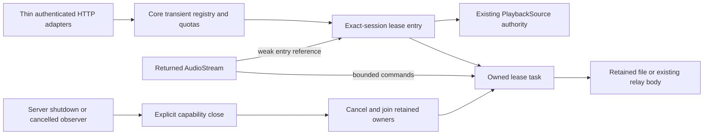

# Retained playback leases

The retained Core capability has authenticated HTTP adapters and server runtime shutdown integration in development source at `385b2969`. The exact combined backend passes independent verification. This does not complete the remote client, desktop remote mode or a running deployment.

`PlaybackAccess.begin_lease` retains an already authorized recording/source pair for one exact foreground session. It returns a random handle and the original expiry. `lease_status` checks current authority without renewing it; `open_lease_audio` opens original audio or an independent range; `release_lease` retires an owned handle. `close` cancels and joins owners admitted through this lease API. It does not close ordinary playback grants elsewhere in the application.

## Ownership and authority

Core owns authorization, SQLite, descriptors, relay bodies and cancellation. The retained grant uses the existing `PlaybackSource` policy. Account, session, PIN, library-grant incarnation and source authority remain separate checks. Another session of the same account cannot use or release the handle. Background and unattended actors cannot create or operate leases.

Observed authorization failure permanently stops the requested owned lease. Unlocking the same session or withdrawing and restoring library membership cannot revive it. Creation, open and read delivery recheck retirement after the reply handoff. This also rejects a successful chunk queued before closure but polled afterward.

Indexed originals retain one contained, authorized descriptor. Reads use independent positional offsets, at most 64 KiB at a time, with observed size, modification and file-identity checks around each read. They require no whole-file copy or hash at admission. These metadata fences are not a cryptographic immutability guarantee or a strong ETag. Managed audio keeps its existing verification policy; provider bodies keep the existing relay and validator behavior.

## HTTP and runtime contract

These routes start at `/api/v1/playback/leases` and use the shared session/bearer authentication, account fence and browser-origin policy. Adapters map typed requests and results; Core retains authorization, transaction and resource ownership. Generate clients from the actual Rust OpenAPI.

| Method and suffix | Operation ID | Request | Result |
| --- | --- | --- | --- |
| POST at the root | `playback_lease_begin` | `BeginPlaybackLease` with string `recording_id` and `source_id` | 200 `PlaybackLease` |
| GET `/{id}` | `playback_lease_status` | UUID handle | 200 `PlaybackLease`, without renewal |
| DELETE `/{id}` | `playback_lease_release` | UUID handle, no JSON body | 204 after owned retirement |
| GET `/{id}/audio` | `playback_lease_audio` | UUID handle and optional `Range`/`If-Range` | Original audio, 200 or 206 |
| HEAD `/{id}/audio` | `playback_lease_audio_head` | UUID handle | 200 headers with no audio body |

Creation accepts exactly the two required fields; unknown fields, wrong types and malformed or oversized JSON use the shared bounded request policy. `PlaybackLease` contains only UUID `id` and integer `expires_at`, the original Unix timestamp in seconds. The handle conveys no authority by itself, offline access or Download intent. Known foreign-session handles are unavailable even to another session of the same account. Release of an unknown or already retired owned handle is idempotent under current authorization.

Creation requires an unlocked account. Status, release and audio use `LockableAccount` so a locked but authenticated owner reaches Core's retirement check before returning the lock error. The old lease stays retired after unlock. Another locked session cannot retire the owner's lease. Responses retain the existing private, no-store policy and safe errors.

Original audio reuses the existing representation policy. Seekable sources support a single byte range; malformed or unsatisfiable ranges return 416 after authorization. HEAD ignores Range. If-Range also suppresses Range because this route provides no conditional validator. Content type, length when known, range headers and seekability come from Core. There is no transcode or quality negotiation through a lease.

The server's owned runtime calls `PlaybackAccess.close` alongside the other capability closures when shutdown starts. Cancelling the outer serve observer signals that owned runtime rather than abandoning it. Closing the capability retires leases and returned bodies and joins retained work before server completion. Dropping an HTTP audio body releases that body's admission; it does not release the whole lease. The client must explicitly release its handle when finished.

## Limits and retirement

| Resource | Limit |
| --- | --- |
| Live or creating leases | Eight per account, 32 per Core owner |
| Pending creation subset | Five per account, eight per Core owner |
| Audio bodies | Two per lease |
| Buffered commands | Eight per lease |
| Original lifetime | At most 24 hours, without renewal |

The pending reservation precedes current authorization SQL. Caller futures waiting to send are outside the buffered-command limit. These limits do not bound total application memory.

Dropping a creation observer stops its unpublished work. Dropping a body releases its body admission. A retained, unpolled body has no strong reference to Core or the descriptor after its owner retires. Explicit close continues joining owners even if a close observer is cancelled, and awaits an actual in-flight blocking read before reporting completion.

The existing one-second grant-admission deadline is not a universal creation or cleanup deadline. Source opens and stalled filesystem work can delay cleanup. SQLite test ownership establishes worker-local resource retirement, not an OS-thread or TLS-destructor join. Workflow logs retain safe outcomes, correlation and timings rather than credentials, session material, media paths, titles or signed URLs.

## Earlier Core qualification

Two specialist review rounds resolved an observed-PIN-lock race. The regression holds a real read worker through lock, status/open/release failure and same-session unlock; the old body and handle must remain dead. A second locked session cannot retire the owner. Other controls cover quota contention before SQL, cancelled creators, held reads, cancelled close observers and queued publication after retirement.

An independent fresh-source Docker repeat passes all 174 Core unit cases, 19 public lease cases, 51 existing playback regressions and 42 native command/resource controls. Exact names match, with no failed, ignored or filtered cases. Strict Core all-target checks, a separate production-only Core check with no optional features, strict native-example checks and formatting pass. All 3,963 combined source and support inputs remain unchanged. The native controls use an empty queue and open no audio Session or output.

The result manifest has SHA-256 `58fe5caa3618e7d5de2ed751358fcfb596982ab65e52a9ae6851376c772b6804`. An initial verification attempt stopped compilation when its resource probe encountered deleted Cargo temporary files. That infrastructure failure remains recorded; six Docker controls qualify the corrected probe, and the same frozen source then passes the complete repeat.

## HTTP/runtime qualification

An independent fresh combined-source Docker repeat passes all 135 named cases, including twelve HTTP lease cases, four runtime cases and thirteen audio-quality regressions. These cover shared authentication and origin policy, exact-session privacy, locked-owner retirement, original representation behavior, cancellation and real TCP shutdown. Two pre-existing lyric diagnostics remain ignored. Strict Core/server all-target checks, production Core checking and workspace formatting pass; all 4,201 source and support inputs remain unchanged.

The integrated Rust API adds the lease and automatic-lyric routes through four path objects and four schemas, preserving all 177 prior paths and 424 prior schemas. The exact source is integrated in development commits `4f16bf08`, `385b2969` and `25e42acb`. This is backend fixture qualification, not a deployed runtime, full remote client, physical output or p95 result. See [the combined receipt and verification limits](status.md#2026-11-11-combined-automatic-lyrics-and-playback-lease-backend).

Creation currently allocates a new handle. A lost committed creation response can leave an unknown lease consuming admission until retirement; reliable client retry needs a bounded, exact-session creation-resume contract. The full remote client, scoped replica transport, queue and progress integration, metadata synchronization, offline behavior, verified device-local matching and temporary cache policy remain unfinished. No ordinary library rows or persistent Download intent are created by a lease. Large sparse-file admission is regression evidence, not codec, p95, five-listener workload or platform-release qualification.
