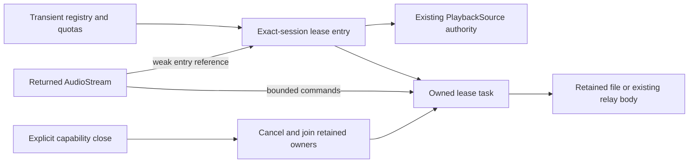

# Retained playback leases

This is a development-source Core capability for remote playback. HTTP delivery, runtime shutdown integration and the remote client are separate work. It does not complete desktop remote mode or change a running deployment.

`PlaybackAccess.begin_lease` retains an already authorized recording/source pair for one exact foreground session. It returns a random handle and the original expiry. `lease_status` checks current authority without renewing it; `open_lease_audio` opens original audio or an independent range; `release_lease` retires an owned handle. `close` cancels and joins owners admitted through this lease API. It does not close ordinary playback grants elsewhere in the application.

## Ownership and authority

Core owns authorization, SQLite, descriptors, relay bodies and cancellation. The retained grant uses the existing `PlaybackSource` policy. Account, session, PIN, library-grant incarnation and source authority remain separate checks. Another session of the same account cannot use or release the handle. Background and unattended actors cannot create or operate leases.

Observed authorization failure permanently stops the requested owned lease. Unlocking the same session or withdrawing and restoring library membership cannot revive it. Creation, open and read delivery recheck retirement after the reply handoff. This also rejects a successful chunk queued before closure but polled afterward.

Indexed originals retain one contained, authorized descriptor. Reads use independent positional offsets, at most 64 KiB at a time, with observed size, modification and file-identity checks around each read. They require no whole-file copy or hash at admission. These metadata fences are not a cryptographic immutability guarantee or a strong ETag. Managed audio keeps its existing verification policy; provider bodies keep the existing relay and validator behavior.

## Limits and retirement

| Resource | Limit |
| --- | --- |
| Live or creating leases | Eight per account, 32 per Core owner |
| Pending creation subset | Five per account, eight per Core owner |
| Audio bodies | Two per lease |
| Buffered commands | Eight per lease |
| Original lifetime | At most 24 hours, without renewal |

The pending reservation precedes current authorization SQL. Caller futures waiting to send are outside the buffered-command limit. These limits do not bound total application memory.

Dropping a creation observer stops its unpublished work. Dropping a body releases its body admission. A retained, unpolled body has no strong reference to Core or the descriptor after its owner retires. Explicit close continues joining owners even if a close observer is cancelled, and awaits an actual in-flight blocking read before reporting completion.

The existing one-second grant-admission deadline is not a universal creation or cleanup deadline. Source opens and stalled filesystem work can delay cleanup. SQLite test ownership establishes worker-local resource retirement, not an OS-thread or TLS-destructor join. Workflow logs retain safe outcomes, correlation and timings rather than credentials, session material, media paths, titles or signed URLs.

## Qualification and remaining work

Two specialist review rounds resolved an observed-PIN-lock race. The regression holds a real read worker through lock, status/open/release failure and same-session unlock; the old body and handle must remain dead. A second locked session cannot retire the owner. Other controls cover quota contention before SQL, cancelled creators, held reads, cancelled close observers and queued publication after retirement.

An independent fresh-source Docker repeat passes all 174 Core unit cases, 19 public lease cases, 51 existing playback regressions and 42 native command/resource controls. Exact names match, with no failed, ignored or filtered cases. Strict Core all-target checks, a separate production-only Core check with no optional features, strict native-example checks and formatting pass. All 3,963 combined source and support inputs remain unchanged. The native controls use an empty queue and open no audio Session or output.

The result manifest has SHA-256 `58fe5caa3618e7d5de2ed751358fcfb596982ab65e52a9ae6851376c772b6804`. An initial verification attempt stopped compilation when its resource probe encountered deleted Cargo temporary files. That infrastructure failure remains recorded; six Docker controls qualify the corrected probe, and the same frozen source then passes the complete repeat.

Creation currently allocates a new handle. A lost committed creation response can leave an unknown lease consuming admission until retirement; reliable client retry needs a bounded, exact-session creation-resume contract. HTTP/runtime integration, scoped replica transport, queue and progress integration, verified device-local matching and temporary cache policy remain unfinished. No ordinary library rows or persistent Download intent are created by a lease. Large sparse-file admission is regression evidence, not codec, p95, five-listener workload or platform-release qualification.
