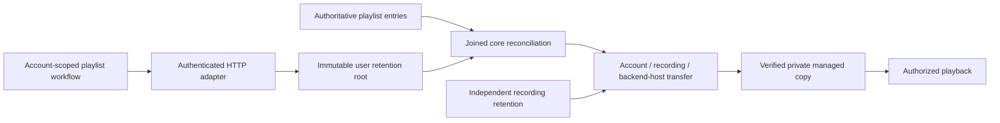

# Playlist downloads

Playlist downloads are deployed to the normal local development server on migration 35.

Selecting **Download** retains the current playlist on the backend host. Reading a playlist, following it, importing it, or playing a track does not request a persistent copy. Web copies stay on the server; listening through the browser still requires that server connection.

## Ownership

Core owns the SQLite transactions, download roots, reference checks, worker admission and file lifecycle. The host joins reconciliation and transfer workers. HTTP maps typed requests and results. The React workflow owns its requests, cancellation and status polling below the playlist page, so download updates do not rerender the track table.

A playlist retention root records one explicit user choice. The transfer and file are separate objects. Duplicate occurrences, multiple downloaded playlists and an independently downloaded recording can retain the same account's copy on the same backend host. Another account does not acquire that copy through its playlist.

Live playlist membership controls transfer and playback authority before the background projection catches up. A Follow refresh can make an existing occurrence playable or unavailable without changing its entry UUID. Reconciliation compares the recording mapping as well as the entry identity.

Removing a root withdraws only that retention. Other current roots keep their copy. After the last reference disappears, core retires the transfer and reclaims its managed bytes. It preserves original music files, library records, private metadata, likes, listening progress and independent playlist copies. Removed roots remain tombstones, so retrying an old removal cannot remove a later root.

## Commands and recovery

| Request | Result |
| --- | --- |
| `POST /api/v1/playlists/{id}/download` with a request UUID | `202` with the request, retention and playlist identities |
| `GET /api/v1/playlists/{id}/download` | Owned retention status, membership revisions and a bounded entry page; `404` when absent |
| `DELETE /api/v1/downloads/{retention_id}` | `204` after accepting removal of that root |

OpenAPI and TypeScript come from the actual Rust routes and wire types. Status defaults to 32 entries and accepts at most 100. Its cursor belongs to one retention and membership revision; changed membership requires restarting pagination. Entry states distinguish pending reconciliation, waiting for a source, queued (with the `insufficient_storage` reason while waiting for disk space)/running/verifying work, ready copies, failed transfers and unavailable recordings.

An immutable receipt binds a request UUID to its original command. Replaying it returns that receipt, including after removal, without starting another transfer. Legacy recording receipts retain their original identities. New recording receipts use the existing `intent_id` wire field for the user retention identity; clients must treat it as the removable root rather than an internal transfer ID.

**Retry failed downloads** sends a fresh explicit playlist command while retaining the same root. Acceptance captures the terminal failures that command may retry. Each batch checks current authoritative membership; an unrelated playlist edit does not cancel the accepted retry. Duplicate entries cannot repeatedly restart a replacement that fails later. Replaying the accepted retry UUID also cannot restart that newer failure. Another attempt needs another explicit command.

A temporarily unavailable source keeps its accepted retry and reports **Waiting for source**. Other recordings can continue. Deferred work checks source availability after 30 seconds through current provider state, without fetching audio until a verified source is available. The retry retains the exact failed transfer and command generation, so a later replacement failure does not inherit permission for another attempt. Discovery, due deferred work and obsolete-row cleanup each process at most 32 records per transaction.

An uncertain browser acknowledgement preserves the command UUID for **Retry download request**. Removal similarly retains its displayed root identity. Account changes and unmounting abort requests; late responses cannot publish into another workflow.

The UI checks only the first 32 entries and labels partial counts as checked entries. It does not infer that the whole playlist is saved from that page. Changed progress permits a 30-second window of one-second checks; unchanged work then uses 30-second checks. Focus and explicit actions can refresh the bounded fast window.

## Bounds and verification

Persistent reconciliation uses bounded transactions and durable cursors. Recording cursors skip duplicate tails during explicit retry. Membership changes coalesce through an outbox; retained ready copies wait for relevant root or membership changes rather than periodic rescanning. Transfers retain the existing limits of two global workers, one per account, 256 pending jobs globally and 32 per account. Playlist reconciliation has a separate joined SQL worker.

Root-run temporary SQLite and TCP tests cover Follow additions and withdrawal, stable occurrence identity, shared roots, stale removal, unprojected publication cleanup, quiescent retained copies, failed transfer recovery and immutable retry receipts. They verify actual managed audio and original/private-state preservation. The retry query diagnostic checks the production SQL with 100,000 duplicate entries and 20,000 unrelated failures under absent, inherited and fresh statistics. Those query checks are not a populated application benchmark or a release latency result.

The React suite passes 178 tests across 56 files, both TypeScript checks and the production build. Real page tests verify fresh failed-download retry, one request despite a double click, exact UUID recovery after a lost acknowledgement, same-root completion and unchanged playback. The final independent frontend review found no additional security, correctness or performance issues through source inspection. The actual release image also passes the owned Chromium workflow described below.

Before final backend review fixes, the combined core/server suite passed 338 unique cases and 342 execution records, including four child-process repetitions, with one usual ignored fault test. Strict Clippy then found two reconciliation guard style errors, which were corrected separately. The final backend review identified lost retries after membership changes, consumed retries while waiting for a source, and cleanup work growing with retained transfer history. Direct regression tests now pass for all three findings. No third independent backend review is claimed.

After those fixes, the combined core/server suite passes 343 distinct cases and 347 execution records, including four child-process repetitions, with one usual ignored filesystem-fault test. Additional migration-command boundary and observer-cancellation tests are tracked separately from that completed run.

The latest eight directed core/server tests also preserve retry cutoffs, duplicate-entry behavior and existing data through migrations 29 to 35. Strict core/server Clippy, the default workspace check across all targets and Rust formatting pass. Actual managed-source deletion remains below the diagnostic's 100-step measurement resolution with 20,000 inactive transfers and, separately, 20,000 unrelated recordings under absent, inherited and fresh SQLite statistics. These are query diagnostics, not release latency measurements.

The development [migration-only command](database-maintenance.md) upgrades a populated library without starting application workers. Its 11 directed tests check populated preservation, rejection boundaries, exact-version replay, literal file selection and observer cancellation through connection close. The earlier full combined run and these final directed checks remain separate evidence. Real contention, graceful CLI signals and public upgrade acceptance remain separate work.

The `linux/arm64` release image built from `77e0a19` passes a fresh disposable Chromium workflow in 45.3 seconds. It downloads duplicate occurrences through one retained copy, recovers a committed response using the same request UUID, reloads and plays the verified saved audio while its provider returns 503, then removes the exact playlist retention while preserving an original file, personal metadata, likes, progress and an independent playlist. No individual recording Download is used. The complete workflow duration is not a start or recovery latency measurement.

Read-only checks against that same isolated server confirm the generated OpenAPI, built JS/CSS, health and unauthenticated player rejection. Twelve private fixture patterns are absent from 10,052 captured log lines. This is scoped synthetic evidence, not a complete logging audit. The server used temporary storage, no published ports and no external network; it was stopped after verification. Normal listener data and services were unchanged.

The normal local deployment uses that same release image. A fresh stopped whole-volume backup was restored into an isolated owned volume before rehearsal. Both the rehearsal and final normal migration ran the migration-only command before application startup. Their audits preserve exact typed rows and rowids across 80 prior tables, sequences, receipts, all non-SQLite files, keys and host identity, with the schema and backfills defined by the actual six migrations. All 35 checksums, foreign keys, database integrity and six FTS integrity checks pass.

The application then started and stopped separately for runtime verification. Neither run changed database rows or managed files. The original port was restored after the normal checkpoint passed; the published runtime passes health, exact OpenAPI/assets and anonymous-player rejection. Other services and normal account connections were preserved. These checks establish this local upgrade, not platform or public-release acceptance.

Local-original Download behavior, temporary playback-cache policy, disk reservations and exhaustion, forced crashes, broader source/provider races, Windows private ACLs, all desktop platforms and the release performance/codec gates remain open. Playlist downloads do not automatically match Spotify metadata to YouTube audio.
