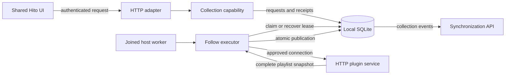

# Follow playlists

Follow is implemented in development source and verified in an isolated release image, including a live public Spotify playlist. It is not deployed on the normal local server yet. The shared UI supports hourly/daily creation, update status, manual refresh and explicit reviewed connection resume. Joined host workers execute refreshes. Normal backup, migration and deployment checks remain open.

Import a copy creates an editable Hito playlist. Follow creates a read-only playlist whose contents come from the provider. Each has its own playlist and entry identities. Refreshing a Follow does not update an independent copy, download audio or create playable sources.

## Ownership

Core owns scheduling, authority checks, provider reads, reconciliation and database transactions. The HTTP adapter authenticates and maps typed inputs and results. A host only needs to poll the executor and join it during shutdown.

A Follow captures the account's approved installation and service revisions. Its background worker uses durable account and connection authority. It does not retain an Actor or listener session, so logging out does not stop an otherwise authorized schedule. Removing or changing the connection prevents a pending or running refresh from publishing.

## Refresh behavior

Creation accepts an hourly or daily interval. The database retains the canonical provider playlist identity and next due time. A refresh reads a complete, bounded provider snapshot before taking the publication write transaction. Incomplete or failed reads leave the last good playlist visible.

The executor preserves witnessed provider occurrence IDs and recording identity through reordering, additions, removals and temporary unavailability. Repeated recordings retain separate entry IDs. An unknown item without a recording identity gets a new entry ID when a changed snapshot is accepted. Hito does not infer a recording match from an uncertain entry.

A digest covers the complete validated provider detail and ordered entries. An identical response under the same approved connection advances freshness and scheduling without rewriting entries or publishing another full collection event. A reused provider snapshot token cannot hide changed contents. Personal metadata, likes and progress remain independent of the provider snapshot.

Hito stores a numeric content revision independently of the provider's snapshot token and the execution generation. Status exposes `content_revision`; followed playlist details expose `follow_content_revision` from the same read transaction as their entries and provenance. Local playlists and independent copies omit the detail field. The UI compares these Hito revisions to reconcile an initial page rendered before a background publication. Freshness changes alone do not reload the full playlist.

Deleting a Follow deactivates its schedule and cancels queued work. Running work retains its lease until the worker observes the changed authority. It cannot publish into the deleted playlist. Deletion preserves catalog records and audio originals. Replaying an earlier creation receipt does not recreate the deleted playlist.

## API and retry behavior

| Method and path | Result |
| --- | --- |
| `POST /api/v1/plugins/{id}/playlists/follow` | `200`, permanent creation receipt |
| `GET /api/v1/playlists/{id}/follow` | `200`, interval, freshness, schedule and state |
| `POST /api/v1/playlists/{id}/follow/refresh` | `202`, durable refresh receipt |
| `POST /api/v1/sync`, action `playlist_follow_resume` | `200`, permanent operation acknowledgement |

Wire types and route documentation come from Rust. Creation accepts a request UUID, the installation revision, a playlist reference and an `hourly` or `daily` interval. Refresh accepts a request UUID. Retrying an uncertain submission uses the original UUID and body. Reusing it with changed contents conflicts.

Accounts cannot read or mutate another account's Follow, including by knowing its playlist or installation UUID. The existing session, account, browser origin and JSON input policies apply to these routes.

Manual refresh receipts remain protected while their jobs are queued or running. Terminal receipts can expire after seven days. Receipt capacity is 256 per account and 4,096 globally; requests for the same pending job still have separate receipts. After expiry, an old manual request UUID no longer guarantees replay. Permanent creation and synchronization receipts are unaffected.

Job history retains the newest 32 unreferenced terminal jobs per playlist and every job still referenced by a retained receipt. Completion, receipt expiry, lease recovery and playlist deletion apply the same pruning rule in their existing transactions. Pending and running jobs are never pruned.

## Connection changes and explicit resume

Accepting a changed plugin declaration does not resume an existing Follow. The last good snapshot remains available with the approval revisions under which it was actually read. Resume requires a separate synchronization operation naming the expected Follow generation and the current original installation and service revisions. Another account, stale generation, missing playlist capability or removed original connection cannot authorize it. Reinstalling the same provider creates a different connection and is not an implicit replacement.

An accepted resume advances the execution generation and makes the next check due. It does not rewrite entries, metadata or snapshot provenance. An older running job remains charged against admission until retirement; it cannot publish, overwrite a new generation's error or postpone its schedule. Exact earlier manual receipts still replay, while a new manual request waits for obsolete running work to retire.

After a complete successful read under the newly approved connection, Hito publishes the verified provenance and advances the content revision. If the content is identical, every accepted entry ID remains stable, including unknown entries. A further identical read under the same approval only advances freshness. Failed publication rolls back the content revision and all associated collection changes together.

Resume uses the existing permanent synchronization receipt. Retrying an uncertain request must retain its device ID, operation UUID and action. A deleted playlist wins over a late resume; an exact earlier receipt cannot recreate it.

## Bounds and evidence

Active Follows are limited to 256 per account and 4,096 globally. Pending work is limited to 16 per account and 128 globally. Core admits at most four running jobs globally and one per account. Provider reads are separate from interactive provider admission and bounded to 60 seconds, 100 pages, 10,000 entries and 16 MiB. Leases expire after 90 seconds; a job gets at most three attempts. Graceful cancellation requeues unfinished work and refunds its attempt.

Public capability regressions exercise real temporary SQLite and owned HTTP provider fixtures. They cover stable witnessed entries, independent editable copies, creator logout, replay, coherent reads, concurrent session revocation, receipt limits and expiry, no-op refreshes, reused provider tokens, interrupted leases and deletion. The upgrade regression starts with a populated migration-0027 database and checks retained data, credentials, ledger high-water values, foreign keys and search indexes after migration 0028.

A separate SQLite instruction test uses 16 accounts, 4,096 Follows and 131,072 terminal jobs. With the history index, the latest-status lookup stays below the counter's 100-instruction resolution. Pruning one extra old target job takes approximately 700 instructions both before and after adding the unrelated history. These are query-work measurements, not playback timing or public-release performance acceptance.

The current core suite passes 215 unique tests, formatting and strict all-target Clippy, with one normally ignored filesystem-fault case. Two independent reviews of the original Follow core found defects. Each accepted finding was resolved through root-run regressions; no third independent clean verdict on that original scope is claimed. The separate Resume/content-revision capability received one fresh security, correctness and performance review round, all passing static review.

Host tests verify actual HTTP refresh publication, progress while another account's provider is blocked, and graceful shutdown with a blocked provider. Reopening the same library preserves the session, last good snapshot and stable entry IDs; the next host publishes the retained job without a new enqueue. These checks do not simulate process death or platform installation.

Canceling the public host future also closes its listener and requeues held work while the explicit shutdown sender remains retained. The complete server suite passes 87 unique cases, strict all-target Clippy and formatting. A workspace-wide default-feature compile check also passes; it is not a native GUI or platform acceptance test.

Focused React tests verify hourly/daily creation, exact creation retries after draft and connection-revision changes, visible entries during updates, and manual refresh retries after a lost response. A completed refresh triggers one partial reload even when the first status check is already Ready with unchanged provider tokens and timestamps. Both application and browser-test TypeScript configurations pass at this checkpoint.

The frontend suite passes 164 cases across 43 files. Both TypeScript configurations and the production build pass. Cases cover pending-request cancellation, stale-result rejection across account and playlist changes, an initial newer Hito revision with the same provider token, recovery after a lost partial detail reload, explicit Resume review, uncertain acknowledgements and fresh review after a definite conflict.

The complete release image `sha256:3ba6fc849324fb37bc9da45586df00da37202e329a435ee2afce6dcc45e5b4eb` passes two isolated Chromium workflows. The first creates an editable copy and a daily Follow, applies a provider update from five entries to four, preserves three witnessed entry IDs and both personal metadata edits, and leaves the copy unchanged. It observes two intercepted partial-detail attempts, one injected network failure and one successful delivery. A focus event checks an unchanged terminal status; the UI still recovers the updated rows. This verifies the application focus listener, not native operating-system focus delivery.

The second workflow reviews and accepts a changed plugin declaration through Settings, verifies that Follow remains paused, then explicitly reviews and resumes it on the playlist page. The real server commits the operation and returns its matching acknowledgement before the test discards that delivery. The UI retries the identical batch and receives the original acknowledgement. There is one Resume event, then one complete Follow publication. While the provider is held, all five old entries and their old provenance remain intact. Releasing it produces four entries with the new verified approval revisions. Neither workflow requests audio. Runtime OpenAPI matches the generated document, and the served JavaScript and stylesheet hashes match the verified build.

The first workflow also passes an exhausted-provider-retry characterization on that same image. Three real HTTP 503 responses exercise the normal two- and four-second retry delays. The UI shows Update failed and retains the complete previous detail, copy, private metadata and collection feed. A new explicit refresh has a different request and job UUID, then publishes the valid update and recovers the lost detail response. The combined workflow passes in 12.6 seconds; this is a fixture duration, not a release latency benchmark.

A live public Spotify check on the same complete image creates hourly and daily Follows through the UI. Each contains 411 entries across five independently checked provider pages, with identical ordered metadata and 411 shared recording identities. The playlist and entry identities remain independent. An unchanged explicit refresh preserves the full detail, generation, content revision, activity and collection cursor. No source, audio, download or Spotify authorization is requested. The isolated run passes in 39.5 seconds. This verifies configured intervals and an immediate refresh, not an hour or day of wall-clock scheduling. This live playlist had no duplicates; duplicate reconciliation has fixture evidence.

The HTTP access case separately rejects another account, stale generations/revisions, removed playlist capability, a removed original connection and a withdrawn service. Deletion remains final after late Resume and earlier receipt replay. The final adapter review round passes fresh security, correctness and performance inspection. These reviewers inspected source; they did not independently execute the reported checks.

Core regressions verify resumed approval without premature provenance changes, retirement and expiry of obsolete leases, reused provider tokens and snapshot/detail coherence. A complete 3,000-entry provider response below the input limit but above the serialized publication limit leaves the previous snapshot, catalog, personal changes, event feed and content revision intact. A corrected refresh then publishes exactly once.

## Remaining work

- Consider later interval editing and explicit identity-preserving rebind after reinstalling a connection.
- Integrate synchronized download references when persistent downloads are implemented.
- Complete release-image migration, restoration and deployment checks before upgrading the normal server.
