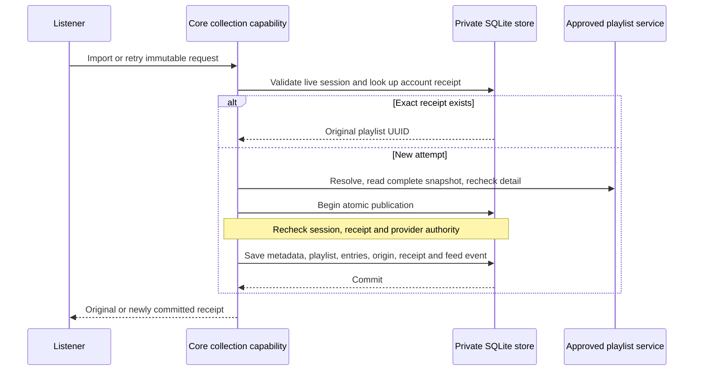

# Playlist import

Import a copy is deployed on the local development server at migration 0024. The SDK, core, HTTP, generated contracts and React workflow have real SQLite and loopback-provider fixture coverage, including three release-image browser cases. The separate [public Spotify plugin](plugin-spotify.md) also passed a complete live UI import without account authorization and is available locally. Public-release acceptance remains open. Current evidence and remaining gates are in [status](status.md).

## An independent editable copy

The Playlists page offers import for personally connected services whose accepted manifest declares `playlists`. The listener chooses a service and supplies a playlist link or identifier. Hito creates a local editable playlist; later provider changes do not update it. The current music-folder plugin declares only `search` and `sources`, so it is not a playlist-import provider.

Import copies track details, order and provenance, without downloading audio. A known recording gets a real Hito recording ID. Repeated occurrences share that recording but have distinct stable playlist-entry UUIDs. An unavailable or unknown provider item remains an ordered entry with explicit origin and no fabricated recording ID. Retained rows display the available provider text or a neutral label, show a dash for unknown duration, and offer entry removal rather than recording actions.

Playlist detail retains the provider identity, canonical playlist ID, snapshot, accepted connection/service revisions, attribution and import time after connection removal. Each occurrence retains its supplied provider recording/occurrence IDs and kind. Real recordings still follow library permissions: losing library membership redacts their metadata and occurrence provenance rather than exposing it through a retained playlist.

Importing an already adopted item reuses its Hito recording identity. It preserves verified existing source identities/readiness, likes, progress and personal metadata overrides. A metadata-only import creates no ready source and does not withdraw legitimate prior sources. Playback still requires a separately authorized available source. Follow scheduling, YouTube matching, yt-dlp playback and downloads remain separate unfinished work.

## From reference to complete snapshot

The Apache-2.0 SDK defines structured data at fixed provider paths:

| Request                    | JSON body                                               | Purpose                                                     |
| -------------------------- | ------------------------------------------------------- | ----------------------------------------------------------- |
| `POST v1/playlists/detail` | `{"kind":"reference","reference":"supplied-reference"}` | Resolve a supplied reference into canonical playlist detail |
| `POST v1/playlists/items`  | See the page request below                              | Read a bounded page for the canonical ID and snapshot token |
| `POST v1/playlists/detail` | `{"kind":"canonical","playlist_id":"playlist-17"}`      | Recheck the complete detail before publication              |

The supplied reference is bounded text, up to 2,048 UTF-8 bytes without control characters. Hito passes it as data to the approved service. Hito does not fetch it as a URL or parse a provider-specific playlist ID. The provider returns the canonical ID, snapshot token, name, total count and attribution. Every item page must bind the same ID and token. The final canonical detail must equal the initial detail.

The SDK permits recording, unavailable and unknown items. Hito rejects the whole snapshot for inconsistent counts, repeated cursors or occurrence IDs, conflicting metadata for one recording, changed canonical identity/version, or an incomplete ending. It never treats a partial result as a complete copy. Network reads finish outside the publication transaction.

| Bound                                   | Current limit                                         |
| --------------------------------------- | ----------------------------------------------------- |
| Complete snapshot                       | 10,000 occurrences, at most 100 pages                 |
| Item page                               | 100 occurrences and 1 MiB response bytes              |
| Each detail response                    | 32 KiB                                                |
| All detail/page response bytes together | 16 MiB                                                |
| Complete read                           | 60 seconds, within ordinary control-request deadlines |
| Control admission                       | Four global requests, one per account                 |

The existing transport supplies the approved address and saved credentials. Playlist data cannot supply arbitrary fetch URLs or headers. These limits bound provider input separately from the encoded synchronization publication.

### Provider JSON examples

These illustrative bodies follow the [SDK wire types](../crates/plugin-sdk/src/playlists.rs). Return uncompressed UTF-8 JSON with `Content-Type: application/json`; unknown fields are rejected. Both detail request kinds return the same detail shape:

```json
{
  "id": "playlist-17",
  "name": "Example playlist",
  "snapshot": "revision-4",
  "total_count": 3,
  "attribution": { "label": "Example service playlist" }
}
```

Hito uses that `id` as `playlist_id` and that `snapshot` unchanged in the first items request:

```json
{
  "playlist_id": "playlist-17",
  "snapshot": "revision-4",
  "cursor": null,
  "limit": 100
}
```

This complete page contains one of each item kind. `total_count` counts all occurrences, including unavailable and unknown rows. Absent optional values are shown as `null`:

```json
{
  "playlist_id": "playlist-17",
  "snapshot": "revision-4",
  "items": [
    {
      "occurrence_id": "entry-1",
      "item": {
        "kind": "recording",
        "recording": {
          "id": "recording-5",
          "title": "Generated example tone",
          "artist": "Example artist",
          "duration_ms": 20000,
          "release": null,
          "disc_number": null,
          "track_number": null,
          "revision": "track-revision-2"
        }
      }
    },
    {
      "occurrence_id": "entry-2",
      "item": {
        "kind": "unavailable",
        "provider_recording_id": "recording-8",
        "title": "Unavailable example item",
        "artist": null
      }
    },
    { "occurrence_id": null, "item": { "kind": "unknown" } }
  ],
  "next_cursor": null
}
```

A nonfinal page returns an opaque `next_cursor`, which Hito sends as the next request's `cursor`. A supplied occurrence ID must be unique across the whole snapshot; repeated recordings can use distinct occurrence IDs or leave them absent. After the final page, the canonical detail recheck must return the original detail unchanged.

## Retry the same request or create a new copy

The application endpoint is `POST /api/v1/plugins/{id}/playlists/import`, where `id` is the personal installation. Its typed body contains `request_id`, `installation_revision` and `playlist_reference`. The successful receipt is compact: `{request_id, playlist_id}`. Entry UUIDs are available through playlist detail and the immutable publication.

A request UUID names one immutable attempt for that account. Exact retry uses the original installation, revision and reference. Reusing the UUID with changed contents conflicts. A new UUID explicitly requests another independent copy, even for the same reference.



Live session validation precedes receipt lookup. A committed exact retry returns the original playlist UUID before provider admission or HTTP, even if the service is offline, the connection revision changed, or the connection was removed. If the playlist was deleted, replay returns its original receipt and does not resurrect it. The transaction repeats receipt lookup to resolve concurrent retries without publishing a second copy.

The React workflow keeps the failed attempt unchanged for **Retry import**. **Import a new copy** uses the current field, current revision and a fresh UUID. Account/installation ownership and request generations fence late results; an accepted revision change cancels stale display work while preserving the original attempt for exact retry. This attempt memory is not a durable offline outbox and does not survive a full page reload.

## Atomic publication and feed authority

One core transaction publishes owner-private catalog metadata, the local playlist, entry UUIDs, durable provenance, receipt and immutable `PlaylistImported` publication. Session and accepted installation/service authority are checked again inside that transaction. Rejection or cancellation before COMMIT is submitted rolls back the transaction. Once COMMIT is executing, it can finish durably even if the caller drops its await; exact retry then recovers the immutable receipt. No partial copy is published. A later retry after a rejected oversized publication can succeed with corrected provider data.

The read feed distinguishes two `SyncEvent` shapes. Ordinary events retain `{sequence, device_id, operation}`. A server publication has `{sequence, publication}` and includes the accepted snapshot, stable identities, deduplicated recording metadata and compact occurrence provenance. Later edits or deletion do not rewrite that publication. The ledger preserves historical sequence numbers and the deleted sequence high-water mark during upgrade.

`Action`, `Operation` and `SyncBatch` remain client input types with strict unknown-field rejection. A client cannot submit a publication, raw read event or extra origin fields through `/api/v1/sync`. A device named `server` remains an ordinary client identity; it grants no server authority. Persisted event origin determines authority, and client-operation and publication UUID namespaces are separate. This read contract provides replication data; a durable client replica is still release work.

Each encoded feed page is bounded to 16 MiB and 200 events. Reads check stored payload lengths before loading large values and then account for the actual encoded event. An individual publication payload must leave room for its feed envelope. Provider input can fit its own 16 MiB budget yet exceed the publication limit after durable identities and provenance are added; that import fails atomically. Paging preserves event order, cursor and `has_more` without skipping or duplicating a publication.

Accounts have separate personal provider libraries, playlists, receipts, effective metadata and feeds. Matching provider IDs or request UUIDs across accounts does not merge their private identities or expose personal fields. Logs retain safe correlation IDs, outcomes, counts and timings rather than references, titles, credentials or raw provider responses.

## Planned provider work

Follow remains planned. A followed playlist will be read-only and use durable hourly/daily refresh jobs chosen in the UI. Reconciliation must preserve stable occurrence IDs, including duplicates, and keep the last complete snapshot after failed or incomplete refreshes. Imported copies remain independent and editable. Download reference updates must preserve originals and library records.

The Spotify workflow accepts a public shared playlist link without a developer application or account connection. The public adapter obtains the complete paged list before publishing a copy and discards tracking parameters before fixed-host requests. A page or embed can expose only an initial subset; visible tracks alone do not prove a complete import. The owned fixtures and live browser case exercise the complete list.

Account authorization remains optional, separate work. The deployed public adapter reads anonymous web metadata and has no Spotify Web API compatibility branch. Its successful live import does not establish private-playlist access or completion of the optional authorization flow.

YouTube matching and yt-dlp playback remain separate provider work. Unavailable items must stay visible, and uncertain matches require review rather than silent substitutions. No current copy operation downloads audio.

## Evidence and unfinished acceptance

Public core and HTTP fixtures cover duplicate and retained entries, durable attribution, source/personal-state preservation, account isolation, offline/deleted-playlist replay, changed-request conflicts, held-response authority checks, network cancellation, protocol inconsistency, encoded feed paging, oversized-publication rollback and old-ledger high-water preservation. A public cancellation regression also covers the acknowledged custom-BEGIN ownership gap; the shared core pool now discards a returned connection whose transaction remains open after queued work is flushed. That narrow result does not prove arbitrary SQLite or startup cancellation.

HTTP fixtures cover actual import/retry and strict rejection of client publication injection. Frontend fixtures cover nullable rows and import ownership, including immutable retry bodies, explicit new-copy UUIDs and late results. The full frontend suite, source/browser-test TypeScript, production build, zero-vulnerability audit and identical regenerated OpenAPI/TypeScript checks passed. The final integrated Rust workspace passed formatting, workspace tests and strict all-target Clippy on `d483ad5`, including the final folder fixes. Exact evidence and remaining limits are recorded in [status](status.md#isolated-plugin-integration-checkpoint).

Three real Chromium workflows passed in 4.2 seconds with disposable SQLite, a loopback provider and the actual release server image. They cover metadata-only import, unavailable/unknown items, duplicates, editing, outage/reload, uninstall, deletion and account privacy, plus desktop/390-pixel layouts, focus, dock hit testing and 44-pixel controls. A committed-response-loss case verifies that Retry import resends the original UUID and serialized body while another draft stays unsent and the provider is offline.

The explicit Import a new copy case also loses a real committed response, enters a different reference, then clicks the new-copy button. A fresh UUID and the current reference create a second independent playlist/publication with disjoint stable entry UUIDs and the same catalog recordings. Replaying the original request offline returns its original receipt without provider HTTP, another copy or further feed/catalog growth. All three cases passed against release image `sha256:efdd68dbbc536749aaa777291aee7593bdeae3f2b105c2e171fd33b35c879c8d`. The 756 captured server-log lines contained no owned bearer, private reference or title fixture patterns, which is scoped privacy evidence.

Eight selected ignored native device-feature progress/recovery cases across six test targets passed with an isolated CPAL monitor as UID 10001, followed by strict device-feature all-target playback Clippy. These are device tests, not GUI tests; no desktop window or fresh complete native/GUI suite ran. Older whole-GUI evidence remains historical.

Two independent review rounds completed, with final findings addressed through resolver regressions and source checks. No third review or independently clean final verdict is claimed. Normal development deployment and release-image browser checks pass. Full native/GUI, other-browser/platform and public-release acceptance remain open. Follow, scheduling, official provider authorization/live checks, matching and persistent downloads remain separate unfinished work.
