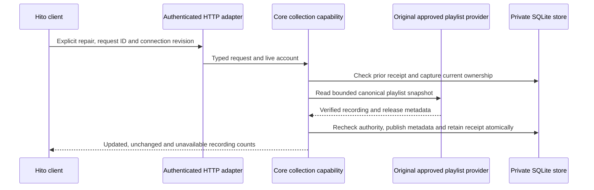

# Repairing missing albums in imported copies

This slice is in development. It is not in the running local deployment yet. It repairs missing album associations on an existing editable playlist copy through its original approved provider. It does not synchronize the provider's playlist membership.

## Ownership and retained state

The collection capability owns the workflow and its transaction. The HTTP handler uses the shared authenticated account and typed JSON extractors. Providers return structured metadata; Hito owns the UI.

Only recordings still present in the copy, still owned through the original primary provider binding, and still missing a release are eligible. Duplicate playlist occurrences count once. Unknown or unavailable upstream entries remain unavailable. New upstream songs do not enter the copy. Existing releases are not replaced, and uncertain matches are not inferred from names.

A successful repair preserves playlist identity, name, entry identities, order, manual source choices, likes, listening progress and personal metadata edits. It adds a provenance observation and a metadata-only synchronization publication. Earlier observations, import receipts and synchronization payloads remain unchanged. No source resolution, audio transfer or Download occurs.

## Request and recovery

`POST /api/v1/playlists/{id}/metadata/refresh` accepts `RefreshImportedPlaylistMetadata` and returns `ImportedPlaylistMetadataRefresh`. The registered Rust route generates the OpenAPI document and shared TypeScript types.

A nonempty request UUID and positive current connection revision identify one attempt. An accepted identical retry returns its immutable receipt without contacting the provider, including after the copy is deleted. A different body under the same UUID conflicts. Replay still requires a live session belonging to the original account. Another account cannot inspect the copy or its receipts.

The shared playlist page offers **Find missing albums** for editable imported copies. It checks the original approved connection when the user starts a lookup. An uncertain response retains the exact request body for **Retry album lookup**. A busy HTTP 409 is uncertain because the first invocation may still finish. Only a 409 carrying `code: "operation_rejected"` allows a fresh lookup with the current connection revision.

Core emits that code only after observing that the installation revision has advanced beyond the requested revision, then checking the immutable receipt in a fresh authenticated transaction. Accepted work still replays first. Future revisions and other conflicts keep their existing uncoded responses. Installation revisions increase monotonically, so an unaccepted request using the older revision cannot later publish through supported connection operations.

Once a receipt is confirmed, a failed detail read keeps its counts visible. **Reload playlist details** retries only the partial page read. Account, playlist and origin changes cancel the owned work. These actions preserve the device's playback session and queue.

Connection removal, changed ownership or changed eligible membership during a held provider request prevents publication. Conflicting metadata rolls back the whole publication. The workflow admits one active request per account and four globally. Retained receipts have explicit account and global limits; accepted replays do not consume another slot or receipt.

## Migration and verification

Migration 0046 permits metadata-only collection events and adds immutable receipts. The event-ledger rebuild preserves stored rows and sequence high-water marks, including the existing `sqlite_sequence` row identities. Child publication indexes avoid repeated full receipt scans during the rebuild. Earlier migration files and checksums are unchanged.

Public capability cases cover independent copies, private edits, no-op receipts, offline retry, account and session isolation, connection revocation, concurrent membership changes, cancellation and atomic rollback. The combined core gate passed 310 distinct cases with one usual ignored filesystem-fault case. The final retry correction separately passes seven directed core cases. A populated 0045 upgrade verifies exact retained typed rows, row identities, event payload bytes, search indexes, keys and original audio. A separate 100,000-event, ten-account fixture checks migration work with fixed SQLite VM instruction budgets. These fixtures do not establish playback latency or public-release scale acceptance.

The final source passes all 144 server cases, 289 frontend cases, both TypeScript checks, the production UI build, formatting and strict all-target workspace Clippy. Generated OpenAPI and TypeScript reproduce. The five metadata HTTP workflows include held-request contention followed by identical offline receipt recovery, owner/session and browser-origin guards, and old receipts surviving a new connection approval. UI cases verify original-connection and receipt identity, exact retries, scoped cancellation, playback preservation and reload-only recovery after a failed detail read.

The full image built from application source `21ae17a` passes fresh Chromium and WebKit workflows. Both perform real setup, connect an owned playlist provider, import an albumless copy, make personal edits, and repair two recordings. The test drops the response after the server commits, disables the provider, then recovers the identical receipt through the UI with the same request body. It verifies retained entries, duplicates, personal metadata, likes, progress, earlier receipts and synchronization payloads, followed by real album navigation with unknown album credits.

The browser workflow requests no audio, source attachment, adoption or Download writes. Playback and queue preservation are separately checked through the real browser player in component tests. Server logs contain 4,907 Chromium and 3,118 WebKit JSON records with no owned private canaries; both disposable servers shut down cleanly. This does not establish live Spotify, codec, physical-device or public-release acceptance.

An audited local deployment remains open. MusicBrainz enrichment and complete external discographies are separate work.
