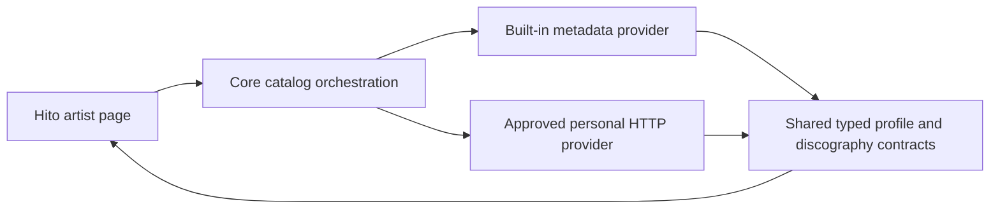

# Catalog extension contracts

The Apache-2.0 plugin SDK defines a read-only catalog extension for artist profiles and paged discographies. This is a development contract. Hito does not yet call these operations, provide MusicBrainz through them, or render external discographies. Existing recording metadata and playlist operations remain separate.

## Negotiation and ownership

A provider declares the existing `catalog` manifest capability. The separate `GET v1/catalog/capabilities` descriptor contains `catalog_version: 1` and a nonempty, unique `operations` list containing `artist_profile`, `artist_discography`, or both. The manifest shape, its serialization and its fingerprints remain unchanged.

The future host integration must treat an absent descriptor as an unsupported extension. Unsupported catalog versions and operations must fail closed for this extension while leaving previously supported plugin functions available. Host authorization, bounded HTTP reads and revision checks are not implemented by the SDK types.

This diagram describes intended host ownership. Only the shared contracts exist in this slice. Providers supply structured data. Hito renders it and never executes downloaded plugin code. These catalog responses have no audio, stream URL, HTML or custom UI fields.

## Identity and artist profiles

Provider IDs are opaque, case-sensitive strings scoped to the selected provider connection. Equal strings from different providers are not evidence of equal artists. A host must retain provider provenance and verified associations rather than treating an external ID as a Hito UUID.

`POST v1/catalog/artists/profile` accepts `ArtistProfileRequest` with `artist_id`. `CatalogArtistProfile` returns the exact requested artist reference, plus nullable sort name, kind, disambiguation and revision. Artist references contain an ID and display name. Kinds are `person`, `group`, `orchestra`, `choir`, `character` and `other`. Missing optional metadata remains unknown.

IDs and revisions are limited to 256 UTF-8 bytes. Names, sort names and disambiguation are limited to 2,048 bytes. Required text must be nonempty and contain no control characters. Complete encoded profiles are limited to 32,768 bytes. Response validation binds the returned artist to the request; the host must call the validator after bounded transport decoding.

## Discographies and continuation

`POST v1/catalog/artists/discography` accepts `ArtistDiscographyRequest` with `artist_id`, nullable `cursor`, nullable `snapshot` and `limit`. Limits range from 1 to 50 release groups. Initial requests have null cursor and snapshot. The initial response may choose an immutable snapshot or return null for a live catalog. Every continuation must send and receive that exact snapshot value, including null.

`ArtistDiscographyPage` returns the requested artist ID, snapshot, release-group items, nullable total count and nullable next cursor. Short pages are valid. Total count may remain unknown; an opaque cursor does not reveal a numeric offset. A non-null next cursor requires at least one item and must differ from the request cursor. IDs must be unique within a page. The host must separately detect repeated cursors across a traversal and bind continuation state to its authorized connection and query.

Release groups represent album concepts. Their IDs are distinct from release editions, track occurrences and recordings. The contract preserves separate same-title groups. Selected-edition track lists need additional contracts and remain unfinished.

Each group contains an ID, title, nullable ordered artist credit, nullable primary kind, secondary type labels, nullable first-release date and nullable revision. Primary kinds are `album`, `ep`, `single`, `broadcast` and `other`. Partial dates retain their precision as `YYYY`, `YYYY-MM` or `YYYY-MM-DD` and must be calendar-valid.

A present credit has 1 to 32 members. Each member retains a nullable identified artist, the credited display name and a join phrase. Repeated identified artists are permitted because a credit is an ordered performance credit, not a set. Unknown artists are not inferred from the credited name. Join phrases may be empty or contain spaces, are limited to 128 bytes and cannot contain control characters. A group has at most 16 distinct secondary labels of at most 128 bytes each.

Cursors are limited to 2,048 bytes. Complete encoded discography pages are limited to 262,144 bytes. Validation counts serialized bytes through a bounded writer and stops on overflow without constructing another full response buffer. All object shapes reject unknown fields. Validation errors are static messages and do not echo provider content.

## Verification and remaining work

All 45 SDK cases pass with generated-schema support, and strict all-target SDK Clippy passes. Compatibility cases preserve exact earlier manifest, recording and playlist wire bytes. Protocol cases cover nullable unknowns, ordered credits, identity mismatch, live and snapshot continuations, partial dates, nested bounds, exact encoded limits and strict generated schemas.

An allocation regression constructs a field-valid oversized page before observing public validation. Before the fix, validation requested a 16,777,216-byte allocation. The unchanged test now verifies that no single validation allocation request exceeds the 262,144-byte page budget. It calibrates its observer and does not measure RSS, total allocation volume or peak live memory. Final security, performance and correctness reviews pass after the bounded-writer fix.

Core source now separately retains [raw artist tag assertions](metadata.md#musicbrainz-artist-tag-evidence-in-verified-source). Built-in host access, provider selection and priority, optional enrichment, approved HTTP operations, persistent associations, caching, artist UI, selected-edition tracks and optional similar artists remain unfinished. This SDK slice does not satisfy those release requirements.
