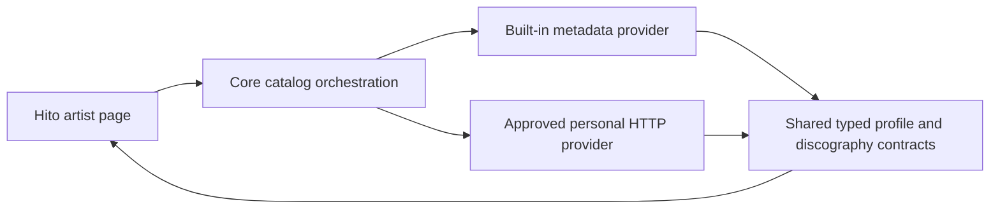

# Catalog extension contracts

The Apache-2.0 plugin SDK defines read-only artist search, artist profiles, paged discographies, edition listings and complete edition track lists. Artist host and browser integration have separate evidence in the [catalog host](artist-catalog-host.md) and [discography](artist-discography.md) documentation. Edition integration is described below. Existing recording metadata and playlist operations remain separate.

## Negotiation and ownership

A provider declares the existing `catalog` manifest capability. The separate `GET v1/catalog/capabilities` descriptor contains `catalog_version: 1` and a nonempty, unique `operations` list containing `artist_profile`, `artist_discography`, or both. The manifest shape, its serialization and its fingerprints remain unchanged.

Hosts must treat an absent descriptor as an unsupported extension. Unsupported catalog versions and operations must fail closed for this extension while leaving previously supported plugin functions available. Host authorization, bounded HTTP reads and revision checks are not implemented by the SDK types.



This diagram describes intended page ownership. The reviewed-profile host has separate source verification. Providers supply structured data. Hito renders it and never executes downloaded plugin code. These catalog responses have no audio, stream URL, HTML or custom UI fields.

## Identity and artist profiles

Provider IDs are opaque, case-sensitive strings scoped to the selected provider connection. Equal strings from different providers are not evidence of equal artists. A host must retain provider provenance and verified associations rather than treating an external ID as a Hito UUID.

## Artist search

Search negotiates independently through `GET v1/catalog/discovery/capabilities`:

```json
{"discovery_version":1,"operations":["artist_search"]}
```

The older catalog descriptor and its operation enum remain unchanged. Adding search there would cause a strict older client to reject the descriptor and lose otherwise supported profile reads. A missing discovery descriptor means search is unsupported; it must not disable those earlier operations.

`POST v1/catalog/artists/search` accepts `ArtistSearchRequest`:

```json
{"query":"Example artist","cursor":null,"snapshot":null,"limit":20}
```

Queries are nonblank text of at most 512 UTF-8 bytes without control characters. Limits range from 1 to 20 candidates. Cursors have a 2,048-byte limit and snapshots a 256-byte limit. Initial requests cannot choose a snapshot. `ArtistSearchPage` returns the exact query, nullable snapshot, candidate items, nullable total count and nullable next cursor. Continuations preserve the exact snapshot, including null. A next cursor requires a nonempty page and must advance; a host must also detect cursor cycles across requests.

Each candidate contains an artist reference, nullable kind and nullable disambiguation. Distinct IDs may have identical display names. Duplicate IDs within one page are invalid. Candidates are suggestions, not confirmed recording-credit associations. Search itself does not adopt recordings, change metadata, download audio or establish canonical artist identity.

Encoded search pages are limited to 65,536 bytes. Validation checks field lengths before scanning their text, bounds item counts before iterating, and counts serialized bytes without allocating another full response buffer. Unknown fields and unsupported discovery versions fail validation. Transport implementations must separately bound incoming bytes before decoding and preserve authorization and provider provenance.

`POST v1/catalog/artists/profile` accepts `ArtistProfileRequest` with `artist_id`. `CatalogArtistProfile` returns the exact requested artist reference, plus nullable sort name, kind, disambiguation and revision. Artist references contain an ID and display name. Kinds are `person`, `group`, `orchestra`, `choir`, `character` and `other`. Missing optional metadata remains unknown.

IDs and revisions are limited to 256 UTF-8 bytes. Names, sort names and disambiguation are limited to 2,048 bytes. Required text must be nonempty and contain no control characters. Complete encoded profiles are limited to 32,768 bytes. Response validation binds the returned artist to the request; the host must call the validator after bounded transport decoding.

## Discographies and continuation

`POST v1/catalog/artists/discography` accepts `ArtistDiscographyRequest` with `artist_id`, nullable `cursor`, nullable `snapshot` and `limit`. Limits range from 1 to 50 release groups. Initial requests have null cursor and snapshot. The initial response may choose an immutable snapshot or return null for a live catalog. Every continuation must send and receive that exact snapshot value, including null.

`ArtistDiscographyPage` returns the requested artist ID, snapshot, release-group items, nullable total count and nullable next cursor. Short pages are valid. Total count may remain unknown; an opaque cursor does not reveal a numeric offset. A non-null next cursor requires at least one item and must differ from the request cursor. IDs must be unique within a page. The host must separately detect repeated cursors across a traversal and bind continuation state to its authorized connection and query.

Release groups represent album concepts. Their IDs are distinct from release editions, track occurrences and recordings. The contract preserves separate same-title groups. Selected-edition contracts are described below; their core, HTTP and browser integration remains unfinished.

Each group contains an ID, title, nullable ordered artist credit, nullable primary kind, secondary type labels, nullable first-release date and nullable revision. Primary kinds are `album`, `ep`, `single`, `broadcast` and `other`. Partial dates retain their precision as `YYYY`, `YYYY-MM` or `YYYY-MM-DD` and must be calendar-valid.

A present credit has 1 to 32 members. Each member retains a nullable identified artist, the credited display name and a join phrase. Repeated identified artists are permitted because a credit is an ordered performance credit, not a set. Unknown artists are not inferred from the credited name. Join phrases may be empty or contain spaces, are limited to 128 bytes and cannot contain control characters. A group has at most 16 distinct secondary labels of at most 128 bytes each.

Cursors are limited to 2,048 bytes. Complete encoded discography pages are limited to 262,144 bytes. Validation counts serialized bytes through a bounded writer and stops on overflow without constructing another full response buffer. All object shapes reject unknown fields. Validation errors are static messages and do not echo provider content.

## Editions and complete track lists

The SDK defines a separate `v1/catalog/editions/capabilities` descriptor with `edition_version: 1`. Its unique, nonempty `operations` array may contain `release_group_editions`, `edition_track_list`, or both. Existing catalog and discovery descriptor bytes remain unchanged. The host must negotiate each operation independently; edition negotiation is not yet connected to core.

`ReleaseGroupEditionsRequest` carries the exact provider release-group ID, nullable cursor and snapshot, and a limit from 1 to 50. The defined path is `v1/catalog/release-groups/editions`. Its page preserves the group, nullable snapshot, distinct edition identities, optional total and next cursor. Same-title editions remain separate. Continuation validation requires the exact snapshot, including null, a nonempty advancing page and bounded encoded output.

`EditionTrackListRequest` carries both edition and release-group IDs. The defined path is `v1/catalog/editions/track-list`. Its result retains the exact identities, title, optional credits/revision and ordered media. Each medium has ordered track occurrences with its own identity, display number, kind, optional duration and optional provider recording reference. Repeated recording references are valid; repeated occurrence identities are not. Only pregaps use position zero. Data tracks remain distinct from audio.


Generic provider IDs remain opaque strings of at most 256 UTF-8 bytes. Track lists allow at most 256 media, 4,096 occurrences and 262,144 encoded bytes. Positions must increase; the generic contract permits sparse numbering. Unknown credits, dates, durations, revisions and recording identities remain unknown. Listing metadata never establishes playable availability or adopts recordings.

The built-in MusicBrainz adapter now implements these reads through its existing paced, bounded, fixed-origin transport. It validates canonical MusicBrainz IDs and exact returned group/edition identities, advances short browse pages by their actual returned count, and exposes no invented snapshot or revision. Complete track lists validate normal counts separately from pregap/data occurrences. Leading data tracks follow the upstream [medium serializer](https://github.com/metabrainz/musicbrainz-server/blob/master/lib/MusicBrainz/Server/WebService/Serializer/JSON/2/Medium.pm), preserving their original positions.

Five edition HTTP fixtures and five named SDK contract/compatibility cases pass, including independent repeats. Strict default/schema checks and final source reviews pass. The tests cover explicit edition selection, short pages, repeated recordings, pregaps/data tracks, incomplete lists, mismatched identities, unchanged older wire bytes and safe logs. No dependency selections change. Core authority and continuation, HTTP plugin negotiation, authenticated application routes, generated contracts, browser navigation and live MusicBrainz acceptance remain open.

## Verification and remaining work

All 54 SDK cases pass with generated-schema support, and strict all-target SDK Clippy and formatting pass. The nine search cases cover negotiation, unchanged legacy descriptors, same-name distinct identities, continuation state, UTF-8 and nested bounds, exact escaped 65,536-byte pages, generated schemas and allocation rejection. Compatibility cases preserve exact earlier manifest, recording and playlist wire bytes. Earlier profile/discography cases cover nullable unknowns, ordered credits, identity mismatch, live and snapshot continuations, partial dates and exact encoded limits.

An allocation regression constructs a field-valid oversized page before observing public validation. Before the fix, validation requested a 16,777,216-byte allocation. The unchanged test now verifies that no single validation allocation request exceeds the 262,144-byte page budget. It calibrates its observer and does not measure RSS, total allocation volume or peak live memory. Final security, performance and correctness reviews pass after the bounded-writer fix.

The search allocation case separately calibrates its thread-local observer and rejects an encoded page larger than 128 KiB without a single validation allocation request exceeding 65,536 bytes. Independent search correctness and security reviews pass. The performance review found text trimming before length rejection; the length-first fix passes its second review and all 54 unchanged cases. These SDK checks do not establish provider transport, browser or release performance acceptance.

Core source separately retains [raw artist tag assertions](metadata.md#musicbrainz-artist-tag-evidence-in-verified-source). The [reviewed-profile host](artist-catalog-host.md) adds account settings, explicit evidence associations and authorized profile reads. Subsequent [discography work](artist-discography.md) records artist-page browsing. Edition host/browser integration, automatic enrichment, caching and optional similar artists remain unfinished. These source foundations do not satisfy the complete release requirement.
