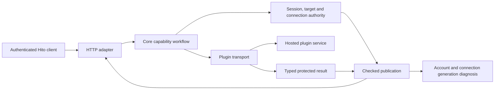
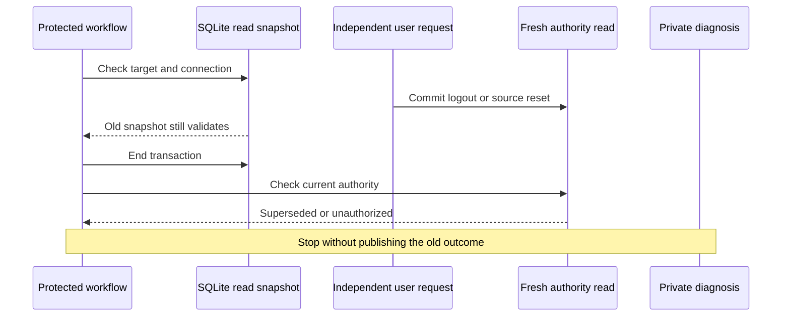

# Plugin connection credentials

This describes the isolated backend candidate. It is not integrated or deployed. The running local server still uses the behavior documented in [LRCLIB troubleshooting](plugin-lrclib.md). [Implementation status](status.md#2026-11-12-credential-qualification-and-review) records the tested cases and remaining work.

A plugin service credential authenticates Hito to a hosted plugin. It is separate from the listener's Hito session and from credentials a plugin uses with its own upstream. Loading a public manifest does not prove that protected content requests will work.

## Ownership

Core owns connection credentials, installation revisions, authorization and private diagnosis. The HTTP adapter maps typed results. A plugin can report its own service health, but cannot set Hito's account-specific credential diagnosis.

The generation includes the account, installation and revision, and service and revision. Each protected exchange also receives a ticket tied to the exact in-memory observation entry. A replaced connection or evicted entry cannot inherit an old request's completion.

## Outcomes

A protected plugin 401 becomes the typed `plugin_credentials_required` result. Direct API errors use HTTP 409, preserving HTTP 401 for the listener's expired or revoked Hito session. An optional `plugin_connection` stamp identifies only the current owner's installation and revision. Generic failures may omit that stamp. Provider 403 and unrelated upstream failures retain their existing classification.

Source resolution keeps its existing result contract. An unavailable provider can still yield a ready alternate source; otherwise the resolution can report provider unavailable. Private connection diagnosis must not replace a valid alternate playback result or leak another account's connection.

A successful manifest or public health request cannot clear a protected rejection. A checked successful content request can. Observations expire after thirty seconds and the cache holds at most 128 entries. Request dispatch order determines which protected result is newer; completion order alone must not let an older rejection overwrite newer success. These limits bound a temporary diagnosis, not the lifetime of a saved credential.

## Changes during a request

A deferred SQLite transaction gives a coherent snapshot. It can remain older than a logout or source-choice reset that has already committed elsewhere. Committing that old read transaction does not refresh its answers.

The source candidate checks fresh authority before later provider exchanges and private observations. This prevents the reproduced stale-snapshot schedules. It does not claim atomicity with every mutation that might happen after the final check. All four lyric callbacks pass their own logout regressions after fresh session and connection checks.

Automatic lookup also rechecks the full recording target and search metadata after ending its transaction. Its public title-edit regression proves that a response for the old title cannot mark the current connection invalid while the session remains valid. The test verifies the accepted edit and complete synchronization-history append, preserving other metadata, collections, identities and original audio. Manual metadata, selected-document and legacy target-change companions remain unfinished.

## Verification and integration

Tests use public HTTP or Core capabilities, temporary SQLite, owned audio originals and protocol fixtures. A deterministic request-scoped barrier holds the actual open transaction while logout or reset commits and an independent session verifies the new state. A late HTTP rejection alone is insufficient: tests also compare complete private installation health after provider cleanup, along with collection, identity, source and original-file preservation.

The source-choice slice passes twelve distinct directed cases. After the automatic title-edit correction, seven recovery cases and all 32 automatic-lyrics cases pass on one unchanged source. This does not complete the feature. Remaining gates include the other lyric target-change companions, shared fixture ownership, strict checks, combined capability and HTTP tests on the composed main branch, actual Rust contract reproduction, frontend integration and packaged end-to-end acceptance. The preview and its watcher must remain untouched during normal-server deployment work.

Logs contain safe outcomes, correlation IDs, counts and timings. They must never contain credentials, session material, raw bodies, audio, private paths, search text, titles or signed URLs.
