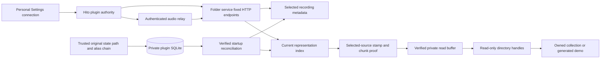

# Music-folder plugin

This separate HTTP service works with Hito's current Settings and Discover workflows. The image contains three original generated sine waves, each 20 seconds long, with truthful titles, artist and album tags. It needs no provider account, paid service, token, shell environment variable, or change to Hito's database to start.

The running development service includes a private identity registry, witnessed release reconciliation, retained unavailable recordings and verified audio-byte emission. Focused binary/HTTP fixtures and the actual release-image browser workflow pass. The official service currently targets Linux Docker; persistent state explicitly rejects non-Unix systems. That service limit is separate from Hito desktop support. Verified tag-edit continuity is limited to the PCM WAV profile below; broader recovery, codec and platform acceptance remain open.

## Start and connect

From the repository root containing the existing Hito Compose deployment, run:

```sh
docker compose -f compose.yaml -f compose.plugins.yaml run --rm --build --no-deps plugin-folder --music /demo --state /state --initialize-state
docker compose -f compose.yaml -f compose.plugins.yaml up -d plugin-folder
```

Run the first command once for a new state volume. The already running local demo has initialized state. Initialization commits the initial private registry and exits; it refuses to overwrite an existing registry. Later starts use only the second command. Normal startup requires established state and never silently initializes a replacement. This starts only the plugin service on the same Compose network as Hito. It does not install a plugin into an account. The host inspection endpoint is `http://localhost:8091/v1/manifest`. Hito must use its internal Docker address:

```text
http://plugin-folder:8090/
```

1. Sign in to Hito as an administrator. Open Settings, then Plugins.
2. Expand Services for this server. Enter the internal address above, then select Offer service. Hito obtains the name `Hito music folder` automatically.
3. Select that offered service, leave Bearer token empty, and select Connect service. Review the displayed `Hito music folder` identity and its `search` and `sources` capabilities. Check connection revalidates the manifest. Each listener personally installs their own connection.
4. Open Discover, select the service, and search for `Hito demo`. The tracks are synthetic test signals, not commercial music.
5. Select Add to library to save a recording without starting playback. Select Play to adopt and play another track. Use the Seek control to change position.
6. In Settings, Plugins, select Remove, then Remove plugin. Saved recordings remain in the library and become unavailable through this connection.

Hito retains its administrator-only address offers, personal installation, and authenticated audio relay. The browser receives Hito source UUIDs. It receives no plugin URL, token, filename or directory locator.

The demo has no bearer authentication. The port binds only to localhost, and the service is reachable by containers on its Compose network. An offered collection is available to accounts allowed to install that offer. Keep this configuration on a trusted local machine and network. A remotely shared collection needs transport and access controls before exposure.

## Use a read-only collection

Create `compose.plugins.local.yaml` with the folder you own:

```yaml
services:
  plugin-folder:
    volumes:
      - plugin-folder-collection-state:/state
      - type: bind
        source: /absolute/path/to/your/music
        target: /collection
        read_only: true
    command:
      [
        "--music",
        "/collection",
        "--state",
        "/state",
        "--listen",
        "0.0.0.0:8090",
      ]
volumes:
  plugin-folder-collection-state:
```

Run:

```sh
docker compose -f compose.yaml -f compose.plugins.yaml -f compose.plugins.local.yaml run --rm --build --no-deps plugin-folder --music /collection --state /state --initialize-state
docker compose -f compose.yaml -f compose.plugins.yaml -f compose.plugins.local.yaml up -d plugin-folder
```

The service scans at startup. Restart it after collection changes. The container runs as UID 10001 and needs read and directory traversal access to the selected collection. It never edits that collection. Remove the local override from the command to return to the generated demo.

Tags supply title, artist, album, album artist, disc and track numbers. Untagged audio gets a neutral opaque label and `Unknown artist`; filenames never become metadata. Names never prove recording identity. Bootstrap preserves distinct legacy file identities. Later matching uses exact historical bytes or a unique supported PCM evidence match. Tagged tracks in one folder with the same album and album artist form a current release group. The registry reconciles that group against verified prior membership, as described below. Multi-disc grouping across folders remains open.

Recognized original representations are WAV, FLAC, MPEG audio, MP4 audio, AAC, Ogg Vorbis/Opus and AIFF. Recognition does not prove every codec will decode in every browser. The owned WAV demo is the tested browser representation. There is no transcoding in this service.

## Ownership and limits



The plugin uses the Apache-2.0 wire SDK and owns its scanner, file handles, and private SQLite registry. It has no dependency on Hito core or access to Hito's database. The manifest declares only search and sources. It implements manifest, paged search, authoritative recording detail, complete source lists, and GET/HEAD audio with single byte ranges. HEAD ignores Range. If-Range returns a full representation. Multipart, malformed and unsatisfiable byte ranges return 416. Responses use private no-store caching.

The separate `plugin-folder-state` volume holds `/state/identity.sqlite` and its single-owner lock. The image runs as UID 10001, the state directory requires mode 0700, and files require mode 0600 with matching ownership. Admission walks the original state path and alias targets through directory handles. Ancestors and aliases must belong to root or the process user. Ordinary ancestors cannot be group- or other-writable; a trusted sticky ancestor is allowed only through trusted owned entries. The final private directory cannot be a symlink. An unsafe original alias is rejected even if its destination has safe permissions. On Linux, SQLite receives an ASCII procfd name for the admitted directory, preserving native non-UTF-8 state names. SQLite resolves that name to a filesystem path; trusted original ancestry supplies the ownership boundary. Temporary snapshots use the pinned directory directly. Processes with the same UID or root already control this state. The rest of the root filesystem and the music mount remain read-only.

Startup scans outside the SQLite write transaction, commits a complete generation, and then starts HTTP. The registry permits at most 10,000 retained recording rows and 100,000 rows each for evidence and representations. Release and release-membership history each permit at most 100,000 rows within their byte budgets. A recording permits at most the SDK's 16 current representations; exceeding the cap fails the generation instead of truncating its source page. It does not prune identity records to make room.

The database has a 64 MiB bound calculated from its actual SQLite page size, including restored databases. Startup accepts power-of-two page sizes from 512 bytes through 64 KiB, checks the existing file and page count, applies the corresponding maximum page count, and checks again before committing. It uses DELETE journaling and full synchronization. The journal-size setting controls retained journal space; a hard bound on an active rollback journal remains open. Sampled disk allocation does not establish that bound.

Back up and restore the complete stopped state volume, preserving ownership and permissions. Missing state, corrupt state, unsupported schema versions and invalid committed snapshot nonces prevent normal startup. Losing an entire volume requires operator restoration or deliberate initialization of a new state volume; the plugin cannot prove that a newly supplied empty volume used to contain another registry. Unchanged schema-1 inputs can acquire audio evidence during migration. Already-retagged inputs without prior evidence cannot prove continuity. Broader historical upgrade fixtures and full recovery acceptance remain unfinished.

Scanning permits at most 50,000 directory entries, 1,024 folders, 32 levels, 10,000 verified file observations and 1 GiB per file, with a five-minute deadline checked during reads and seeks. Retained observation data has a 32 MiB aggregate budget, including 32 bytes of SHA-256 chunk proof per 64 KiB of each observation, and private relative locators have a 16 KiB limit. Persistent scans additionally share a 16 GiB read-work budget across snapshot copies, metadata, evidence and original-file revalidation, including unsupported inputs. One anonymous snapshot exists at a time, contains at most 1 GiB, and disappears when its last file handle closes. Tags, exact checksum, chunk proofs and audio evidence come from that same snapshot. Chunk proofs are computed alongside the existing whole-file checksum, without another read pass. The original locator, stamp and checksum must still match after inspection. Metadata reads have an 8 MiB byte budget; cover art is not parsed into metadata. Unsupported or initially unreadable media is skipped and counted. Changed inputs, snapshot failures, exhausted budgets and collection-limit failures stop startup rather than publishing a partial catalog. The startup log reports safe outcomes, counts and elapsed time.

The service skips symlinks and non-regular files. An owned parent handle opens the selected root with one no-follow operation, rejecting a replacement symlink at that boundary. This does not pin mutable ancestor pathnames before the parent is acquired. No-follow child directory handles preserve containment, and audio requests select an existing opaque source ID rather than a path. Reopened files must match their scanned inode, change time, modification time and size on Linux. Before returning any bytes, the stream reads the containing aligned 64 KiB chunk into a private buffer, checks its stamp and SHA-256 proof, then emits the requested part. This also applies to ranges and later chunks in an active response. A retained writable host mapping can change bytes without changing timestamps; a mismatched proof stops the body before those bytes are emitted. Already verified bytes can still be returned. Replaced or removed files become unavailable. The Docker mount prevents plugin writes; the host can still edit the collection. This service does not retain a complete immutable playback snapshot.

JSON bodies are limited to 4 KiB, search results to the protocol's 256 KiB budget, and request handling to 16 concurrent requests with ten-second handler/body deadlines. Four file-open workers and eight audio streams have separate admission limits. Streaming reads at most 64 KiB at a time and respects backpressure. Each blocking read worker owns its file and admission permit. If a consumer closes during a pending read, capacity remains occupied until that read finishes and the worker closes the file. Logs use safe operation categories, correlation IDs, outcomes and timings. Input rejection omits parser details even at TRACE. Production logging also hard-filters all dependency diagnostics, including parser messages bridged from `log`, independently of `RUST_LOG`; safe plugin-owned counts and outcomes remain available.

SIGINT and Docker's default SIGTERM request graceful HTTP drain. Signal handlers are installed before startup work. Responsive active responses finish or close before the server stops. A filesystem read blocked inside the kernel cannot be cancelled by this service; its worker retains admission and can delay process exit beyond Docker's stop grace period. The tested shutdown case uses responsive owned local audio.

## Identity and retained availability

Bootstrap preserves unchanged legacy recording/source IDs and unambiguous release IDs. New recording IDs are opaque and persistent. A verified tag edit can preserve the recording ID through an unambiguous `riff-pcm-s16-v1` match: ordinary little-endian RIFF WAV, one 16-byte PCM format chunk, one nonempty data chunk, 16-bit integer samples, one or two channels, 8–192 kHz, and consistent byte rate, alignment and frame length. The evidence hashes the complete format and exact PCM bytes. It never converts samples through f32, resamples, or performs acoustic matching. Other formats and WAV profiles remain exact-byte-only, including 32-bit PCM. Unsupported and high-precision codec countercases still need broader acceptance coverage.

Every wire source ID is permanently bound to one recording and exact representation. Changed tagged bytes receive a new opaque source ID. The former source ID rejects audio requests, including stale ranges; it cannot silently serve new byte offsets. Recording metadata revisions are content observations separate from recording IDs. They use `observation-` followed by a SHA-256 digest of the observed metadata and representation binding. This intentionally replaces the legacy recording-ID revision format while preserving recording and source identities.

Recording metadata has a persisted private owner locator. A newly discovered representation does not replace a verified incumbent owner. If that observation disappears, reconciliation selects another current verified observation and commits its metadata with source availability. Audio does not use the metadata owner: each requested source selects only its own verified representation and can try equivalent same-checksum locators. The complete source lookup shares one ten-second opening deadline across all current representations and their candidates. A timeout fails the request instead of publishing a partial source list. Kernel-blocked filesystem operations retain the existing shutdown limitation described above.

Release continuity uses persisted recording-membership witnesses and verified prior occurrences. A uniquely matched prior release keeps its ID through a tag edit or membership change. A split or merge that relates one prior release to several current groups, or several prior releases to one group, permanently retires the ambiguous prior IDs and allocates new opaque IDs. Returning to the former tags does not revive a retired ID. A release with no current group can remain retained and eligible for a later verified restoration. Paths and tags alone never prove historical continuity.

The old tag-and-member hash is used only to preserve an unambiguous legacy release at bootstrap. New releases receive opaque IDs. Same-tag groups in different folders are resolved conservatively rather than merged from their names. Reconciliation bounds witness work and fails the generation if that budget is exhausted.

Historical checksum bindings are stored as a multimap. Every verified locator and its metadata reach reconciliation before recording deduplication. Private relative locator bytes preserve native names without becoming protocol IDs or logged values. All current observations resolve against the previous generation before new evidence is written. A previous locator preserves its recording only when exact bytes or compatible verified PCM evidence also match. Novel byte-identical inputs share a new identity when no historical candidate resolves them; a locator or inode alone never proves identity.

The tested legacy collision starts with distinct A/B recording IDs containing equal PCM and different tags. Rewriting A in place to B's exact tagged bytes preserves both IDs and separate source bindings. A new third locator matching that ambiguous checksum receives a separate recording/source and keeps both across restart. Distinct non-UTF-8 names exercise lossless private locator storage. This does not prove every historical ambiguity case.

Search contains current recordings. Authoritative detail also serves retained recording metadata after every locator disappears. After reconciliation such a recording has a complete empty source list. If locators disappear while the service is running, its current source IDs report `ready: false` and audio returns 404. No replacement recording or source is fabricated. An equivalent same-checksum locator can still serve the original representation when another copy disappears.

Every committed startup generation has a fresh random snapshot nonce. Search cursors bind the registry identity, generation and nonce, so restarting from an older backup rejects old cursors even if a generation number repeats. The nonce commits with the reconciled catalog.

The owned startup task retains the registry claim through SQLite establishment, scanning and explicit initialization. Explicit registry-configuration errors after connection establishment await SQLite close before releasing that claim. Public regressions hold actual establishment during caller cancellation and hold actual close after rejection of `journal_mode`; both preserve ownership and later recover the same state over HTTP. These checks do not prove cleanup for every internal SQLx establishment failure, out-of-memory condition or forced process crash. The separate core pool cancellation case covers a different owner. There is no background watcher.

## Verification

The focused check uses the existing Hito tools image and volumes, a separate `/build/plugin-folder-target`, two compile jobs and disabled incremental compilation:

```sh
./scripts/check-plugin-folder.sh
```

The final folder source, merged in integration `d483ad5`, passed 38 tests, three library and 35 integration cases, with no failures or ignored cases. Formatting and strict all-target Clippy passed. Actual-binary HTTP cases cover explicit initialization and private state, unchanged legacy IDs, verified retags and moves, changed PCM, historical collisions, distinct native filenames, metadata-owner fallback, release continuity and conservative split/merge retirement. Additional cases cover same-checksum source fallback, the 16-source cap, retained unavailable detail, backup-restored cursor rejection and rollback at the actual-page database bound, including 64 KiB pages. State-path cases reject writable ancestry and unsafe original aliases, then verify unchanged identity after recovery. Linux native state names survive initialization and HTTP restarts. Actual SQLite establishment/canceled-open and rejected-configuration/held-close cases verify claim lifetime and same-state HTTP recovery.

The protocol/audio checks cover complete paging, response budgets, containment, symlinks and special files, malformed requests, TRACE privacy, immutable source bytes, single ranges, HEAD and abandoned-stream cleanup. A real TCP case verifies deferred stream logging retains request correlation and a scoped subscriber, then checks graceful shutdown with responsive audio. The retained-mapping regression changes unread PCM with every indexed stamp field unchanged; unpolled full/range bodies and an active full body with a correct prefix return no changed bytes. Five compiled cases also pass as the image UID 10001, covering both ancestry cases, native state paths, mapped audio and held-close recovery.

Two independent review rounds completed. Resolver regressions and source checks address the final findings; no third independent review or independently clean final verdict is claimed. The final integrated workspace also passed formatting, workspace tests and strict all-target Clippy on `d483ad5`, including the state-path/chunk fixes. The release-image browser workflow and local deployment below also pass. Current integration evidence and its exact scope are in [status](status.md). Full native/GUI, other-platform and public-release acceptance remain open. Active journal accounting, broader cancellation/crash coverage and codec/upgrade fixtures remain open.

## Running development demo

For the isolated browser flow, first have Hito's development tools and `hito-e2e-server:latest` image available. This browser configuration mounts the existing `hito_node-modules` dependency volume. It uses a fresh tmpfs database and its own administrator account, never the normal server volume:

```sh
docker compose -p hito-plugin-folder -f compose.plugins.yaml build plugin-folder
docker compose -p hito-plugin-folder -f compose.plugins.yaml run --rm --no-deps plugin-folder --music /demo --state /state --initialize-state
docker compose -p hito-plugin-folder -f compose.plugins.yaml -f scripts/plugins/compose.e2e.yaml --profile e2e run --rm plugin-folder-browser
docker compose -p hito-plugin-folder -f compose.plugins.yaml -f scripts/plugins/compose.e2e.yaml --profile e2e down
```

The current release images passed a real Chromium workflow in 3.5 seconds on 2026-10-16: UI offer/connect, discovery, adoption without autoplay, playback, seeking with relayed byte ranges, coherent album adoption and removal with saved Hito IDs retained. The folder image is `sha256:be2eaba8184a848065384f7b10ebb14fa94d69021549282416b7b20e367726fe` and the server image is `sha256:efdd68dbbc536749aaa777291aee7593bdeae3f2b105c2e171fd33b35c879c8d`. The mobile screenshot was inspected. This is browser evidence for the deployed registry implementation, not native desktop, physical-output, broad codec or public-release acceptance.

That exact folder image is healthy on the normal local Compose network. Its private state volume was explicitly initialized, with mode 0700 on the directory and mode 0600 on the database and lock, all owned by UID 10001. The container retains its read-only root, dropped capabilities, resource limits, ports and runtime user. Actual HTTP comparison with the legacy service preserves all recording/release IDs, metadata apart from the intentional observation-revision format, and complete source pages. A real restart preserves the new metadata, revisions and sources exactly. Both internal and localhost manifests pass. No connection was installed into the normal application account. Disposable browser containers were removed.

Jamendo, YouTube/yt-dlp, debrid, community, mobile, cross-platform packages, large-library performance and the rest of the release plan remain separate work.
