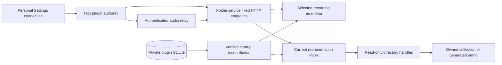

# Music-folder plugin demo

This separate HTTP service works with Hito's current Settings and Discover workflows. The image contains three original generated sine waves, each 20 seconds long, with truthful titles, artist and album tags. It needs no provider account, paid service, token, shell environment variable, or change to Hito's database to start.

This is a development demo and an initial read-only folder adapter. The complete official folder-plugin release remains unfinished. Verified tag-edit continuity is limited to the PCM WAV profile below; complete duplicate-copy acceptance, recovery and durable release reconciliation remain open.

## Start and connect

From the repository root containing the existing Hito Compose deployment, run:

```sh
docker compose -f compose.yaml -f compose.plugins.yaml run --rm --build --no-deps plugin-folder --music /demo --state /state --initialize-state
docker compose -f compose.yaml -f compose.plugins.yaml up -d plugin-folder
```

Run the first command once. It commits the initial private registry and exits; it refuses to overwrite an existing registry. Later starts use only the second command. Normal startup requires established state and never silently initializes a replacement. This starts only the plugin service on the same Compose network as Hito. It does not install a plugin into an account. The host inspection endpoint is `http://localhost:8091/v1/manifest`. Hito must use its internal Docker address:

```text
http://plugin-folder:8090/
```

1. Sign in to Hito as an administrator. Open Settings, then Plugins.
2. Expand Services for this server. Enter `Folder demo` and the internal address above, then select Offer service.
3. Select that offered service, leave Bearer token empty, and select Connect service. Review the displayed `Hito music folder` identity and its `search` and `sources` capabilities. Check connection revalidates the manifest. Each listener personally installs their own connection.
4. Open Discover, select the service, and search for `Hito demo`. The tracks are synthetic test signals, not commercial music.
5. Select Add to library to save a recording without starting playback. Select Play to adopt and play another track. Use the Seek control to change position.
6. In Settings, Plugins, select Remove, then Remove plugin. Saved recordings remain in the library and become unavailable through this connection.

Hito retains its administrator-only address offers, personal installation, and authenticated audio relay. The browser receives Hito source UUIDs. It receives no plugin URL, token, filename or directory locator.

The demo has no bearer authentication. The port binds only to localhost, and the service is reachable by containers on its Compose network. An offered collection is available to accounts allowed to install that offer. Keep this configuration on a trusted local machine and network. A remotely shared collection needs transport and access controls before exposure.

## Use a read-only collection

Create `compose.plugins.local.yaml` with the folder you own:

```yaml
services:
  plugin-folder:
    volumes:
      - plugin-folder-collection-state:/state
      - type: bind
        source: /absolute/path/to/your/music
        target: /collection
        read_only: true
    command: ["--music", "/collection", "--state", "/state", "--listen", "0.0.0.0:8090"]
volumes:
  plugin-folder-collection-state:
```

Run:

```sh
docker compose -f compose.yaml -f compose.plugins.yaml -f compose.plugins.local.yaml run --rm --build --no-deps plugin-folder --music /collection --state /state --initialize-state
docker compose -f compose.yaml -f compose.plugins.yaml -f compose.plugins.local.yaml up -d plugin-folder
```

The service scans at startup. Restart it after collection changes. The container runs as UID 10001 and needs read and directory traversal access to the selected collection. It never edits that collection. Remove the local override from the command to return to the generated demo.

Tags supply title, artist, album, album artist, disc and track numbers. Untagged audio gets a neutral opaque label and `Unknown artist`; filenames never become metadata. Names never prove recording identity. Bootstrap preserves distinct legacy file identities. Later matching uses exact historical bytes or a unique supported PCM evidence match. Tagged tracks in one folder with the same album and album artist share a release; different folders remain separate unless their complete audio/tag evidence is identical. Multi-disc grouping across folders remains open.

Recognized original representations are WAV, FLAC, MPEG audio, MP4 audio, AAC, Ogg Vorbis/Opus and AIFF. Recognition does not prove every codec will decode in every browser. The owned WAV demo is the tested browser representation. There is no transcoding in this service.

## Ownership and limits



The plugin uses the Apache-2.0 wire SDK and owns its scanner, file handles, and private SQLite registry. It has no dependency on Hito core or access to Hito's database. The manifest declares only search and sources. It implements manifest, paged search, authoritative recording detail, complete source lists, and GET/HEAD audio with single byte ranges. HEAD ignores Range. If-Range returns a full representation. Multipart, malformed and unsatisfiable byte ranges return 416. Responses use private no-store caching.

The separate `plugin-folder-state` volume holds `/state/identity.sqlite` and its single-owner lock. The image runs as UID 10001, the state directory requires mode 0700, and files require mode 0600 with matching ownership. The rest of the root filesystem and the music mount remain read-only. Startup scans outside the SQLite write transaction, commits a complete generation, and then starts HTTP. The registry permits at most 10,000 retained recording rows and 100,000 rows each for evidence and representations. A recording permits at most the SDK's 16 current representations; exceeding the cap fails the generation instead of truncating its source page. New 4 KiB-page databases use a 64 MiB page budget and DELETE journaling. The journal-size setting controls retained journal space; active rollback-journal accounting and page-size recovery validation remain open. It does not prune identity records to make room.

Back up and restore the complete stopped state volume, preserving ownership and permissions. Missing state, corrupt state, and unknown schema versions prevent normal startup. Losing an entire volume requires operator restoration or deliberate initialization of a new state volume; the plugin cannot prove that a newly supplied empty volume used to contain another registry. Unchanged schema-1 inputs can acquire audio evidence during migration. Already-retagged inputs without prior evidence cannot prove continuity. Retained unavailable detail and full recovery acceptance remain unfinished.

Scanning permits at most 50,000 directory entries, 1,024 folders, 32 levels, 10,000 verified file observations and 1 GiB per file, with a five-minute deadline checked during reads and seeks. Retained observation data has a 32 MiB aggregate budget and private relative locators have a 16 KiB limit. Persistent scans additionally share a 16 GiB read-work budget across snapshot copies, metadata, evidence and original-file revalidation, including unsupported inputs. One anonymous snapshot exists at a time, contains at most 1 GiB, and disappears when its last file handle closes. Tags, exact checksum and audio evidence come from that same snapshot. The original locator, stamp and checksum must still match after inspection. Metadata reads have an 8 MiB byte budget; cover art is not parsed into metadata. Unsupported or initially unreadable media is skipped and counted. Changed inputs, snapshot failures, exhausted budgets and collection-limit failures stop startup rather than publishing a partial catalog. The startup log reports safe outcomes, counts and elapsed time.

The service skips symlinks and non-regular files. An owned parent handle opens the selected root with one no-follow operation, rejecting a replacement symlink at that boundary. This does not pin mutable ancestor pathnames before the parent is acquired. No-follow child directory handles preserve containment, and audio requests select an existing opaque source ID rather than a path. Reopened files must match their scanned inode, change time, modification time and size on Linux. Replaced or removed files become unavailable. A read-only Docker mount prevents plugin writes, though the host owner can still modify the collection. It is not an immutable audio snapshot during a host edit.

JSON bodies are limited to 4 KiB, search results to the protocol's 256 KiB budget, and request handling to 16 concurrent requests with ten-second handler/body deadlines. Four file-open workers and eight audio streams have separate admission limits. Streaming reads at most 64 KiB at a time and respects backpressure. Each blocking read worker owns its file and admission permit. If a consumer closes during a pending read, capacity remains occupied until that read finishes and the worker closes the file. Logs use safe operation categories, correlation IDs, outcomes and timings. Input rejection omits parser details even at TRACE. Production logging also hard-filters all dependency diagnostics, including parser messages bridged from `log`, independently of `RUST_LOG`; safe plugin-owned counts and outcomes remain available.

SIGINT and Docker's default SIGTERM request graceful HTTP drain. Signal handlers are installed before startup work. Responsive active responses finish or close before the server stops. A filesystem read blocked inside the kernel cannot be cancelled by this service; its worker retains admission and can delay process exit beyond Docker's stop grace period. The tested shutdown case uses responsive owned local audio.

## Identity work still open

Bootstrap preserves the current unchanged recording, source and release IDs. New recording IDs are opaque and persistent. A verified tag edit can preserve the recording ID through an unambiguous `riff-pcm-s16-v1` match: ordinary little-endian RIFF WAV, one 16-byte PCM format chunk, one nonempty data chunk, 16-bit integer samples, one or two channels, 8–192 kHz, and consistent byte rate, alignment and frame length. The evidence hashes the complete format and exact PCM bytes. It never converts samples through f32, resamples, or performs acoustic matching. Other formats and WAV profiles remain exact-byte-only, including 32-bit PCM.

Every wire source ID is permanently bound to one recording and exact representation. Changed tagged bytes receive a new opaque source ID. The former source ID rejects audio requests, including stale ranges; it cannot silently serve new byte offsets. Recording metadata revisions are content observations separate from recording IDs.

Recording metadata has a persisted private owner locator. A newly discovered representation does not replace a verified incumbent owner. If that observation disappears, reconciliation selects another current verified observation and commits its metadata with source availability. Audio does not use the metadata owner: each requested source selects only its own verified representation and can try equivalent same-checksum locators. The complete source lookup shares one ten-second opening deadline across all current representations and their candidates. A timeout fails the request instead of publishing a partial source list. Kernel-blocked filesystem operations retain the existing shutdown limitation described above.

Release IDs hash album tags and the sorted recording identities in one folder group. They contain no path or directory name. This keeps the immutable demo album coherent and survives moving its whole unchanged folder. Adding, removing or retagging album members can change the release ID. Persistent release continuity remains open.

Historical checksum bindings are stored as a multimap. Every verified locator and its metadata reach reconciliation before recording deduplication. Private relative locator bytes preserve native names without becoming protocol IDs or logged values. All current observations resolve against the previous generation before new evidence is written. A previous locator preserves its recording only when exact bytes or compatible verified PCM evidence also match. Novel byte-identical inputs share a new identity when no historical candidate resolves them; a locator or inode alone never proves identity.

The tested legacy collision starts with distinct A/B recording IDs containing equal PCM and different tags. Rewriting A in place to B's exact tagged bytes preserves both IDs and separate source bindings. A new third locator matching that ambiguous checksum receives a separate recording/source and keeps both across restart. Distinct non-UTF-8 names exercise lossless private locator storage. This does not prove every historical ambiguity case. Same-checksum runtime locator fallback and source-cap failures still need dedicated regressions. Retained unavailable detail, precision countercases and crash/cancellation acceptance remain open. Startup counters currently fence ordinary search cursors; backup-restore fencing needs a fresh committed token. The registry claim now travels with the actual blocking scan, but cancellation/cleanup ownership is not yet independently verified. These are open identity requirements, not completed acceptance. There is no background watcher.

## Verification

The focused check uses the existing Hito tools image and volumes, a separate `/build/plugin-folder-target`, two compile jobs and disabled incremental compilation:

```sh
./scripts/check-plugin-folder.sh
```

The recorded focused run passed seventeen folder-service tests and one SDK contract test, with formatting and strict Clippy clean. A real TCP test also verifies deferred stream logging retains request correlation and a scoped subscriber, then checks graceful server shutdown. Boundary tests cover the real SDK contract, complete paging, large-tag response limits, conservative matching, coherent releases, root moves, symlinks, special files, traversal, changed sources, malformed requests, TRACE privacy, single ranges, HEAD and abandoned-stream cleanup.

The registry bootstrap step has a separate actual-binary HTTP regression for explicit initialization, state permissions, and unchanged legacy wire IDs across two restarts. A second actual-binary HTTP regression edits WAV tags and moves the root/file, then requires the same recording ID, a nonempty changed revision, a new source ID, old-source 404 and new-source 206 containing the changed tag bytes. The registry image and browser flow have not yet been rebuilt or rerun for this step; the deployment evidence below describes the earlier accepted demo.

The next narrow run passed all four actual-binary identity tests, formatting and strict Clippy. It adds same-path changed-PCM coverage with unchanged tags and exact PCM ranges, plus the legacy A/B exact-byte collision regression. The former passed existing behavior; the latter failed before complete observations and verified prior-location matching were implemented. The broader suite has not been rerun for this observation-reconciliation step.

The owner/source step passed six actual-binary identity tests and five adjacent audio/containment tests. Its corrected regression places the alternative representation in another folder, preserving the separate release-membership requirement. It requires both current source IDs to serve their different tag bytes, retains incumbent metadata/revision while available, then removes that owner and requires atomic metadata fallback, stable alternative source and old-source 404. Formatting and strict Clippy pass. Complete workspace gates and a rebuilt registry-image browser run remain pending.

For the isolated browser flow, first have Hito's development tools and `hito-e2e-server:latest` image available. This browser configuration mounts the existing `hito_node-modules` dependency volume. It uses a fresh tmpfs database and its own administrator account, never the normal server volume:

```sh
docker compose -p hito-plugin-folder -f compose.plugins.yaml build plugin-folder
docker compose -p hito-plugin-folder -f compose.plugins.yaml run --rm --no-deps plugin-folder --music /demo --state /state --initialize-state
docker compose -p hito-plugin-folder -f compose.plugins.yaml -f scripts/plugins/compose.e2e.yaml --profile e2e run --rm plugin-folder-browser
docker compose -p hito-plugin-folder -f compose.plugins.yaml -f scripts/plugins/compose.e2e.yaml --profile e2e down
```

The browser test uses real UI offer/install, search, adoption without autoplay, playback, seek, relayed byte ranges, one shared durable album, and personal removal with durable recording IDs retained. Screenshots go to `test-results/plugins-folder/`. Root rebuilt the integrated source and reran this workflow on 2026-10-16. The folder image was `sha256:85b970e4b01157c0941b3b4493e74d51a76dc3739fce321fb96b55b06575f9b6`; the Hito image was `sha256:8e2ad1ed7e68e3ed692777ca4544a7c15b7650987551c5785b22827cae2a978b`. The workflow passed in 3.9 seconds. Docker stop also exited successfully with the graceful lifecycle event. This proves the HTTP plugin boundary, not native desktop speed or a public release.

That exact folder image is running on the normal local Compose network. Both its internal manifest and localhost port mapping returned the expected identity. The user was notified here with installation steps. No connection was installed into the normal application account by the agent. The isolated browser account and database were removed after the test.

Jamendo, YouTube/yt-dlp, debrid, community, mobile, cross-platform packages, large-library performance and the rest of the release plan remain separate work.
