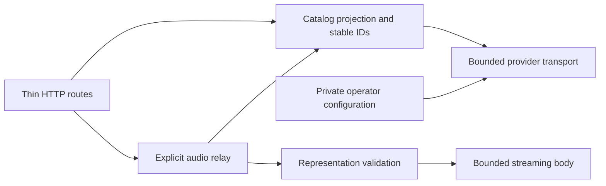

# Jamendo adapter in development

The `feature/jamendo-plugin` branch contains an independent Rust HTTP adapter using Hito's plugin SDK. It is a library with a router, not an operator-ready service or a deployed plugin. Live credentials, runtime packaging and host integration remain unfinished.

The operator supplies a private Jamendo client ID. Hito accounts do not supply that credential. The manifest declares search and sources; the adapter returns structured SDK data and adds no plugin UI.

## Ownership

Configuration fixes the production API endpoint. Provider transport owns independent metadata and media clients with proxies, automatic redirects and retries disabled. Catalog projection owns recording, release and source identifiers. The relay owns stream admission, framing and body lifetime. HTTP handlers validate SDK requests and map typed results.

Manifest, search, detail and source discovery retrieve no audio. An explicit audio request re-reads the selected track and validates its current stream address. The service forwards neither the caller's authorization nor cookies. It exposes opaque IDs instead of upstream media addresses or the client ID.

## Current implementation

| Route | Operation |
| --- | --- |
| `GET /v1/manifest` | SDK capabilities |
| `POST /v1/search` | First bounded search page |
| `POST /v1/recordings/detail` | One recording |
| `POST /v1/sources` | Current playable source facts |
| `GET /v1/audio` | Explicit source relay |

The implementation requests Jamendo's `mp32` format and accepts one documented media host. It does not provide artwork, playlists, downloads or a media cache. The upstream API distinguishes streaming and download addresses; the adapter uses the streaming address. See the [Jamendo tracks API](https://developer.jamendo.com/v3.0/tracks).

Requests have a 4 KiB body limit. Provider JSON has a 256 KiB limit. Metadata and audio each have 16 admission permits. The stream holds its permit through completion or drop, emits at most 64 KiB per chunk and limits each awaited upstream body read to 15 seconds. These implementation bounds do not establish saturation, cancellation or performance acceptance.

## Verification and remaining work

Docker checks exercise actual HTTP against owned provider and audio fixtures. The initial workflow validates SDK manifest/search/detail/source responses, exact WAV delivery, zero metadata audio requests, caller-header isolation and omission of private transport data. This fixture verifies transport behavior, not live MP3 compatibility.

A second HTTP case changes the authoritative audio address after source selection. Opening the captured source re-reads provider metadata and rejects the changed origin without contacting it or opening the previous audio. Captured crate logs retain a safe rejection outcome and request correlation while excluding fixture credentials, addresses, search text and musical metadata. Both cases and strict all-target Clippy pass in Docker.

Strict all-target Clippy passes. Independent source review accepted module ownership, bounded transport and streaming. Adversarial framing, HEAD/ranges, admission saturation, deadlines, interrupted sockets, runtime logging and live-provider checks remain release work. Scoped crate-log checks cannot establish the privacy of a future executable's full dependency logs.

Live integration needs generic host support for creator/provider credits, a per-recording backlink and persistence restrictions. The existing SDK recording contract cannot express those facts or stop Hito's generic Download action. Jamendo's API terms require attribution and backlinks and restrict offline access; a stream-only adapter alone cannot enforce host behavior. See [clauses 3.3 and 4.1](https://devportal.jamendo.com/api_terms_of_use).

Runtime packaging and those shared contracts must be completed before offering this service to Hito accounts. Fixture acceptance does not replace a configured operator client ID or live checks.
