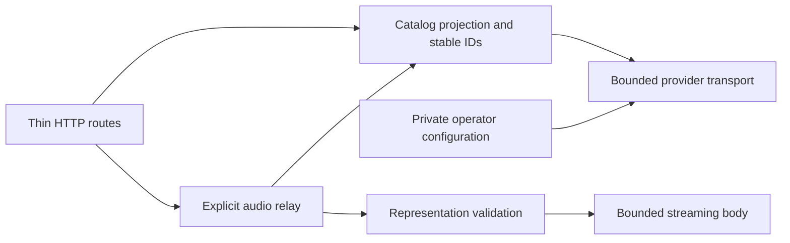
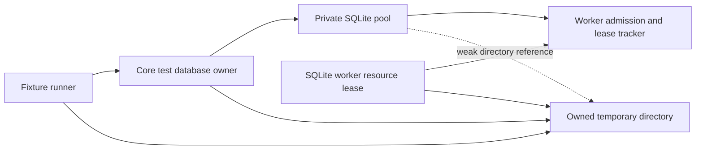

# Jamendo adapter in development

`hito-plugin-jamendo` contains an independent Rust HTTP adapter and a development executable using Hito's plugin SDK. Its development container has isolated runtime verification. It is not deployed or ready to offer to Hito accounts. Live credentials, host integration and public-release acceptance remain unfinished.

The operator supplies a private Jamendo client ID. Hito accounts do not supply that credential. The manifest declares search, sources, playlists and featured (the last two are source-only, see [featured albums](#featured-albums)); the adapter returns structured SDK data and adds no plugin UI.

## Ownership



Configuration fixes the production API endpoint. Provider transport owns independent metadata and media clients with proxies, automatic redirects and retries disabled. Catalog projection owns recording, release and source identifiers. The relay owns stream admission, framing and body lifetime. HTTP handlers validate SDK requests and map typed results.

Manifest, search, detail and source discovery retrieve no audio. An explicit audio request re-reads the selected track and validates its current stream address. The service forwards neither the caller's authorization nor cookies. It exposes opaque IDs instead of upstream media addresses or the client ID.

## Current implementation

| Route | Operation |
| --- | --- |
| `GET /v1/manifest` | SDK capabilities |
| `POST /v1/search` | First bounded search page |
| `POST /v1/recordings/detail` | One recording |
| `POST /v1/sources` | Current playable source facts |
| `GET /v1/audio` | Explicit source relay |
| `POST /v1/featured` | This week's popular albums as featured items |
| `POST /v1/playlists/detail` | One album as a playlist, by reference or canonical ID |
| `POST /v1/playlists/items` | Pages of that album's tracks |

The implementation requests Jamendo's `mp32` format and accepts one documented media host. It exposes albums through the playlist routes described below. It provides no artwork endpoint, downloads or media cache. The upstream API distinguishes streaming and download addresses; the adapter uses the streaming address. See the [Jamendo tracks API](https://developer.jamendo.com/v3.0/tracks).

Requests have a 4 KiB body limit. Provider JSON has a 256 KiB limit. Metadata and audio each have 16 admission permits. The stream holds its permit through completion or drop, emits at most 64 KiB per chunk and limits each awaited upstream body read to 15 seconds. These implementation bounds do not establish saturation, cancellation or performance acceptance.

## Featured albums

These capabilities are source-only. The packaged runtime evidence below predates them. No live Jamendo request or operator client ID was used; the cases below run against an owned fake of the Jamendo API.

`POST v1/featured` asks Jamendo's albums endpoint (`/v3.0/albums/`, `order=popularity_week`, `limit` as requested) and returns each album as a `FeaturedKind::Album` item. Its `id` and `reference` are both `jamendo:album:v1:<numeric id>`, the title is the album name and the subtitle is the artist. It sends no `artwork_id` and no `item_count`, because the adapter has no artwork endpoint yet, so Hito shows a generated cover for these cards. The capability contract, bounds and host behavior are in [featured music](plugins.md#featured-music).

The `playlists` capability exists so that a featured album can be imported. A reference is `jamendo:album:v1:<id>` or an `https://www.jamendo.com/album/<id>/...` link; anything else, a non-numeric ID or an ID with a leading zero is a 400 before any request to Jamendo. The adapter reads the album with its tracks (`/v3.0/albums/tracks/`), names the playlist after the album, counts its tracks and derives the snapshot token from a SHA-256 over the album name and each track's ID, title and length. Item pages are cut from a fresh read of the album, with the offset as the cursor. If the album changed since the detail request the pages answer 409, so Hito never mixes two versions. Each track becomes the same recording projection that search uses, with the album credit and Jamendo's canonical track page as attribution; playback sources come from the existing `sources` route: a copy of the album plays through Jamendo's own search and sources by the automatic resolution described in [playlist import](playlist-import.md).

Cases (`src/tests/featured.rs`): the manifest, the featured projection and the exact upstream query, out-of-contract limits that never reach Jamendo, detail by reference, link and canonical ID, paging with a cursor, invalid references, an unknown album (404), a changed album (409) and an invalid cursor. They failed first (`red-featured-plugin.log`). Not verified: the real `albums` and `albums/tracks` response shapes (taken from Jamendo's public API documentation, not observed), Jamendo's rate limits for these endpoints, and the Jamendo licence terms for listing popular albums.

## Development executable

The executable accepts a credential file and an optional listen address:

```text
hito-plugin-jamendo --client-id-file /run/secrets/jamendo-client-id --listen 0.0.0.0:8093
```

The default address is `127.0.0.1:8093`. On Unix, the credential must be an absolute path to a regular file owned by the effective user, with one hard link and mode `0400` or `0600`. The final path component cannot be a symbolic link. Reads are bounded, and the client ID accepts at most 128 ASCII letters, digits, hyphens or underscores with an optional trailing newline. Other platforms currently reject credential loading until their file-access policy is implemented. The executable accepts neither an inline credential nor a provider endpoint override.

JSON logs include lifecycle outcomes and correlated request outcomes. The executable permits only its own crate's log targets, even when `RUST_LOG=trace`, and discards invalid filter settings without logging their contents. Initialization failures use static reasons. SIGTERM and SIGINT stop admission and await active HTTP requests before the stopped event.

## Development container

[docker/plugin.Dockerfile](../docker/plugin.Dockerfile) builds the shared plugin image with `PLUGIN=hito-plugin-jamendo`. [deploy/compose/jamendo.yaml](../deploy/compose/jamendo.yaml) can run alone in an isolated development project. Its default host address is `http://localhost:8094/v1/manifest`; the container listens on port 8093. The example mounts no Hito application data and provides no account-connection setup. Generic attribution and persistence policy remain prerequisites for offering this service to accounts.

The image uses pinned Rust and Debian bases. The build disables debug information and incremental compilation, uses two compiler jobs and has a Jamendo-specific cache separated by project and architecture. Give each source snapshot a separate project/cache identity. Before and during large builds, retain at least 40 GiB of host headroom and keep combined Hito Cargo targets within 10 GiB. Run compiler-heavy work sequentially.

The runtime uses UID/GID 10001, a read-only root filesystem, dropped capabilities, no-new-privileges, a 256 MiB memory limit, one CPU and 64 PIDs. Logs rotate at 10 MiB with three files. A manifest health check runs every five seconds. Compose gives SIGTERM draining 30 seconds before its stop deadline; active upstream-audio shutdown acceptance remains unfinished. Restart is explicit in this development example.

Build from this checkout in its own project:

```sh
export HITO_JAMENDO_CREDENTIAL_VOLUME=hito-jamendo-dev-credentials
HITO_JAMENDO_IMAGE_TAG=development docker compose --project-directory . -p hito-jamendo-dev -f deploy/compose/jamendo.yaml --profile plugins build plugin-jamendo
```

The credential volume is external and must be provisioned before startup. Its explicit name is required in `HITO_JAMENDO_CREDENTIAL_VOLUME`. Docker Compose does not apply `uid`, `gid` or `mode` overrides to file-backed secrets because those use bind mounts. See [Docker's secret ownership documentation](https://docs.docker.com/reference/compose-file/services/#secrets). A host file bind, especially through Docker Desktop, must not be assumed to appear as owner 10001. The procedure below writes the private file inside a Docker volume, then assigns the Linux owner and mode that the executable checks.

For packaging checks, use an owned fixture client ID and only the manifest and invalid-request paths. An actual operator client ID belongs in an existing private file outside this checkout and its build context. The file contents pass through standard input; they do not appear in the command arguments, environment, image or terminal output. Do not enable shell tracing for credential provisioning.

Set the source path to that existing file and create a fresh dedicated volume:

```sh
export HITO_JAMENDO_CLIENT_ID_FILE=/absolute/private/jamendo-client-id
export HITO_JAMENDO_CREDENTIAL_VOLUME=hito-jamendo-dev-credentials
docker volume create --label org.hito.purpose=jamendo-credentials "$HITO_JAMENDO_CREDENTIAL_VOLUME"
docker run --rm -i --network none --read-only --user 0:0 \
  --cap-drop ALL --cap-add CHOWN --security-opt no-new-privileges:true \
  --mount "type=volume,source=$HITO_JAMENDO_CREDENTIAL_VOLUME,target=/run/secrets,volume-nocopy" \
  --entrypoint /bin/sh hito-plugin-jamendo:development -eu -c '
    umask 077
    set -C
    head -c 131 > /run/secrets/jamendo-client-id
    size=$(wc -c < /run/secrets/jamendo-client-id)
    test "$size" -ge 1 && test "$size" -le 130
    chmod 0700 /run/secrets
    chmod 0400 /run/secrets/jamendo-client-id
    chown 10001:10001 /run/secrets/jamendo-client-id
    chown 10001:10001 /run/secrets
  ' < "$HITO_JAMENDO_CLIENT_ID_FILE"
```

The one-time helper has no network access and receives only the capability needed to change ownership. It refuses to overwrite an existing credential file. The source still has to satisfy the executable's client-ID validation. The runtime mounts the resulting volume read-only with copying disabled. Docker Compose does not create or delete this external volume; see [external volume lifecycle](https://docs.docker.com/reference/compose-file/volumes/#external).

Start only the isolated service, then stop it after inspection:

```sh
HITO_JAMENDO_IMAGE_TAG=development HITO_JAMENDO_PORT=18094 docker compose --project-directory . -p hito-jamendo-dev -f deploy/compose/jamendo.yaml --profile plugins up --wait --wait-timeout 30 --no-deps --no-build plugin-jamendo
docker compose --project-directory . -p hito-jamendo-dev -f deploy/compose/jamendo.yaml --profile plugins exec -T plugin-jamendo curl -fsS --max-time 2 http://127.0.0.1:8093/v1/manifest
docker compose --project-directory . -p hito-jamendo-dev -f deploy/compose/jamendo.yaml --profile plugins stop plugin-jamendo
docker compose --project-directory . -p hito-jamendo-dev -f deploy/compose/jamendo.yaml --profile plugins down
```

The project publishes only loopback port 18094 in this example. A successful manifest or health check needs no upstream request and does not validate a Jamendo credential.

The packaged image `sha256:da966315a4c7e05bcfd5900e8f4dd52d4c745c30bbcaa3f080555bfb5db702d5` passed an isolated Docker Compose check with an owned fixture client ID. Root inspection verified the effective user, credential ownership and permissions, read-only mount/root, capabilities, resource limits, log rotation and loopback binding. The manifest returned 200 and an invalid local search returned 400. Twelve structured TRACE records retained request correlations and lifecycle outcomes without the controlled private inputs, client ID, paths, URLs or provider-I/O events. Idle SIGTERM shutdown exited successfully without an OOM kill. The test project was removed afterward; no Hito application volume or normal service was used. Independent packaging review passed. Active upstream-audio shutdown and live-provider acceptance remain open.

A rebuild from the integrated workspace, including the pinned SQLite dependency source, produced `sha256:d4cef640695cd030e7e02c4db9dd6e0b20a2c9bdb4ff2e694334175893d88db9`. A second isolated run passed the same effective configuration, manifest, rejection, TRACE-redaction and idle SIGTERM checks. Its project and fake-credential volume were removed afterward. These checks made no provider request and installed no account connection.

## Verification and remaining work

Docker checks exercise actual HTTP against owned provider and audio fixtures. The initial workflow validates SDK manifest/search/detail/source responses, exact WAV delivery, zero metadata audio requests, caller-header isolation and omission of private transport data. This fixture verifies transport behavior, not live MP3 compatibility.

A second HTTP case changes the authoritative audio address after source selection. Opening the captured source re-reads provider metadata and rejects the changed origin without contacting it or opening the previous audio. Captured crate logs retain a safe rejection outcome and request correlation while excluding fixture credentials, addresses, search text and musical metadata. Both cases and strict all-target Clippy pass in Docker.

An actual-process Docker test verifies TCP manifest readiness, invalid-request responses, structured correlation and omission of private request and operator inputs under TRACE. It holds an HTTP request at its body read, sends SIGTERM, observes the draining event, completes the request and verifies successful process exit with the listener closed. Both owned HTTP cases, this process case and strict all-target Clippy pass. Independent source reviews accepted the adapter and executable ownership.

Adversarial framing, HEAD/ranges, admission saturation, deadlines, interrupted sockets, rejected credential/startup cases, malformed logging settings, active upstream-audio shutdown and live-provider checks remain release work. The process fixture makes no upstream request, so it does not establish privacy during live provider access.

The development SDK and core now support a narrow [source persistence declaration](plugins.md#optional-source-persistence-declaration). Its `playback_only` ceiling rejects new direct transfers and gives restricted playlist entries a terminal outcome. Public fixtures also verify queued-work withdrawal after approved manifest tightening and preservation of a prior ready copy after actual provider shutdown. It is declaration-based admission, not licensing verification or blanket revocation of ready copies. The source-qualified Jamendo manifest now declares `playback_only`; the folder, Spotify and YouTube manifests still omit it. Existing packaged images described earlier predate that declaration. This does not enable account use or replace packaged host and live-provider acceptance. A later held-body host case verifies approved tightening, prompt retirement, upstream body drop before release, partial reclamation and no replay restart. Seven selected download/policy cases and strict core checks pass with independent review. Alternate-binding and broader source-change cases still need public characterization.

The generic SDK/core [recording attribution foundation](recording-attribution.md) now retains creator/provider credits and canonical backlinks with immutable history and private overrides. The adapter now emits the validated provider artist as an ordered creator list, the Jamendo label and a canonical `https://www.jamendo.com/track/{id}` backlink constructed from the validated numeric track identity. It ignores upstream share and short URLs. Shared recording pages render retained credits and backlinks. Generic initial preview/acceptance and held-transfer enforcement have separate source and isolated-package qualification. Jamendo-specific packaged host integration and broader persistence/provider acceptance remain open. Jamendo's API terms require attribution and backlinks and restrict offline access; a stream-only adapter alone cannot enforce host behavior. See [clauses 3.3 and 4.1](https://devportal.jamendo.com/api_terms_of_use).

Those shared contracts and live-provider checks must be completed before offering this service to Hito accounts. Fixture acceptance does not replace a configured operator client ID or live checks.

### Recording credit projection

The existing search/detail HTTP fixture first failed because credits were absent. It now verifies exact creator, provider label and canonical content URL while adversarial upstream share/short URLs contain private markers. The privacy check permits only the exact owned canonical backlink at its two expected response locations, then scans every other value with the prior forbidden markers. All three existing Jamendo cases and strict all-target Clippy pass. A fresh independent source review found no blocking correctness, security or performance issue.

This change adds no provider request, audio access, credential handling or manifest permission. The packaged development images above predate it. Live provider, packaged host integration, account offering and broader persistence acceptance remain open.


### Playback-only manifest declaration

The packaging candidate described in this section introduced `ContentPolicy { source_persistence: PlaybackOnly }` through the existing SDK while retaining Search and Sources. Current source also declares Playlists and Featured, as described above; the earlier packaged checks do not verify those additions. Neither version declares account authorization or a download/cache endpoint. This policy describes source persistence and grants no licence.

The existing HTTP contract and real-child runtime cases first fail on the absent declaration, then pass with the typed policy. They also verify that GET/POST requests to download/cache paths return 404, the manifest and rejected paths retrieve no provider data or audio, and the contract remains private/no-store. All three crate cases, strict all-target Clippy, formatting and independent review pass in Docker. Existing attribution, credential privacy and joined shutdown assertions remain intact.

A tracked-source rebuild from `22194df` produces image `sha256:1b9444562e1dd22499f90ccd6373c6ca922657f378579c12eed6c61cb97457ec`. Its isolated Docker Compose runtime check passes with a fresh fake-credential volume, network disabled and no published ports. Effective inspection verifies UID/GID 10001, a read-only root and credential mount, no added runtime capabilities and the declared resource limits. The manifest returns the exact playback-only policy and existing capabilities; invalid search returns 400 and the four unsupported download/cache requests return 404, all private/no-store. No upstream or audio request occurs.

Eleven JSON records retain seven distinct request correlations and ordered readiness, SIGTERM drain and stopped outcomes. The expected invalid-request event is paired with its timed 400 completion. Controlled credentials, request input, private paths and URLs are absent. Credential and executable hashes and metadata remain unchanged. The process exits zero without an OOM kill, its listener process is gone, and execution against the stopped container is rejected. The owned containers and fake-credential volume are removed; the normal server's identity, configuration, mounts and running state remain unchanged.

Fourteen private auditor controls pass, including subprocess interruption, bounded output, strict error-event correlation and Docker mount-order comparison without losing mount fields. These controls qualify the audit, not additional provider behavior. No service or connection has been added to the normal deployment. Jamendo-specific packaged host integration, active upstream-audio shutdown, codec coverage and live checks with an operator client ID remain open.

### Source-library host integration

Four cases in `src/tests/host_integration.rs` compose the actual Jamendo HTTP router with an owned upstream protocol fixture, Hito's HTTP router and real temporary SQLite. They create an account, offer the service, review and accept its exact manifest, search and adopt a recording. The recording retains the creator, Jamendo label and canonical track backlink in its selected observation and history after the host stops and reopens. Metadata reads retrieve zero audio and create no download work. Explicit playback returns the exact owned WAV; a byte-range request returns the exact requested bytes through both relays. Caller cookies and authorization do not reach the upstream fixture, and the captured Jamendo logs omit credentials, transport addresses, search text and musical metadata.

The actual Jamendo `playback_only` declaration makes Hito reject a direct persistent download with a policy conflict before retrieving audio. A playlist containing the adopted recording settles its download entry as `unavailable` with `policy_restricted`, creates no recording transfer and preserves the playlist and original owned file. These cases exercise existing production behavior; no production fix or behavior RED was required. Bounded range support was added to the owned upstream fixture alongside its new acceptance assertion, without a separate failing-first claim.

The first candidate passed all 11 library cases, the existing real-child runtime case and strict all-target Clippy in Docker. Review then found that its cleanup could leave Axum connection tasks alive and that cancellation could bypass cleanup. A disposable child control reproduced the held-handler leak before the fixture ownership redesign. The replacement server owner tracks each HTTP connection, stops admission, requests graceful closure and aborts overdue connections before draining every join. A deadline remains a failure after settlement. Each server and the enclosing startup/workflow have retained runtime-thread owners whose handles cannot be sent to their own threads. Dropping the caller's future cancels and joins the fixture owner before temporary storage is removed.

The second candidate passed 19 library cases and the real-child runtime case, but further review found that SQLx worker ownership could survive Core/runtime drop and that abandoning readiness could panic during cleanup. A control now cancels before readiness is sent, and two controls first reproduced normal shutdown and cancelled Core opening acknowledging live SQLite resource leases. Those controls pass after explicit core-owned retirement was connected to the fixture. A checked-out connection also exposed a retry loop that could starve the current-thread caller after a deadline; retirement now awaits pool close once and then waits on resource-lease changes. Recorded deadline failure remains visible to concurrent and repeated retirement calls.

Owned controls cover held handlers and response bodies, cancellation during partial startup and an active request holding Core, and caught startup/workflow panics. They observe retired connections, closed listeners and storage lifetime. Separate child controls verify that unexpected attribution, foreign transport URLs, send failures and body-read failures report static messages without private input. The resolved source passes all 24 Jamendo library cases, the existing real-child runtime case, four Core database-ownership controls, strict Jamendo all-target Clippy, strict Core library Clippy both with and without `test-support`, and formatting in Docker. These controls cover owned asynchronous work, not arbitrary blocking handlers or a process being forcibly killed.

An independent final-source Docker repeat passes the same 24 library cases and real-child case. It also passes all 162 Core unit cases across two invocations: 161 cases in 92.43 seconds and the isolated chapter-admission work case in 119.61 seconds. The earlier supplementary run reached its 90-second outer deadline with that case still running; the isolated result closes that test's qualification without claiming a single complete-suite invocation. The chapter fixture exercises requested-anchor SQL work with 100,000 recording rows, 10,000 chapter entries and 1,002 books under three planner-statistics conditions. It does not qualify the full indexed-file or concurrent-listener release workload. Strict checks independently pass with Core's `test-support` feature enabled and with no enabled Core features. Formatting passes, and all 2,527 source and support inputs remain unchanged across verification. Fresh review accepts the new Core ownership boundary. This source is integrated into the development branch; no running image, account connection or deployment changed.

#### SQLite ownership in the fixture

Core's optional `test-support` database owner retains the concrete temporary directory. It admits one Core opening, registers its private pool before migrations and acquires a directory lease before every SQLite worker is spawned. The same closing state gates worker admission and pool publication. The plugin sees no SQL or pool types. Its fixture stops requests and Core jobs, drops Services, closes admission and the pool, and waits for those resource leases before dropping the runtime and directory. Each reopen retires the previous owner first.



The tracker owns no pool. Pool callbacks retain only that tracker and a weak directory reference, so the directory cannot be retained through a controller/pool cycle. The existing SQLx worker guard retires after worker-local SQLite resources and references have been released, including cancelled connection initialization. This is a storage-resource fence, not an OS-thread/TLS join or a claim that a cosmetic pool counter has reached zero. A deadline records failure while cleanup continues to drain with storage retained.

This is source-library host integration. It does not run an isolated browser or the packaged Jamendo executable against upstream media. The executable still fixes its production endpoint, and the private fixture configuration exists only in the library test build. Packaged host integration, active upstream-audio shutdown, codec coverage and live-provider checks with an operator client ID remain open. No service or connection was added to the normal deployment.
