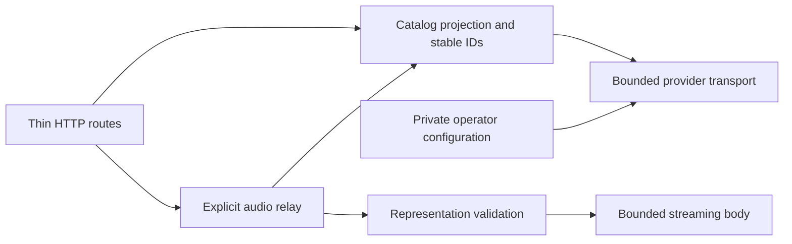

# Jamendo adapter in development

`hito-plugin-jamendo` contains an independent Rust HTTP adapter and a development executable using Hito's plugin SDK. Its development container has isolated runtime verification. It is not deployed or ready to offer to Hito accounts. Live credentials, host integration and public-release acceptance remain unfinished.

The operator supplies a private Jamendo client ID. Hito accounts do not supply that credential. The manifest declares search and sources; the adapter returns structured SDK data and adds no plugin UI.

## Ownership



Configuration fixes the production API endpoint. Provider transport owns independent metadata and media clients with proxies, automatic redirects and retries disabled. Catalog projection owns recording, release and source identifiers. The relay owns stream admission, framing and body lifetime. HTTP handlers validate SDK requests and map typed results.

Manifest, search, detail and source discovery retrieve no audio. An explicit audio request re-reads the selected track and validates its current stream address. The service forwards neither the caller's authorization nor cookies. It exposes opaque IDs instead of upstream media addresses or the client ID.

## Current implementation

| Route | Operation |
| --- | --- |
| `GET /v1/manifest` | SDK capabilities |
| `POST /v1/search` | First bounded search page |
| `POST /v1/recordings/detail` | One recording |
| `POST /v1/sources` | Current playable source facts |
| `GET /v1/audio` | Explicit source relay |

The implementation requests Jamendo's `mp32` format and accepts one documented media host. It does not provide artwork, playlists, downloads or a media cache. The upstream API distinguishes streaming and download addresses; the adapter uses the streaming address. See the [Jamendo tracks API](https://developer.jamendo.com/v3.0/tracks).

Requests have a 4 KiB body limit. Provider JSON has a 256 KiB limit. Metadata and audio each have 16 admission permits. The stream holds its permit through completion or drop, emits at most 64 KiB per chunk and limits each awaited upstream body read to 15 seconds. These implementation bounds do not establish saturation, cancellation or performance acceptance.

## Development executable

The executable accepts a credential file and an optional listen address:

```text
hito-plugin-jamendo --client-id-file /run/secrets/jamendo-client-id --listen 0.0.0.0:8093
```

The default address is `127.0.0.1:8093`. On Unix, the credential must be an absolute path to a regular file owned by the effective user, with one hard link and mode `0400` or `0600`. The final path component cannot be a symbolic link. Reads are bounded, and the client ID accepts at most 128 ASCII letters, digits, hyphens or underscores with an optional trailing newline. Other platforms currently reject credential loading until their file-access policy is implemented. The executable accepts neither an inline credential nor a provider endpoint override.

JSON logs include lifecycle outcomes and correlated request outcomes. The executable permits only its own crate's log targets, even when `RUST_LOG=trace`, and discards invalid filter settings without logging their contents. Initialization failures use static reasons. SIGTERM and SIGINT stop admission and await active HTTP requests before the stopped event.

## Development container

[Dockerfile.plugin-jamendo](../Dockerfile.plugin-jamendo) builds a separate executable image. [compose.jamendo.yaml](../compose.jamendo.yaml) can run alone in an isolated development project. Its default host address is `http://localhost:8094/v1/manifest`; the container listens on port 8093. The example mounts no Hito application data and provides no account-connection setup. Generic attribution and persistence policy remain prerequisites for offering this service to accounts.

The image uses pinned Rust and Debian bases. The build disables debug information and incremental compilation, uses two compiler jobs and has a Jamendo-specific cache separated by project and architecture. Give each source snapshot a separate project/cache identity. Before and during large builds, retain at least 40 GiB of host headroom and keep combined Hito Cargo targets within 10 GiB. Run compiler-heavy work sequentially.

The runtime uses UID/GID 10001, a read-only root filesystem, dropped capabilities, no-new-privileges, a 256 MiB memory limit, one CPU and 64 PIDs. Logs rotate at 10 MiB with three files. A manifest health check runs every five seconds. Compose gives SIGTERM draining 30 seconds before its stop deadline; active upstream-audio shutdown acceptance remains unfinished. Restart is explicit in this development example.

Build from this checkout in its own project:

```sh
export HITO_JAMENDO_CREDENTIAL_VOLUME=hito-jamendo-dev-credentials
HITO_JAMENDO_IMAGE_TAG=development docker compose -p hito-jamendo-dev -f compose.jamendo.yaml --profile plugins build plugin-jamendo
```

The credential volume is external and must be provisioned before startup. Its explicit name is required in `HITO_JAMENDO_CREDENTIAL_VOLUME`. Docker Compose does not apply `uid`, `gid` or `mode` overrides to file-backed secrets because those use bind mounts. See [Docker's secret ownership documentation](https://docs.docker.com/reference/compose-file/services/#secrets). A host file bind, especially through Docker Desktop, must not be assumed to appear as owner 10001. The procedure below writes the private file inside a Docker volume, then assigns the Linux owner and mode that the executable checks.

For packaging checks, use an owned fixture client ID and only the manifest and invalid-request paths. An actual operator client ID belongs in an existing private file outside this checkout and its build context. The file contents pass through standard input; they do not appear in the command arguments, environment, image or terminal output. Do not enable shell tracing for credential provisioning.

Set the source path to that existing file and create a fresh dedicated volume:

```sh
export HITO_JAMENDO_CLIENT_ID_FILE=/absolute/private/jamendo-client-id
export HITO_JAMENDO_CREDENTIAL_VOLUME=hito-jamendo-dev-credentials
docker volume create --label org.hito.purpose=jamendo-credentials "$HITO_JAMENDO_CREDENTIAL_VOLUME"
docker run --rm -i --network none --read-only --user 0:0 \
  --cap-drop ALL --cap-add CHOWN --security-opt no-new-privileges:true \
  --mount "type=volume,source=$HITO_JAMENDO_CREDENTIAL_VOLUME,target=/run/secrets,volume-nocopy" \
  --entrypoint /bin/sh hito-plugin-jamendo:development -eu -c '
    umask 077
    set -C
    head -c 131 > /run/secrets/jamendo-client-id
    size=$(wc -c < /run/secrets/jamendo-client-id)
    test "$size" -ge 1 && test "$size" -le 130
    chmod 0700 /run/secrets
    chmod 0400 /run/secrets/jamendo-client-id
    chown 10001:10001 /run/secrets/jamendo-client-id
    chown 10001:10001 /run/secrets
  ' < "$HITO_JAMENDO_CLIENT_ID_FILE"
```

The one-time helper has no network access and receives only the capability needed to change ownership. It refuses to overwrite an existing credential file. The source still has to satisfy the executable's client-ID validation. The runtime mounts the resulting volume read-only with copying disabled. Docker Compose does not create or delete this external volume; see [external volume lifecycle](https://docs.docker.com/reference/compose-file/volumes/#external).

Start only the isolated service, then stop it after inspection:

```sh
HITO_JAMENDO_IMAGE_TAG=development HITO_JAMENDO_PORT=18094 docker compose -p hito-jamendo-dev -f compose.jamendo.yaml --profile plugins up --wait --wait-timeout 30 --no-deps --no-build plugin-jamendo
docker compose -p hito-jamendo-dev -f compose.jamendo.yaml --profile plugins exec -T plugin-jamendo curl -fsS --max-time 2 http://127.0.0.1:8093/v1/manifest
docker compose -p hito-jamendo-dev -f compose.jamendo.yaml --profile plugins stop plugin-jamendo
docker compose -p hito-jamendo-dev -f compose.jamendo.yaml --profile plugins down
```

The project publishes only loopback port 18094 in this example. A successful manifest or health check needs no upstream request and does not validate a Jamendo credential.

The packaged image `sha256:da966315a4c7e05bcfd5900e8f4dd52d4c745c30bbcaa3f080555bfb5db702d5` passed an isolated Docker Compose check with an owned fixture client ID. Root inspection verified the effective user, credential ownership and permissions, read-only mount/root, capabilities, resource limits, log rotation and loopback binding. The manifest returned 200 and an invalid local search returned 400. Twelve structured TRACE records retained request correlations and lifecycle outcomes without the controlled private inputs, client ID, paths, URLs or provider-I/O events. Idle SIGTERM shutdown exited successfully without an OOM kill. The test project was removed afterward; no Hito application volume or normal service was used. Independent packaging review passed. Active upstream-audio shutdown and live-provider acceptance remain open.

## Verification and remaining work

Docker checks exercise actual HTTP against owned provider and audio fixtures. The initial workflow validates SDK manifest/search/detail/source responses, exact WAV delivery, zero metadata audio requests, caller-header isolation and omission of private transport data. This fixture verifies transport behavior, not live MP3 compatibility.

A second HTTP case changes the authoritative audio address after source selection. Opening the captured source re-reads provider metadata and rejects the changed origin without contacting it or opening the previous audio. Captured crate logs retain a safe rejection outcome and request correlation while excluding fixture credentials, addresses, search text and musical metadata. Both cases and strict all-target Clippy pass in Docker.

An actual-process Docker test verifies TCP manifest readiness, invalid-request responses, structured correlation and omission of private request and operator inputs under TRACE. It holds an HTTP request at its body read, sends SIGTERM, observes the draining event, completes the request and verifies successful process exit with the listener closed. Both owned HTTP cases, this process case and strict all-target Clippy pass. Independent source reviews accepted the adapter and executable ownership.

Adversarial framing, HEAD/ranges, admission saturation, deadlines, interrupted sockets, rejected credential/startup cases, malformed logging settings, active upstream-audio shutdown and live-provider checks remain release work. The process fixture makes no upstream request, so it does not establish privacy during live provider access.

Live integration needs generic host support for creator/provider credits, a per-recording backlink and persistence restrictions. The existing SDK recording contract cannot express those facts or stop Hito's generic Download action. Jamendo's API terms require attribution and backlinks and restrict offline access; a stream-only adapter alone cannot enforce host behavior. See [clauses 3.3 and 4.1](https://devportal.jamendo.com/api_terms_of_use).

Those shared contracts and live-provider checks must be completed before offering this service to Hito accounts. Fixture acceptance does not replace a configured operator client ID or live checks.
