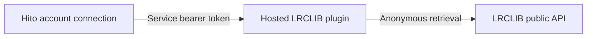

# LRCLIB lyrics service

The standalone Rust service and its owned protocol tests are implemented. The initial twenty-case checkpoint passed an independent frozen-source Linux Docker repeat against synthetic upstream responses and private temporary credentials. The current diagnostics qualification below passes 32 cases, preserving all 24 previously accepted names. They cover search, metadata, plain lyrics, bounded LRC anchors, throttling, cancellation, complete-body deadlines, safe logs and joined executable shutdown. Both strict plugin/SDK checks and formatting pass. All 145 schema-enabled SDK tests pass independently, including the legacy server, authentication, logging and cancellation cases, alongside production default and schema-only builds. Two review rounds resolved raw absence-validation and canonical-ID gaps; their original HTTP failures remain preserved. Hito's reviewed lyric-identity backend is independently qualified and runs in the local development deployment. A separate bounded live executable check also passes. The full packaged UI workflow and public-release acceptance remain open.

The service retrieves records from [LRCLIB's stable v1 API](https://lrclib.net/docs.txt), reviewed on 11 November 2026. It does not publish, flag or contribute lyrics. Anonymous upstream access requires no API key. Requests identify Hito with its name and version. Operators may supply a contact through `HITO_METADATA_CONTACT`; no personal contact is built in. Optional LRCLIB application registration is a separate upstream concern.

The plugin manifest declares search, metadata and lyrics. It exposes no audio, source, download, playlist or executable interface capability. A service bearer protects content requests between Hito and this service. That credential is separate from LRCLIB's anonymous API access.

## Connecting Hito to the service

LRCLIB itself needs no API key or account. The separately hosted Hito plugin requires its own service token, provisioned by its operator. These are different connections.



Offer the plugin address through Hito's plugin settings, then connect the listener account with the provisioned token. Paste only the token into the bearer-token field, without a `Bearer ` prefix. An existing connection can have its token updated without reinstalling the service or restarting Hito. Do not put the token into the service URL, documentation or logs.

The public manifest may load even when this credential is missing. Protected search and lyric routes then refuse access. Hito currently maps an upstream authentication refusal to `502 upstream_failed`; that response can also have other causes, so verify the connection credential before changing protocol versions. An absent health declaration does not disable content routes. Manifest `protocol_version: 1` is compatible with the separately negotiated v2 lyrics descriptor and endpoint.

The local development diagnosis on 11 November found an account connection with no saved credential. The same service accepted an authenticated search, while the controlled unauthenticated search returned 401. No reinstall, protocol change or preview restart was needed. This checks the authentication boundary, not the complete browser workflow.

## Identity and review

LRCLIB numeric record IDs are provider recording identities. Titles, artist names, album names and durations are discovery metadata. Matching those values does not prove that a lyric document belongs to the selected audio rendition. Album names remain text because LRCLIB does not provide album identities. Unknown language and revision values remain unknown.

Hito must ask the user to choose an approved provider before disclosing search terms, then show candidate metadata for explicit review. Accepting a lyric identity must not change primary metadata, audio source bindings, playlists, likes or progress. Lookup uses the retained lyric provider identity. Hito owns that authorization, retention and review workflow. This service owns upstream requests and lyric parsing.

```mermaid
flowchart LR
    User[Explicit provider choice] --> Search[Hito authorized search]
    Search --> Plugin[LRCLIB HTTP plugin]
    Plugin --> Upstream[LRCLIB stable retrieval API]
    Upstream --> Candidates[Structured candidate metadata]
    Candidates --> Review[User reviews identity]
    Review --> Retain[Hito retains lyric identity]
    Retain --> Lookup[Explicit lyric lookup]
    Lookup --> Static[Hito static lyric view]
```



Plain lyrics have no timestamps. LRC lyrics contain anchors on LRCLIB's own rendition timeline. Neither document establishes correspondence with Hito's current audio. Hito must display static text until a separate verified-version or reviewed-offset workflow establishes alignment.

Lyrics use the SDK's separate version 2 descriptor and endpoint. Version 1 endpoints remain unsupported because their required intervals cannot represent plain text or bare start anchors honestly. Version 2 preserves blank anchored clear events and simultaneous text, while leaving line ends unknown. Malformed or unsupported timing falls back to genuine supplied plain text. Nonzero LRC offset tags also use plain text because the [upstream conversion code](https://github.com/tranxuanthang/lrclib/blob/main/core/src/lyricsfile.rs) does not establish offset application semantics. No lyric author is inferred from the recording artist.

## Protocol limits

The implementation serializes upstream retrievals, spaces starts by at least one second, honors `429` and `503` `Retry-After` responses with bounded jitter, and preserves the cooldown after caller cancellation. An excessive retry delay rejects new work rather than clamping it and contacting LRCLIB early. Numeric delays and HTTP dates retain their full delay plus up to 30% positive jitter, capped at one second. An invalid, duplicate or overflowing retry header blocks upstream work and logs a safe restart instruction. Restarting the service is the operator recovery for that condition. Metadata and lyric reads share a six-second lifetime including cooldown and the complete received body. Stable v1 search returns at most twenty records and has no pagination; plugin search must not invent a cursor.

Tests use owned synthetic lyrics and an isolated HTTP upstream. Live checks are separate explicit opt-in work. Diagnostics may contain generated correlation IDs, safe outcomes, counts and elapsed times. They must exclude search terms, metadata text, lyrics, credentials, private paths and upstream response bodies.


## Failure diagnostics

Source at `101553b0` emits one WARN at `RUST_LOG=info` when an actual upstream exchange fails, or its returned data fails semantic validation. The event uses static `operation`, `reason` and `stage` values, optional numeric `upstream_status`, `elapsed_ms` and a fresh local `failure_id` UUID. That UUID identifies this plugin failure; it is not Hito's request ID. Existing debug request/workflow spans provide parent correlation when enabled.

Transport failures distinguish request admission from body reads. Other reasons identify deadlines, HTTP status, invalid headers, announced or streamed body limits, malformed JSON and invalid records. For example, these excerpts contain only static diagnostic fields:

```json
{"event":"lrclib_upstream_failed","operation":"search","reason":"invalid_json","stage":"decode","upstream_status":200}
{"event":"lrclib_upstream_failed","operation":"lyrics","reason":"transport","stage":"body","upstream_status":200}
```

Success, genuine not-found results, authentication rejection, cancellation and repeated local busy/cooldown polls stay quiet at info or use debug logs. A real upstream cooldown response warns once. Invalid or overflowing Retry-After emits `lrclib_upstream_cooldown_blocked` once with `recovery=restart_service`; subsequent blocked polls do not repeat it. Inspect the service logs without copying search terms, titles, lyric bodies, URLs, contacts or credentials into reports:

```sh
docker compose -f compose.yaml -f deploy/compose/lrclib.yaml --profile plugins logs --since 10m plugin-lrclib
```

Fresh independent R1 review passes. Root's independent sanitized current-source Docker repeat passes all 32 actual named cases with all 24 previous names retained and zero failures, ignored or filtered cases. Strict all-target Clippy, production library/CLI checks without default features and workspace formatting pass; all 4,211 source and support inputs remain unchanged. Ten current ELF executable families are preserved outside Cargo caches. Seven author behavioral failing/passing controls remain recorded separately from formatter stdout handling and retention-name audit corrections. Those verification-setup corrections changed no application test assertion.

This changes observability, not HTTP responses, cooldown policy, body limits, the six-second deadline or the 10 MiB search cap. It does not fix older-account credential refusals or implement timed-first lyric priority. Current frontend/full-flow and platform acceptance remain open.

## Local diagnostics deployment

Only the local LRCLIB sidecar was replaced with the qualified content-addressed executable. Its actual bytes match SHA-256 `a6118b5328fa148c819edd3d070eb58740a64aa4b3a680c0ead3fb0c776b06d1`, and its manifest returns HTTP 200. The service address, credential volume, environment and runtime hardening remain unchanged. The preview and normal Hito server also remain unchanged.

This is a local diagnostics deployment. It includes no Hito backend image, VPS, `main` or public-release update, and does not establish that all provider failures are fixed.

## Live compatibility check

On 11 November 2026, one network-enabled Docker Compose tools run used the independently qualified executable against the official LRCLIB origin. One search, metadata read and lyric read each returned HTTP 200. Search returned five candidates; the selected identity was preserved through a valid anchored document with 39 lines. Logs contained no query, metadata text, lyrics or credentials. SIGTERM joined the service with exit 0, and the isolated process, private credential directory, container and network were removed.

This is a single compatibility check, not availability, p95, packaged-image, Hito UI or platform acceptance. Search took 490 ms, metadata 1,094 ms and lyrics 1,102 ms, including the service's spacing. No raw lyric response or credential was retained with the evidence.

## Standalone executable

Build and test this workspace through its Docker Compose tools profile with a source-specific target directory. The repository's generic `docker/plugin.Dockerfile` also supports `PLUGIN=hito-plugin-lrclib` and `PORT=8101`; no image build or deployment is part of this evidence.

The executable reads optional `HITO_METADATA_CONTACT` once at startup. Surrounding whitespace is trimmed; an absent or blank value sends only the application name and version. A configured contact must contain at most 128 visible ASCII bytes without spaces or parentheses. Invalid values stop startup with a safe reason code and are never logged. Library callers can use `Config::with_contact` for explicit configuration.

The executable accepts `--service-token-file /absolute/private/token` and optional `--listen 127.0.0.1:8101`. The token belongs to the Hito-to-plugin connection. It is never an LRCLIB API key. Private token files are currently supported on Unix platforms; non-Unix startup is refused. Linux Docker is the tested runtime. The file must be a regular, single-link file owned by the process user, with mode `0400` or `0600`, and contain at most 4,096 printable credential bytes plus one optional line ending. Symlinks, public files, malformed credentials and duplicate arguments are refused without logging their values or paths. `--endpoint` accepts the official origin or an explicit loopback fixture origin.

The manifest is public for installation preview and health checks. All content and descriptor routes require the service bearer and plugin protocol header. SIGINT and SIGTERM stop admission, cancel pending requests, retire upstream bodies and join the HTTP server. The executable uses the SDK's logging filter so verbose library diagnostics cannot expose private HTTP inputs.

| Route | Typed result |
| --- | --- |
| `GET /v1/manifest` | `Manifest` |
| `POST /v1/search` | `SearchPage` |
| `POST /v1/recordings/detail` | `ProviderRecording` |
| `POST /v1/recordings/metadata` | `RecordingMetadata` |
| `GET /v2/lyrics/capabilities` | `LyricsCapabilitiesV2` |
| `POST /v2/lyrics` | `LyricsResponseV2` |

Inbound bodies are bounded to 4,096 bytes. Upstream search receives at most 10 MiB (10,485,760 bytes) and twenty records; individual metadata and lyric records receive at most 262,144 bytes. The SDK separately bounds the complete encoded lyric response, line count, raw line text and timeline anchors. Malformed timing with no genuine plain fallback returns an unavailable error, never a false empty answer. Explicit instrumental absence, upstream 404 and unsupported provider revisions return an exact echoed reference with null lyrics.

## Optional Compose configuration

[deploy/compose/lrclib.yaml](../deploy/compose/lrclib.yaml) uses the shared hardened plugin image recipe on port 8101. Set `HITO_LRCLIB_CREDENTIAL_VOLUME` to a provisioned external volume containing `lrclib-service-token`, owned by UID/GID 10001 with the private permissions above. The volume is mounted read-only. No upstream API key is needed.

```sh
docker compose -f compose.yaml -f deploy/compose/lrclib.yaml --profile plugins config
docker compose -f compose.yaml -f deploy/compose/lrclib.yaml --profile plugins up -d --build plugin-lrclib
```

The host inspection address is `http://127.0.0.1:8101/v1/manifest`; Hito containers use `http://plugin-lrclib:8101/`. The optional configuration does not install or connect a listener account. Offer the service through the normal plugin settings flow and use its Hito-to-plugin credential for the account connection. Independent source checks include rendering this Compose configuration and checking its private mount, runtime user, read-only root, dropped capabilities, no-new-privileges and loopback port. No image build, running service, live upstream or platform packaging is claimed by that check.
