# Public Spotify playlist import

This separate HTTP plugin imports a public Spotify shared link into an editable private Hito playlist. The public-link path needs no Spotify account, developer application, OAuth connection, or personal bearer token. It imports playlist and track metadata only. It does not provide Spotify audio, previews, or downloads. Playback needs a separately verified source.

The service is running on the local development server and can be connected through Settings. All 23 owned TCP tests and strict all-target Clippy pass. A release-image Chromium case imported a complete live playlist through the Hito UI without account authorization, then checked every ordered item, account privacy, disabled playback, disconnection, and editing. See [release evidence and unfinished work](status.md). Public-release acceptance remains open.

## Link and import behavior

The browser flow is Playlists, Import, choose the personal Spotify connection, paste a public shared link, then select Import a copy. For example, this owned placeholder is a playlist reference, not a real shared playlist:

```text
https://open.spotify.com/playlist/0000000000000000000001?si=ownedtracking
```

The plugin removes the share link's `si` tracking parameter and uses the canonical playlist address. It validates the reference before contacting Spotify. A public link must expose its complete contents anonymously; a private or unavailable playlist cannot become an empty successful import. An accessible empty playlist is a separate valid result.

Import a copy creates Hito's editable, owner-only playlist. It preserves provider order and repeated tracks. Public web metadata does not supply a stable entry UID, so the SDK's `occurrence_id` remains null. The plugin must not invent stable provider identity from a track's position or ID.

Null and unsupported entries retain their positions as unknown items. A malformed recognized track fails the snapshot instead of silently losing metadata. Failed or incomplete later pages cannot replace a retained complete snapshot.

Hito also offers read-only Follow playlists with hourly or daily refresh and automatic audio resolution through approved source providers. Those workflows belong to Hito; the Spotify plugin supplies metadata and never audio. See [Follow playlists](playlist-follow.md) and [automatic sources](automatic-sources.md).

## Verified album metadata

The accepted producer source retains the public playlist response's `albumOfTrack` URI and name as the verified Spotify release ID and title. That response does not establish the album artist, so the plugin omits that field. It preserves recording performers and disc/track numbers without guessing an album credit or fetching each album separately.

An absent or null album leaves the recording without a release. A supplied album must have the exact Spotify album URI format and a valid bounded title; malformed metadata fails the complete snapshot with the existing safe error. Album fields participate in snapshot hashing and cache byte accounting.

All 23 owned TCP cases and strict all-target Clippy pass. They cover 101-entry order and duplicate retention, exact verified album fields, absent/null albums, twelve malformed-field cases, pinned snapshots and unchanged upstream request counts. Independent source review found no actionable issue. A fresh packaged Chromium workflow passed against the public reference playlist with 411 tracks, 250 albums and 221 recording artists. It compared every stored recording and release with a pinned complete provider snapshot, then opened album, track-metadata and artist pages. All album-artist credits remained honestly unknown. It observed no audio, external browser requests, download mutations or private console values. Two initial runs exposed immediate heading reads before Inertia navigation completed; condition-based waits fixed the test without changing application code or its exact assertions. The final workflow took 9.6 seconds, not a latency benchmark.

The producer is deployed to the normal local service. The server offers **Find missing albums** on existing editable copies. A separate live upgrade test repairs an albumless 411-recording copy through its unchanged original connection, exposing 250 albums while preserving bindings, earlier observations, entries, receipts and personal data. Updating the plugin alone leaves copies unchanged; users start the lookup explicitly. See [repair behavior and acceptance](playlist-metadata-refresh.md).

## Artist pages and ISRC

Each recording also lists the canonical artist page (`https://open.spotify.com/artist/<id>`) of every credited performer, taken from the artist `uri` in the public response, so Hito can ask MusicBrainz whether that page belongs to exactly one artist (see [artist matching](artist-matching.md#matching-from-provider-evidence)). If any credited artist lacks a valid `spotify:artist:` URI the list is omitted rather than partial; a malformed artist URI never fails the snapshot. The playlist snapshot digest includes the pages, so the first refresh after this change reports a new revision for playlists whose artists carry identifiers.

Each recording also carries the credited artists as a list (`artists`): every artist in Spotify's order with its name, its Spotify identifier and artist page when the `uri` is valid, and `, ` as the join text between artists. An artist is `featured` only when the title's own feature clause names it exactly (case ignored): `(feat. X)`, `[ft. X]`, `(featuring X, Y)` or `- feat. X`; the plugin never guesses a feature from the artist order or from words such as "with", and a credit never loses its last main artist. An artist without a usable `uri` stays in the list by name and the older `artist_urls` list is still omitted. If Spotify's names would break the SDK limits (more than 16 artists, a repeated name, an oversized name) the plugin drops the list and keeps the recording. Hito uses the list as described in [credited artists](metadata.md#credited-artists-from-providers). Three owned cases in `public_artist_pages` cover order and identity, the feature clause and an artist without an identifier. The Spotify plugin container was not rebuilt for this change, so the running service does not send the list yet.

The public playlist response states **no ISRC**, so the plugin publishes none and never derives one. An ISRC would need Spotify's authenticated Web API (`external_ids.isrc`), which this public-link plugin deliberately does not use. Two owned cases (`public_artist_pages`) cover one and two credited artists, four kinds of unidentified artist, and the absence of an ISRC; the live shape of the artist `uri` is taken from the plugin's existing fixtures and has not been re-observed live for this change.

## Ownership and snapshot consistency

```mermaid
flowchart LR
  Browser[Authenticated browser] --> Hito[Hito server]
  Hito --> Plugin[Separate HTTP plugin]
  Plugin --> Embed[Public embed bootstrap]
  Embed --> Session[Ephemeral anonymous session]
  Session --> Pages[Complete paged public metadata]
  Pages --> Snapshot[Ordered normalized metadata and SHA-256]
  Snapshot --> SDK[SDK playlist pages]
  SDK --> Recheck[Fresh complete canonical detail fetch]
  Recheck --> Commit[Hito atomic publication]
  Commit --> Copy[(Private editable copy)]
```



The plugin owns Spotify requests, normalization, and its temporary snapshot. Hito owns the account connection, private catalog, playlist transaction, and retry rules. The plugin has no access to Hito's SQLite database. The browser sends the shared link to Hito and does not contact the plugin or receive its anonymous session material.

Spotify's public web response supplies neither a server revision nor stable entry UIDs. The snapshot revision is SHA-256 over the complete ordered normalized metadata, including duplicate occurrences. SDK pages all refer to that snapshot. Before Hito publishes the copy, a fresh canonical detail request fetches the entire playlist again and confirms the same revision. Rechecking only the first upstream page cannot establish that later pages stayed unchanged. The complete recheck and publication path passed the live browser case. These repeated reads detect changed observations; the undocumented upstream does not provide an atomic snapshot guarantee.

Private playlists and personal made-for-you mixes (Discover Weekly, Daily Mix, Release Radar and similar, ids beginning `37i9dQZEVXd`) are not served to a public link: Spotify answers the playlist embed page with its not-found page. The plugin recognizes that page and answers 422 with the message that private playlists and personal mixes need the Spotify account and cannot be imported, instead of a 502 invalid response. Observed live against one personal mix on 2026-11-06. Hito core currently reports any unlisted 4xx from a plugin with its generic rejected-request text, so the plugin's own message does not yet reach the user.

The anonymous bootstrap secret stays in memory and uses zeroizing storage. It is not a personal credential and does not enter Hito's credential vault. Source limits are four admitted workflows, a ten-second workflow deadline, at most 100 upstream pages and 10,000 entries, and an 8 MiB normalized snapshot charge. The cache holds at most four snapshots and 32 MiB of charged data for 120 seconds. Missing snapshots return a reimport error. Full expiry, saturation, cancellation and memory-pressure acceptance remain open.

## Local setup

The normal service is healthy on verified image `sha256:dac6f44955658f9569fc27e5cfc61e9c01189bdeb7476de7c03d4260c53a7b90`, built from the album producer at `3e677c4`. Its 23 fixture cases, strict Clippy and packaged live album workflow pass. Deployment preserved the complete container runtime policy, image process defaults, network aliases and byte-identical manifest. The service has no data mounts. The server, YouTube and folder container identities and configuration stayed unchanged; anonymous player access still returns 401. No listener account was authenticated or modified.

Build and inspect the plugin in a separate Compose project first. The project name also gives the Dockerfile a separate Cargo build cache. Keep different source snapshots on separate caches. Run compiler-heavy checks sequentially, with debug information and incremental compilation disabled. Check host free space and combined Hito Cargo targets before and during builds; retain at least 40 GiB of host headroom and keep those targets within 10 GiB.

```sh
HITO_SPOTIFY_PORT=18092 docker compose -p hito-spotify-public -f compose.yaml -f deploy/compose/spotify.yaml --profile plugins build plugin-spotify
HITO_SPOTIFY_PORT=18092 docker compose -p hito-spotify-public -f compose.yaml -f deploy/compose/spotify.yaml --profile plugins up -d --no-deps --no-build plugin-spotify
```

The isolated host manifest address will be `http://localhost:18092/v1/manifest`. First-run browser acceptance must use the isolated e2e profile and its temporary data, never the normal server's persistent volume.

To start the verified plugin image on the normal local Hito network:

```sh
docker compose -p hito -f compose.yaml -f deploy/compose/spotify.yaml --profile plugins up -d --no-deps --no-build plugin-spotify
```

The normal host inspection address will be `http://localhost:8092/v1/manifest`. Hito must use the internal Docker address:

```text
http://plugin-spotify:8092/
```

An administrator opens Settings, Plugins, Services for this server, enters the internal address above, then selects Offer service. Hito obtains `Spotify public playlists` from the manifest automatically. Advanced settings has an optional custom label for protected services. Each listener selects the offer, leaves Bearer token empty, and selects Connect service. Once connected, that listener uses Playlists, Import, and Import a copy. The offer does not install the connection for every account.

The deployed server retrieves missing recording covers for existing copies after the listener approves the artwork capability. Explicit approval invalidates previous unavailable checks without a reload. Playlist and album entity storage and artwork jobs remain in [the backlog](../TODO.md).

The overlay binds the host port to loopback, runs the plugin as a non-root user with a read-only root filesystem, and mounts no Hito data volume. This is a local development configuration. Public release and remote hosting need their own acceptance evidence.

## Artist photos

The plugin now answers `artist` requests on `POST /v1/artwork`, for a library credit that Hito knows only through a Spotify playlist. The identifier is the 22-character Spotify artist identifier the plugin itself returned in the credit. The plugin reads `https://open.spotify.com/embed/artist/<id>`, takes the largest image of at most 1,024 pixels from the page's `visualIdentity` or `coverArt` list, checks that the page describes `spotify:artist:<id>` and fetches the image from the same two Spotify image CDN origins and path rules as every other cover, then applies the same PNG and JPEG validation, size and dimension limits. Redirects, credentials, ports, queries and fragments are still refused. Ids, names and URLs are not logged at info level. The declared capabilities stay `playlists` and `artwork`, so connections and playlist follows approved before this change are not affected, and Hito asks for a photo only while automatic artwork is on (see [photos from a connected plugin](plugin-artwork.md#photos-from-a-connected-plugin)).

Evidence: 4 owned fixture-server cases in `artwork_artist` (a photo fetched from the artist page and the allowed image origin; a page that describes another entity refused before any image request; an artist page without images answered 404; identifiers that are not Spotify ids refused with no upstream request) plus the existing validation, URL policy and logging cases. The live shape of the artist embed page (that it carries `visualIdentity.image` like the track page) is assumed from the track and playlist pages and has not been observed live. The running container was not rebuilt, so the deployed service answers an artist request with 400 (its JSON extractor maps an unknown kind to an invalid request), which Hito treats as no photo. To roll it out, rebuild `docker/plugin.Dockerfile` with `PLUGIN=hito-plugin-spotify` using the commands in [local setup](#local-setup) (build in a separate project first, then `docker compose -p hito -f compose.yaml -f deploy/compose/spotify.yaml --profile plugins build plugin-spotify` and `up -d --no-deps --no-build plugin-spotify`). The manifest is unchanged, so followed playlists keep updating without a new approval.

## Artwork in verified source

Albums imported from a Spotify playlist now get their covers through this release request automatically when read; see [imported album covers](plugin-artwork.md#provider-covers-for-imported-albums). The container must run an image that declares `artwork`, and the listener approves the added capability.

The current deployed image also declares `artwork` and returns validated PNG/JPEG bytes for recording, release and playlist requests. It accepts the exact Spotify ak/fa image CDN origins and playlist mosaics on `mosaic.scdn.co`, with separate canonical path rules. URLs with aliases, credentials, explicit ports, query strings, fragments or redirects are rejected before fetching image bytes. The browser receives Hito's authorized image route, not a Spotify URL.

Twenty fixture cases and strict all-target Clippy pass. New regressions first reproduced rejected valid mosaics and accepted normalized dot paths, then passed the fixes. Public HTTP tests verify raster bytes, independent admission and rejection before network I/O. A 22-case policy table exercises the actual URL validator with production origins. The focused URL change passed two independent review rounds.

The isolated packaged image `sha256:c909761b88a8fb4968d343615632a1b964a7e37e82ca620e0bb3c67c8c8e798e` returned a real public playlist cover of 99,323 bytes and a recording cover of 194,151 bytes. Both were JPEG and decoded at 640 × 640. This is limited live evidence, not general image compatibility. This was the previous normal image. The current album producer retains its artwork contract and runtime policy; no listener connection or permission was changed during either deployment.

The host currently retains recording covers, including those already referenced by independent copies. Release and playlist entity storage/jobs remain unfinished. See [private artwork ownership, UI retrieval and remaining work](plugin-artwork.md).

## Featured music (planned)

Not built. The optional [featured capability](plugins.md#featured-music) needs a list of featured playlists or albums, and the anonymous path this plugin uses cannot supply one: the embed bootstrap and paged query read one playlist that is named by a link, and nothing in them lists Spotify's featured or new-release shelves. Spotify's browse endpoints (featured playlists, new releases, categories) belong to the Web API, which needs an application registration or a signed-in account. The plugin avoids both on purpose (see above), so it declares neither `featured` nor a browse request. The first service to implement the capability is [Jamendo](plugin-jamendo.md#featured-albums).

What would change this: the optional [authorization groundwork](plugins.md#optional-authorization-declaration) completed and accepted for the Web API, or a documented anonymous browse endpoint. Either needs a decision and live evidence first. Spotify playlist references already work as the `reference` of a featured item, because they are what Import a copy accepts.

## External dependency and diagnostics

The plugin reads anonymous public web metadata through the embed bootstrap and paged web query. This is an undocumented Spotify web protocol. Its response shape, query hash, or bootstrap can change. A successful live check proves the observed path worked at that time, not continuing compatibility. Protocol failures must leave Hito's existing library and playlists intact.

Structured INFO events record request correlation, status and elapsed time. Page counts belong at DEBUG. Owned INFO/TRACE fixtures check that links, IDs, titles, tokens and raw bodies stay out of logs. Production filtering excludes dependency diagnostics even with a broad log setting. The live browser case also checked private browser logs, history and storage. The public path does not require account cookies, app registration, TOTP generation, attestation workarounds, or an OAuth login.

The separate [optional OAuth groundwork](plugins.md#optional-authorization-declaration) does not gate public-link import. Private Spotify access and token exchange remain separate work. The public plugin must not retain a temporary Spotify Web API compatibility branch as its import path.
