# Public Spotify playlist import

This separate HTTP plugin is being built to import a public Spotify shared link into an editable private Hito playlist. The public-link path needs no Spotify account, developer application, OAuth connection, or personal bearer token. It imports playlist and track metadata only. It does not provide Spotify audio, previews, or downloads. Playback needs a separately verified source.

The service is running on the local development server and can be connected through Settings. Ten owned TCP tests and strict all-target Clippy pass. A release-image Chromium case imported a complete live playlist through the Hito UI without account authorization, then checked every ordered item, account privacy, disabled playback, disconnection, and editing. See [release evidence and unfinished work](status.md). Public-release acceptance remains open.

## Link and import behavior

The browser flow is Playlists, Import, choose the personal Spotify connection, paste a public shared link, then select Import a copy. For example, this owned placeholder is a playlist reference, not a real shared playlist:

```text
https://open.spotify.com/playlist/0000000000000000000001?si=ownedtracking
```

The plugin removes the share link's `si` tracking parameter and uses the canonical playlist address. It validates the reference before contacting Spotify. A public link must expose its complete contents anonymously; a private or unavailable playlist cannot become an empty successful import. An accessible empty playlist is a separate valid result.

Import a copy creates Hito's editable, owner-only playlist. It preserves provider order and repeated tracks. Public web metadata does not supply a stable entry UID, so the SDK's `occurrence_id` remains null. The plugin must not invent stable provider identity from a track's position or ID.

Null and unsupported entries retain their positions as unknown items. A malformed recognized track fails the snapshot instead of silently losing metadata. Failed or incomplete later pages cannot replace a retained complete snapshot.

Hito also offers read-only Follow playlists with hourly or daily refresh and automatic audio resolution through approved source providers. Those workflows belong to Hito; the Spotify plugin supplies metadata and never audio. See [Follow playlists](playlist-follow.md) and [automatic sources](automatic-sources.md).

## Verified album metadata

The accepted producer source retains the public playlist response's `albumOfTrack` URI and name as the verified Spotify release ID and title. That response does not establish the album artist, so the plugin omits that field. It preserves recording performers and disc/track numbers without guessing an album credit or fetching each album separately.

An absent or null album leaves the recording without a release. A supplied album must have the exact Spotify album URI format and a valid bounded title; malformed metadata fails the complete snapshot with the existing safe error. Album fields participate in snapshot hashing and cache byte accounting.

All 23 owned TCP cases and strict all-target Clippy pass. They cover 101-entry order and duplicate retention, exact verified album fields, absent/null albums, twelve malformed-field cases, pinned snapshots and unchanged upstream request counts. Independent source review found no actionable issue. This slice has not yet passed a live packaged album import or been deployed to the normal service. The Hito host must support the shared unknown-album-credit contract before that deployment. Existing independent playlist copies still need backfill without changing recording identities, entries or personal data.

## Ownership and snapshot consistency

```mermaid
flowchart LR
  Browser[Authenticated browser] --> Hito[Hito server]
  Hito --> Plugin[Separate HTTP plugin]
  Plugin --> Embed[Public embed bootstrap]
  Embed --> Session[Ephemeral anonymous session]
  Session --> Pages[Complete paged public metadata]
  Pages --> Snapshot[Ordered normalized metadata and SHA-256]
  Snapshot --> SDK[SDK playlist pages]
  SDK --> Recheck[Fresh complete canonical detail fetch]
  Recheck --> Commit[Hito atomic publication]
  Commit --> Copy[(Private editable copy)]
```



The plugin owns Spotify requests, normalization, and its temporary snapshot. Hito owns the account connection, private catalog, playlist transaction, and retry rules. The plugin has no access to Hito's SQLite database. The browser sends the shared link to Hito and does not contact the plugin or receive its anonymous session material.

Spotify's public web response supplies neither a server revision nor stable entry UIDs. The snapshot revision is SHA-256 over the complete ordered normalized metadata, including duplicate occurrences. SDK pages all refer to that snapshot. Before Hito publishes the copy, a fresh canonical detail request fetches the entire playlist again and confirms the same revision. Rechecking only the first upstream page cannot establish that later pages stayed unchanged. The complete recheck and publication path passed the live browser case. These repeated reads detect changed observations; the undocumented upstream does not provide an atomic snapshot guarantee.

The anonymous bootstrap secret stays in memory and uses zeroizing storage. It is not a personal credential and does not enter Hito's credential vault. Source limits are four admitted workflows, a ten-second workflow deadline, at most 100 upstream pages and 10,000 entries, and an 8 MiB normalized snapshot charge. The cache holds at most four snapshots and 32 MiB of charged data for 120 seconds. Missing snapshots return a reimport error. Full expiry, saturation, cancellation and memory-pressure acceptance remain open.

## Local setup

The normal service is healthy on verified image `sha256:c909761b88a8fb4968d343615632a1b964a7e37e82ca620e0bb3c67c8c8e798e`. The original import image passed startup, manifest, graceful SIGTERM shutdown and the isolated live browser case. The updated producer passed 20 fixture cases, strict Clippy and the live artwork checks below.

Build and inspect the plugin in a separate Compose project first. The project name also gives the Dockerfile a separate Cargo build cache. Keep different source snapshots on separate caches. Run compiler-heavy checks sequentially, with debug information and incremental compilation disabled. Check host free space and combined Hito Cargo targets before and during builds; retain at least 40 GiB of host headroom and keep those targets within 10 GiB.

```sh
HITO_SPOTIFY_PORT=18092 docker compose -p hito-spotify-public -f compose.yaml -f compose.spotify.yaml --profile plugins build plugin-spotify
HITO_SPOTIFY_PORT=18092 docker compose -p hito-spotify-public -f compose.yaml -f compose.spotify.yaml --profile plugins up -d --no-deps --no-build plugin-spotify
```

The isolated host manifest address will be `http://localhost:18092/v1/manifest`. First-run browser acceptance must use the isolated e2e profile and its temporary data, never the normal server's persistent volume.

To start the verified plugin image on the normal local Hito network:

```sh
docker compose -p hito -f compose.yaml -f compose.spotify.yaml --profile plugins up -d --no-deps --no-build plugin-spotify
```

The normal host inspection address will be `http://localhost:8092/v1/manifest`. Hito must use the internal Docker address:

```text
http://plugin-spotify:8092/
```

An administrator opens Settings, Plugins, Services for this server, enters the internal address above, then selects Offer service. Hito obtains `Spotify public playlists` from the manifest automatically. Advanced settings has an optional custom label for protected services. Each listener selects the offer, leaves Bearer token empty, and selects Connect service. Once connected, that listener uses Playlists, Import, and Import a copy. The offer does not install the connection for every account.

The deployed server retrieves missing recording covers for existing copies after the listener approves the artwork capability. A reload may be needed after approval. Playlist and album entity storage and artwork jobs remain in [the backlog](../TODO.md).

The overlay binds the host port to loopback, runs the plugin as a non-root user with a read-only root filesystem, and mounts no Hito data volume. This is a local development configuration. Public release and remote hosting need their own acceptance evidence.

## Artwork in verified source

The current deployed image also declares `artwork` and returns validated PNG/JPEG bytes for recording, release and playlist requests. It accepts the exact Spotify ak/fa image CDN origins and playlist mosaics on `mosaic.scdn.co`, with separate canonical path rules. URLs with aliases, credentials, explicit ports, query strings, fragments or redirects are rejected before fetching image bytes. The browser receives Hito's authorized image route, not a Spotify URL.

Twenty fixture cases and strict all-target Clippy pass. New regressions first reproduced rejected valid mosaics and accepted normalized dot paths, then passed the fixes. Public HTTP tests verify raster bytes, independent admission and rejection before network I/O. A 22-case policy table exercises the actual URL validator with production origins. The focused URL change passed two independent review rounds.

The isolated packaged image `sha256:c909761b88a8fb4968d343615632a1b964a7e37e82ca620e0bb3c67c8c8e798e` returned a real public playlist cover of 99,323 bytes and a recording cover of 194,151 bytes. Both were JPEG and decoded at 640 × 640. This is limited live evidence, not general image compatibility. The normal service now uses this same image. Its effective environment, process, mounts, ports, network and resource policy were preserved; no listener connection or permission was changed during deployment.

The host currently retains recording covers, including those already referenced by independent copies. Release and playlist entity storage/jobs remain unfinished. See [private artwork ownership, UI retrieval and remaining work](plugin-artwork.md).

## External dependency and diagnostics

The plugin reads anonymous public web metadata through the embed bootstrap and paged web query. This is an undocumented Spotify web protocol. Its response shape, query hash, or bootstrap can change. A successful live check proves the observed path worked at that time, not continuing compatibility. Protocol failures must leave Hito's existing library and playlists intact.

Structured INFO events record request correlation, status and elapsed time. Page counts belong at DEBUG. Owned INFO/TRACE fixtures check that links, IDs, titles, tokens and raw bodies stay out of logs. Production filtering excludes dependency diagnostics even with a broad log setting. The live browser case also checked private browser logs, history and storage. The public path does not require account cookies, app registration, TOTP generation, attestation workarounds, or an OAuth login.

The separate [optional OAuth groundwork](plugins.md#optional-authorization-declaration) does not gate public-link import. Private Spotify access and token exchange remain separate work. The public plugin must not retain a temporary Spotify Web API compatibility branch as its import path.
