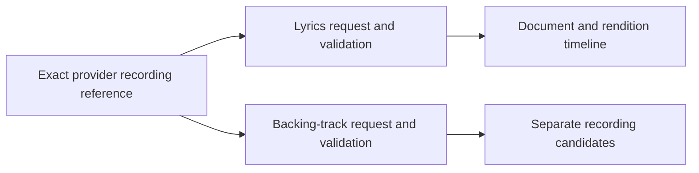

# Timed lyrics and backing-track contracts

The Apache-2.0 plugin SDK defines structured lyrics and backing-track responses. Existing manifest bytes and capability declarations remain unchanged. The host can read lyrics for a retained, authorized provider identity. Rendering, verified audio alignment, reference providers and backing-track playback remain unfinished.

## Protocol and identities

Services declare the existing `lyrics` or `backing_tracks` capability and expose the corresponding descriptor. The host negotiates the lyrics extension independently. An unsupported version does not disable unrelated approved capabilities. Future backing-track lookup must preserve that rule.

| Method and relative path             | Request or response                              |
| ------------------------------------ | ------------------------------------------------ |
| `GET v1/lyrics/capabilities`         | `{"lyrics_version":1}`                           |
| `POST v1/lyrics`                     | `LyricsRequest` → `LyricsResponse`               |
| `GET v1/backing-tracks/capabilities` | `{"backing_tracks_version":1}`                   |
| `POST v1/backing-tracks`             | `BackingTracksRequest` → `BackingTracksResponse` |

Both POST requests contain `recording`, with the chosen service's opaque recording `id` and nullable `revision`. Both responses must echo that exact reference, even for empty results or unknown revisions. Each ID or present revision must be nonblank, contain no control characters and fit within 256 UTF-8 bytes.

These are provider identities, not Hito IDs or another provider's source identifiers. A lyrics provider can supply its own metadata identity independently of the service supplying audio. Lookup must not disclose local paths, credentials or signed audio URLs.

## Lyrics

`LyricsResponse` contains `recording` and nullable `lyrics`. Null is a valid negative answer. A present `TimedLyrics` document contains:

- `id` and `rendition_id`, each bounded to 256 bytes. Document identity and rendition timeline have separate meanings, including when a provider uses the same string in their separate namespaces.
- Nullable `revision`, `rendition_label`, `language` and `duration_ms`. Present revisions have the 256-byte limit; labels have a 2,048-byte limit and language has a 64-byte limit. Unknown values remain unknown.
- Nullable `attribution`, using existing recording credits and a canonical HTTPS backlink without credentials, query or fragment.
- `lines`, containing one to 2,000 objects with integer `start_ms`, integer `end_ms` and plain `text` bounded to 2,048 UTF-8 bytes.

Intervals use milliseconds on the declared rendition timeline. They are half-open, ordered and nonoverlapping: `start_ms < end_ms`, and the next start is at least the previous end. Gaps and touching intervals are valid. No interval may exceed seven days. A known duration must cover every interval and cannot exceed seven days. Negative, fractional and overflowing times are rejected. Text limits apply before trimming or scanning; blank text and control characters are rejected.

The complete encoded response, including recording reference, metadata, attribution, lines and JSON escaping, cannot exceed 262,144 bytes. `MAX_LYRICS_RESPONSE_BYTES` publishes that bound. Validation serializes into a bounded counting writer without allocating another complete response buffer. The HTTP host also bounds received bytes before decoding JSON and applies one total deadline to negotiation and response reading.

## Host lyric lookup

`POST /api/v1/recordings/{id}/lyrics` requires a normal authenticated account and browser request protections. Its JSON body contains `observation_id` and `installation_revision`. The host derives the provider recording reference from that retained observation. Clients cannot supply an arbitrary provider ID or match by title.

The recording must belong to the caller's personal library. Its selected primary observation, or its current attached source-provider observation, must still belong to a live nonretired binding. The installation must belong to that account, remain active, approve `lyrics` and match the requested revision. Historical observations cannot silently substitute for the current provider identity. Session, library grant, binding, observation and installation authority are rechecked during held responses and before publication.

The result has a `status` field:

| Status        | Meaning                                                                                                                          |
| ------------- | -------------------------------------------------------------------------------------------------------------------------------- |
| `ready`       | Contains the exact Hito `recording_id`, `observation_id` and SDK `document`. `document.lyrics: null` is a valid negative answer. |
| `unsupported` | The approved service does not support version 1 of the lyrics extension. Other approved capabilities remain available.           |
| `unavailable` | The provider failed, returned invalid data, exceeded the received-byte limit or missed the total deadline.                       |
| `cancelled`   | The caller cancelled the public core operation.                                                                                  |

Authorization and stale-revision failures retain their normal HTTP errors. Successful and account-authorized error responses are private and not stored in shared caches.

Negotiation accepts at most 4,096 received bytes. A lyric response accepts at most 262,144 received bytes, including whitespace, before SDK validation. Both exchanges share one ten-second lifetime. Lyrics have separate admission of at most four in-flight requests globally and one per account, so a held lyric response does not consume playback-source capacity. Cancellation or authority loss drops the upstream body and releases admission.

Lookup does not modify the library or collection, adopt a recording, resolve sources, fetch audio, prepare transfers or create a download. Structured completion events contain generated correlation IDs, safe outcomes and elapsed time. Provider identities, document text, revisions, credentials and private paths are excluded.

An independent lyrics provider can serve a current attached provider identity. A lyrics-only service without a retained identity or review path cannot yet be selected for a local recording. That identity-review workflow remains unfinished. This lookup does not establish timeline alignment or enable synchronized highlighting.

## Backing tracks

`BackingTracksResponse` contains `recording` and `items`, with zero to sixteen existing `ProviderRecording` objects. Normal recording, release and attribution validation applies. Candidates preserve their own identities and unknown metadata.

Candidate IDs must be unique and distinct from the original recording ID, regardless of revision or display metadata. An instrumental is a separate recording, rather than an alternate source of the original. It must not inherit saved progress by matching a title. Responses contain no source objects, stream URLs or plugin-supplied UI. The complete encoded response has the same 262,144-byte limit, exported as `MAX_BACKING_TRACKS_RESPONSE_BYTES` and enforced by the shared bounded writer.

Future adoption and playback must use existing approved-provider, source-resolution, relay and explicit-download owners. Looking up a candidate must not fetch audio or create a persistent copy.

## Required host and player integration

Highlighting requires a host-owned association between the validated document digest, its rendition and an authorized audio timeline. Verified exact-version evidence or an explicit user-reviewed offset can establish it. A matching title, similar duration or arbitrary provider echo of a source ID cannot. For an accepted offset, lyric position is audio position minus the offset. Without accepted alignment, Hito can display static lines but must not claim synchronized highlighting.

A changed source, metadata observation, playback generation or document digest must retire the old alignment. Hito owns rendering and navigation. Only the timed-text component should subscribe to position observations; catalog pages must not rerender on playback ticks. Independent lyric providers must work with local audio and metadata/audio supplied by different services.

Independent-provider identity review, alignment, rendering, backing-recording adoption and end-to-end playback remain unfinished. Microphone mixing, vocal removal, scoring and performance recording remain outside this release.

## Verification

Complete Docker SDK suites pass 68 default and 74 schema-enabled cases. Formatting and strict schema-enabled all-target SDK Clippy pass. New public cases first reproduce missing temporal, text, attribution, candidate and encoded-size enforcement before their fixes. They verify exact 262,144-byte boundaries and one-byte excesses, Unicode and JSON escaping, exact nullable version echoes, unknown-field rejection, legacy manifest bytes and schemas derived from actual Rust types.

Independent security, correctness and performance reviews pass. These checks qualify SDK contracts; they do not establish provider compatibility, timeline alignment, UI behavior or platform acceptance.

Nine host HTTP/core cases pass against real temporary SQLite, owned HTTP protocol providers and a read-only original WAV. They cover exact retained identity and null results, unsupported versions, wrong identity echoes, received-byte limits, one total deadline, session revocation, explicit cancellation, peer denial and playback isolation. A held lyric response permits another recording in the same account to refresh its actual provider source and relay an exact WAV byte range. Public collection state, original bytes and metadata remain preserved, and lyric lookup creates no persistent download.

One early concurrent two-case run missed an expected completion event. Later passing runs have not established its cause. Independent repeats of all nine host cases pass. A finite concurrent diagnostic also passes in one author invocation and one independent invocation, retaining the same strict assertions. Those passes do not explain the earlier missed event, so its cause remains open. Strict core/server all-target Clippy, formatting, actual Rust OpenAPI export and generated TypeScript reproduction pass. The contract adds one path and six schemas while preserving all prior 95 path objects and 223 schema objects. The host checks do not establish official-provider compatibility, rendering, timeline alignment or packaged platform acceptance.
