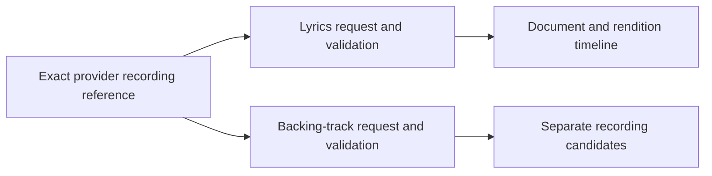
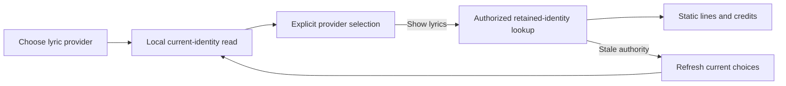
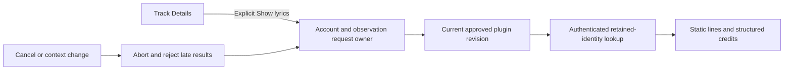

# Timed lyrics and backing-track contracts

The Apache-2.0 plugin SDK defines structured lyrics and backing-track responses. Existing manifest bytes and capability declarations remain unchanged. The host can read lyrics for a retained, authorized provider identity. Static rendering is qualified below. Verified audio alignment, reference providers and backing-track playback remain unfinished.

## Protocol and identities

Services declare the existing `lyrics` or `backing_tracks` capability and expose the corresponding descriptor. The host negotiates the lyrics extension independently. An unsupported version does not disable unrelated approved capabilities. Future backing-track lookup must preserve that rule.

| Method and relative path             | Request or response                              |
| ------------------------------------ | ------------------------------------------------ |
| `GET v1/lyrics/capabilities`         | `{"lyrics_version":1}`                           |
| `POST v1/lyrics`                     | `LyricsRequest` → `LyricsResponse`               |
| `GET v1/backing-tracks/capabilities` | `{"backing_tracks_version":1}`                   |
| `POST v1/backing-tracks`             | `BackingTracksRequest` → `BackingTracksResponse` |

Both POST requests contain `recording`, with the chosen service's opaque recording `id` and nullable `revision`. Both responses must echo that exact reference, even for empty results or unknown revisions. Each ID or present revision must be nonblank, contain no control characters and fit within 256 UTF-8 bytes.

These are provider identities, not Hito IDs or another provider's source identifiers. A lyrics provider can supply its own metadata identity independently of the service supplying audio. Lookup must not disclose local paths, credentials or signed audio URLs.

## Lyrics

`LyricsResponse` contains `recording` and nullable `lyrics`. Null is a valid negative answer. A present `TimedLyrics` document contains:

- `id` and `rendition_id`, each bounded to 256 bytes. Document identity and rendition timeline have separate meanings, including when a provider uses the same string in their separate namespaces.
- Nullable `revision`, `rendition_label`, `language` and `duration_ms`. Present revisions have the 256-byte limit; labels have a 2,048-byte limit and language has a 64-byte limit. Unknown values remain unknown.
- Nullable `attribution`, using existing recording credits and a canonical HTTPS backlink without credentials, query or fragment.
- `lines`, containing one to 2,000 objects with integer `start_ms`, integer `end_ms` and plain `text` bounded to 2,048 UTF-8 bytes.

Intervals use milliseconds on the declared rendition timeline. They are half-open, ordered and nonoverlapping: `start_ms < end_ms`, and the next start is at least the previous end. Gaps and touching intervals are valid. No interval may exceed seven days. A known duration must cover every interval and cannot exceed seven days. Negative, fractional and overflowing times are rejected. Text limits apply before trimming or scanning; blank text and control characters are rejected.

The complete encoded response, including recording reference, metadata, attribution, lines and JSON escaping, cannot exceed 262,144 bytes. `MAX_LYRICS_RESPONSE_BYTES` publishes that bound. Validation serializes into a bounded counting writer without allocating another complete response buffer. The HTTP host also bounds received bytes before decoding JSON and applies one total deadline to negotiation and response reading.

## Host lyric lookup

`POST /api/v1/recordings/{id}/lyrics` requires a normal authenticated account and browser request protections. Its JSON body contains `observation_id` and `installation_revision`. The host derives the provider recording reference from that retained observation. Clients cannot supply an arbitrary provider ID or match by title.

The recording must belong to the caller's personal library. Its selected primary observation, or its current attached source-provider observation, must still belong to a live nonretired binding. The installation must belong to that account, remain active, approve `lyrics` and match the requested revision. Historical observations cannot silently substitute for the current provider identity. Session, library grant, binding, observation and installation authority are rechecked during held responses and before publication.

The result has a `status` field:

| Status        | Meaning                                                                                                                          |
| ------------- | -------------------------------------------------------------------------------------------------------------------------------- |
| `ready`       | Contains the exact Hito `recording_id`, `observation_id`, host `document_digest` and SDK `document`. `document.lyrics: null` is a valid negative answer. |
| `unsupported` | The approved service does not support version 1 of the lyrics extension. Other approved capabilities remain available.           |
| `unavailable` | The provider failed, returned invalid data, exceeded the received-byte limit or missed the total deadline.                       |
| `cancelled`   | The caller cancelled the public core operation.                                                                                  |

Authorization and stale-revision failures retain their normal HTTP errors. Successful and account-authorized error responses are private and not stored in shared caches.

Negotiation accepts at most 4,096 received bytes. A lyric response accepts at most 262,144 received bytes, including whitespace, before SDK validation. Both exchanges share one ten-second lifetime. Lyrics have separate admission of at most four in-flight requests globally and one per account, so a held lyric response does not consume playback-source capacity. Cancellation or authority loss drops the upstream body and releases admission.

Lookup does not modify the library or collection, adopt a recording, resolve sources, fetch audio, prepare transfers or create a download. Structured completion events contain generated correlation IDs, safe outcomes and elapsed time. Provider identities, document text, revisions, credentials and private paths are excluded.

An independent lyrics provider can serve a current attached provider identity. A lyrics-only service without a retained identity or review path cannot yet be selected for a local recording. That identity-review workflow remains unfinished. This lookup does not establish timeline alignment or enable synchronized highlighting.

## Document fingerprint

Every ready response includes a lowercase SHA-256 `document_digest`. Hito computes it from its serialization of the complete validated typed `LyricsResponse`, after the existing authority recheck. It includes provider reference, document/rendition identities, text, timings and attribution, including a valid null-lyrics response. Clients treat the value as opaque. It identifies returned content; it does not certify its provenance or establish an audio timeline. No registry, persistence, additional provider request or new SDK protocol is introduced, and digests are excluded from workflow logs.

One authenticated HTTP tracer checks identical-response stability and separate timing/text changes with unchanged document IDs and revisions. It also preserves authorization, exact provider calls, private state and original audio, and checks diagnostics before its digest assertions. The initial missing-field failure passes unchanged after the implementation. All fourteen normal lyric cases and scoped core/server strict checks pass; two existing diagnostic cases remain ignored. An independent Docker execution repeats the new case using the retained qualified executable, after matching the combined Rust/Cargo/vendor inputs apart from a service README update. That execution passes in 0.84 seconds and leaves no containers.

Actual Rust export and TypeScript generation add only the required ready-result field, preserving all 105 paths, 257 schema names and other contract content. Both TypeScript configurations pass after adding that field to the shared typed test fixture. Static rendering is unchanged. Reviewed offsets, current audio-load ownership and synchronized highlighting remain separate work.

## Current lyric providers

`GET /api/v1/recordings/{id}/lyrics/providers` returns the caller's currently retained lyric-capable identities. Each item contains its observation, installation and current installation revision, exact provider recording reference and display label. Selected primary identity comes first, followed by current attached source-provider identities in stable order. Historical observations, inactive installations/services and unapproved lyric capabilities are excluded. A lyrics-only provider without a retained identity still needs the separate discovery/review workflow.

This is a local authorized read with a one-second lifetime and at most nine current identities, derived from the existing binding limit. It never contacts providers, reads audio, prepares a source or creates persistent state. Malformed recording IDs use the existing `422` validation response. Lookup still uses the original POST authority checks; listing choices does not authorize an old observation or installation revision.

Three public cases qualify primary identity, attached current-versus-historical observations, and account/current-approval boundaries. They preserve private owner and peer state and original audio, verify no provider work on listing, and require separate safe completion logs. All 13 normal lyric cases pass, with two existing diagnostics ignored, alongside strict core/server checks and an independent 13-case repeat. Actual Rust export adds only this path and two DTO schemas, preserving all prior 98 paths, 231 schemas and other contract metadata. Actual generated TypeScript and both type configurations pass. The shared chooser and its packaged checkpoint are qualified below.

## Choosing a retained lyric provider

Track Details offers **Choose lyric provider** without requesting choices or lyrics when the page opens. The action reads the current local identities above. Selecting a row makes no lyric request. **Show lyrics** then sends that row's exact observation and installation revision; the host derives and revalidates its provider identity. A local recording can use a current attached provider even when its primary metadata came from a local file.

If the connection changes and lookup rejects the old revision, refreshing the chooser reads current authority again. It preserves the selected observation when still eligible and keeps the unsaved metadata editor intact. It requires another explicit Show before contacting the provider. Historical observations do not supply replacement choices.

The list and lookup have separate account/context request owners. Cancel, account changes, primary-observation changes and selected-provider changes retire the relevant work and reject late bodies. List reads include JSON decoding in a five-second deadline; lyric lookup retains its fifteen-second client deadline. Neither workflow subscribes the page to playback position updates.

Nine new DOM cases plus the six existing lyric cases pass together, including an independent Docker repeat and another repeat after integration. The stale-revision case first reproduced the failed refresh, then passed without changing its assertions. Other cases qualify local-primary selection, cancellation, account/context changes, provider reselection, complete-body deadlines, exact commands, private logs and edit retention. Both TypeScript configurations and the integrated production bundle pass. The read-only tools environment initially rejected Vite's configuration-cache write; the bundle passed with Vite's runner configuration loader and unchanged application inputs.

These controlled-fetch DOM checks and source reviews qualify the shared source. The separate packaged checkpoint below exercises the retained-provider chooser. Live provider discovery, reviewed identity adoption and rendition alignment remain release work.

## Shared static lyric view

Track Details now offers **Show lyrics** for a selected primary provider observation. Clicking it reads the current approved installation revision and starts the retained-identity lookup above. Opening the page does not request lyrics. Hito renders plain lines and structured credits; the plugin supplies no executable interface. A valid null answer, unsupported capability and temporary failure have separate states with explicit retry.

The workflow belongs to the account, recording and selected observation. Cancel, navigation or a context change retires the request and fences late replies. The client also bounds the complete settings/read/JSON lifetime to fifteen seconds. A ready result must echo the current Hito recording, observation and provider reference before it appears. This static view does not subscribe to playback position or claim rendition alignment.

Six DOM cases exercise the actual page and HTTP client against controlled fetch responses. They check explicit lookup, immutable personal edit drafts, exact request bodies, cancellation, account and observation changes, null and error states, wrong identity echoes, retries and private-log exclusion. The deadline case uses a simulated frontend clock; it does not prove real network timing or upstream body retirement. All 511 frontend cases, both TypeScript configurations and the production bundle pass in an independent Docker repeat. Fresh source review also passes.

Packaged reading, cancellation and retained-provider selection are qualified below with owned provider fixtures. Live provider acceptance, timeline alignment and backing-track UI remain open.

## Cancellation completion

A polled lyric request now owns its completion event and tracing span until the future is dropped. Cancellation restores the original log dispatcher, emits one static outcome with elapsed time and retires the core span before releasing that dispatcher. A future dropped before its first poll emits no event. Authority checks, upstream body ownership and lookup outcomes are unchanged.

The public regression holds an actual provider response, polls under one subscriber and drops under another. It requires peer EOF before fixture release, one correlated cancellation, exactly one core-span and parent-span close event, and an empty decoy capture. A fresh authenticated HTTP retry succeeds without changing private state or original audio. The initial completion regression missed its event; a stronger retirement control later exposed an unclosed span. Each failure passed unchanged after its corresponding ownership fix.

All ten normal lyric cases pass, with two finite diagnostics explicitly ignored. Strict core/server all-target checks, formatting and fresh source review pass. An independent integrated run passes those ten cases and the community-ranking HTTP workflow; actual OpenAPI export remains byte-identical at 98 paths and 231 schemas. The packaged Chromium/WebKit checks below also pass.

Two separate intermittent observations lacked an expected event or span context. Their causes remain open despite finite passing diagnostics. The controlled dropped-future and span-retirement fixes do not establish a cause for those samples.

## Packaged static lyric workflows

Four isolated cases pass against the runtime built from `ee17d7336c8942a6a283d3c59d635fa0f6c2bdfb`: reading and lifecycle in both Chromium and WebKit. They drive first-run setup, plugin installation, Discover adoption and Track Details. Only explicit lookup contacts the owned provider. Exact escaped text, structured credits, a valid null answer and unsaved metadata drafts are checked. No playback, preparation, persistent download or implicit write occurs; private state and original audio remain unchanged.

Each lifecycle case holds two real provider responses. Cancellation and navigation retire their bodies before fixture release, then immediate explicit retries succeed. Host outcomes are exactly `cancelled`, `ready`, `cancelled`, `ready`, with separate correlation IDs and elapsed times. Reading produces exactly `ready`, `not_found`. Both engines report no JavaScript errors, unexpected failed requests or private console values.

The immutable image is `sha256:003cd13c5e575c3bfe77d084772f506fbe4edd32db6e6e16c5419775184e438c`. Its 1,970 committed inputs hash to `b3240208bc22b403f2452afb1cd5ce532d5012bc031f3df05c2672d5af871999`. The separately recorded gate overlay preserves the exact executed test code; later gate and Privacy commits are not part of this runtime. See the [reproduction guide and artifact identities](../scripts/lyrics/recording-browser.md).

These are owned protocol fixtures and Linux browser engines. Account-switch and late-owner browser controls, live providers, physical platforms, timeline alignment and backing playback remain open. The two historical missing-log observations remain unexplained. The normal persistent server was not changed.

## Packaged retained-provider selection

One complete chooser workflow passes in Chromium and WebKit, including an independent repeated run of both engines. It reviews and connects two owned HTTP providers, adopts A through Discover and attaches B through the public generic resolver. It verifies the current retained observations before opening Track Details. No database fixture invents those identities.

Choose lists A and B without contacting either provider. Selecting B makes no lyric request. A separate Show sends B's exact observation and installation revision, returns its opaque provider reference and renders its escaped lines and structured credits. A receives no lookup; B receives exactly one. The selected primary metadata, unsaved editor node and draft, owner/peer state and original WAV bytes/metadata remain unchanged. The chooser makes no audio, preparation, download or implicit-write request.

Both engines pass the host outcome and privacy verifier, source/module pins and exact owned-container cleanup. Local listing and ready lookup each have a distinct completion correlation. Only exact optional missing-resource responses have matched native console diagnostics; unexpected failures remain rejected. The independent two-engine run passes in 24.44 seconds. This elapsed time includes fixture orchestration and is not a release-latency benchmark.

The immutable image is `sha256:d1622a90f01be763b6391f241df935e2f98bac124400ce1ea0331509c854e024`, built from `6cc3a0a42fcbde7bb590bcd0de644a5aa8cefa23`. Its 1,994 product inputs hash to `bff5049f4248acd9a3a495d43adf752cc0f7c08377933b2543ad2ec04c68342b`. Executable gate inputs remain byte-identical after integration; the reproduction README received only its qualification and checkpoint instructions. See the [isolated runner and reproduction guide](../scripts/lyrics/provider-choice/README.md).

A real tool timeout first exposed an unremoved one-off container. Exact project/name/run ownership checks and a `finally` cleanup now pass six failure/success controls, an independent timeout repeat and fresh review. The first browser run passed its UI assertions but rejected equivalent macOS `/var` and `/private/var` bind paths. Canonical path comparison passes that saved inspection while rejecting all 19 altered mount/runtime controls. Both original failures remain recorded; no application behavior changed to resolve them.

This checkpoint covers retained-provider selection with owned protocol fixtures. It does not qualify an arbitrary lyrics-only provider's identity discovery, live providers, physical platforms, stale-authority browser races, timeline alignment or backing playback. The normal persistent server was not changed.

## Backing tracks

`BackingTracksResponse` contains `recording` and `items`, with zero to sixteen existing `ProviderRecording` objects. Normal recording, release and attribution validation applies. Candidates preserve their own identities and unknown metadata.

Candidate IDs must be unique and distinct from the original recording ID, regardless of revision or display metadata. An instrumental is a separate recording, rather than an alternate source of the original. It must not inherit saved progress by matching a title. Responses contain no source objects, stream URLs or plugin-supplied UI. The complete encoded response has the same 262,144-byte limit, exported as `MAX_BACKING_TRACKS_RESPONSE_BYTES` and enforced by the shared bounded writer.

Future adoption and playback must use existing approved-provider, source-resolution, relay and explicit-download owners. Looking up a candidate must not fetch audio or create a persistent copy.

## Required host and player integration

Highlighting requires a host-owned association between the validated document digest, its rendition and an authorized audio timeline. Verified exact-version evidence or an explicit user-reviewed offset can establish it. A matching title, similar duration or arbitrary provider echo of a source ID cannot. For an accepted offset, lyric position is audio position minus the offset. Without accepted alignment, Hito can display static lines but must not claim synchronized highlighting.

A changed source, metadata observation, playback generation or document digest must retire the old alignment. Hito owns rendering and navigation. Only the timed-text component should subscribe to position observations; catalog pages must not rerender on playback ticks. Independent lyric providers must work with local audio and metadata/audio supplied by different services.

Independent-provider identity review, alignment, backing-recording adoption and end-to-end playback remain unfinished. Microphone mixing, vocal removal, scoring and performance recording remain outside this release.

## Verification

Complete Docker SDK suites pass 68 default and 74 schema-enabled cases. Formatting and strict schema-enabled all-target SDK Clippy pass. New public cases first reproduce missing temporal, text, attribution, candidate and encoded-size enforcement before their fixes. They verify exact 262,144-byte boundaries and one-byte excesses, Unicode and JSON escaping, exact nullable version echoes, unknown-field rejection, legacy manifest bytes and schemas derived from actual Rust types.

Independent security, correctness and performance reviews pass. These checks qualify SDK contracts; they do not establish provider compatibility, timeline alignment, UI behavior or platform acceptance.

Nine host HTTP/core cases pass against real temporary SQLite, owned HTTP protocol providers and a read-only original WAV. They cover exact retained identity and null results, unsupported versions, wrong identity echoes, received-byte limits, one total deadline, session revocation, explicit cancellation, peer denial and playback isolation. A held lyric response permits another recording in the same account to refresh its actual provider source and relay an exact WAV byte range. Public collection state, original bytes and metadata remain preserved, and lyric lookup creates no persistent download.

One early concurrent two-case run missed an expected completion event. Later passing runs have not established its cause. Independent repeats of all nine host cases pass. A finite concurrent diagnostic also passes in one author invocation and one independent invocation, retaining the same strict assertions. Those passes do not explain the earlier missed event, so its cause remains open. Strict core/server all-target Clippy, formatting, actual Rust OpenAPI export and generated TypeScript reproduction pass. The contract adds one path and six schemas while preserving all prior 95 path objects and 223 schema objects. The host checks do not establish official-provider compatibility, rendering, timeline alignment or packaged platform acceptance.
