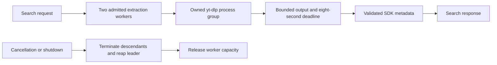

# YouTube plugin development

The separate YouTube HTTP service currently supports search. It returns bounded SDK recording metadata through `v1/search`. Recording detail, playable sources, audio relay and Spotify-to-YouTube matching are still being implemented. Its manifest advertises search only, so Hito keeps playback and adoption disabled for these results.

## Isolated Docker service

Build and start the service in its own project:

```sh
HITO_YOUTUBE_PORT=18093 docker compose -p hito-youtube-runtime -f compose.youtube.yaml --profile plugins build plugin-youtube
HITO_YOUTUBE_PORT=18093 docker compose -p hito-youtube-runtime -f compose.youtube.yaml --profile plugins up -d --no-deps --no-build --wait plugin-youtube
```

The manifest is available at `http://localhost:18093/v1/manifest`. This isolated project is separate from the normal Hito server network and has no Hito database or music mounts. Do not use the normal persistent server for first-run acceptance tests.

The image pins yt-dlp 2026.08.19 and Deno 2.9.7 for Linux GNU amd64 and arm64. The installer verifies SHA-256 before unpacking each release asset. It retains yt-dlp's complete runtime bundle and bundled notices, plus Deno's root MIT license and available notices from its pinned source archive. The complete dependency attribution and redistribution audit remains a release requirement.

The service runs as UID 10001 with a read-only root filesystem, no extra capabilities, a 64 MiB temporary filesystem, a 128-process limit and a 512 MiB memory limit. The temporary filesystem disallows executable files. Deno and yt-dlp are installed in the read-only image; requests do not install runtimes or remote components.

## Process ownership



The extractor passes literal arguments without a shell and clears the inherited environment. It disables configuration, cookies, browser cookies, plugin directories, remote components, downloads and disk caching. Search allows at most 50 results. Output is limited to 2 MiB on stdout and 64 KiB on stderr, then normalized to a maximum 256 KiB SDK response. Search terms and upstream output stay out of operational logs.

The worker retains its capacity until process-group cleanup finishes, including when the HTTP caller disconnects. Shutdown stops admission, cancels workers and joins cleanup. A cleanup failure stops further extraction. These process-ownership checks currently target Linux GNU, which is the service container platform.

## Verification and remaining work

Eight fixture cases passed through Docker, including the real host executable's SIGTERM path, retained capacity during cancellation, descendant cleanup, the exact child environment and INFO/TRACE redaction. Formatting and strict all-target Clippy passed for that source checkpoint.

The packaged arm64 image started under the configured restrictions, reported both pinned runtime versions and completed an offline Deno program. A live public search through the packaged HTTP service returned a validated recording. Rebuilding with the Deno notices preserved those checks; the live request took 1,053 ms. That single observation is a functional check, not a latency benchmark.

The amd64 runtime, detailed extraction, JavaScript challenge compatibility, AAC/M4A relay, seeking, expiry and range recovery, bounded source caching, full Hito installation/adoption/playback, uncertain matching and platform release acceptance remain open. A working search service does not establish playable YouTube audio.
