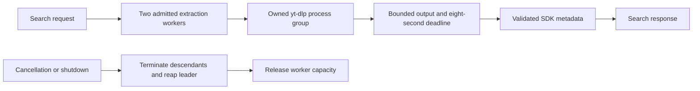
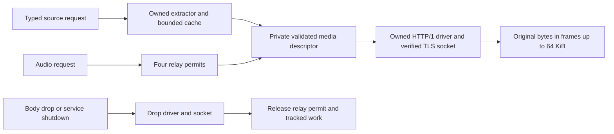

# YouTube plugin development

The separate YouTube HTTP service implements search, recording details, musical metadata, AAC/M4A sources and audio relay. Its manifest declares `search`, `metadata` and `sources`. Plugins return structured metadata and audio; Hito owns the interface. The verified image runs on the normal local Docker network. Address-only installation, discovery, saving, playback, reviewed attachment and one real automatic Spotify-to-YouTube target pass in WebKit against disposable libraries. Each listener connects personally; deployment did not authenticate or change a normal account.

## Server-side limitation

Current behavior, and an external dependency. On the VPS deployment, YouTube refuses to give audio to the service. Every player client that was tried returned a sign-in or bot-confirmation response (`LOGIN_REQUIRED`) from the datacenter IP address. Search and metadata work. Audio extraction does not.

This is the supported position for server installs, not a defect waiting for a workaround. Hito will not add cookies, a signed-in account, a residential proxy or a relay through a personal computer to get around it. On a server, YouTube is a search and metadata source. Audio must come from another provider, such as a folder, Jamendo or a debrid service. When extraction fails, source resolution reports `provider_unavailable` instead of `no_suitable_source`, so the UI can say the provider is blocked ([how resolution works](architecture.md#playback-source-resolution)).

Options considered, with evidence and decisions:

| Option | Result or status | Decision |
| --- | --- | --- |
| Other yt-dlp player clients (`web_embedded`, `tv_downgraded`, `tv_samsung`, `mweb`, `visionos`) | Tested on the VPS. All returned the same sign-in or bot-confirmation failure before any formats appeared. | Not a fix. |
| Newer extractor (official nightly `2026.10.10.233141`) | Tested in isolation with one client. Same error, same error-output hash. | Not deployed, no change. |
| IPv6 egress | Tested. No playable metadata. | Not a fix. |
| Anonymous Player tokens (Bgutil 2.0.2 provider and plugin) | Tested against a baseline on the same recording. The token was generated and sent. The player still returned `LOGIN_REQUIRED`. | Not a fix for this sample. |
| Browser cookies or a signed-in YouTube account | Not tried. | Rejected by the project owner. |
| Residential proxy | Not tried. | Rejected by the project owner. |
| Relay extraction through the owner's Mac | Not tried. | Rejected by the project owner. |
| Debrid services as a YouTube fetch path | Untested. It is not known whether any supported debrid provider will fetch YouTube links. | Open. Needs a test before any claim. |
| Extraction on the listener's device in the desktop app | Proposed. Not implemented. The listener's own residential connection would make the request. | Planned idea, not a commitment. |

The tests did not show that every anonymous method fails or that the VPS address is banned everywhere. They show that none of the methods tried works for the sampled recording. The full probe record is in [VPS deployment](vps-deployment.md#youtube-extraction-on-the-vps).

### Metadata-only mode

Start the service with `--metadata-only` and it declares only `search`, `metadata` and `artwork`. The `/v1/sources` and `/v1/audio` routes are not mounted, so they answer 404 and never start yt-dlp. Because the manifest no longer lists `sources`, Hito stops asking this plugin to resolve audio, and Play no longer pays for an extraction that fails. A user can still save a YouTube result from Discover. Hito stores the recording with YouTube's title, artist, album and thumbnail, and with no sources from YouTube. Play then looks for audio through the user's other approved providers, and reports that no source was found if none matches. None of the audio comes from YouTube. Without the flag, behavior is unchanged. At startup the service logs one `youtube_service_mode` event with `mode` set to `metadata_only` or `full`.

The VPS compose file sets this flag. The change removes a capability from the manifest, so an existing connection does not switch on its own. In Settings, Plugins, use Check connection, then Accept changes. Until then the old approval remains. Tests start the real binary with and without the flag and check the manifest, the 404 responses, and that only a search runs the extractor. The VPS deployment itself has not been updated or verified for this change.

## Thumbnails as artwork

Current behavior, tested against a local fixture only. The service declares `artwork` in both full and `--metadata-only` modes. `POST /v1/artwork` accepts a `recording` request and fetches `https://i.ytimg.com/vi/<video id>/hqdefault.jpg`, a fixed 480x360 JPEG. It does not start yt-dlp, so it needs no extractor slot and does not depend on the player API that refuses the VPS. Release and playlist requests answer 404.

The fetch uses the same hardened client as audio. It is https only, sends no cookies or authorization, follows no redirects, times out after 8 seconds and reads at most 2 MiB. The service returns the image only if the response is `image/jpeg` with identity encoding, starts with a JPEG start marker, has a supported frame header of at most 1024x1024, and ends with the end marker. Hito's core re-checks and decodes it. WebP and other formats are never requested.

Logs record one `youtube_artwork_complete` event with outcome, size and timing. They never include the video id, URL or path.

Not verified live: whether i.ytimg.com serves thumbnails to the VPS address. Thumbnails are not audio, so the `LOGIN_REQUIRED` block is not expected to apply, but nobody has checked.

Existing connections do not gain the capability on their own. In Settings, Plugins, use Check connection, then Accept changes. Until then, YouTube recordings keep the placeholder.

## Isolated Docker service

Build and start the service in its own project:

```sh
HITO_YOUTUBE_PORT=18093 docker compose --project-directory . -p hito-youtube-runtime -f deploy/compose/youtube.yaml --profile plugins build plugin-youtube
HITO_YOUTUBE_PORT=18093 docker compose --project-directory . -p hito-youtube-runtime -f deploy/compose/youtube.yaml --profile plugins up -d --no-deps --no-build --wait plugin-youtube
```

The manifest is available at `http://localhost:18093/v1/manifest`. This isolated project is separate from the normal Hito server network and has no Hito database or music mounts. Do not use the normal persistent server for first-run acceptance tests.

The image pins yt-dlp 2026.08.19 and Deno 2.9.7 for Linux GNU amd64 and arm64. The installer verifies SHA-256 before unpacking each release asset. It retains yt-dlp's complete runtime bundle and bundled notices, plus Deno's root MIT license and available notices from its pinned source archive. The complete dependency attribution and redistribution audit remains a release requirement.

The service runs as UID 10001 with a read-only root filesystem, no extra capabilities, a 64 MiB temporary filesystem, a 128-process limit and a 512 MiB memory limit. The temporary filesystem disallows executable files. Deno and yt-dlp are installed in the read-only image; requests do not install runtimes or remote components.

## Testing on the normal local installation

The normal service runs image `sha256:497267e06352260f159ae0410869cd9dcbe5302b9ba5baedae3f1444305fa797`, built from `2b4ad7e`, at `http://plugin-youtube:8093/`, with a loopback host manifest at `http://localhost:8093/v1/manifest`. It searches the music catalog. Its health, manifest and reachability from the normal server passed. The runtime retains its exact environment, command, network, ports, read-only root, UID 10001, dropped capabilities, temporary-filesystem and resource limits, with no Hito data or music volume.

In Settings, Plugins, offer that internal address and connect without a bearer token. Existing connections use Check connection, then Accept changes to approve the new metadata capability. Discover can search and save YouTube recordings. Ordinary Play on a saved Spotify recording can now resolve its audio automatically. For a correction, open its details, use Find a source to review and attach an alternative, then choose that playback source. Both paths retain the recording and playlist identities and Spotify metadata owner. Resolution happens when playback needs it; importing a playlist does not start persistent downloads. See [automatic matching policy and live evidence](automatic-sources.md).

The music-search update keeps the existing manifest and permissions. An already approved metadata connection needs no reinstall or additional approval for this update.

## Process ownership



The extractor passes literal arguments without a shell and clears the inherited environment. It disables configuration, cookies, browser cookies, plugin directories, remote components, downloads and disk caching. Search runs one extractor process with two literal targets: first the YouTube Music songs catalog with an encoded query, then an ordinary YouTube video search (`ytsearchN:`). `--playlist-end` is set to the requested limit, at most 50, and `--ignore-errors` lets the second target run when the first fails. Existing explicit video identities still use the same detail and audio endpoints. Output is limited to 2 MiB on stdout and 64 KiB on stderr, then normalized to a maximum 256 KiB SDK response. Search terms and upstream output stay out of operational logs.

Flat music results contain only identity and title. Flat video results add the channel and duration; the channel is returned as `Channel: <name>`, which Core does not treat as a known artist. When no artist or channel evidence is present, search returns `Unknown artist` with an optional duration. Detail extraction remains strict and independent. The plugin never fills musical credits or track titles from the listener's query, and never derives a performer from a channel name.

### Search ranking and partial results

Current behavior in development source, not deployed. In Docker, the plugin suite passes against owned extractor fixtures, covering ranking, shared identities, either target failing, a malformed first or second document, and a hanging target. The four Core ranking cases pass against owned provider pages. These fixtures stand in for yt-dlp: whether the pinned yt-dlp really continues to the second target after the first fails has not been checked live.

- At most one video leads the page: the first video whose title contains every word of the query. All catalog songs follow in catalog order, then the remaining videos. Each video identity appears once.
- When the same identity is in both lists, the song row's title, artists and duration win. The video only fills fields the song row lacks.
- Each target's document is read on its own. A target that fails, prints a malformed document, or is still running at the eight-second deadline is dropped, and the other target's complete document is kept. Cancellation, cleanup failure and oversized output still fail the search. A hanging songs target prevents the video target from running, so that search still times out.

Known limitation: Core verifies at most three plausible results per search. When a plausible lead video is present, that window is the lead video and the first two catalog songs. A correct third catalog song is then not checked, and the lead video can be used as a best guess instead. Not every match the songs-only search used to verify is preserved. A promoted video is never verified on its title alone; it needs independent musical evidence like any other result.

Still open: automatic matching is not complete. Existing library rows with a missing artist are not backfilled by this search change, and one unexplained 503 in a plugin source test (recorded during the first test run of this change) has not been classified.

The worker retains its capacity until process-group cleanup finishes, including when the HTTP caller disconnects. Shutdown stops admission, cancels workers and joins cleanup. A cleanup failure stops further extraction. These process-ownership checks currently target Linux GNU, which is the service container platform.

## Audio ownership and bounds

Recording details and sources use a canonical eleven-character video identifier. A source ID identifies the selected format, length and upstream modification witness. It contains no signed URL. The 128-entry LRU cache can reextract an evicted or expired item; a changed representation cannot reuse an old source ID. These witnesses do not establish cryptographic content identity.

Only original, progressive HTTPS AAC LC in an M4A container is supported, up to 128 MiB. The extractor does not pass its returned cookies or authorization headers into audio requests. Audio endpoints accept HEAD, full GET and one byte range. Hito verifies upstream status, length, range, media type and available validators before sending audio. Conversion and other codecs remain open.



The HTTP connection driver stays inside the response owner; it is not spawned into a detached client task. Header requests are bounded by the existing eight-second open budget. DNS, TCP and TLS connection establishment has a two-second timeout; HTTP parsing allows 32 fields, 16 KiB of headers and a 256 KiB read buffer. These async deadlines do not establish a bound on underlying operating-system resolver work.

A ten-second idle deadline applies while actively waiting for upstream audio. Downstream pauses do not consume that deadline, and buffered bytes can resume after a pause. Incoming frames larger than 64 KiB are split without copying their payload. Admission remains held with the owned stream and pending bytes until cleanup. Shutdown closes retained bodies and waits for admitted opens and process cleanup.

## Verification and remaining work

Sixteen fixture cases passed through Docker, together with formatting and strict all-target Clippy. They cover executable SIGTERM and descendant cleanup, the exact child environment, metadata/source validation, cache eviction and changed representation identity, full AAC delivery, ranges, native decoding, four-body admission, consumer pauses, active input timeout, large real HTTPS frames, correlated completion logs and INFO/TRACE privacy. A current-thread Linux regression observes the concrete client socket inode and verifies it is closed before shutdown returns, even while the caller retains an unpolled response body.

Two review rounds found defects that received failing public-boundary regressions and passing resolver checks. The final ownership fix uses the direct HTTP driver described above. No third independent clean verdict is claimed.

The packaged arm64 image `sha256:fe3f2abaff3df419a332bc3d34ad3d037a7b79afee154ea6e2ed77291b381178` is healthy in the isolated project. An explicitly opted-in live test passed SDK details/sources, HEAD, a nonzero byte range, full transfer and native Symphonia decoding. It received 527,856 encoded bytes and decoded 2,871,296 finite samples at 44.1 kHz stereo with nonzero energy. HEAD, range and full transfer together took 16,291 ms; decoding took 316 ms. The recording was about 33 seconds long. These are functional observations, not playback-start or release latency measurements.

The ignored test requires `HITO_YOUTUBE_LIVE=1`, an explicit isolated `HITO_YOUTUBE_LIVE_BASE_URL` and a canonical public `HITO_YOUTUBE_LIVE_VIDEO_ID`. It accepts only loopback or named isolated-service endpoints, writes encoded bytes to a mode-0600 temporary file, bounds transfer and decode work, and prints numeric evidence without titles, identifiers, URLs or paths. Invoke it through the Docker Rust tools service with `cargo test --locked -p hito-plugin-youtube --test live_audio -- --ignored --exact release_image_relays_public_aac_with_ranges_and_native_decoding --nocapture`.

An explicitly opted-in release-image WebKit workflow passed in 21.7 seconds. It offered the service address, connected without a bearer, searched, saved the recording, played AAC through the authorized Hito source URL, sought to 7.9 seconds and continued through navigation. Presented time reached 8.33 seconds with media error zero. No browser request reached the plugin or media CDN. This sample sought within buffered audio; the separate live HTTP check above exercises a nonzero upstream byte range.

The test distinguishes WebKit's headerless synthetic network observation from a real HTTP response. It requires that observation to finish normally and match an actual same-URL 200/206 response with valid audio framing. Zero is never counted as HTTP success. WebKit can also cancel a progressive read and resume through increasing open byte ranges. A separate 17-row fixture table verifies the narrow classification of its exact cancellation code, consistent source/total/framing, chronological range replacements and normally completed final tail. Raw cancellations remain counted separately from unexpected failures. Media errors, malformed responses, unexplained failures, external URLs and stalled presentation still fail the workflow.

A real public Spotify playlist workflow passed in 12.8 seconds. It imported 411 ordered entries, explicitly reviewed and attached one conservatively selected YouTube candidate, played AAC, sought to 57.5 seconds and continued through navigation. The recording, playlist order, Spotify metadata owner and personal edits remained unchanged. The other 410 entries stayed visibly unavailable. Ten browser range replacements were distinguished from zero unexpected request failures; media error remained zero. This demonstrates manual association, not automatic matching or general provider compatibility. The final setup guard passed a separate owned-server regression: an initialized server is refused before credential input or POSTs, while account and collection snapshots remain unchanged. The guarded live workflow then passed again in 13.0 seconds. Independent correctness and performance reviews passed; a security finding received the failing regression, fix and passing second review. The browser spec separates provider setup, collection invariants and playback checks into cohesive helpers.

The packaged Chromium test browser reports no AAC support. The packaged Firefox advertises AAC but raises a media decode error in the real workflow. These are unresolved compatibility limits of the current test images; they do not establish behavior in every installed browser. Conversion and broader browser acceptance remain open. Source and browser-test TypeScript and formatting passed. Scoped scans of 1,316 Hito and 562 plugin log lines found no configured video identifier, signed media host/expiry or bearer values.

The amd64 runtime, broader upstream and challenge compatibility, expiry and range-recovery countercases, automatic playlist-wide association, other codecs, physical output and platform/public-release acceptance remain open. Complete runtime dependency attribution and redistribution acceptance are also still required.
