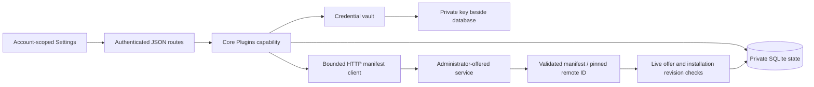
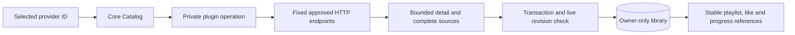
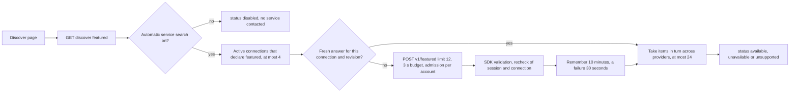
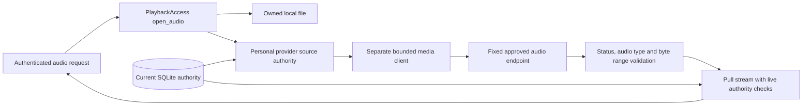
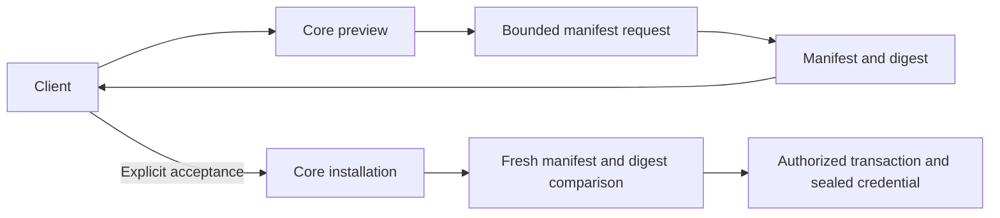
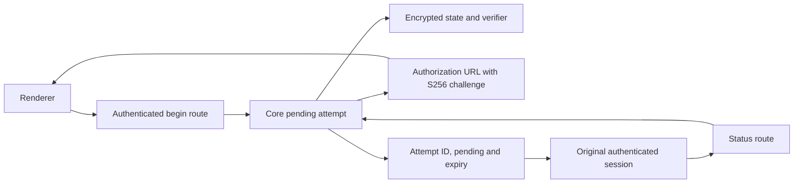
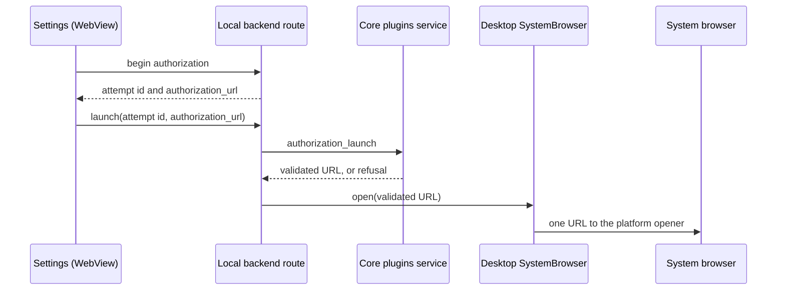
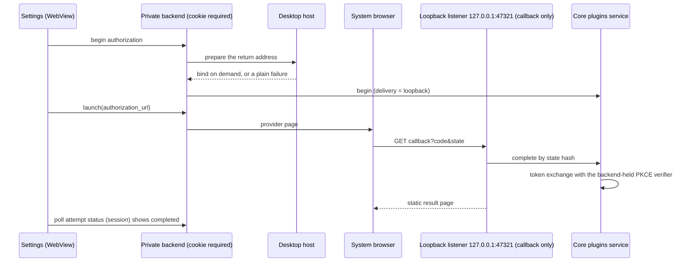
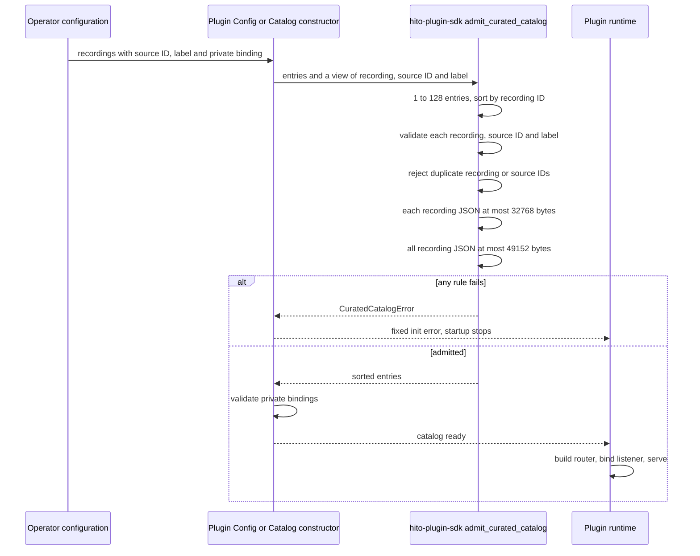

# Plugin connections

The SDK defines [timed-lyrics and backing-track contracts](plugin-timed-content.md), with independent version negotiation, exact provider references, bounded structured responses and separate backing-recording identities. Host lookup, verified audio alignment and shared rendering remain unfinished.

Hito connects to separately hosted HTTP services. It does not download or execute plugin code. Settings supports service offers, personal installation, manifest validation/review, credential storage, and removal. Discover supports private music search, durable adoption, and playback through authorized audio relay. These workflows and the source-refresh behavior below are implemented in the development build. Catalog browsing capabilities, enrichment, official playlist-provider adapters, dashboard content, lyrics, and backing tracks remain release work.

Generic playlist Import a copy is deployed on the local development server, with loopback-provider fixture and release-image browser coverage. See its [provider JSON examples](playlist-import.md#provider-json-examples), [copy/retry behavior](playlist-import.md#retry-the-same-request-or-create-a-new-copy) and current [acceptance limits](status.md#isolated-plugin-integration-checkpoint). Public Spotify import and hourly/daily Follow are also deployed locally; provider account authorization and remaining release acceptance are separate work.

## Settings

Open Settings → Plugins. An administrator expands **Services for this server**, enters the service address, and selects **Offer service**. Hito fetches the public manifest and uses its validated name. **Advanced settings** has an optional custom label for services that require a token before exposing their manifest. An explicit label skips this initial lookup; the personal connection still validates the manifest with its own optional token.

The operator can also pre-offer addresses with `HITO_PLUGIN_SERVICES=label=address,...`. At startup, and by retrying in the background until each answers, the server fetches the manifest, validates it, and adds the offer with the same address rules as the administrator form. An address that is already offered, or that an administrator withdrew, is skipped. The setting never installs a connection for any account. See the [self-hosting guide](self-hosting.md).

Offers are shared choices, not shared credentials or automatic installations. Only administrators can choose addresses that Hito will contact. Ordinary accounts select an offered service and optionally enter its bearer token. No environment-variable editing is needed. Existing service labels remain unchanged.

An automatic name lookup sends no credentials or browser cookies. Failed validation saves no offer. Hito rechecks the administrator's live session after the HTTP request, without holding a SQLite write transaction during network work.

Each account owns its connections. Administrators cannot list, check, or clear another account's connection. Removing a personal connection clears its saved token. Withdrawing an offered service disconnects all installations of that service and clears their tokens. Both actions retain an inactive identity record. Reoffering the same address creates a new service identity.

Settings describes each connection in one plain sentence derived from its declared capabilities (for example "Finds songs and plays them from YouTube"), and keeps the technical declaration, source persistence and token settings in a collapsed **Details** section. When Settings opens, the web app asks `POST /api/v1/plugins/{id}/declaration-check` for each connection. This is a read-only look with the saved token: it stores nothing and does not change the connection revision. If the service now declares something different, a banner such as "New: album covers" offers **Review and accept**, which opens the same review and digest-bound acceptance as below. Failures of this automatic look are silent; **Check connection** remains for manual checks.

**Check connection** fetches and validates the manifest. A changed name or capability declaration appears for review. Acceptance fetches the manifest again and requires the reviewed digest. A different remote plugin ID is rejected; remove and reconnect to accept a new identity. Accepting changes raises the connection revision. Followed playlists keep updating when the service, plugin identity and saved token are unchanged, `playlists` is still declared and no new capability appeared; otherwise they pause and the playlist page asks to resume (see [Follow playlists](playlist-follow.md#connection-changes-automatic-resume-and-explicit-resume)). Failed requests and unaccepted reviews preserve the accepted manifest and credentials. **Save token** checks the replacement before saving it. **Clear saved token** is local and works even when the service is unavailable.

## Discover music

Open Discover, choose a connected music service, and search for a track or artist. Only connections with an accepted search capability appear. Services that offer search without sources show results with Play and Add disabled.

Search returns one transient page and does not change the library. **Add to library** refetches authoritative detail and sources, then saves a durable private recording without starting audio. **Play** performs the same adoption before replacing the queue. Neither action downloads a persistent audio copy. Use Previous and Next for the service's opaque cursor pages. Completed adoptions keep their In library feedback across pages and searches for the current connection revision.

Changing accounts, services, or accepted connection revisions clears private results and feedback. A later search cancels the earlier search and pending selection. A later player command supersedes delayed provider Play; playback continues through page navigation. A failed search or selection offers Refresh services, which reloads accepted connections while preserving the search draft. Unavailable adopted tracks remain in the library and explain why playback cannot start.

## Ownership and recovery



The core owns URL validation, HTTP policy, credential encryption, quotas, and transactions. Routes authenticate and map typed requests/results. React's workflow hook owns cancellation and account scope; components own form drafts and rendering. The SDK is Apache-2.0 and contains the wire manifest without a database dependency.

No SQLite transaction stays open during HTTP work. Install and refresh recheck live service/installation revisions before committing. A delayed response cannot restore a removed connection or withdrawn offer. An account can have 32 active installations; the server can offer 64 active services. Active account reads and credential-key discovery use indexes.

Personal provider data is confined to an owner-only library. It can reuse the recording/source graph without entering a shared library. Administrator membership changes reject personal libraries, and database constraints back that rule. Audio relay checks the owning account, accepted capability, active connection/service, and saved source binding before contacting the service and throughout streaming.

## Provider content groundwork

`Catalog::search_provider` returns transient provider results. It requires the accepted `search` capability and an expected installation revision. Search does not populate the library. `Catalog::adopt_provider` takes only an installation revision and opaque provider recording ID. It requires `sources`, refetches detail and the complete source list, then commits durable recording/source/release identities and observations atomically. The `metadata` capability has a typed SDK extension in development below; host enrichment and automatic-matching integration remain unfinished.



Provider IDs are namespaced by personal installation. Matching titles never merge recordings. A repeated selection preserves UUIDs and personal fields. Source IDs cannot silently move to a different recording. Failed responses leave previous catalog state intact. Only a complete successful source response withdraws missing sources. Removing a connection or withdrawing its service retains recordings and collection references but removes readiness. Reinstallation starts a separate identity scope.

Provider observations record the accepted manifest ID, installation, remote recording ID, optional remote revision, observation time, and validated detail JSON. File checksum, local source, and file inspection version remain null. Missing duration displays as zero; the retained provider JSON preserves whether it was actually reported. Recording checksums remain real file evidence or null. Provider source metadata explicitly uses `provider_response` provenance.

The outgoing JSON protocol uses these fixed paths relative to the approved base address:

| Operation                   | Request                             | Response limit                                    |
| --------------------------- | ----------------------------------- | ------------------------------------------------- |
| `POST v1/search`            | `query`, optional `cursor`, `limit` | 262,144 bytes, at most 50 items                   |
| `POST v1/recordings/detail` | `recording_id`                      | 32,768 bytes, one matching recording              |
| `POST v1/sources`           | `recording_id`                      | 32,768 bytes, complete list of at most 16 sources |

Detail returns `id`, `title`, `artist`, optional `duration_ms`, optional `release` with `id/title/artist`, optional positive disc/track numbers, and optional `revision`. Search returns `items` with the same recording fields plus optional `next_cursor`. Sources returns `items` containing `id`, `label`, and `ready`. No operation returns stream URLs or arbitrary request headers. The SDK validates these language-neutral JSON contracts.

Queries use at most 512 bytes; cursors use 2,048; IDs/revisions/source labels use 256; titles/artist names use 2,048. Text must be nonblank and contain no control characters. Durations must fit JavaScript's safe integer range. Unknown fields, duplicate IDs, oversized pages, mismatched detail IDs, invalid content types, and encoded responses are rejected. Requests use the same credential, admission, redirect, and deadline policy as manifest requests below. No SQLite transaction spans HTTP work.

Optional recording fields never change the protocol version. `isrc`, `artist_urls` and `artists` (the credited artist list) are omitted when absent, so older plugins keep their exact bytes, and the SDK validates each when present: `artists` holds at most 16 entries with bounded names, identifiers, join text and allowlisted page addresses, at least one main artist and no repeated name. A recording that breaks these limits is rejected as a whole, so a producer drops the list instead of sending a broken one. See [recording evidence](plugin-catalog.md#recording-evidence).

For plugin authors building against the Rust SDK this is a source-level change: `ProviderRecording` gained the public `artists` field (struct literals need `artists: Vec::new()`), and `ProviderPlaylistItem::Recording` holds a `Box<ProviderRecording>`. Neither changes the wire. Deploy the host before a rebuilt Spotify plugin: a host that predates `artists` rejects the field through the unknown-field rule, so the rebuilt plugin's playlist responses would fail until the host is upgraded.

## Musical metadata in development

The SDK and YouTube adapter implement `POST v1/recordings/metadata`, using the existing strict `recording_id` request. This extension belongs to the `metadata` capability. It preserves the existing recording, search, detail and source wire shapes. Core's development resolver now consumes it through explicitly approved connections. The normal server and YouTube service have not received these changes.

The response contains an existing `recording` object and optional `musical_title`, `album_title` and `source_ids` fields. For example:

```json
{
  "recording": {
    "id": "provider-recording-1",
    "title": "Performer - Song (Official Audio)",
    "artist": "Performer",
    "duration_ms": 180000,
    "release": null,
    "disc_number": null,
    "track_number": null,
    "revision": null
  },
  "musical_title": "Song",
  "album_title": "Live at the venue",
  "source_ids": ["provider-audio-1"]
}
```

Musical title and album context come from provider-reported music fields. They do not replace the original video title or invent a release identifier. Official wording and a channel badge do not establish recording identity. The example deliberately retains a live-album qualifier despite the video wrapper.

The complete encoded response is limited to 32,768 bytes. Present musical text must be nonblank, contain no control characters and fit 2,048 bytes. A supplied source witness list is complete, contains at most sixteen unique IDs and uses the existing 256-byte ID limit. Metadata-only providers may omit witnesses. Enriched audio matching must require them and compare the returned recording and complete witness list with the details and sources it will publish.

YouTube projects the recording, musical fields and source witness from one retained extraction snapshot. The sequential fixture verifies one extraction and byte-identical legacy detail/source responses. Invalid extra musical fields do not break legacy detail or audio reads; the new metadata projection rejects them. Core integration must handle cache replacement or expiry rather than assume independent requests always observe the same snapshot.

An existing connection must explicitly accept a manifest change before Hito may use its new metadata capability. This work does not approve capabilities in a listener's account. Host transport now bounds and validates the response, compares its full legacy projection and source witnesses with the detail/source snapshot, and retains accepted evidence on the immutable automatic decision. A controlled core workflow serves the exact owned WAV; a mismatched-witness case rejects publication and replays without provider IO. Additional malformed-adapter, version, authority, persistence and live-integration cases remain required.

The SDK passes seventeen public contract cases with schema generation enabled. YouTube passes nineteen fixture cases, with one live case explicitly ignored. Strict all-target Clippy passes for both. The new endpoint first returned 404 in its HTTP/process regression, then passed after implementation. Its separate first independent security, correctness and performance source reviews found no material defect. The HTTP fixture covers sequential snapshot reuse; malformed-extra HTTP behavior, cache replacement and metadata-specific cancellation need further verification. This is adapter and contract evidence, not automatic Spotify-to-YouTube playback or release acceptance.

## Optional recording credits

`ProviderRecording.attribution` can retain ordered creator names, a provider label and a canonical HTTPS content backlink. Absent credits preserve existing wire bytes. Core validates and retains credits on immutable metadata observations, independently of personal edits and playback sources. This declaration grants no download permission and does not identify the currently playing source. Shared rendering and normal deployment are still unfinished. See [contract, verification and limits](recording-attribution.md).

## Featured music

Current behavior in source (the Spotify plugin container is not rebuilt and the local server is not redeployed). A provider can declare the optional `featured` capability to offer a short list of playlists, albums or new releases. Discover shows them as the **From your services** shelf. Old plugins are unaffected: the capability is optional, no earlier wire shape changed, and a plugin that does not declare it is never asked.

**Wire contract** (`crates/plugin-sdk/src/featured.rs`). `POST v1/featured` takes `{"limit": n}` with `n` from 1 to 24 and unknown fields rejected. The reply is `{"items": [...]}` with at most `limit` items and at most 32,768 encoded bytes. Each item has:

| Field | Rule |
| --- | --- |
| `id` | Provider identity, 1 to 256 bytes, unique in the reply |
| `title` | 1 to 256 bytes |
| `subtitle` | Optional, up to 256 bytes (usually the curator or artist) |
| `kind` | `playlist`, `album` or `new_release` |
| `reference` | 1 to 2,048 bytes, a reference the same provider accepts at `POST v1/playlists/detail` as `{"kind":"reference"}` |
| `artwork_id` | Optional, up to 256 bytes; the provider serves the image at `POST v1/artwork` with `{"entity":"featured","provider_id":...}` |
| `item_count` | Optional, at most 10,000 |

Text must be nonblank and free of control and deceptive format characters, as for every other SDK field. Core rejects the whole reply when any rule fails. A manifest that declares `featured` without `playlists` is invalid.

**Opening a card.** Every card, whatever its `kind`, is imported with the existing playlist import (`POST /api/v1/plugins/{id}/playlists/import`, Import a copy) using the item's `reference`. Albums and new releases therefore arrive as playlists of their tracks. **Open** imports and shows the playlist page. **Play** imports, reads the playlist and queues its recordings through the player, the same queue the Play button of a playlist page uses; playback of recordings without a ready source resolves as usual (see [automatic sources](automatic-sources.md)), including through the same provider when it offers `search` and `sources` (see [playlist import](playlist-import.md)). Cards open through `POST /api/v1/plugins/{id}/playlists/open`, which reuses the account's existing copy of the same provider playlist (same connection, same canonical playlist ID, not deleted) instead of importing another, and answers `reused`. A changed provider snapshot is not merged into the copy: the copy keeps the listener's edits, and replacing its entries would destroy them, so refreshing a copy's contents stays a separate decision (Follow keeps a read-only playlist updated). The plain Import a copy button still makes a new copy every time. Shelf entries carry `existing_playlist_id` when a copy exists, found by matching the item's `id` with the canonical playlist ID, so a provider should use the canonical playlist ID as the item `id` (Jamendo does); otherwise the page learns the copy from the open call and remembers it for the visit. Every Play of a copy whose recordings have no ready source costs one provider `search` plus a `recordings/detail` and `sources` call per recording, on top of the open call.

**Reading the shelf** (`Catalog::featured`, `GET /api/v1/discover/featured`).



- Account data sent: none. The request is `{"limit":12}` with the connection's own bearer token and Hito's protocol header. No cookie, session, library, listening or search data is sent.
- Consent: the read follows the account's **Search connected services automatically** choice (Settings, Privacy, on by default), because opening Discover contacts a service without a click. With the choice off the reply is `disabled` and no service is contacted.
- Statuses: `available` (items), `unsupported` (no connection declares `featured`), `disabled` (choice off), `unavailable` (every capable connection failed, timed out, was busy or answered with nothing). The page hides the shelf for every status but `available` and shows no error for the others.
- Bounds: eight seconds for the whole read, three seconds per connection (a provider that fails or times out contributes nothing and never hides the others; providers read before the budget ends are kept), one connection at a time per account, four connections per read, 24 items per shelf. The cache is in memory, keyed by connection ID and revision, holds at most 64 answers and is lost on restart. It is not shared between accounts, because connections are personal.
- Covers: the browser never loads a provider address. It asks `GET /api/v1/plugins/{id}/featured-artwork?revision=&artwork=`, which needs the connection's `featured` and `artwork` capabilities, a matching revision and the owning account. Core accepts only PNG or JPEG bytes whose signature matches the declared type and whose declared size is at most 4,096 by 4,096 pixels, waits up to about three seconds when artwork admission is busy, follows the same automatic-service-search choice as the shelf (off answers 404) and keeps up to 16 MiB of covers in memory, keyed by connection, revision and cover ID, until restart. The page asks once more after a second when a cover fails before keeping the generated cover. An item from a connection without `artwork` has no cover address and shows a generated cover.

**Approval.** A connection gains `featured` only when its owner accepts the changed declaration: Settings, Plugins shows "New: featured music on Discover" after the automatic look, or use **Check connection**, then **Accept changes**. Until then the connection is not asked for featured items. New installations show the capability in the initial review.

**Which services offer it.** Jamendo implements it in source (popular albums of the week, see [Jamendo](plugin-jamendo.md#featured-albums)). Spotify does not: its public embed protocol exposes only a playlist given by link, and its browse or featured endpoints need a developer application or a user sign-in, which the public plugin deliberately avoids. Spotify featured music is planned (see [Spotify](plugin-spotify.md#featured-music-planned)). YouTube and the folder plugin do not declare it.

**Evidence.** SDK wire cases (`crates/plugin-sdk/tests/wire/featured.rs`), core cases with an owned `FakePlugin` (`crates/core/tests/plugins/featured.rs`), HTTP cases (`apps/server/tests/api/featured.rs`), Jamendo protocol cases against an owned fake of its API, DOM cases (`discover-featured.test.ts`) and a browser case with an owned provider (`apps/web/e2e/provider-featured.spec.ts`). See the [status entry](status.md).

## Audio relay

The provider serves `GET` and `HEAD v1/audio?source_id=<encoded opaque ID>`. Only Hito selects the approved service address and supplies its personal token. The browser requests the existing `/api/v1/sources/{id}/audio` route with Hito's durable source UUID. Provider URLs, tokens, browser cookies, and arbitrary request headers never become source data returned to the browser.



The relay accepts supported audio MIME types and identity encoding. Transfer-Encoding must be absent or a single chunked coding without Content-Length. It validates single byte-range responses, known lengths, and premature EOF. Unknown request range units are ignored. Multipart ranges are unsupported. HEAD ignores Range. If-Range is treated as an unmatched validator and returns a full representation. Only validated content type, lengths, range support, and Content-Range reach the browser, with private no-store caching. Provider cookies, redirects, filenames, and custom headers are discarded. MIME/framing validation does not verify the decoded recording or establish codec compatibility.

The media client has a two-second connect deadline, ten-second header deadline, and fifteen-second deadline for each actively awaited upstream body read. Consumer pauses and backpressure do not run that read timer. A healthy stream has no total-duration timeout. Redirects, proxies, and retries are disabled. Sixteen global slots and two per account are independent of control requests. Slots last through EOF, failure, or consumer cancellation. A request that finds both of its account's slots taken waits up to half a second for one before answering `409`: a browser seek opens its replacement range request before the server has seen the connection the browser just abandoned, and that is not a second concurrent stream. Hito yields at most 64 KiB per pull, retains at most one upstream client frame, and does not spawn an audio-buffering pump or persist a download.

Connection removal, service withdrawal, credential changes, capability withdrawal, and lost source ownership cancel active requests and bodies. A database-backed monitor checks unread streams every 250 ms with a one-second authorization-query deadline. Checks also surround each body read. Changes made by a separately opened service instance are visible. A cached readiness change prevents new opens but does not interrupt a healthy current stream. An unchanged connection check can advance its revision without revoking an existing stream. Transfer completion retains the opening log correlation and records only safe outcome, byte count, and elapsed time.

Browser playback-time refresh and recovery are described below. Conversion, official services, and live-provider checks remain unfinished. Fixture-based playback does not establish codec compatibility or release performance.

## Refreshing playback sources

`GET /api/v1/recordings/{id}/sources` reads the current cached source snapshot. It does not contact a provider, including when artwork uses that lookup. `POST /api/v1/recordings/{id}/sources/refresh` explicitly asks the saved recording's active personal connection for its complete source list. The request takes the durable Hito recording ID, has no JSON body, and uses the existing session, account, and same-origin checks. Local recordings and inactive connections return cached availability without a provider request.

The core resolves the immutable provider binding and accepted metadata observation before HTTP. It requests only `v1/sources`, then rechecks access and connection/service revisions inside a short transaction. A generation comparison rejects responses that overlap a newer accepted refresh or adoption. The entire validated page commits together. Failures, duplicate or reparented IDs, removal, and stale generations leave the prior snapshot intact. Only a successful complete response withdraws omitted sources.

Returned sources keep their durable Hito IDs. Newly discovered sources inherit the last accepted recording observation, including its real album appearance when present. This operation does not refetch details, accept new metadata, create observations, or change personal edits, likes, playlists, or progress. Historical bindings and evidence remain stored, but cached listing and readiness withdrawal visit the current generation. Migration 0022 retains all previous rows and marks only previously ready bindings current. Earlier versions did not distinguish withdrawn history from explicitly unavailable entries; a new validated refresh restores that authoritative distinction. Both publication and current listing are bounded by the provider's 16-source page, independently of retained history.

The browser tries ready cached alternatives first. After exhausting them it refreshes once, and can retry stable source IDs once in that new snapshot. If another request won the refresh race, one final cached read can use that accepted result. The cycle is bounded. Recovery resumes near the current or latest requested seek position, including backward seeks and zero, and keeps playback speed. Selecting another recording or changing accounts aborts pending resolution. Unrecoverable recordings display a failure and allow the queue to continue.

Track details for saved provider recordings offer **Check availability**, with pending, ready, unavailable, and service-error states. Checking preserves metadata drafts and current playback. **Play track** is a separate action after audio becomes ready. No provider request runs merely from viewing details. This is manual rechecking and failure recovery; debrid preparation, track-boundary reconsideration, source ranking/overrides, gapless playback, and native recovery are still unfinished.

## HTTP manifest protocol, version 1

The connection, search, adoption, and relay operations are deployed locally. This protocol is still only part of the launch plugin specification.

A base address can use HTTP or HTTPS and a path prefix. It cannot contain user information, a query, or a fragment. Hito normalizes the trailing slash. For `https://provider.example/hito/`, it requests:

```http
GET /hito/v1/manifest
Accept: application/json
Accept-Encoding: identity
X-Hito-Plugin-Protocol: 1
Authorization: Bearer <personal token, only when configured>
```

Services must return a successful status with `Content-Type: application/json`, optional content-type parameters, and an uncompressed UTF-8 JSON manifest. Hito accepts no more than 65,536 response bytes, including chunked responses.

```json
{
  "id": "org.example.collection",
  "name": "My collection",
  "protocol_version": 1,
  "capabilities": ["search", "sources"]
}
```

The manifest requires these fields and permits the optional source persistence and authorization declarations below. IDs contain 1–128 ASCII letters, numbers, dots, hyphens, or underscores. Names contain 1–256 bytes, cannot be blank, and cannot contain control characters. At least one known capability is required. Supported declarations are `search`, `catalog`, `metadata`, `sources`, `source_preparation`, `playlists`, `artwork`, `dashboard`, `lyrics`, `backing_tracks` and `featured`. `featured` also requires `playlists`, because a featured item opens through playlist import (see [featured music](#featured-music)). Unknown capabilities and unsupported protocol versions are rejected.

The remote manifest ID, administrator service ID, and personal installation ID are separate. The reviewed digest is SHA-256 over a domain prefix and canonical SDK serialization, with capabilities sorted. JSON whitespace and capability ordering do not require review; semantic changes do.

The client disables automatic redirects, system proxies, and retries. It uses a two-second connection deadline, a ten-second total request deadline, four simultaneous requests globally, and one per account. Busy requests fail promptly. Private/self-hosted service addresses are supported because choosing an address is an administrator operation. Use HTTPS for services across untrusted networks. A service receives only the configured token and Hito protocol headers, never the browser's session cookie.

### Optional source persistence declaration

The development SDK and core accept a manifest-wide ceiling for new persistent transfers:

```json
{
  "id": "org.example.playback",
  "name": "Playback service",
  "protocol_version": 1,
  "capabilities": ["sources"],
  "content_policy": {
    "source_persistence": "playback_only"
  }
}
```

`source_persistence` accepts `explicit_download` or `playback_only`. The first leaves explicit downloads subject to Hito's existing admission rules; the second prevents new persistent transfers from the selected provider source. A `content_policy` object requires this field. Unknown nested fields and policy values are rejected. This is declaration-based admission, not verification of a recording's license or permission to download it.

Without `content_policy`, existing download admission behavior is unchanged. The SDK omits the absent field rather than serializing `null`, preserving existing SDK-serialized manifest bytes and fingerprint input. Adding or changing a declaration changes the reviewed digest. The official folder, Spotify and YouTube manifests currently omit this declaration. The source-qualified Jamendo manifest declares `playback_only`; older packaged Jamendo images predate it. A new image has been built, with isolated runtime and live-provider checks tracked separately.

Hito first selects the current provider origin under its existing authority, ordering and personal source-choice rules, then applies the accepted manifest's ceiling. A restricted selection does not silently choose another binding or fall through to an RSS enclosure. Restriction is classified before capacity, so a full queue does not replace the playback-only reason with Busy. Search, adoption and streaming still start no implicit persistent download.

For a new restricted transfer, direct Download returns a safe `Conflict`, mapped to HTTP 409, without retaining an intent, queueing a job or fetching audio. Playlist admission rolls back tentative retention changes and stops scheduling the restricted member. After reconciliation, an entry without a retained transfer reports the existing `unavailable` state with `error: "policy_restricted"`; it does not remain pending or retry on a capacity timer. Existing ready and active transfer states keep precedence in the playlist read.

Reusable ready copies are considered before new-transfer admission. This ceiling does not rewrite or blanket-revoke accepted ready copies. User originals, retained-copy access and explicit removal keep their existing behavior. See [persistent download ownership](persistent-downloads.md).

Directed public Docker tests cover exact owned WAV playback alongside restricted direct admission, terminal playlist projection and the same policy outcome with 32 permitted queued downloads. They preserve originals and private collection state. SDK checks cover exact legacy bytes, both typed policies and malformed declarations. Two additional public cases approve a changed manifest through real review: queued work fails with `authority_changed` without fetching audio, receipt replay cannot restart it, and new admission is refused; a previously completed explicit copy remains locally playable after the provider actually stops. Both preserve private state and originals. A later public case starts a healthy WAV transfer, verifies 64 saved bytes and its actual partial file, then approves playback-only policy while the remaining body is held. The worker completes within three seconds, drops the upstream body without releasing it and reclaims the partial file. No source is published; exact receipt replay cannot restart work, fresh admission is denied and private state/originals remain unchanged. All seven selected download/policy cases, strict all-target core Clippy and formatting pass in Docker; independent review passes. This case does not separately establish active-worker liveness during unaccepted review. Alternate-binding and broader source-change cases remain open. Generic [recording credits and backlinks](recording-attribution.md), the installed-policy display below and initial core/HTTP review are qualified in source. Initial consent UI is now qualified below. Packaged initial review is qualified below. Broader persistence boundaries and live Jamendo acceptance remain open.

The connection settings now show accepted source persistence and both sides of a proposed declaration change. Shared rendering distinguishes an absent declaration with unknown permission, an explicit-download declaration still subject to Hito checks, and playback-only restrictions on new offline downloads. It explains that completed copies remain retained. This display grants no licence and changes no admission rule, manifest, request or credential workflow.

Seven new React cases exercise all six transitions among these declarations and replacement-token decline through the existing settings and HTTP client. They first failed because the disclosure was absent. Decline sends no request; acceptance sends the exact reviewed digest, and the accepted state stays unchanged until the server returns the update. Existing plugin cases and both type configurations pass. All 422 frontend cases and the production build pass; the integrated frontend is byte-identical to that qualified snapshot. Independent review passes. The separate initial consent qualification follows below. Packaged browser acceptance and normal deployment are not included.

### Initial installation review

The development API adds `POST /api/v1/plugins/preview`. It accepts an offered service ID, its revision and an optional write-only bearer token. Core validates a fresh manifest and returns only that manifest and its digest. Preview saves no installation or credential, changes no collection state and requests no audio or download. Session, offer revision, duplicate installation and the 32-connection account limit are checked around provider I/O. A fresh session check after the final read transaction prevents returning a preview from a revoked session.

Installation accepts an optional `accept_manifest_digest` and independently fetches the manifest with the submitted credential. Any supplied digest must match, including when a policy has been removed since preview. A declared `content_policy` requires reviewed acceptance; an undeclared legacy request can still omit it. Credentials are sealed only after this comparison. Final session, service revision and capacity checks guard the serialized publication.



Fourteen new public core cases and three HTTP cases pass with real temporary SQLite, owned providers and unchanged original WAV files. They cover exact refetch, ephemeral preview credentials, accepted credentials across restart, malformed requests, service withdrawal/reoffer, concurrent duplicate/capacity changes, logout and private playlist/progress/event preservation. A controlled test first reproduces logout after the final read snapshot was pinned; the added fresh-session fence resolves it. The full source passes 356 distinct core cases with one usual fault case ignored and all 159 distinct server cases. Strict workspace Clippy, formatting and byte-for-byte Rust/TypeScript contract reproduction pass. Integrated Rust inputs and generated contracts match the qualified snapshot. Independent core and HTTP reviews pass. Packaged acceptance and normal deployment remain open.

Shared Settings now offers **Review connection** before **Accept and connect**. Review shows the service name, declared capabilities and source persistence through shared rendering. Back, credential edits, service revisions, account changes and unmount invalidate the review. Acceptance sends the exact reviewed digest with the current credential draft. Failed installation requires a fresh review; a later attempt replaces its prior error while preserving unrelated connection errors.

Twenty-five new HTTP-boundary React cases cover all declarations, explicit acceptance, refusal, credential and revision changes, held responses, cancellation, account switching, insecure-context UUID fallback and failure recovery. All 447 frontend cases across 138 files, both TypeScript configurations and the production build pass in Docker. Independent security and performance reviews pass; correctness review passes after a reproduced stale-error regression was fixed. The combined package from `cd17832`, image `sha256:ecfaee71be260f83131d9a3d513165f7b52fbcc3925023754c610b461c38e0f8`, also passes four Chromium and four WebKit cases. Actual Settings workflows verify playback-only disclosure, ephemeral review, Back without installation, exact acceptance and separate account credentials. Two collector controls first reproduced a stalled response-body deadline and unbounded retained request samples; their fixes pass both engines and focused independent review. Every install request remains counted, with bounded retained samples and static failures. Size checks occur after Playwright materializes data and are not process-memory bounds.

The complete recording-credit workflow also passes through the reviewed connection in each engine, preserving observations, private state and originals without audio/download requests. The added preview accounts for exactly one additional private manifest read. Both type configurations pass. Existing browser connection helpers now use the review flow; their live provider checks were adapted but not rerun as part of this slice. Normal deployment, broader policy transitions and live Jamendo remain separate acceptance work.

### Optional authorization declaration

The SDK accepts an `oauth2_pkce` declaration. The local server can begin, inspect and complete (code exchange) an authorization attempt, as described below. It does not yet store a token or complete an account connection. A declaration alone does not obtain or store an access token.

```json
{
  "id": "org.example.spotify",
  "name": "Spotify playlists",
  "protocol_version": 1,
  "capabilities": ["playlists"],
  "authorization": {
    "kind": "oauth2_pkce",
    "client_id": "public-application-client-id",
    "authorization_endpoint": "https://accounts.spotify.com/authorize",
    "token_endpoint": "https://accounts.spotify.com/api/token",
    "scopes": ["playlist-read-private"]
  }
}
```

All declaration fields are public. The client ID contains 1–256 visible ASCII bytes. The authorization and token endpoints are each at most 2,048 bytes, use HTTPS, and have a host. Literal IPv4 or IPv6 loopback addresses may use HTTP for local protocol fixtures. Endpoints cannot contain credentials, a query, a fragment, whitespace, or control characters.

Scopes contain at most 32 distinct tokens. Each token contains 1–128 visible ASCII bytes except double quotes and backslashes; spaces are invalid. An empty scope set is valid for providers that need no scopes. The SDK sorts scopes during serialization. Unknown authorization kinds or fields are rejected, including `client_secret`. Hito is a public client: it exchanges the code with the declared token endpoint itself, and the plugin service never sees the code, verifier or tokens.

Manifests without authorization continue to omit the field when serialized, preserving their existing wire representation and reviewed digest. Adding, removing, or changing an authorization declaration changes that digest and requires review. Scope ordering alone does not.

### Pending authorization attempts in development

The development branch adds `POST /api/v1/plugins/{id}/authorization` with the expected installation `revision`. It returns an attempt ID, authorization URL and expiry. Core uses the accepted manifest to generate fresh state and an S256 PKCE challenge. State and verifier are encrypted in the private vault, bound to the account, installation, service and attempt. The browser receives state only as part of the authorization URL; it never receives the verifier.

The callback address is fixed to `/api/v1/plugin-authorization/callback` beneath `HITO_PUBLIC_ORIGIN`. The configured origin must use HTTPS or a literal loopback IP over HTTP, with no credentials, path prefix, query or fragment. Neither request bodies nor incoming host headers choose the callback.



Attempts last ten minutes, with at most eight live attempts per account. An attempt is `pending`, `exchanging`, `completed` or `failed` (migration 0083). Only `pending` and `exchanging` attempts count toward the limit, so a failed or finished attempt frees its slot at once. `GET /api/v1/plugins/{id}/authorization/{attempt}` returns only the attempt ID, that status and the expiry. It requires the original live session. Pending attempts also need matching active installation/service revisions; a closed attempt stays readable until it expires. Another session of the same account cannot inspect the attempt. Restart preserves a valid attempt; expiry, logout or changed authority makes it unavailable. All authorization routes return `Cache-Control: no-store`.

#### Callback and code exchange

`GET /api/v1/plugin-authorization/callback` is the fixed redirect target. It is not a JSON route: it renders a short static HTML page and never reflects `state`, `code`, `error` or any other query value. Pages carry `Cache-Control: no-store`.

1. The request must carry the original live session (cookie or bearer). Attempts begun by the desktop host are the exception and use the [loopback return](#desktop-loopback-return). A missing session gives a 401 page. Because the session cookie is `SameSite=Strict`, a browser arriving from the provider sends no cookie. When `Sec-Fetch-Site` says `cross-site` or `same-site`, the handler returns a page with a one-second meta refresh to itself and sets a 30-second `hito_callback_retry` marker cookie (`HttpOnly`, `SameSite=Lax`, scoped to the callback path). The refresh is a same-origin navigation that carries the session cookie. A request that already carries the marker, or does not claim to be cross-site, gets the 401 page instead, so the retry cannot loop. All callback pages send `Referrer-Policy: no-referrer`.
2. Core finds the attempt by the SHA-256 of `state`, restricted to the same account and session, decrypts the stored state and compares it in constant time. Another session, another account, an unknown or altered state, a duplicate or over-long parameter, and a missing `code` all give the same "not valid" page and consume nothing.
3. A used attempt gives "already used". An expired one gives "expired". Changed installation or service revisions, or a changed manifest, close the attempt and give "changed".
4. A provider `error` parameter closes the attempt as `failed` (page "declined" for `access_denied`, otherwise a provider-problem page). No exchange happens and the error text is not shown.
5. Otherwise one `BEGIN IMMEDIATE` transaction moves the attempt from `pending` to `exchanging` and erases the stored state and verifier. A replayed or concurrent callback sees `exchanging` or a closed state and is refused, so exactly one exchange runs.
6. Hito POSTs `grant_type=authorization_code`, `code`, `redirect_uri`, `client_id` and `code_verifier` to the manifest `token_endpoint` itself. The plugin service never sees the code, verifier or tokens. The client refuses redirects, ignores proxies, allows 2 seconds to connect and 10 seconds overall, caps the response at 16 KiB, requires an uncompressed JSON body with a bearer `access_token` (`expires_in` may be a number or a numeric string), admits four exchanges at once and one per account, and runs to completion even if the browser disconnects. A callback that finds the account or the client busy gets a 503 page and does not consume the attempt. The state, verifier, code, form body and token response are held in zeroizing buffers inside Hito.
7. The attempt becomes `completed` only if the session, revisions and expiry are still current; otherwise it is `failed` and the page says "changed". Any exchange failure (unreachable, non-success status, redirect, oversized or invalid response) gives `failed` and a "could not finish" page.

A failed attempt is final: the code is single use, so the person starts a new attempt from Settings. Failed attempts hold no slot and no secret. A crash during an exchange leaves the attempt `exchanging` until it expires after at most ten minutes.

Boundary of this slice: a `completed` attempt now means a stored connection (next section). The connection UI is covered below. The token endpoint is reached over HTTPS (or a loopback IP for fixtures) as declared. The connection resolver refuses loopback, private, link-local, CGNAT, multicast, unspecified, IPv6 unique-local and link-local, documentation and NAT64 addresses, including IPv4 addresses embedded in IPv6, and connects only to the permitted addresses it resolved, so DNS rebinding cannot redirect the request. A literal IP endpoint is checked the same way; only literal loopback IPs stay allowed for local fixtures. A locked session gets a 423 HTML page and the attempt stays pending. Code parameters may be up to 4,096 bytes.


#### Provider connections: tokens, refresh and revocation

Migration 0084 adds `plugin_connections`: at most one row per installation, so one live connection per account and installation. On a successful exchange the same `BEGIN IMMEDIATE` transaction that marks the attempt `completed` upserts the row, so a new authorization replaces the old connection atomically. A failed or declined attempt never changes an existing connection.

- **Storage.** The access token, the optional refresh token, the expiry and the granted scopes (the response `scope`, or the requested scopes when absent) are stored. Both tokens sit in one XChaCha20-Poly1305 envelope, bound to the account, installation, service and a SHA-256 digest of the authorization declaration. The key fingerprint of live connections protects the plugin key from replacement, like live credentials. The database file holds no token bytes in the clear. Expiry is `now + expires_in` (capped at one year); a missing `expires_in` is kept as "unknown" and treated as non-expiring.
- **Use.** `Plugins::access_token(actor, installation)` is the core capability for later provider features. It serves only the owning account's connection. A token with more than 60 seconds left is returned as is. Otherwise Hito posts `grant_type=refresh_token`, the refresh token and `client_id` to the same declared `token_endpoint` through the same hardened client (no redirects, resolver address guard, 16 KiB cap, timeouts, one exchange or refresh per account and four overall). A missing `expires_in` with a refresh token is treated as one hour, and `expires_in: 0` as two minutes, so a provider cannot make the connection non-expiring or cause refresh churn. A newly returned refresh token replaces the old one; if none is returned the old one is kept. A returned `scope` replaces the stored scopes. Callers of one connection share a single refresh (a per-connection lock, re-checked after waiting), so concurrent callers cause one request (waiting is bounded at 15 seconds). The refresh itself runs in a detached task, so a caller that disconnects mid-refresh cannot lose a rotated refresh token. Different installations of one account refresh concurrently. The write only succeeds against the exact ciphertext that was read, so a disconnect or a new authorization during a refresh is never undone.
- **Failures.** `invalid_grant` wipes the tokens and marks the connection `needs_reauthorization`. A missing refresh token on an expired access token, or tokens that cannot be decrypted with a ready key, do the same. `invalid_client`, `unauthorized_client`, an HTTP 401 and a 200 response carrying one of those error codes are terminal in the same way. Network failures, timeouts, 5xx and 429 keep the tokens and return a retryable upstream error. Other 4xx answers and malformed responses also keep them, but three consecutive such failures, or failures over 24 hours, move the connection to `needs_reauthorization`; a successful refresh resets the count. A busy account returns the provider-busy error. A missing connection or `needs_reauthorization` returns an `authorization_required` conflict (HTTP 409).
- **Status and disconnect.** `GET /api/v1/plugins/{id}/connection` returns `status` (`not_connected`, `connected` or `needs_reauthorization`), `expires_at` and `scopes`, never token material. `DELETE /api/v1/plugins/{id}/connection` deletes the tokens at once, closes the installation's pending or exchanging attempts and is idempotent. Both are account-scoped (another account gets 404) and send `Cache-Control: no-store`.
- **Wipe triggers.** Disconnect; removing the installation; withdrawing the service; a manifest refresh or any change that alters the authorization declaration (client ID, endpoints or scopes; a change to other manifest fields keeps the connection, and a declaration that no longer matches is also discarded when the connection is next read); account deletion. If the plugin key is lost, a connection protects the missing key from replacement and cannot be read (conflict); disconnecting it, as with clearing credentials, allows a new key on restart.
- **What "wipe" means.** Wiping is logical deletion: the row or ciphertext is removed or nulled in SQLite, but free pages and the write-ahead log may keep old ciphertext until reused or checkpointed, the same boundary as saved credentials. The key is never stored in the database.
- **Not done.** Hito never sends a revocation request to the provider: the manifest has no revocation endpoint field yet, so disconnect is a local wipe and the provider-side grant stays until the person revokes it there. The shared connection UI, no provider feature consumes `access_token` yet, and a provider-rejected access token (401 before expiry) has no reporting path yet.

#### Sign-in controls in Settings

Current behavior (web UI, source and tested in development): the row of an installed plugin whose manifest declares `oauth2_pkce` gains an **Account sign-in** line under **Plugins**. Plugins without the declaration show nothing new.

- **Status.** Settings reads `GET /api/v1/plugins/{id}/connection` and shows **Not connected**, **Connected** (the granted scopes appear below it as plain words, for example "playlist read private") or **Sign in again needed**. It never shows tokens, expiry timestamps, state or attempt IDs; none of them enter the page address.
- **Connect / Reconnect.** The button opens a blank tab straight from the click (so browsers treat it as user-initiated, and it is detached from Hito with `opener = null`), calls `POST /api/v1/plugins/{id}/authorization`, then points that tab at the provider's authorization URL. If the browser refuses the tab, the row shows the provider link instead, as a normal `target="_blank" rel="noopener noreferrer"` link. While the attempt is open the row shows "Waiting for <provider>…" and **Stop waiting**.
- **Waiting.** The page polls `GET /api/v1/plugins/{id}/authorization/{attempt}` after 1 s, then every 1.5 times the previous wait up to 5 s, and checks at once when the tab or window regains focus or becomes visible. `completed` refreshes the connection status. `failed`, a 404 (the attempt was closed by logout or changed authority) and passing the attempt's expiry stop the wait with a plain message and offer Connect again. `exchanging` and transient network errors keep waiting.
- **Disconnect.** A confirmation dialog explains that the saved sign-in is deleted on this account; confirming calls `DELETE /api/v1/plugins/{id}/connection` and refreshes the status. Provider-side revocation is not sent (see above).
- **Lifetime.** `usePluginAuthorization` owns every request and timer. Leaving the page, signing out or switching account aborts the in-flight request, clears the timer and removes the focus listeners; a closed Plugins page therefore stops polling. Status checks are `no-store`, and the poll is logged at debug only.

Tested evidence: nineteen component/hook cases with fake timers (each status, begin/poll/complete with the backoff schedule, exchanging, failed, expired, 404, transient errors, focus and visibility wake-ups, blocked tab fallback, failed begin, Stop waiting, disconnect confirm and cancel, retry of a failed status check, unmount and account switch cancelling the request). The gated browser test `apps/web/e2e/plugin-connection-ui.spec.ts` (run with `npm run e2e:plugin-authorization` and the loopback-origin override in `scripts/plugin-authorization/compose.yaml`) passes in Chromium and WebKit (as projects that wait for the callback test, because every new attempt deletes expired ones for all accounts) against a loopback fake provider that serves the authorization page and token endpoint: Connect opens a new page with a PKCE S256 challenge, the exact fixed callback and the declared scopes; Deny leaves "did not finish" and Not connected; Approve shows "Provider authorized" and the Settings row turns Connected; a reload stays Connected; a second account sees Not connected, connects and disconnects without touching the first account's connection; the first account is still Connected afterwards. The tokens never appear in the page. The "sign in again" state is produced by stubbing the status response in the browser test, because nothing in the fake provider can make a stored connection fail a refresh yet.

#### Desktop browser launcher

Current behavior (source and Linux Docker evidence only). The desktop WebView must not show a provider's page: it denies new windows and navigation away from the private local origin. In the desktop app Settings does not call `window.open`. After `POST /api/v1/plugins/{id}/authorization` returns, it calls `POST /api/v1/plugins/{id}/authorization/{attempt}/launch` with the exact `authorization_url` it was given. The Settings page knows it is in the desktop app from the same `native_playback` page property that selects native playback.



The route is a host capability, like the folder chooser. A host without a browser launcher (every ordinary server) answers 404 and the browser path is unchanged. The desktop grants no Tauri IPC permission for this: the opener crate is called from Rust, the opener plugin is not registered and no capability exists, so the WebView cannot ask the operating system to open anything. This differs from a "Tauri command" on purpose.

Core, not the host or the page, decides what may be opened. `authorization_launch` requires a live, pending attempt that belongs to the calling account and session, whose installation and service revisions still match. The submitted URL is accepted only if all of these hold:

- it parses, is at most 4096 bytes and has no control or whitespace characters;
- its scheme is `https`, or `http` with a literal loopback IP (never `localhost`), and it has no user name, password or fragment;
- scheme, host, port and path equal the manifest's `authorization_endpoint`;
- it carries exactly one `state` whose SHA-256 equals the attempt's stored hash, and exactly one `redirect_uri` equal to the attempt's stored callback.

Anything else is a 422, an unknown or foreign attempt is a 404, and nothing is opened. The desktop `SystemBrowser` repeats the scheme and credential checks before calling the platform opener (`xdg-open` or `gio` on Linux, `open` on macOS, `ShellExecute` on Windows), so a bug in the route cannot hand it `file:` or a custom scheme. An opener failure is a 502 with a fixed message and leaves the attempt usable. The desktop shows that message and Connect again; there is no fallback link, because the WebView would refuse to open it. Logs record the attempt ID and the outcome, never the URL, state or endpoint.

Tested evidence. Three core cases cover the accept/reject table (https and both loopback literals accepted; other host, port, path, scheme, `localhost`, private and unspecified IPs, user info, fragment, another attempt's state or callback, duplicate state, oversize and control characters refused). Five server cases use a recording launcher through the real router: the exact URL is delivered once; seven forged or foreign URLs, an unknown attempt and an invalid token deliver nothing; another session of the same account gets 404; a host without a launcher gets 404; a launcher failure is a 502 without the endpoint in the body and the attempt stays pending. Three desktop cases cover the opener guard and failure. Two web cases cover the desktop branch (no `window.open`, exact arguments, no fallback link, failure message and no polling) and the browser case asserts the launcher is never called. The Linux WebView smoke (`scripts/desktop/smoke.mjs`) puts a stub `xdg-open` first on `PATH`, installs a loopback plugin service that declares authorization, clicks the real Connect button and requires: one opener call with one argument; that argument's origin and path equal the declared endpoint and its `redirect_uri` equals the local callback; the WebView stays on Settings and the provider endpoint receives no request from the app; three forged URLs and a replayed URL from another attempt give 422 with no further opener call; and invoking `plugin:opener|open_url` from the page fails.

#### Desktop loopback return

Current behavior (source and Linux Docker evidence). The desktop cannot use the callback above, because its private backend answers only the WebView, so it uses the native-app loopback redirect pattern ([RFC 8252](https://www.rfc-editor.org/rfc/rfc8252#section-7.3)). Every attempt begun through the desktop backend is created with the fixed return address `http://127.0.0.1:47321/api/v1/plugin-authorization/callback`. That exact string is the `redirect_uri` sent to the provider and sent again in the token exchange. The path is the same as the server's, so the provider registration has the same shape.



How the attempt is matched. The migration 0088 column `delivery` is `session` for browser attempts and `loopback` for desktop attempts. A loopback callback finds its attempt by the SHA-256 of `state`, among loopback attempts only, then resumes the session that began it. It takes no cookie, because the system browser has none. Everything else is the shared path: expiry, atomic `pending` to `exchanging` consumption, constant-time state comparison, installation and service revision checks, one exchange per account, the SSRF-guarded client, `no-store` and `no-referrer`, and pages that never reflect a query value. Two crossings are refused and consume nothing. A browser attempt presented to the loopback listener, and a desktop attempt presented to the ordinary callback (even with the right session), both give the "not valid" page.

The listener. The desktop host binds `127.0.0.1:<port>` the first time a sign-in is begun, not at startup, so an unused port is never held and a busy port cannot stop the application from starting. It stays up for eleven minutes after the latest attempt (attempts last ten), then closes, and it closes at once on shutdown. It serves only the callback path; every other path answers 404 with no cookie, and the private backend remains unreachable from it. If the port cannot be bound, the Connect action fails with a plain message such as "Port 47321 is in use, so Hito cannot receive the provider's sign-in. Close the program using it, or set HITO_DESKTOP_OAUTH_PORT to another port and register the new address with the provider." Hito never falls back to another port, because the provider would reject an unregistered address.

Threats and why they fail.

- A local process or page guesses the callback. It needs the 256-bit random `state` of a pending attempt. Unknown, malformed, duplicate and over-long values give the "not valid" page and change nothing.
- Replay. The first valid callback moves the attempt to `exchanging`, then `completed`; a second gets "already used" and no second exchange runs.
- A state belonging to another account's attempt. The state selects exactly one attempt, and only that attempt (and that account's connection) is completed. It never completes a different one. Whoever holds a state can finish only the attempt it names, with a code the provider issued for the PKCE challenge of that same attempt.
- Login CSRF. An attacker cannot make the desktop store tokens for the attacker's provider account. That would need the victim's pending `state`, which exists only in the system browser's address bar and the provider's request. A forged callback carrying the attacker's own code and a made-up state matches no attempt. Even with a leaked state, the code was issued against a different PKCE challenge, so the provider refuses the exchange with the backend's verifier, which never leaves the backend.
- Another process binds the port first. The bind fails and Connect reports it. If a process takes the port after the listener closes, it can read a code but cannot redeem it without the verifier.
- The callback arrives after the desktop locked or signed out. The attempt belongs to the session that began it, and a callback whose session has ended finds no usable attempt and shows "not valid" with no exchange (tested). A locked session gets the 423 page and the attempt stays pending until it is unlocked or expires.

Listener hardening. The listener accepts only requests whose `Host` is exactly `127.0.0.1:<port>` and that carry no `Origin` header (a normal provider redirect is a navigation and sends none), so DNS-rebinding and cross-origin fetches get a 403. It runs its own accept loop with a five-second header-read timeout, a fifteen-second limit per connection, and at most eight connections at once; a stalled local connection can therefore not hold the listener, a later Connect or shutdown, because stopping aborts every open connection and the wait for it is bounded. The return address is prepared only after the attempt passes validation (installation, revision, declaration), so a rejected Connect never opens the port.

Known limits of this design. The return is plain HTTP on the loopback interface, which RFC 8252 allows because it never leaves the machine. The `state` is visible in the system browser's address bar and history, and anyone who holds a pending state can close that attempt by sending `error=` (a cancel, not a connection). A process that binds the port after the listener closes can capture a code but cannot redeem it without the verifier. On Windows, a process that binds the same port with address reuse could share it with the listener; this is untested, and macOS and Windows port-sharing behavior is unverified.

Register the redirect address once with the provider. For Spotify, open the app in the Spotify developer dashboard, choose Edit settings, and add `http://127.0.0.1:47321/api/v1/plugin-authorization/callback` under Redirect URIs. To use another port, set `HITO_DESKTOP_OAUTH_PORT` (1024 to 65535) before starting the desktop app and register the address with that port. Any other value stops the desktop app at startup with a plain message. A browser-based Hito server is unchanged and still uses `HITO_PUBLIC_ORIGIN`.

Tested evidence. Core: the redirect constructor accepts only literal loopback `http` with a port and the exact path, and a browser attempt and a desktop attempt each refuse the other's completion. Server (fifteen cases through the real routers): a desktop attempt completes with no cookie and exchanges with the fixed `redirect_uri` and a verifier matching the challenge; guessed, malformed and replayed states; a second account's state; a browser attempt at the loopback router; a desktop attempt at the session route; a signed-out session; a locked session then unlock; expiry; denial; callback-only routing; a busy port giving a 409 with the message and no stored attempt, no port preparation for a stale revision or unknown installation, and a styled no-referrer page for an unexpected failure. Desktop (six integration cases on a real host, plus four unit cases for idle shutdown, a stalled connection not blocking stop or the next Connect, the header-read timeout and the connection cap): the system browser completes a sign-in at the loopback address with no window cookie and the connection becomes Connected; only the callback is served; the port is closed before the first sign-in and after shutdown; an occupied port fails Connect and the next attempt works after it is freed; the setting parser; a cross-site request with an `Origin`, and four wrong `Host` values, get a 403 with no exchange; and a captured code redeemed at a fake provider without the verifier, or with a guessed one, is rejected while the honest callback still connects. The Linux WebView smoke (`scripts/desktop/smoke.mjs`) runs the whole flow under `network_mode: none` with a stub system opener that follows the provider URL: the provider redirects to the fixed loopback callback, the exchange uses that redirect and a matching PKCE verifier, and the Settings row shows Connected with no token in the page or log.

Limits. Only Linux has run: the macOS and Windows openers and loopback binding (including Windows firewall prompts) are untested, and no real provider (Spotify) consent screen has been exercised against the desktop. The result page shown in the system browser has no link back to the app. A browser may keep or suppress the tab, and the user returns to the Hito window by hand.

macOS and Windows openers are untested. Only the Linux stub (`xdg-open` on `PATH`) has run; no real browser opened, and no real provider consent screen was shown.

Not done: a real provider's consent screen against the desktop, macOS and Windows opener and loopback checks, and any feature that consumes the token.

### Public Spotify playlist import

The separate [Spotify plugin](plugin-spotify.md) is being built for public shared-link import without a Spotify account, developer application, OAuth connection, or personal bearer token. It imports metadata into an editable private Hito playlist. It provides no Spotify audio, previews, or downloads; playback needs a separately verified source. The optional authorization groundwork above is separate from this path.

The service is running in the local development deployment. Ten owned TCP tests cover the public manifest, complete pagination, pinned SDK pages, duplicates, unknown entries, malformed tracks, incomplete refreshes and private logs. Strict all-target Clippy passes. A release-image Chromium case connected the service with an empty token, imported a complete live playlist, and verified order, private ownership, disabled playback, retention after disconnection and editing. Follow and YouTube matching remain planned work. See [setup and limits](plugin-spotify.md).

## Plugin crates and the SDK

Plugin services live in `plugins/<name>`: `folder`, `spotify`, `youtube`, `jamendo`, `listenbrainz`, `real-debrid`, `all-debrid`, `torbox` and `premiumize`. Each depends on `crates/plugin-sdk` (`hito-plugin-sdk`) and never on `hito-core`. The four debrid plugins also depend on their provider client in `crates/debrid/<provider>`. All nine build from the one `docker/plugin.Dockerfile` (`PLUGIN` and `PORT` build arguments), and each has a Compose overlay at `deploy/compose/<name>.yaml` (`folder.yaml` for the folder plugin). Premiumize and ListenBrainz have images and overlays, but no installed application integration. The [architecture](architecture.md#repository-and-crate-dependencies) shows the dependency graph.

The SDK owns the wire types, their `validate` functions and the size limits that core also applies. A plugin that returns data the SDK rejects fails in core, not in the browser.

### Shared plugin HTTP server

Current behavior. `hito-plugin-sdk` has an optional `server` feature (`crates/plugin-sdk/src/server`). Every plugin crate turns it on. Core does not. It provides:

- `ServiceAuth`: checks exactly one `Authorization: Bearer` value against the service credential with a constant-time comparison of SHA-256 digests, then requires exactly one `x-hito-plugin-protocol: 1` header. A missing, duplicate or wrong bearer gives 401. A missing, duplicate or wrong protocol header gives 400. `bearer_digest`, `require_protocol` and `credential_digest` are the same steps for callers that choose among several credentials.
- `observe_requests` and `RequestPolicy`: the request layer used by All-Debrid, TorBox and Premiumize. It rejects oversized query strings and headers, requires `ServiceAuth` on every route but the manifest when one is set, allows 16 requests at once (429 beyond that), cancels a request after 14 seconds (504), adds `Cache-Control: private, no-store` and `X-Content-Type-Options: nosniff`, and logs one debug event with the outcome, status and elapsed time. The span and event keep each plugin's own names (for example `torbox_plugin_request`), created by the `request_telemetry!` macro inside the plugin crate, so log targets and field names are unchanged. Premiumize alone adds an `X-Request-Id` header.
- `with_manifest`: adds the unauthenticated `/v1/manifest` route and the request body limit to a plugin router.
- `init_logging`: JSON logs limited to the listed crate targets. It turns ANSI colour off. All-Debrid, TorBox and Premiumize already did; Real-Debrid, Jamendo, Folder, Spotify and YouTube now do too. JSON output carries no colour codes, so the lines are not expected to change, but this was not verified byte for byte.

Tested evidence: `crates/plugin-sdk/tests/server.rs` covers a missing bearer, a duplicate `Authorization` header, a wrong bearer, a missing and a wrong protocol header, success, the body limit, the manifest route and the opt-in request ID header, the query, header-count and header-size limits (400), limits checked before authentication, 429 with all 16 slots held, 504 at the 14-second deadline on a paused clock, routes without layer authentication, credential edge cases, and the `init_logging` target filter (run in a child process so the global subscriber stays isolated). Each plugin's contract tests still run unchanged.

Left in the plugins on purpose:

- Real-Debrid checks authentication through `ServiceAuth` but keeps its own request layer. It checks the bearer before the size limits, uses a 13-second deadline, answers "busy" with 503 and returns a `reason` field in every error body.
- Premiumize serves several service credentials, so its route extractor picks the connection with `bearer_digest` and `require_protocol` instead of the single-credential layer.
- ListenBrainz uses `ServiceAuth` and `with_manifest`, but answers every failure, including a wrong protocol header, with 401 and has no request layer or deadline. Jamendo, Folder, Spotify and YouTube have no service bearer layer and keep their own request handling; they use `init_logging`.
- Argument parsing and private credential-file reading stay per plugin. The three debrid readers do not apply the same file-identity checks across a read, so they are not interchangeable without changing behavior.

### Curated catalog admission at startup

Current behavior. The Real-Debrid, All-Debrid, TorBox and Premiumize services each serve an operator-supplied list of recordings. They share one admission function, `admit_curated_catalog` in `crates/plugin-sdk/src/curated.rs`, so the rules are the same everywhere.



The size counts cover the serialized public recording only. Private source IDs, labels and provider bindings are not counted. The function reports a typed error and never includes catalog contents in it. Each plugin maps the error to a fixed startup reason (`InvalidCatalog`, or `InvalidConfiguration` in Premiumize), so logs show no operator data.

Behavior changes from moving to the shared function:

- All-Debrid and TorBox now reject a recording whose JSON exceeds 32,768 bytes. Earlier they accepted it.
- Premiumize and TorBox aggregates no longer count private source, label and binding bytes.

Tested evidence: `crates/plugin-sdk/tests/wire/curated_catalog.rs` covers the rules. Each plugin's contract tests start a service with a curated catalog. See [debrid adapters](debrid-adapters.md#curated-recording-detail-budgets) for the per-provider limits.

## Application API

The actual routes and wire schemas generate [OpenAPI](openapi.json) and the web TypeScript contract. The table includes development source routes. Initial preview and digest-bearing installation are not yet on the normal server; authorization groundwork is described above.

| Route                                          | Behavior                                                                                                                     |
| ---------------------------------------------- | ---------------------------------------------------------------------------------------------------------------------------- |
| `GET /api/v1/plugins`                          | Offered services, this account's installations, credential-storage readiness                                                 |
| `POST /api/v1/plugins/services`                | Administrator offers an address; the validated manifest supplies its name unless an explicit custom label is provided       |
| `DELETE /api/v1/plugins/services/{id}`         | Administrator withdraws the expected revision                                                                                |
| `POST /api/v1/plugins/preview`                 | Development: validates an offered service manifest without saving a connection or credential                                  |
| `POST /api/v1/plugins`                         | Installs an offered revision with an optional write-only bearer; development requires exact digest acceptance for declared policy |
| `POST /api/v1/plugins/{id}/refresh`            | Checks an expected installation revision; optional reviewed digest and keep/replace credential action                        |
| `DELETE /api/v1/plugins/{id}/credential`       | Clears this account's credential at the expected revision                                                                    |
| `DELETE /api/v1/plugins/{id}`                  | Removes this account's installation at the expected revision                                                                 |
| `GET /api/v1/plugins/{id}/connection`          | Development: provider connection status, expiry and scopes (no token material)                                              |
| `DELETE /api/v1/plugins/{id}/connection`       | Development: wipes this account's provider tokens at once                                                                    |
| `POST /api/v1/plugins/{id}/search`             | Searches with an expected installation revision, query, optional cursor, and bounded limit; returns transient results        |
| `POST /api/v1/plugins/{id}/recordings`         | Adopts or refreshes an opaque provider recording ID at an expected installation revision; returns its durable Hito recording |
| `GET /api/v1/recordings/{id}/sources`          | Reads the current cached source snapshot without provider HTTP                                                               |
| `POST /api/v1/recordings/{id}/sources/refresh` | Refreshes only source availability for a saved authorized recording                                                          |
| `GET /api/v1/sources/{id}/audio`               | Streams authorized local or provider audio, including validated single byte ranges                                           |
| `HEAD /api/v1/sources/{id}/audio`              | Returns the authorized representation headers without a body                                                                 |

Mutation JSON rejects unknown fields. Refresh returns `updated` or `review_required`. Responses expose only whether a credential is saved, never a token or encrypted credential. Conflicts require reloading current state; upstream failures return a safe 502 explanation without the service's response body. Browser mutations retain the existing same-origin/account checks and private no-store response policy.

## Credential key and backups

Bearer tokens are encrypted using RustCrypto XChaCha20-Poly1305 with a fresh random nonce and authenticated account/installation/service context. The versioned envelope includes a key fingerprint. Tokens are limited to 4,096 visible ASCII characters. They are not logged, returned, or saved in browser storage.

The key lives beside the configured database, replacing its extension with `.plugin-key`. The default is `/data/hito.plugin-key`. A new key is published atomically only when there are no encrypted credentials and no existing key. The development authorization branch also protects live pending attempts from key replacement; expired attempts alone do not block creation. On Linux and macOS a key is accepted only when it is a regular, non-symlink file with exactly 32 bytes, one hard link, the server's effective user as owner, and mode 0400 or 0600. Anything else leaves credential storage unavailable. Hito never repairs permissions, changes the owner or replaces the file for you. The generated key is written to a temporary file in the same directory (mode 0600), flushed, then published with a no-overwrite link and a directory flush, so a crash or a concurrent start cannot leave a partial or replaced key. A data directory that group or others can write is refused when Hito opens it, before any key is created.

Windows fails closed. No owner-only ACL check is implemented or verified, so Hito does not create or read a credential key there: credential storage is reported unavailable, local playback is unaffected, and the administrator-token reader also reports unavailable credentials. The design for enabling it (create the key with a protected DACL that grants only the current user, check the owner and DACL on reopen, refuse inherited or broader grants, and replace with `ReplaceFileW`) is not implemented. Windows device verification is deferred to community testing, like the other Windows and Linux desktop checks. Packaged credential storage stays disabled on Windows until then.

Back up the complete stopped data volume, including SQLite WAL files, `hito.device-id`, and `hito.plugin-key`. See [operations](operations.md). A database-only backup cannot recover its encrypted plugin tokens.

A missing, malformed, inaccessible, or mismatched key disables credential storage and checks that need saved tokens. It does not prevent core startup or local playback. Settings still lists connections and allows clearing tokens or removing installations. Restore the matching private key with the server's ownership/permissions, then restart. Hito does not silently replace a bad key or overwrite encrypted credentials. If every saved credential is deliberately cleared, a missing key can be regenerated on restart. In the development authorization branch, no live pending attempt may remain either. An existing invalid key still requires operator repair/removal while the server is stopped.

## Verification limits

Public core and HTTP tests use real temporary SQLite and owned loopback HTTP services. They cover account isolation, real prefixed manifest requests, unsupported manifests, HTTP status/content-type/redirect/size failures, a stalled request deadline and retry, duplicate installs, revision conflicts, delayed remove/withdraw fencing, credential persistence/rotation/review, malformed/missing/wrong key recovery, unsafe key permissions, hard links, symlinks and foreign owners (the owner case runs as root in the Linux container), and trace redaction. Frontend checks cover failed drafts, manifest review, and late account responses. Docker browser tests exercise the real UI/API/fixture path.

These checks do not prove live official-provider compatibility, production TLS deployments, native-platform credentials, release latency, or complete plugin capabilities. Official adapters and their live accounts remain separate release tasks.
